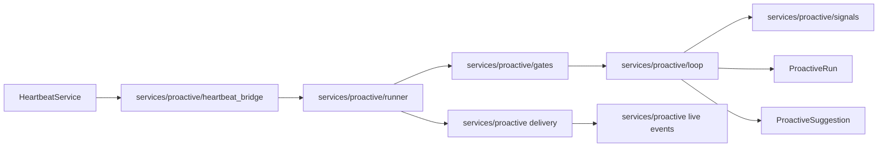
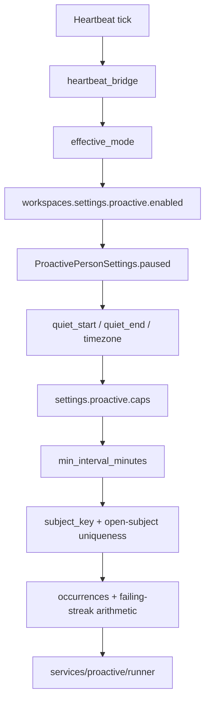
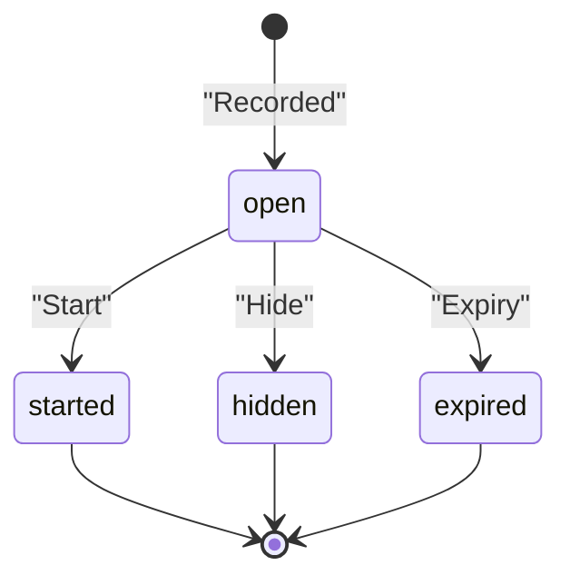

# Proactive Check-Ins & Suggestions (PRD-268)

<details>
<summary>Relevant source files</summary>

The following files were used as context for generating this wiki page:

- [docs/proactive-auto/engineering/_index.md](docs/proactive-auto/engineering/_index.md)
- [docs/proactive-auto/engineering/configuration.md](docs/proactive-auto/engineering/configuration.md)
- [docs/proactive-auto/engineering/data-and-routes.md](docs/proactive-auto/engineering/data-and-routes.md)
- [docs/proactive-auto/engineering/operations.md](docs/proactive-auto/engineering/operations.md)
- [docs/proactive-auto/switches-and-privacy.md](docs/proactive-auto/switches-and-privacy.md)
- [frontend/components/activity/command-center-history.tsx](frontend/components/activity/command-center-history.tsx)
- [frontend/components/activity/widgets/__tests__/needs-you-widget.test.tsx](frontend/components/activity/widgets/__tests__/needs-you-widget.test.tsx)
- [frontend/components/activity/widgets/activity-widget.tsx](frontend/components/activity/widgets/activity-widget.tsx)
- [frontend/components/activity/widgets/needs-you-widget.tsx](frontend/components/activity/widgets/needs-you-widget.tsx)
- [frontend/components/activity/widgets/playbook-metrics-widget.tsx](frontend/components/activity/widgets/playbook-metrics-widget.tsx)
- [frontend/components/chatbot/__tests__/auto-now-rail.test.tsx](frontend/components/chatbot/__tests__/auto-now-rail.test.tsx)
- [frontend/components/command-center/__tests__/needs-you-counters.test.tsx](frontend/components/command-center/__tests__/needs-you-counters.test.tsx)
- [frontend/hooks/use-auto-now.ts](frontend/hooks/use-auto-now.ts)
- [frontend/hooks/use-kpi-api.ts](frontend/hooks/use-kpi-api.ts)
- [frontend/hooks/use-needs-you.ts](frontend/hooks/use-needs-you.ts)
- [frontend/lib/needs-you-breakdown.ts](frontend/lib/needs-you-breakdown.ts)
- [orchestrator/alembic/versions/llm_usage_agent_name.py](orchestrator/alembic/versions/llm_usage_agent_name.py)
- [orchestrator/api/kpi_api.py](orchestrator/api/kpi_api.py)
- [orchestrator/core/playbook_schedule.py](orchestrator/core/playbook_schedule.py)
- [orchestrator/core/services/auto_reporting.py](orchestrator/core/services/auto_reporting.py)
- [orchestrator/modules/tools/discovery/handlers_auto_reporting.py](orchestrator/modules/tools/discovery/handlers_auto_reporting.py)
- [orchestrator/services/needs_you.py](orchestrator/services/needs_you.py)
- [orchestrator/services/proactive/__init__.py](orchestrator/services/proactive/__init__.py)
- [orchestrator/services/proactive/retention.py](orchestrator/services/proactive/retention.py)
- [orchestrator/services/schedule_reconcile.py](orchestrator/services/schedule_reconcile.py)
- [orchestrator/tests/test_f049_deleted_agent_spend_keeps_its_name.py](orchestrator/tests/test_f049_deleted_agent_spend_keeps_its_name.py)
- [orchestrator/tests/test_f207_decisions_needed_are_never_silently_empty.py](orchestrator/tests/test_f207_decisions_needed_are_never_silently_empty.py)
- [orchestrator/tests/test_f246_needs_you_counts_what_waits.py](orchestrator/tests/test_f246_needs_you_counts_what_waits.py)
- [orchestrator/tests/test_f271_schedule_type_none_is_refused_and_says_how_to_stop_a_timer.py](orchestrator/tests/test_f271_schedule_type_none_is_refused_and_says_how_to_stop_a_timer.py)
- [orchestrator/tests/test_f274_needs_you_rows_name_their_ticket_and_mission.py](orchestrator/tests/test_f274_needs_you_rows_name_their_ticket_and_mission.py)
- [orchestrator/tests/test_prd252_needs_you.py](orchestrator/tests/test_prd252_needs_you.py)
- [orchestrator/tests/test_prd268_runs_retention.py](orchestrator/tests/test_prd268_runs_retention.py)
- [orchestrator/tests/test_schedule_reconcile.py](orchestrator/tests/test_schedule_reconcile.py)

</details>


## Purpose and scope

PRD-268 turns selected heartbeat ticks into bounded, read-only check-ins. A check-in may inspect workspace signals and record suggestions; it does not perform the suggested work. This page covers the runner and `CHECK_IN` lane, gates and limits, suggestion records and decisions, heartbeat integration, delivery events, and the `/api/proactive` route family. [docs/proactive-auto/engineering/_index.md:19-21]()

Sources: [docs/proactive-auto/engineering/_index.md:19-21]()

---

### 11.6.1 Subsystem Architecture & Core Runner (`services/proactive`)

The implementation separates pure rules from orchestration. `orchestrator/modules/proactive/` contains rules such as check-in windows, dedupe keys, provenance, caps, failing-streak arithmetic, and heartbeat modes. `orchestrator/services/proactive/` contains the runner, gates, loop, signal readers, run-row handling, suggestion decisions, delivery, heartbeat bridge, live events, and related services. [docs/proactive-auto/engineering/_index.md:60-68]()

A check-in can be triggered by an Auto workspace heartbeat or an agent heartbeat. The heartbeat bridge decides whether the heartbeat converts; the runner then applies gates and, if admitted, executes the check-in loop. In `off` mode, converted heartbeat behavior does not run; in `shadow`, a check-in runs and records results without delivery; in `live`, a converted check-in runs instead of the normal tick and may deliver suggestions. [docs/proactive-auto/engineering/_index.md:42-55]()[docs/proactive-auto/engineering/operations.md:26-29]()[docs/proactive-auto/engineering/operations.md:67-78]()

**Diagram: heartbeat names mapped to implementation entities**



Sources: [docs/proactive-auto/engineering/_index.md:42-55]()[docs/proactive-auto/engineering/_index.md:64-68]()

**Data flow and persisted records.** `proactive_runs` records each check-in run or refusal, including its kind, time window, outcome, signals, suggestion count, model, tokens, cost, and error class. `proactive_suggestions` records the addressee, source, run, title and detail, evidence, proposed action, dedupe subject, severity, status, and decision metadata. [docs/proactive-auto/engineering/data-and-routes.md:34-64]()

Sources: [docs/proactive-auto/engineering/data-and-routes.md:34-64]()

---

### 11.6.2 The Read-Only `CHECK_IN` Tool Loop

The check-in loop runs in the `check_in` lane, which enforces read-only restrictions server-side. Its allowed reads include workspace platform data exposed through read-only platform actions. Connected apps, plugins, workspace files and code tools are not offered and are refused if attempted; web access and starting sub-agents or missions are also refused. The write-shaped exception is `platform_suggest_next_step`: it records a suggestion rather than carrying out the proposed action. [docs/proactive-auto/switches-and-privacy.md:101-116]()[docs/proactive-auto/engineering/_index.md:70-72]()

The loop has hard-coded bounds: at most 4 model calls per check-in, 8 tool calls per model call, a `$0.05` per-check-in cost ceiling, and an 800-token output budget per call. Check-in context uses the `CHECK_IN` context mode with a 12,000-token budget. [docs/proactive-auto/engineering/configuration.md:98-108]()

**Diagram: read-only lane and suggestion-recording boundary**

```mermaid
sequenceDiagram
    participant runner as "services/proactive/runner"
    participant loop as "services/proactive/loop"
    participant lane as "check_in_lane"
    participant tools as "Read-only platform actions"
    participant suggest as "platform_suggest_next_step"
    participant store as "proactive_suggestions"

    runner->>loop: "Start bounded check-in"
    loop->>lane: "Execute requested tool"
    lane->>tools: "Read workspace state"
    tools-->>lane: "Return evidence"
    lane-->>loop: "Return tool result"
    loop->>lane: "Record proposed next step"
    lane->>suggest: "Validate check-in action"
    suggest->>store: "Persist suggestion; do not execute action"
    store-->>loop: "Suggestion record"
```

Sources: [docs/proactive-auto/engineering/_index.md:48-55]()[docs/proactive-auto/engineering/_index.md:70-72]()[docs/proactive-auto/engineering/configuration.md:98-108]()[docs/proactive-auto/switches-and-privacy.md:101-116]()

---

### 11.6.3 Modules, Caps, Deduplication, and Streaks (`modules/proactive`)

Check-in admission is controlled at four levels: platform mode, workspace enablement, workspace caps, and the person’s pause setting. Reads fail closed: an unknown or unreadable switch is treated as off, and an unreadable pause is treated as paused. `effective_mode(db, workspace_id)` returns the platform mode only when the workspace switch is on; otherwise it returns `off`. [docs/proactive-auto/engineering/configuration.md:20-37]()

Workspace caps can tighten, but not loosen, configured defaults. The configurable limits cover model runs per day, suggestions per run, new suggestions per person per day, open suggestions per person and per source agent, the minimum interval between runs, and the maximum interval for a failing streak. A zero suggestion cap refuses a check-in at its start. [docs/proactive-auto/engineering/configuration.md:52-68]()

Deduplication uses `subject_key`, with forms such as `agent:<id>:error:<class>`, `ticket:<number>`, or a normalized-title key. An open suggestion is unique by workspace, user, and subject key. Suggestions also carry `occurrences` and `last_seen_at` for streak counting. The modules package supplies dedupe keys, normalized titles, caps, and failing-streak arithmetic. [docs/proactive-auto/engineering/data-and-routes.md:34-53]()[docs/proactive-auto/engineering/_index.md:60-65]()

Quiet hours and the person’s pause have distinct effects. A pause prevents suggestions for that person; quiet hours suppress suggestion bells and pushes while check-ins can still run and record results. Check-ins also run only within the applicable heartbeat active hours. [docs/proactive-auto/switches-and-privacy.md:73-84]()[docs/proactive-auto/engineering/operations.md:53-58]()

**Diagram: natural-language gates mapped to code and settings**



Sources: [docs/proactive-auto/engineering/configuration.md:20-37]()[docs/proactive-auto/engineering/configuration.md:52-68]()[docs/proactive-auto/engineering/data-and-routes.md:34-53]()[docs/proactive-auto/engineering/_index.md:60-65]()

---

### 11.6.4 Suggestion Models and Lifecycle States

`ProactiveSuggestion` stores the source (`check_in`, `heartbeat`, `streak`, or `follow_up`), originating run and agent where applicable, title, detail, evidence references, proposed action, subject key, severity, and decision fields. The `status` constraint allows `open`, `started`, `hidden`, or `expired`. `expires_at` is set seven days after creation. [docs/proactive-auto/engineering/data-and-routes.md:34-53]()

The open-suggestion unique index is scoped by workspace, user, and subject key. A suggestion can be started or hidden through its decision flow; expiration is another terminal state. The record includes `started_ref` for start-related references and `decided_via`, `hide_reason`, and `decided_at` for decision provenance. [docs/proactive-auto/engineering/data-and-routes.md:34-53]()

**Diagram: suggestion lifecycle**



Sources: [docs/proactive-auto/engineering/data-and-routes.md:34-53]()[docs/proactive-auto/engineering/_index.md:64-66]()

---

### 11.6.5 Start and Hide Decisions with Optimistic Updates

The backend’s proactive services include suggestion decisions and start-ticket handling. The decision flow may start a suggestion by creating a ticket and storing a `started_ref`; hiding records the decision and optional hide reason. The model describes the possible reference as `{board_task_id, watch_id}` after a ticket Start. [docs/proactive-auto/engineering/_index.md:64-66]()[docs/proactive-auto/engineering/data-and-routes.md:45-50]()

The supplied implementation excerpts do not establish frontend optimistic-update behavior or a particular Start/Hide request path, so those details are not specified here.

Sources: [docs/proactive-auto/engineering/_index.md:64-66]()[docs/proactive-auto/engineering/data-and-routes.md:45-50]()

---

### 11.6.6 Heartbeat Bridge, Bell, and Real-Time SSE Events

`heartbeat_bridge` integrates check-ins with heartbeat execution. Per-heartbeat configuration uses `agents.configuration.heartbeat.mode` (`check_in` or `act`); when unset, the documented default is `act` if `auto_act` is set, otherwise `check_in`. The orchestrator heartbeat also considers `proactive_level`. [docs/proactive-auto/engineering/configuration.md:36-37]()

In shadow mode, converted heartbeats still run their existing tick behavior while check-ins record results without delivery. In live mode, the check-in replaces the tick for converted heartbeats. New suggestions are posted once in the addressee’s Auto thread; a `today` suggestion can produce a `suggestion_ready` bell, subject to delivery controls. Suggestion push is separately disabled by default; disabling push does not disable the in-app bell. [docs/proactive-auto/engineering/operations.md:26-29]()[docs/proactive-auto/engineering/operations.md:67-82]()[docs/proactive-auto/engineering/configuration.md:44-50]()

The proactive service includes live-event handling, and the engineering index identifies structured message parts on background posts. The available excerpts do not specify an exact SSE event payload or prove that every suggestion-state change emits `suggestion_changed`; those details are therefore not asserted here. [docs/proactive-auto/engineering/_index.md:64-76]()

**Diagram: heartbeat mode to recorded and delivered outcomes**

```mermaid
flowchart LR
    tick["Heartbeat tick"] --> bridge["heartbeat_bridge"]
    bridge --> switches["effective_mode"]
    switches -->| "off" | normal["Normal heartbeat behavior"]
    switches -->| "shadow" | shadow["Check-in records; no delivery"]
    switches -->| "live" | live["Check-in replaces converted tick"]
    shadow --> runs["proactive_runs"]
    live --> runs
    live --> suggestions["proactive_suggestions"]
    suggestions --> deliver["deliver_run"]
    deliver --> thread["Auto thread suggestion@1"]
    deliver --> bell["suggestion_ready bell"]
    bell --> push["Suggestion push, if enabled and eligible"]
```

Sources: [docs/proactive-auto/engineering/operations.md:26-29]()[docs/proactive-auto/engineering/operations.md:67-82]()[docs/proactive-auto/engineering/_index.md:42-55]()[docs/proactive-auto/engineering/_index.md:64-76]()

---

### 11.6.7 Proactive API Routers (`/api/proactive`)

The API routes are synchronous handlers using a synchronous database session and are registered through `RouterSpec` in `orchestrator/router_manifest.py`. The route family includes `orchestrator/api/proactive.py`, `proactive_brief.py`, `proactive_follow_ups.py`, `readiness.py`, `approval_views.py`, and `auto_calibration.py`. Routes are also listed in `orchestrator/reports/route-manifest.json`. [docs/proactive-auto/engineering/data-and-routes.md:103-111]()

Route authorization is described by role capabilities: `workspace:manage` for owners and admins, `agents:execute` additionally for editors, and `members:read` for every role. `require_workspace_answerer` covers owners, admins, editors, and the super admin. A request for another workspace’s resource returns 404 rather than 403. [docs/proactive-auto/engineering/data-and-routes.md:105-111]()

The workspace settings are changed with `PUT /api/proactive/settings`; per-person pause and quiet-hour settings use `PUT /api/proactive/me`. The documented operational flow reads runs with `GET /api/proactive/runs?since=<ISO time>` and suggestions with `GET /api/proactive/suggestions?status=open` (other listed statuses include `hidden`, `started`, and `expired`). [docs/proactive-auto/engineering/configuration.md:25-28]()[docs/proactive-auto/switches-and-privacy.md:73-84]()[docs/proactive-auto/engineering/operations.md:42-65]()

The route inventory’s detailed method/path table is not present in the supplied excerpt; this section therefore does not infer additional endpoint paths or request schemas.

Sources: [docs/proactive-auto/engineering/data-and-routes.md:103-111]()[docs/proactive-auto/engineering/configuration.md:25-28]()[docs/proactive-auto/switches-and-privacy.md:73-84]()[docs/proactive-auto/engineering/operations.md:42-65]()

---