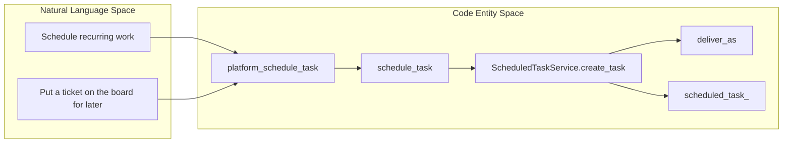
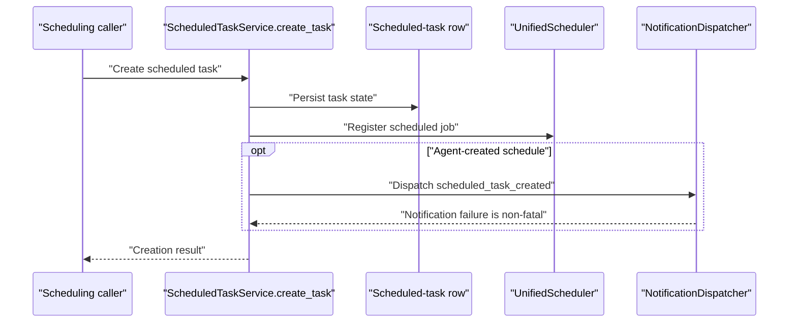
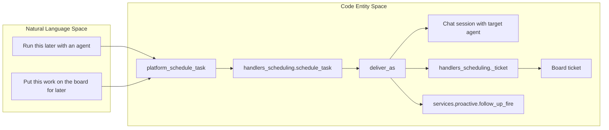
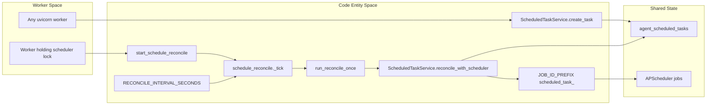

# Scheduled Tasks & Reconciliation

Relevant source files

The following files were used as context for generating this wiki page:

- [docs/proactive-auto/engineering/_index.md](docs/proactive-auto/engineering/_index.md)
- [docs/proactive-auto/engineering/configuration.md](docs/proactive-auto/engineering/configuration.md)
- [docs/proactive-auto/engineering/data-and-routes.md](docs/proactive-auto/engineering/data-and-routes.md)
- [docs/proactive-auto/engineering/operations.md](docs/proactive-auto/engineering/operations.md)
- [docs/proactive-auto/switches-and-privacy.md](docs/proactive-auto/switches-and-privacy.md)
- [frontend/components/activity/board/__tests__/review-verdict.test.tsx](frontend/components/activity/board/__tests__/review-verdict.test.tsx)
- [frontend/components/activity/board/approval-effect.ts](frontend/components/activity/board/approval-effect.ts)
- [frontend/components/activity/board/review-verdict.tsx](frontend/components/activity/board/review-verdict.tsx)
- [frontend/components/activity/board/ticket-actions-menu.tsx](frontend/components/activity/board/ticket-actions-menu.tsx)
- [frontend/components/widgets/CodingCanvasWidget/CanvasTerminal.tsx](frontend/components/widgets/CodingCanvasWidget/CanvasTerminal.tsx)
- [frontend/hooks/use-scheduled-tasks-api.ts](frontend/hooks/use-scheduled-tasks-api.ts)
- [frontend/hooks/use-ticket-deep-link.ts](frontend/hooks/use-ticket-deep-link.ts)
- [frontend/lib/chat/runtime-canvas.ts](frontend/lib/chat/runtime-canvas.ts)
- [orchestrator/api/scheduled_tasks.py](orchestrator/api/scheduled_tasks.py)
- [orchestrator/services/board_task_bridge.py](orchestrator/services/board_task_bridge.py)
- [orchestrator/services/cli_ticket_lane.py](orchestrator/services/cli_ticket_lane.py)
- [orchestrator/services/orchestration_board_bridge.py](orchestrator/services/orchestration_board_bridge.py)
- [orchestrator/services/orchestration_state.py](orchestrator/services/orchestration_state.py)
- [orchestrator/services/proactive/__init__.py](orchestrator/services/proactive/__init__.py)
- [orchestrator/services/proactive/retention.py](orchestrator/services/proactive/retention.py)
- [orchestrator/services/schedule_reconcile.py](orchestrator/services/schedule_reconcile.py)
- [orchestrator/services/scheduled_task_service.py](orchestrator/services/scheduled_task_service.py)
- [orchestrator/tests/test_f094_a_step_card_ends_on_its_sessions_outcome.py](orchestrator/tests/test_f094_a_step_card_ends_on_its_sessions_outcome.py)
- [orchestrator/tests/test_f143_a_rejected_plan_is_cancelled_not_failed.py](orchestrator/tests/test_f143_a_rejected_plan_is_cancelled_not_failed.py)
- [orchestrator/tests/test_f188_b_the_payoff_moves_boom_on.py](orchestrator/tests/test_f188_b_the_payoff_moves_boom_on.py)
- [orchestrator/tests/test_prd268_runs_retention.py](orchestrator/tests/test_prd268_runs_retention.py)
- [orchestrator/tests/test_schedule_reconcile.py](orchestrator/tests/test_schedule_reconcile.py)

## Purpose & Scope

This page explains how `ScheduledTaskService` manages scheduled work, how `deliver_as` distinguishes chat delivery from board-ticket delivery, and how a leader-elected reconciliation loop keeps APScheduler aligned with database state. It also documents the scheduling platform actions exposed to agents. [orchestrator/services/scheduled_task_service.py:1-14](), [orchestrator/services/schedule_reconcile.py:1-23](), [orchestrator/modules/tools/discovery/actions_scheduling.py:7-14]()

Sources: [orchestrator/services/scheduled_task_service.py:1-14](), [orchestrator/services/schedule_reconcile.py:1-23](), [orchestrator/modules/tools/discovery/actions_scheduling.py:7-14]()

---

## 1. ScheduledTaskService Architecture & Data Model

`ScheduledTaskService` is initialized with a SQLAlchemy session and a workspace ID. Its `create_task` interface accepts creator and target agent IDs, task type, description, schedule, optional run limit and origin chat, delivery mode, payload, and optional operator identity. `deliver_as` defaults to `chat`. [orchestrator/services/scheduled_task_service.py:104-109](), [orchestrator/services/scheduled_task_service.py:136-149]()

The service defines limits of 10 tasks per agent, 25 recurring tasks per workspace, and 50 operator-scheduled tasks per workspace. Scheduled-task jobs use the `scheduled_task_` ID prefix. Reconciliation is configured for a 60-second interval; late one-shot jobs receive a misfire grace of three intervals. [orchestrator/services/scheduled_task_service.py:35-52]()

| Concern | Code entity or value | Role |
|---|---|---|
| Service | `ScheduledTaskService` | Service for creating, listing, cancelling, and executing scheduled tasks. [orchestrator/services/scheduled_task_service.py:104-109]() |
| Task kinds | `one_shot`, `recurring` | The creation interface documents one-shot schedules as ISO datetimes and recurring schedules as cron expressions. [orchestrator/services/scheduled_task_service.py:150-160]() |
| Delivery modes | `DELIVER_CHAT`, `DELIVER_BOARD_TASK`, `DELIVER_FOLLOW_UP` | Delivery-mode constants are imported from `scheduled_task_steps`; creation defaults to `DELIVER_CHAT`. [orchestrator/services/scheduled_task_service.py:28-30](), [orchestrator/services/scheduled_task_service.py:145-149]() |
| Job identity | `JOB_ID_PREFIX = "scheduled_task_"` | Prefix for scheduled-task APScheduler job IDs. [orchestrator/services/scheduled_task_service.py:41-42]() |
| Reconcile interval | `RECONCILE_INTERVAL_SECONDS = 60` | Maximum configured interval between reconciliation passes. [orchestrator/services/scheduled_task_service.py:43-46]() |
| One-shot grace | `ONE_SHOT_MISFIRE_GRACE_SECONDS` | Three reconcile intervals of grace for a recently missed one-shot schedule. [orchestrator/services/scheduled_task_service.py:47-52]() |
| Workspace task list | `_LIST_SQL`, `_COUNT_SQL` | Queries task rows for a workspace, excluding `follow_up` delivery rows. [orchestrator/services/scheduled_task_service.py:54-73]() |

### Natural-language request to service entities

**Diagram: Scheduling intent mapped to code entities**

Sources: [orchestrator/modules/tools/discovery/actions_scheduling.py:7-46](), [orchestrator/modules/tools/discovery/handlers_scheduling.py:50-106](), [orchestrator/services/scheduled_task_service.py:41-52](), [orchestrator/services/scheduled_task_service.py:136-149]()

### Creation and notification

`create_task` receives the scheduling request and delivery options. Agent-created schedules can be announced through `_announce_new_schedule`, which dispatches a `scheduled_task_created` notification with a link to the task. Notification failure is caught and logged rather than failing the create path. [orchestrator/services/scheduled_task_service.py:115-134](), [orchestrator/services/scheduled_task_service.py:136-149]()

The creation interface allows `target_agent_id` to be absent for board delivery, in which case the board ticket is filed into the Inbox; chat delivery requires a target agent. [orchestrator/services/scheduled_task_service.py:150-160]()

**Diagram: Creation request and schedule announcement**

Sources: [orchestrator/services/scheduled_task_service.py:1-14](), [orchestrator/services/scheduled_task_service.py:115-134](), [orchestrator/services/scheduled_task_service.py:136-149]()

---

## 2. Delivery Modes: Chat vs. Board Task

The `deliver_as` field determines the scheduled task’s delivery path. The service documentation describes `chat` as opening a new chat session with the target agent and using the task description as the opening message. For `board_task`, the firing schedule files a ticket on the board instead. `follow_up` is another delivery mode, fired as a check-in-lane turn through `services.proactive.follow_up_fire`. [orchestrator/services/scheduled_task_service.py:8-14](), [orchestrator/services/scheduled_task_service.py:28-30]()

| Delivery mode | Behavior | Target handling |
|---|---|---|
| `chat` | Opens a chat session with the target agent and supplies the scheduled task description as its opening message. [orchestrator/services/scheduled_task_service.py:8-10]() | The creation interface says a target agent is required for chat delivery. [orchestrator/services/scheduled_task_service.py:150-160]() |
| `board_task` | Files a board ticket for the scheduled work. [orchestrator/services/scheduled_task_service.py:10-12]() | A board ticket may have no target agent and be filed into the Inbox. [orchestrator/services/scheduled_task_service.py:154-158]() |
| `follow_up` | Fires once as one check-in-lane turn through `services.proactive.follow_up_fire`. [orchestrator/services/scheduled_task_service.py:13-14]() | Follow-ups are person-specific and excluded from the regular scheduled-task list and count. [orchestrator/services/scheduled_task_service.py:54-73]() |

For board delivery, the scheduling handler builds a ticket payload with fields including title, priority, review mode, and tags. [orchestrator/modules/tools/discovery/handlers_scheduling.py:26-33](), [orchestrator/modules/tools/discovery/handlers_scheduling.py:123-131]()

**Diagram: Delivery mode mapped to code and destination**

Sources: [orchestrator/modules/tools/discovery/actions_scheduling.py:17-46](), [orchestrator/modules/tools/discovery/handlers_scheduling.py:26-33](), [orchestrator/modules/tools/discovery/handlers_scheduling.py:50-106](), [orchestrator/modules/tools/discovery/handlers_scheduling.py:109-131](), [orchestrator/services/scheduled_task_service.py:8-14](), [orchestrator/services/scheduled_task_service.py:28-30]()

---

## 3. Leader-Elected Schedule Reconciliation Loop

In a multi-worker deployment, any uvicorn worker may handle a request that changes a schedule, but only the worker holding the scheduler lock hosts the active APScheduler. `schedule_reconcile` runs on that scheduler worker and compares database schedule sources with registered APScheduler jobs. The scheduled-task mapping is `agent_scheduled_tasks` rows to `scheduled_task_<id>` jobs. [orchestrator/services/schedule_reconcile.py:1-23]()

`start_schedule_reconcile` returns `False` if no running scheduler is supplied. Otherwise, it registers `_tick` as an interval job with `max_instances=1` and `coalesce=True`, then runs an initial pass immediately. `_tick` resolves the unified scheduler at call time when one was not passed, and catches exceptions so a failed reconciliation pass does not kill the job. [orchestrator/services/schedule_reconcile.py:58-90]()

A reconciliation pass runs `ScheduledTaskService.reconcile_with_scheduler` along with heartbeat, playbook, and social-post reconciliation. The pass opens and closes its own database session unless a session is passed in. [orchestrator/services/schedule_reconcile.py:36-55]()

### Scheduled-task reconciliation behavior

`reconcile_with_scheduler` is tested as an idempotent diff: it adds missing scheduled-task jobs, removes stale scheduled-task jobs, and leaves already-registered jobs in place. It does not touch the database if the scheduler is absent or not running. [orchestrator/tests/test_schedule_reconcile.py:132-158]()

For one-shot tasks, an expired schedule more than the grace interval in the past is treated as stale and is not re-added. A recently past one-shot schedule is registered with `ONE_SHOT_MISFIRE_GRACE_SECONDS`; cron jobs do not receive that one-shot grace setting. [orchestrator/tests/test_schedule_reconcile.py:160-179]()

| Reconciliation source | Database representation | Scheduler job identity |
|---|---|---|
| Scheduled tasks | `agent_scheduled_tasks` | `scheduled_task_<id>` [orchestrator/services/schedule_reconcile.py:10-14]() |
| Agent heartbeats | `agents.configuration.heartbeat` | `agent_hb_<id>` [orchestrator/services/schedule_reconcile.py:10-15]() |
| Cron playbooks | `workflow_recipes.schedule_config` | `playbook_cron_<id>` [orchestrator/services/schedule_reconcile.py:15-17]() |
| Scheduled social posts | `social_posts` | `social-publish-<id>` [orchestrator/services/schedule_reconcile.py:18-19]() |

**Diagram: Worker boundary and reconciliation pass**

Sources: [orchestrator/services/scheduled_task_service.py:41-52](), [orchestrator/services/scheduled_task_service.py:136-149](), [orchestrator/services/schedule_reconcile.py:1-23](), [orchestrator/services/schedule_reconcile.py:36-55](), [orchestrator/services/schedule_reconcile.py:58-90]()

---

## 4. Platform Actions & Tool Discovery

Scheduling platform actions are registered by `register_scheduling_actions` and implemented by handlers in `handlers_scheduling.py`. The action set includes `platform_schedule_task`, `platform_list_scheduled_tasks`, `platform_cancel_scheduled_task`, and `platform_get_schedule`. [orchestrator/modules/tools/discovery/actions_scheduling.py:7-14](), [orchestrator/modules/tools/discovery/actions_scheduling.py:17-46](), [orchestrator/modules/tools/discovery/actions_scheduling.py:103-166]()

| Action | Permission / confirmation | Purpose |
|---|---|---|
| `platform_schedule_task` | `write`; no confirmation required. | Creates one-shot or recurring scheduled work and supports chat or board-task delivery. [orchestrator/modules/tools/discovery/actions_scheduling.py:17-46]() |
| `platform_list_scheduled_tasks` | `read`. | Lists scheduled tasks with optional status and agent-name filters. [orchestrator/modules/tools/discovery/actions_scheduling.py:103-133]() |
| `platform_cancel_scheduled_task` | `write`; requires confirmation. | Cancels a scheduled task by ID. [orchestrator/modules/tools/discovery/actions_scheduling.py:136-160]() |
| `platform_get_schedule` | `read`. | Retrieves schedule information. [orchestrator/modules/tools/discovery/actions_scheduling.py:163-166]() |

The tool-handler layer translates the scheduling action into `ScheduledTaskService` calls. For task creation, it chooses delivery mode and constructs board-ticket payload details when applicable. [orchestrator/modules/tools/discovery/handlers_scheduling.py:50-106](), [orchestrator/modules/tools/discovery/handlers_scheduling.py:109-131]()

Sources: [orchestrator/modules/tools/discovery/actions_scheduling.py:7-166](), [orchestrator/modules/tools/discovery/handlers_scheduling.py:26-33](), [orchestrator/modules/tools/discovery/handlers_scheduling.py:50-106](), [orchestrator/modules/tools/discovery/handlers_scheduling.py:109-131]()

---

## 5. Listing, Cancellation & Schedule Reads

The scheduled-task listing SQL scopes rows to `workspace_id`, optionally filters by creator or target agent and status, and sorts newest-created rows first. Both the list query and count query exclude `deliver_as = follow_up`; the returned task dictionary includes the delivery mode, description, schedule, status, creator and target names, run counters, next and last run timestamps, and last error. [orchestrator/services/scheduled_task_service.py:54-73](), [orchestrator/services/scheduled_task_service.py:76-101]()

The platform actions expose listing, cancellation, and schedule lookup through their corresponding tool definitions. [orchestrator/modules/tools/discovery/actions_scheduling.py:103-166]()

Sources: [orchestrator/services/scheduled_task_service.py:54-73](), [orchestrator/services/scheduled_task_service.py:76-101](), [orchestrator/modules/tools/discovery/actions_scheduling.py:103-166]()

---