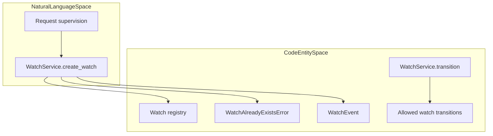
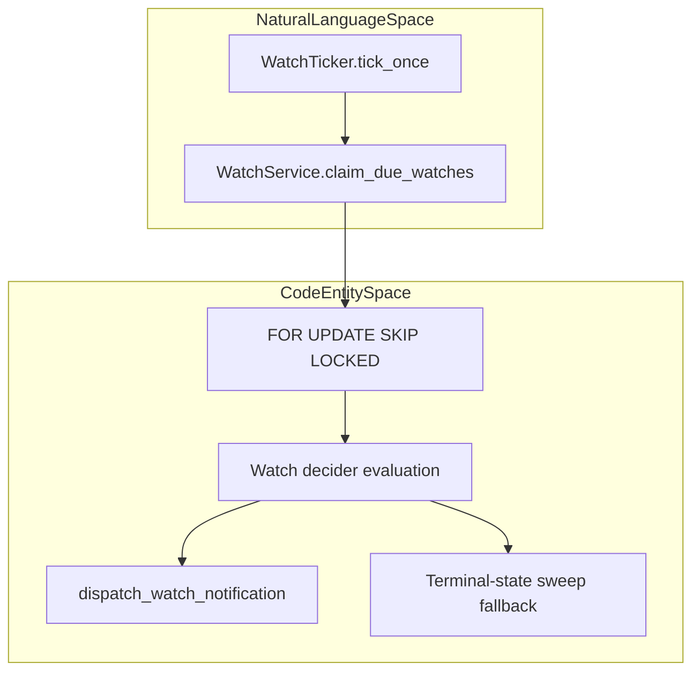
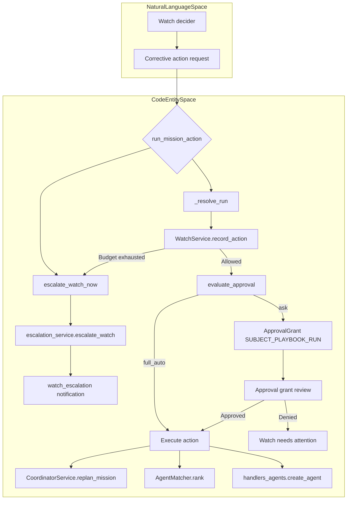
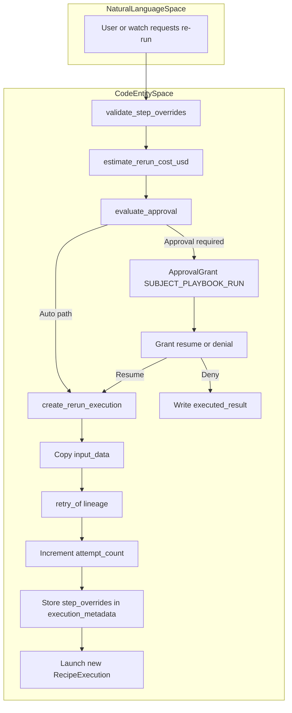

# Watches & Re-run Service

Relevant source files

The following files were used as context for generating this wiki page:

- [docs/PRDS/PRD-228-FLEET-STATE.md](docs/PRDS/PRD-228-FLEET-STATE.md)
- [frontend/components/agents/__tests__/use-fleet-state.test.tsx](frontend/components/agents/__tests__/use-fleet-state.test.tsx)
- [frontend/components/command-center/__tests__/board-event-stream.test.tsx](frontend/components/command-center/__tests__/board-event-stream.test.tsx)
- [frontend/hooks/use-board-event-stream.ts](frontend/hooks/use-board-event-stream.ts)
- [frontend/lib/chat/api.ts](frontend/lib/chat/api.ts)
- [orchestrator/alembic/versions/prd206_chat_summary.py](orchestrator/alembic/versions/prd206_chat_summary.py)
- [orchestrator/api/fleet.py](orchestrator/api/fleet.py)
- [orchestrator/services/audit_retention.py](orchestrator/services/audit_retention.py)
- [orchestrator/services/board_events.py](orchestrator/services/board_events.py)
- [orchestrator/services/escalation_service.py](orchestrator/services/escalation_service.py)
- [orchestrator/services/memory_archival_job.py](orchestrator/services/memory_archival_job.py)
- [orchestrator/services/memory_jobs.py](orchestrator/services/memory_jobs.py)
- [orchestrator/services/watch_actions.py](orchestrator/services/watch_actions.py)
- [orchestrator/services/watch_rerun.py](orchestrator/services/watch_rerun.py)
- [orchestrator/tests/test_board_dispatch.py](orchestrator/tests/test_board_dispatch.py)
- [orchestrator/tests/test_board_sse_listen_notify.py](orchestrator/tests/test_board_sse_listen_notify.py)
- [orchestrator/tests/test_p2w2_audit_retention.py](orchestrator/tests/test_p2w2_audit_retention.py)
- [orchestrator/tests/test_p2w2_governance_audit.py](orchestrator/tests/test_p2w2_governance_audit.py)
- [orchestrator/tests/test_p2w2_governance_policy_budget.py](orchestrator/tests/test_p2w2_governance_policy_budget.py)
- [orchestrator/tests/test_prd197_substrate.py](orchestrator/tests/test_prd197_substrate.py)
- [orchestrator/tests/test_prd204_rerun.py](orchestrator/tests/test_prd204_rerun.py)
- [orchestrator/tests/test_prd204_run_verdict.py](orchestrator/tests/test_prd204_run_verdict.py)
- [orchestrator/tests/test_prd204_silent_holes.py](orchestrator/tests/test_prd204_silent_holes.py)
- [orchestrator/tests/test_prd204_watch_actions.py](orchestrator/tests/test_prd204_watch_actions.py)
- [orchestrator/tests/test_prd206_thread_checkpoint.py](orchestrator/tests/test_prd206_thread_checkpoint.py)
- [orchestrator/tests/test_prd224_ticket_watch_actions.py](orchestrator/tests/test_prd224_ticket_watch_actions.py)

## Purpose and Scope

Section 11.4 documents the PRD-204 watch and re-run subsystem: registering watches against work, evaluating them, requesting corrective actions, re-running playbook executions, and escalating unresolved cases for human review. The main service boundaries are `WatchService`, `watch_rerun`, `watch_actions`, and `escalation_service`. [orchestrator/services/watch_service.py:1-24]() [orchestrator/services/watch_rerun.py:1-44]() [orchestrator/services/watch_actions.py:1-45]() [orchestrator/services/escalation_service.py:109-121]()

Sources: `[orchestrator/services/watch_service.py:1-24]`, `[orchestrator/services/watch_rerun.py:1-44]`, `[orchestrator/services/watch_actions.py:1-45]`, `[orchestrator/services/escalation_service.py:109-121]`

---

## Watch Registry & Lifecycle (`WatchService`)

`WatchService` owns the watch registry and its lifecycle operations. Watches represent supervision of a target, while watch events record observations and action history. Registry operations include creation, guarded status transitions, event ingestion, and claiming watches that are due for evaluation. [orchestrator/services/watch_service.py:142-182]() [orchestrator/tests/test_prd204_watch_service.py:109-187]()

### Core Registry Operations

| Operation | Responsibility |
|---|---|
| `create_watch` | Creates a watch for a target. Duplicate live watches are surfaced as `WatchAlreadyExistsError`. [orchestrator/services/watch_service.py:150-182]() [orchestrator/tests/test_prd204_watch_service.py:109-118]() |
| `transition` | Applies a requested status change subject to the permitted watch transition map. [orchestrator/tests/test_prd204_watch_service.py:125-140]() |
| `ingest` / `ingest_terminal` | Records watch events and terminal state changes; event-key conflicts are handled as duplicates rather than creating repeated events. [orchestrator/tests/test_prd204_watch_service.py:161-187]() |
| `claim_due_watches` | Claims due watches for processing using row-locking semantics so concurrent ticker workers can divide work. [orchestrator/services/watch_service.py:1-18]() |

The registry flow connects user- or system-requested supervision to persisted watch state and its event history. [orchestrator/services/watch_service.py:142-182]() [orchestrator/tests/test_prd204_watch_service.py:109-187]()

Title: Watch Creation and Registry Flow

Sources: `[orchestrator/services/watch_service.py:142-182]`, `[orchestrator/tests/test_prd204_watch_service.py:109-187]`

---

## Fail-Soft Terminal Hooks

Producer code can report terminal states through watch hooks. The hook boundary is fail-soft: failures while handling a watch update are caught so that watch-plane problems do not interrupt the producer’s core execution path. [orchestrator/services/watch_hooks.py:1-69]() [orchestrator/tests/test_prd204_watch_hooks.py:36-54]()

Sources: `[orchestrator/services/watch_hooks.py:1-69]`, `[orchestrator/tests/test_prd204_watch_hooks.py:36-54]`

---

## Ticker & Decision Engine

`WatchTicker` checks for due watches through `claim_due_watches` and passes watches to the decider for evaluation. A terminal-state sweep provides a recovery path for terminal outcomes that were not delivered through producer hooks. [orchestrator/services/watch_service.py:1-18]() [orchestrator/tests/test_prd204_watch_ticker.py:172-204]()

Title: Polling and Sweep Cycle Flow

Sources: `[orchestrator/services/watch_service.py:1-18]`, `[orchestrator/tests/test_prd204_watch_ticker.py:172-204]`

---

## Watch Actions & Corrective Mechanics

The corrective-action set includes mission actions (`replan`, `reassign`, `spawn_agent`), playbook or board re-runs, and escalation. Mission action handling is exposed through `run_mission_action`; it resolves the target mission, records the action against the watch budget, and then applies the approval gate. [orchestrator/services/watch_actions.py:61-70]() [orchestrator/services/watch_actions.py:106-165]()

- **Replan:** Uses `CoordinatorService.replan_mission` with the watch diagnosis as replanner notes. The failed-to-replanning-to-running transitions remain the mission service’s authority. [orchestrator/services/watch_actions.py:13-18]()
- **Reassign:** Uses `AgentMatcher.rank` while excluding the agent associated with the failure. If no capable agent is available, the action escalates. [orchestrator/services/watch_actions.py:19-25]() [orchestrator/tests/test_prd204_watch_actions.py:124-148]()
- **Spawn agent:** Uses the `handlers_agents.create_agent` path and validates the result with `blueprint_validator.validate_agent`. In v1, only a `full_auto` decision auto-approves this action; the `auto_below_budget` lane does not. [orchestrator/services/watch_actions.py:26-34]()
- **Re-run:** Playbook re-runs are handled by `watch_rerun`; board-ticket watches use the board’s own run-now machinery. [orchestrator/services/watch_rerun.py:1-17]() [orchestrator/services/watch_actions.py:67-70]() [orchestrator/tests/test_prd224_ticket_watch_actions.py:1-180]()
- **Escalate:** Calls `escalation_service.escalate_watch`, dispatches a `watch_escalation` notification from the caller, and moves the watch to `escalated`. This is an ungated escape path. [orchestrator/services/watch_actions.py:35-39]() [orchestrator/services/escalation_service.py:109-121]()

The action budget is consumed at initiation, before approval evaluation. Therefore, an action parked for approval still consumes an attempt if a human later denies it; this limits repeated ask loops. If the budget is exhausted, the action is refused and the watch is escalated. [orchestrator/services/watch_actions.py:41-45]() [orchestrator/services/watch_actions.py:143-163]()

Title: Watch Action Execution and Governance Flow

Sources: `[orchestrator/services/watch_actions.py:106-170]`, `[orchestrator/services/escalation_service.py:109-170]`, `[orchestrator/tests/test_prd204_watch_actions.py:1-13]`

---

## Re-run & Tweak Service

`watch_rerun` implements playbook re-runs by copying a prior execution’s inputs into a new `RecipeExecution`. It keeps the shared `workflow_recipes.steps` definition unchanged; optional `step_overrides` are stored on the new execution for the executor’s run-start merge. The approval path uses the original execution’s LLM usage cost estimate. [orchestrator/services/watch_rerun.py:1-17]() [orchestrator/services/watch_rerun.py:19-33]()

### Rerun Execution Mechanics

- **Execution lineage:** `create_rerun_execution` stages a new execution row, copies `input_data`, links `retry_of` to the original execution, and increments `attempt_count`. [orchestrator/services/watch_rerun.py:153-184]()
- **Step overrides:** `validate_step_overrides` accepts only known step IDs and non-empty string `prompt_template` values. Overrides are per execution; the shared recipe definition is not mutated. [orchestrator/services/watch_rerun.py:89-120]() [orchestrator/tests/test_prd204_rerun.py:43-70]()
- **Cost estimate:** `estimate_rerun_cost_usd` obtains the original execution’s cost from `compute_execution_metrics`; if estimation fails, it logs a warning and returns `0.0`. [orchestrator/services/watch_rerun.py:128-146]()
- **Approval:** The rerun approval decision uses `evaluate_approval`. When approval is required, the durable `ApprovalGrant` uses `subject_type=SUBJECT_PLAYBOOK_RUN` and carries the rerun specification in `details`, including the `watch_action` discriminator. [orchestrator/services/watch_rerun.py:12-17]() [orchestrator/services/watch_rerun.py:19-38]()
- **Transaction boundary:** The auto path commits before launch so the execution row is visible to the playbook engine’s separately opened session; the ask path flushes and leaves the commit to its caller. [orchestrator/services/watch_rerun.py:40-43]()

Title: Playbook Re-run Flow

Sources: `[orchestrator/services/watch_rerun.py:12-43]`, `[orchestrator/services/watch_rerun.py:89-184]`, `[orchestrator/tests/test_prd204_rerun.py:43-70]`

---

## Escalation Subsystem

`escalation_service` creates board tasks for human review. Its escalation paths include long-blocked board tasks, watch-specific escalation, and repeatedly stalled tasks. Watch escalation is deliberately distinct from stall escalation: it uses watch-specific tags and a watch-specific deduplication key. [orchestrator/services/escalation_service.py:1-9]() [orchestrator/services/escalation_service.py:109-121]()

- **Blocked tasks:** `check_blocked_escalations` selects workspace board tasks blocked for more than `BLOCKED_ESCALATION_HOURS` (24 hours), skips tasks with an existing open escalation, and creates an escalation card. [orchestrator/services/escalation_service.py:23-76]()
- **Watch escalation:** `escalate_watch` creates a high-priority human-review `BoardTask` tagged `escalation` and `watch:{watch_id}`. It deduplicates against existing non-done cards for the same watch. The caller dispatches the `watch_escalation` notification. [orchestrator/services/escalation_service.py:109-170]()
- **Stalled tasks:** `escalate_stalled_task` only creates an escalation for repeated stalls (two or more) and avoids duplicating an open card for the task. [orchestrator/services/escalation_service.py:173-204]()

Sources: `[orchestrator/services/escalation_service.py:23-76]`, `[orchestrator/services/escalation_service.py:109-204]`

---