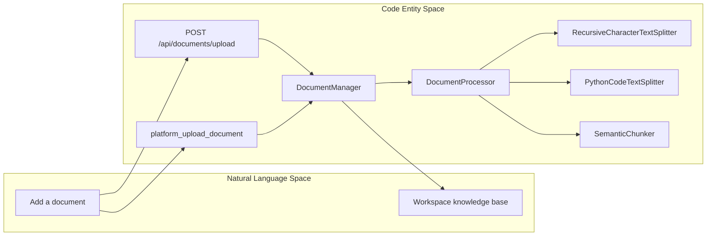
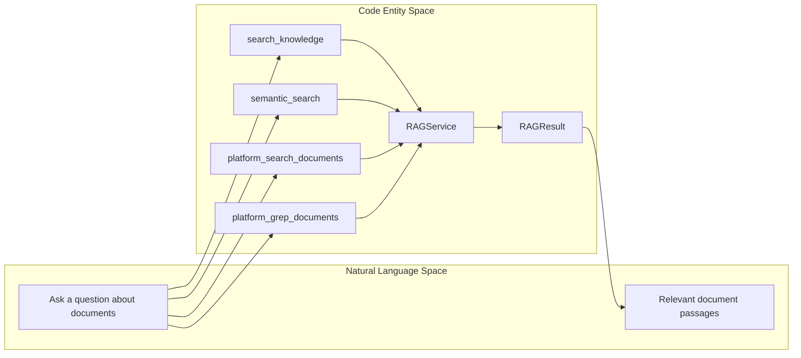

# Knowledge Base & RAG

Relevant source files

The following files were used as context for generating this wiki page:

- [orchestrator/api/context.py](orchestrator/api/context.py)
- [orchestrator/api/documents.py](orchestrator/api/documents.py)
- [orchestrator/api/github_webhooks.py](orchestrator/api/github_webhooks.py)
- [orchestrator/api/models_endpoints.py](orchestrator/api/models_endpoints.py)
- [orchestrator/modules/rag/__init__.py](orchestrator/modules/rag/__init__.py)
- [orchestrator/modules/rag/ingestion/manager.py](orchestrator/modules/rag/ingestion/manager.py)
- [orchestrator/modules/rag/service.py](orchestrator/modules/rag/service.py)
- [orchestrator/modules/search/services/entity_extractor.py](orchestrator/modules/search/services/entity_extractor.py)
- [orchestrator/services/document_downloads.py](orchestrator/services/document_downloads.py)
- [orchestrator/tests/security/test_s5_closures.py](orchestrator/tests/security/test_s5_closures.py)
- [orchestrator/tests/test_auto_model_workspace_save.py](orchestrator/tests/test_auto_model_workspace_save.py)
- [orchestrator/tests/test_entity_extractor_no_vendor_key.py](orchestrator/tests/test_entity_extractor_no_vendor_key.py)
- [orchestrator/tests/test_f357_an_upload_dedupes_only_in_its_own_workspace.py](orchestrator/tests/test_f357_an_upload_dedupes_only_in_its_own_workspace.py)
- [orchestrator/tests/test_f450_only_the_platform_admin_changes_a_system_setting.py](orchestrator/tests/test_f450_only_the_platform_admin_changes_a_system_setting.py)
- [orchestrator/tests/test_f451_the_platform_default_needs_agents_read.py](orchestrator/tests/test_f451_the_platform_default_needs_agents_read.py)
- [orchestrator/tests/test_f453_a_document_download_is_the_callers_own.py](orchestrator/tests/test_f453_a_document_download_is_the_callers_own.py)
- [orchestrator/tests/test_f453_b_document_content_is_the_callers_own.py](orchestrator/tests/test_f453_b_document_content_is_the_callers_own.py)
- [orchestrator/tests/test_prd233_s4_storage_factory.py](orchestrator/tests/test_prd233_s4_storage_factory.py)

## Purpose and Scope

The Knowledge Base & RAG system makes workspace documents available for retrieval by agents. Its public module surface includes document ingestion, chunking, and retrieval services; this parent page summarizes how those areas fit together and links to the detailed child pages. [orchestrator/modules/rag/__init__.py:1-24]()

Sources: [orchestrator/modules/rag/__init__.py:1-24]()

---

## System Architecture & Processing Flows

The module describes a document pipeline from upload and parsing through chunking, embedding, storage, and search. The diagrams connect user-facing concepts—adding documents and asking questions—to concrete API routes, services, and tool names. [orchestrator/modules/rag/__init__.py:1-21]()

Sources: [orchestrator/modules/rag/__init__.py:1-21]()

### Ingestion Pipeline Architecture

**Diagram: Document ingestion entry points and components**

The upload route is defined under `/api/documents`, and `platform_upload_document` is a registered action. `DocumentManager`, `DocumentProcessor`, `RecursiveCharacterTextSplitter`, `PythonCodeTextSplitter`, and `SemanticChunker` are exposed by the RAG module or used within its ingestion pipeline. [orchestrator/api/documents.py:30-30]()[orchestrator/modules/tools/discovery/actions_documents.py:54-94]()[orchestrator/modules/rag/__init__.py:34-55]()[orchestrator/modules/rag/ingestion/manager.py:154-166]()[orchestrator/modules/rag/ingestion/manager.py:36-37]()

Sources: [orchestrator/api/documents.py:30-30](), [orchestrator/modules/tools/discovery/actions_documents.py:54-94](), [orchestrator/modules/rag/__init__.py:34-55](), [orchestrator/modules/rag/ingestion/manager.py:154-166](), [orchestrator/modules/rag/ingestion/manager.py:36-37]()

### Retrieval & RAG Execution Flow

**Diagram: Natural-language questions mapped to retrieval code entities**

The agent platform tool catalog includes `search_knowledge` and `semantic_search`. The document action registry defines `platform_search_documents` for semantic search and `platform_grep_documents` for literal text search. `RAGService` and `RAGResult` are part of the RAG module’s retrieval interface. [orchestrator/modules/agents/services/agent_platform_tools.py:50-67]()[orchestrator/modules/agents/services/agent_platform_tools.py:90-127]()[orchestrator/modules/tools/discovery/actions_documents.py:98-133]()[orchestrator/modules/tools/discovery/actions_documents.py:135-159]()[orchestrator/modules/rag/__init__.py:26-33]()

Sources: [orchestrator/modules/agents/services/agent_platform_tools.py:50-67](), [orchestrator/modules/agents/services/agent_platform_tools.py:90-127](), [orchestrator/modules/tools/discovery/actions_documents.py:98-133](), [orchestrator/modules/tools/discovery/actions_documents.py:135-159](), [orchestrator/modules/rag/__init__.py:26-33]()

---

## Document Management

The document API is mounted at `/api/documents`; its upload route requires the `documents:create` workspace permission. The route’s file-type mapping includes PDF, Markdown, text, DOC/DOCX, JSON, CSV, and spreadsheet formats. The `platform_list_documents` action allows agents to list uploaded documents, filtering by search terms and supporting pagination. For UI, upload-flow, pinning, and team-access details, see [Document Management](#7.1). [orchestrator/api/documents.py:30-30]()[orchestrator/api/documents.py:78-95]()[orchestrator/api/documents.py:144-153]()[orchestrator/modules/tools/discovery/actions_documents.py:16-52]()

Sources: [orchestrator/api/documents.py:30-30](), [orchestrator/api/documents.py:78-95](), [orchestrator/api/documents.py:144-153](), [orchestrator/modules/tools/discovery/actions_documents.py:16-52]()

---

## Document Ingestion Pipeline

The RAG module exports `DocumentManager`, `DocumentProcessor`, and `IngestionPipeline` as ingestion components. `DocumentProcessor` configures `RecursiveCharacterTextSplitter` and `PythonCodeTextSplitter`; the upload API also maps listed file types to processing types. The `platform_upload_document` action allows agents to add text-based documents (markdown, text, JSON) to the knowledge base. For extraction, annotation, embedding, and persistence details, see [Document Ingestion Pipeline](#7.2). [orchestrator/modules/rag/__init__.py:42-56]()[orchestrator/modules/rag/ingestion/manager.py:154-166]()[orchestrator/modules/rag/ingestion/manager.py:36-37]()[orchestrator/api/documents.py:78-95]()[orchestrator/modules/tools/discovery/actions_documents.py:54-94]()

Sources: [orchestrator/modules/rag/__init__.py:42-56](), [orchestrator/modules/rag/ingestion/manager.py:154-166](), [orchestrator/modules/rag/ingestion/manager.py:36-37](), [orchestrator/api/documents.py:78-95](), [orchestrator/modules/tools/discovery/actions_documents.py:54-94]()

---

## Semantic Chunking Strategies

The RAG module exposes `SemanticChunker`, `ChunkingStrategy`, and related chunking types. `DocumentChunk` includes optional `parent_content` and header metadata, supporting contextual representation alongside chunk text. The `sections_first` function is used for initial section-based chunking. For strategy selection, sizes, overlap, and parent-child expansion, see [Semantic Chunking Strategies](#7.3). [orchestrator/modules/rag/__init__.py:34-41]()[orchestrator/modules/rag/ingestion/manager.py:134-152]()[orchestrator/modules/rag/ingestion/manager.py:37-37]()

Sources: [orchestrator/modules/rag/__init__.py:34-41](), [orchestrator/modules/rag/ingestion/manager.py:134-152](), [orchestrator/modules/rag/ingestion/manager.py:37-37]()

---

## RAG Retrieval System

`RAGService` exposes retrieval configuration and returns `RAGResult` objects containing chunks, formatted context, token counts, sources, and optional source mappings. Retrieval settings include options such as RRF fusion and reranking; the service also provides an off-event-loop search helper. The `platform_search_documents` action performs semantic search, while `platform_grep_documents` performs regex-based literal text search. For retrieval modes, filters, ranking, and evaluation details, see [RAG Retrieval System](#7.4). [orchestrator/modules/rag/service.py:55-67]()[orchestrator/modules/rag/service.py:159-180]()[orchestrator/modules/rag/service.py:118-135]()[orchestrator/modules/tools/discovery/actions_documents.py:98-133]()[orchestrator/modules/tools/discovery/actions_documents.py:135-159]()

Sources: [orchestrator/modules/rag/service.py:55-67](), [orchestrator/modules/rag/service.py:159-180](), [orchestrator/modules/rag/service.py:118-135](), [orchestrator/modules/tools/discovery/actions_documents.py:98-133](), [orchestrator/modules/tools/discovery/actions_documents.py:135-159]()

---

## Cloud Storage Integration

The document API constructs a workspace-configured `DocumentManager` with S3 vector settings from application configuration. The tool-result formatter can retrieve text files from S3 when resolving document content. The `DocumentManager` also uses `get_s3_client` for S3 operations. For cloud connections, synchronization jobs, folder selection, and storage-backend details, see [Cloud Storage Integration](#7.5). [orchestrator/api/documents.py:109-118]()[orchestrator/modules/tools/formatting/result_formatter.py:71-88]()[orchestrator/modules/rag/ingestion/manager.py:35-35]()

Sources: [orchestrator/api/documents.py:109-118](), [orchestrator/modules/tools/formatting/result_formatter.py:71-88](), [orchestrator/modules/rag/ingestion/manager.py:35-35]()

---

## Entity Extraction & Semantic Layer

`EntityExtractor` represents the entity-extraction service. It combines regex extraction with optional LLM-based extraction and initializes its LLM manager lazily. It extracts entities like technologies, concepts, organizations, people, and products. For relationship extraction and how semantic data feeds graph and retrieval features, see [Entity Extraction & Semantic Layer](#7.6). [orchestrator/modules/search/services/entity_extractor.py:39-69]()[orchestrator/modules/search/services/entity_extractor.py:77-118]()[orchestrator/modules/search/services/entity_extractor.py:159-165]()

Sources: [orchestrator/modules/search/services/entity_extractor.py:39-69](), [orchestrator/modules/search/services/entity_extractor.py:77-118](), [orchestrator/modules/search/services/entity_extractor.py:159-165]()

---

## Documents API Reference

The documents router provides the `/api/documents` route namespace, including a permission-protected upload endpoint. The separate `/api/context` router exposes workspace-scoped retrieval statistics and additional context monitoring endpoints. The `platform_list_documents`, `platform_upload_document`, `platform_search_documents`, `platform_grep_documents`, and `platform_read_document` actions provide programmatic access to document management and retrieval. For endpoint coverage and request details, see [Documents API Reference](#7.7). [orchestrator/api/documents.py:30-30]()[orchestrator/api/documents.py:144-153]()[orchestrator/api/context.py:54-54]()[orchestrator/api/context.py:88-108]()[orchestrator/modules/tools/discovery/actions_documents.py:16-159]()[orchestrator/modules/tools/discovery/actions_read_document.py:22-69]()

Sources: [orchestrator/api/documents.py:30-30](), [orchestrator/api/documents.py:144-153](), [orchestrator/api/context.py:54-54](), [orchestrator/api/context.py:88-108](), [orchestrator/modules/tools/discovery/actions_documents.py:16-159](), [orchestrator/modules/tools/discovery/actions_read_document.py:22-69]()

---

## Child Pages

- [Document Management](#7.1) — DocumentManagement component, upload flow, provider cards, document details, pinning, team scoping
- [Document Ingestion Pipeline](#7.2) — Text extraction, chunking, contextual annotation, embedding generation, storage to vector database
- [Semantic Chunking Strategies](#7.3) — Chunk size, overlap, topic-coherence/adaptive/hierarchical strategies, parent-child expansion
- [RAG Retrieval System](#7.4) — Hybrid/dense/sparse retrieval, RRF fusion, reranking, retrieval filters, recall evals, context optimizer
- [Cloud Storage Integration](#7.5) — CloudSyncService, cloud file downloader, CloudDocument model, folder selection, sync jobs, S3 Vectors backend
- [Entity Extraction & Semantic Layer](#7.6) — EntityExtractor, relationship extraction, semantic search services feeding graph and retrieval
- [Documents API Reference](#7.7) — API endpoints for document upload, search, download, delete, analytics, pins, cloud connections

Sources: [orchestrator/modules/rag/__init__.py:1-21](), [orchestrator/api/documents.py:30-30](), [orchestrator/modules/rag/service.py:55-67]()

---