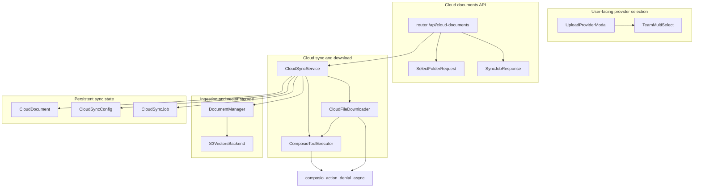
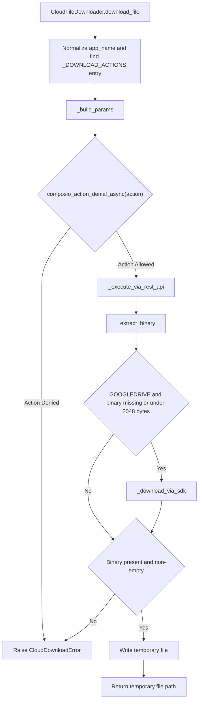
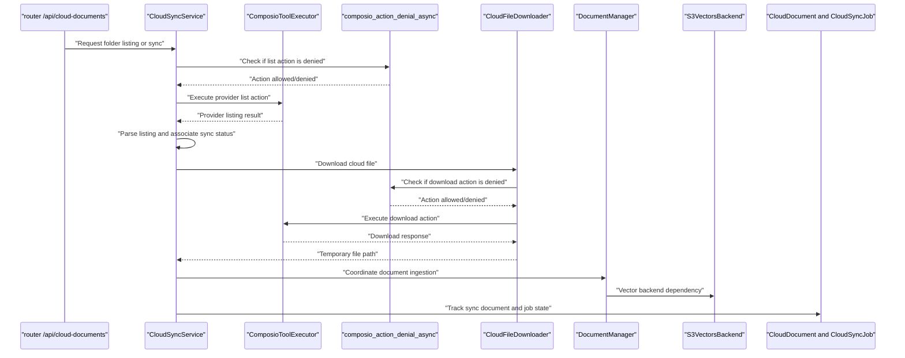

# Cloud Storage Integration

Relevant source files

The following files were used as context for generating this wiki page:

- [frontend/components/documents/delete-confirmation-modal.tsx](frontend/components/documents/delete-confirmation-modal.tsx)
- [frontend/components/documents/document-details-modal.tsx](frontend/components/documents/document-details-modal.tsx)
- [frontend/components/documents/local-storage-browser.tsx](frontend/components/documents/local-storage-browser.tsx)
- [frontend/components/documents/provider-browser.tsx](frontend/components/documents/provider-browser.tsx)
- [frontend/components/documents/team-multi-select.tsx](frontend/components/documents/team-multi-select.tsx)
- [frontend/components/documents/upload-provider-modal.tsx](frontend/components/documents/upload-provider-modal.tsx)
- [frontend/hooks/use-document-api.ts](frontend/hooks/use-document-api.ts)
- [frontend/lib/__tests__/socials-channels.test.ts](frontend/lib/__tests__/socials-channels.test.ts)
- [frontend/lib/__tests__/upload-outcome.test.ts](frontend/lib/__tests__/upload-outcome.test.ts)
- [frontend/lib/upload-outcome.ts](frontend/lib/upload-outcome.ts)
- [orchestrator/alembic/versions/prd158_cloud_default_team.py](orchestrator/alembic/versions/prd158_cloud_default_team.py)
- [orchestrator/api/cloud_documents.py](orchestrator/api/cloud_documents.py)
- [orchestrator/api/socials_channels.py](orchestrator/api/socials_channels.py)
- [orchestrator/core/composio/deny_list.py](orchestrator/core/composio/deny_list.py)
- [orchestrator/core/models/cloud_sync.py](orchestrator/core/models/cloud_sync.py)
- [orchestrator/modules/rag/chunking/semantic_chunker.py](orchestrator/modules/rag/chunking/semantic_chunker.py)
- [orchestrator/modules/rag/ingestion/coverage.py](orchestrator/modules/rag/ingestion/coverage.py)
- [orchestrator/modules/rag/services/cloud_file_downloader.py](orchestrator/modules/rag/services/cloud_file_downloader.py)
- [orchestrator/modules/rag/services/cloud_sync_service.py](orchestrator/modules/rag/services/cloud_sync_service.py)
- [orchestrator/services/composio_api_service.py](orchestrator/services/composio_api_service.py)
- [orchestrator/services/document_versions.py](orchestrator/services/document_versions.py)
- [orchestrator/tests/test_f072_cloud_download_receipt.py](orchestrator/tests/test_f072_cloud_download_receipt.py)
- [orchestrator/tests/test_f087_same_name_upload_replaces.py](orchestrator/tests/test_f087_same_name_upload_replaces.py)
- [orchestrator/tests/test_f088_uploads_and_newer_documents_win_near_ties.py](orchestrator/tests/test_f088_uploads_and_newer_documents_win_near_ties.py)
- [orchestrator/tests/test_prd251_composio_deny.py](orchestrator/tests/test_prd251_composio_deny.py)
- [orchestrator/tests/test_prd251w2_channels.py](orchestrator/tests/test_prd251w2_channels.py)

## Purpose and Scope

This page describes the PRD-42 cloud storage integration: how Automatos AI lists files from connected providers, downloads cloud files, and coordinates document ingestion and sync-state tracking. The documented provider mappings cover Google Drive, Dropbox, OneDrive, and Box. The available implementation also identifies S3 Vectors as the vector-storage backend used by the sync service; its internal indexing behavior is outside the supplied source excerpts. [orchestrator/modules/rag/services/cloud_sync_service.py:1-9]() [orchestrator/modules/rag/services/cloud_file_downloader.py:1-11]() [orchestrator/modules/rag/services/cloud_sync_service.py:20-26]()

Sources: [orchestrator/modules/rag/services/cloud_sync_service.py:1-9]() [orchestrator/modules/rag/services/cloud_file_downloader.py:1-11]() [orchestrator/modules/rag/services/cloud_sync_service.py:20-26]()

---

## System Architecture & Code Entity Mapping

The backend API exposes cloud-connection and folder-navigation operations. `CloudSyncService` coordinates provider listings and sync state; `CloudFileDownloader` handles file retrieval; and the service imports `DocumentManager` and `S3VectorsBackend` for ingestion and vector storage. The provided frontend excerpts show a provider-selection component and team selector, but do not show their cloud-sync API call sites. [orchestrator/api/cloud_documents.py:13-27]() [orchestrator/modules/rag/services/cloud_sync_service.py:20-26]() [frontend/components/documents/upload-provider-modal.tsx:28-50]()

### Architecture Overview (Natural Language Space to Code Entity Space)

Sources: [frontend/components/documents/upload-provider-modal.tsx:28-50]() [frontend/components/documents/team-multi-select.tsx:20-39]() [orchestrator/api/cloud_documents.py:13-27]() [orchestrator/api/cloud_documents.py:64-93]() [orchestrator/modules/rag/services/cloud_sync_service.py:20-26]() [orchestrator/modules/rag/services/cloud_sync_service.py:51-67]() [orchestrator/modules/rag/services/cloud_file_downloader.py:123-141]() [orchestrator/modules/rag/services/cloud_file_downloader.py:24-26]() [orchestrator/core/composio/deny_list.py:24-26]()

### Main Code Entities

| Entity | Role |
|---|---|
| `CloudSyncService` | Uses `EntityManager` and `ComposioToolExecutor`; its documented responsibilities include listing cloud files/folders, triggering download and ingestion, and tracking state in cloud-sync tables. [orchestrator/modules/rag/services/cloud_sync_service.py:1-9]() [orchestrator/modules/rag/services/cloud_sync_service.py:51-67]() |
| `CloudFileDownloader` | Downloads provider files through Composio and returns a temporary-file path for the caller to remove when finished. [orchestrator/modules/rag/services/cloud_file_downloader.py:123-147]() |
| `CloudDocument`, `CloudSyncConfig`, `CloudSyncJob` | Models imported by the sync service for cloud document and job state; the API also uses them for cloud-document operations. [orchestrator/modules/rag/services/cloud_sync_service.py:20-23]() [orchestrator/api/cloud_documents.py:21-22]() |
| `DocumentManager` | Ingestion manager imported by `CloudSyncService`. [orchestrator/modules/rag/services/cloud_sync_service.py:24]() |
| `S3VectorsBackend` | Vector backend imported by `CloudSyncService`. [orchestrator/modules/rag/services/cloud_sync_service.py:26]() |
| `UploadProviderModal` | Frontend component that lets a user choose among connected providers and passes the selected provider and optional team access to its `onUpload` callback. [frontend/components/documents/upload-provider-modal.tsx:28-50]() [frontend/components/documents/upload-provider-modal.tsx:61-80]() |
| `TeamMultiSelect` | Frontend selector for team values represented by canonical `normalized_name` strings. [frontend/components/documents/team-multi-select.tsx:3-9]() [frontend/components/documents/team-multi-select.tsx:20-39]() |
| `composio_action_denial_async` | Function from `core.composio.deny_list` used to check if a Composio action is denied before execution. [orchestrator/modules/rag/services/cloud_file_downloader.py:25]() [orchestrator/core/composio/deny_list.py:24-26]() |

Sources: [orchestrator/modules/rag/services/cloud_sync_service.py:1-9]() [orchestrator/modules/rag/services/cloud_sync_service.py:20-26]() [orchestrator/modules/rag/services/cloud_sync_service.py:51-67]() [orchestrator/modules/rag/services/cloud_file_downloader.py:123-147]() [orchestrator/api/cloud_documents.py:21-22]() [frontend/components/documents/upload-provider-modal.tsx:28-50]() [frontend/components/documents/team-multi-select.tsx:3-9]() [orchestrator/modules/rag/services/cloud_file_downloader.py:25]() [orchestrator/core/composio/deny_list.py:24-26]()

---

## Supported Cloud Providers & API Mapping

The backend defines separate action maps for listing and downloading. Provider names are normalized to uppercase in the downloader before lookup. The external identifier passed to `download_file` is a string; the supplied code excerpt does not define provider-specific ID formats. [orchestrator/modules/rag/services/cloud_sync_service.py:42-48]() [orchestrator/modules/rag/services/cloud_file_downloader.py:30-36]() [orchestrator/modules/rag/services/cloud_file_downloader.py:135-156]()

| Provider | List action | Download action |
|---|---|---|
| `GOOGLEDRIVE` | `GOOGLEDRIVE_LIST_FILES` | `GOOGLEDRIVE_DOWNLOAD_FILE` |
| `DROPBOX` | `DROPBOX_LIST_FILES_IN_FOLDER` | `DROPBOX_READ_FILE` |
| `ONEDRIVE` | `ONEDRIVE_LIST_FILES` | `ONEDRIVE_DOWNLOAD_FILE` |
| `BOX` | `BOX_LIST_FOLDER_ITEMS` | `BOX_DOWNLOAD_FILE` |

The list-action map is used by `list_folders` and `list_files`; the downloader rejects providers absent from its download-action map. [orchestrator/modules/rag/services/cloud_sync_service.py:42-48]() [orchestrator/modules/rag/services/cloud_sync_service.py:91-108]() [orchestrator/modules/rag/services/cloud_sync_service.py:149-154]() [orchestrator/modules/rag/services/cloud_file_downloader.py:148-154]()

Sources: [orchestrator/modules/rag/services/cloud_sync_service.py:42-48]() [orchestrator/modules/rag/services/cloud_sync_service.py:91-108]() [orchestrator/modules/rag/services/cloud_file_downloader.py:30-36]() [orchestrator/modules/rag/services/cloud_file_downloader.py:148-154]()

---

## CloudFileDownloader: Multi-Layer Download Strategy

`CloudFileDownloader` is initialized with a SQLAlchemy `Session` and creates a `ComposioToolExecutor`. Its `download_file` method accepts a provider name, external file ID, workspace UUID, and optional filename. It returns the path of a temporary file; the caller is responsible for deleting it. [orchestrator/modules/rag/services/cloud_file_downloader.py:123-147]()

### Download Logic Flow

The visible implementation uses the Composio v3 REST API first. For Google Drive, if the extracted payload is missing or smaller than `_MIN_EXPECTED_SIZE` (2,048 bytes), it attempts an SDK fallback. The excerpt establishes that the SDK fallback is called in this condition; it does not show the implementation of either download helper or the subsequent temp-file-writing code. [orchestrator/modules/rag/services/cloud_file_downloader.py:57-58]() [orchestrator/modules/rag/services/cloud_file_downloader.py:135-186]()

Sources: [orchestrator/modules/rag/services/cloud_file_downloader.py:135-186]() [orchestrator/modules/rag/services/cloud_file_downloader.py:159]()

### Response Extraction and Validation

- **Download response keys:** `_URL_KEYS` lists URL-shaped response fields, including `s3url`, `downloadUrl`, and `webContentLink`; `_CONTENT_KEYS` lists known inline content fields, including `file_content_bytes`, `downloaded_file_content`, and `content`. The code comments specify that URL keys are checked before content keys. [orchestrator/modules/rag/services/cloud_file_downloader.py:38-55]()
- **Receipt detection:** `_looks_like_a_receipt` identifies short byte payloads containing presigned-URL signature markers, so a download receipt is not treated as file content. The configured markers include `X-Amz-Signature=`, `X-Goog-Signature=`, and `X-Amz-Credential=`. [orchestrator/modules/rag/services/cloud_file_downloader.py:65-68]() [orchestrator/modules/rag/services/cloud_file_downloader.py:116-120]()
- **SDK output path check:** `_is_sdk_download` accepts a path only if it resolves to a file under the Composio SDK’s configured output directory. It rejects long or NUL-containing strings and does not open paths outside that directory. [orchestrator/modules/rag/services/cloud_file_downloader.py:91-113]()
- **Redirect bound:** The module defines `_MAX_REDIRECTS = 3`; the supplied excerpt does not show the redirect-handling implementation. [orchestrator/modules/rag/services/cloud_file_downloader.py:70-72]()
- **Errors:** `CloudContentError` represents a provider response that is not file content, while `CloudDownloadError` represents a failed fetch. The downloader raises `CloudDownloadError` when no non-empty binary is available after its download attempts. [orchestrator/modules/rag/services/cloud_file_downloader.py:74-82]() [orchestrator/modules/rag/services/cloud_file_downloader.py:184-186]()

Sources: [orchestrator/modules/rag/services/cloud_file_downloader.py:38-55]() [orchestrator/modules/rag/services/cloud_file_downloader.py:65-82]() [orchestrator/modules/rag/services/cloud_file_downloader.py:91-113]() [orchestrator/modules/rag/services/cloud_file_downloader.py:184-186]()

---

## CloudSyncService: Orchestration & Folder Selection

`CloudSyncService` is initialized with a database session and constructs an `EntityManager` and `ComposioToolExecutor`. Its module documentation describes the overall flow as listing cloud folders/files, triggering download and ingestion, storing vectors in S3 Vectors, and tracking sync state in `cloud_documents` and `cloud_sync_jobs`. [orchestrator/modules/rag/services/cloud_sync_service.py:1-9]() [orchestrator/modules/rag/services/cloud_sync_service.py:51-67]()

### Sync Process Flow (Natural Language to Code Entity)

The following diagram maps the documented sync flow to code entities. The supplied excerpt shows the listing methods and service dependencies, but not the body of `sync_folder`; therefore, it does not assert undocumented call order or per-file implementation details. [orchestrator/modules/rag/services/cloud_sync_service.py:1-9]() [orchestrator/modules/rag/services/cloud_sync_service.py:51-67]() [orchestrator/modules/rag/services/cloud_sync_service.py:72-180]()

Sources: [orchestrator/api/cloud_documents.py:26-27]() [orchestrator/modules/rag/services/cloud_sync_service.py:1-9]() [orchestrator/modules/rag/services/cloud_sync_service.py:20-26]() [orchestrator/modules/rag/services/cloud_sync_service.py:51-67]() [orchestrator/modules/rag/services/cloud_sync_service.py:72-180]() [orchestrator/modules/rag/services/cloud_file_downloader.py:123-147]() [orchestrator/modules/rag/services/cloud_file_downloader.py:25]() [orchestrator/core/composio/deny_list.py:24-26]()

### Folder Navigation & Caching

- `list_folders(connection_id, path="/")` reads a cached folder listing first. On a cache miss, it resolves the connection, provider, workspace, and provider list action; executes the action with `agent_id=0` and `skip_validation=True`; parses the response; and caches the parsed folders. [orchestrator/modules/rag/services/cloud_sync_service.py:72-123]()
- `list_files(connection_id, path="/", recursive=False)` uses a cache key containing the path and recursive flag. When the file listing is cached, the method still fetches sync status from the database, as stated in the code comments. On a cache miss, it executes the provider listing action, parses the response, and caches the result. [orchestrator/modules/rag/services/cloud_sync_service.py:129-180]()
- Both methods account for Composio responses nested under a `data` key before parsing. [orchestrator/modules/rag/services/cloud_sync_service.py:114-118]() [orchestrator/modules/rag/services/cloud_sync_service.py:172-175]()
- The service module documents `cloud_documents` and `cloud_sync_jobs` as the sync-state tables. The supplied excerpts do not include the model definitions or the remainder of `list_files`, so column-level persistence behavior is not specified here. [orchestrator/modules/rag/services/cloud_sync_service.py:5-9]() [orchestrator/modules/rag/services/cloud_sync_service.py:129-180]()

Sources: [orchestrator/modules/rag/services/cloud_sync_service.py:72-123]() [orchestrator/modules/rag/services/cloud_sync_service.py:129-180]() [orchestrator/modules/rag/services/cloud_sync_service.py:5-9]()

### Folder Selection and API Models

The cloud-documents API is mounted at `/api/cloud-documents`. Its visible response models include connection information, folder entries, cloud-file sync status, folder-selection input/output, sync-job counters, sync status totals, disconnect results, and RAG-query parameters/results. [orchestrator/api/cloud_documents.py:26-27]() [orchestrator/api/cloud_documents.py:33-145]()

`SelectFolderRequest` requires a non-empty `root_folder_path` and optionally accepts `default_team_access`. The field description states that the teams are applied to documents synced from the connection and normalized server-side. `SelectFolderResponse` reports the selected path and defaults `sync_enabled` to `True`. [orchestrator/api/cloud_documents.py:64-76]()

The visible `CloudFileResponse` fields include the external file ID, name, path, MIME type, size, modification time, sync flag/status/error, chunk count, and last sync time. `SyncJobResponse` exposes job status and timestamps plus synced, skipped, errored, and chunk counters. [orchestrator/api/cloud_documents.py:50-62]() [orchestrator/api/cloud_documents.py:84-94]()

Sources: [orchestrator/api/cloud_documents.py:26-27]() [orchestrator/api/cloud_documents.py:33-145]()

---

## S3 Vectors Backend

`CloudSyncService` imports `S3VectorsBackend`, and its module documentation describes cloud sync as storing vectors in S3 Vectors after download and ingestion. The supplied source excerpt does not include the backend implementation, so backend configuration, workspace isolation mechanics, index creation, dimension validation, and search behavior cannot be established from the available content. [orchestrator/modules/rag/services/cloud_sync_service.py:5-9]() [orchestrator/modules/rag/services/cloud_sync_service.py:20-26]()

Sources: [orchestrator/modules/rag/services/cloud_sync_service.py:5-9]() [orchestrator/modules/rag/services/cloud_sync_service.py:20-26]()

---

## Security, Error Handling & Team Access Controls

- **Workspace-bound connection lookup:** The API helper obtains a workspace’s `ComposioEntity` and queries connections through that entity. `_get_connection_or_404` filters by both connection ID and entity ID before returning a connection. [orchestrator/api/cloud_documents.py:152-184]()
- **Downloader action denial integration:** `cloud_file_downloader.py` imports `composio_action_denial_async` alongside `ComposioToolExecutor`. The `download_file` method calls `composio_action_denial_async` before executing the Composio tool to download the file. [orchestrator/modules/rag/services/cloud_file_downloader.py:24-26]() [orchestrator/modules/rag/services/cloud_file_downloader.py:159]()
- **Avoiding local path misuse:** `_is_sdk_download` restricts accepted local file paths to the Composio SDK output directory; arbitrary paths are not treated as SDK downloads. [orchestrator/modules/rag/services/cloud_file_downloader.py:91-113]()
- **Safe sync errors:** `_sync_error_text` returns the downloader’s own message for `CloudContentError` or `CloudDownloadError`; other exceptions map to a generic message intended for the workspace, keeping upstream error details in server logs. [orchestrator/modules/rag/services/cloud_sync_service.py:30-40]()
- **Team selection UI:** `TeamMultiSelect` obtains teams through `useTeams`, uses normalized names as selected values, and can create a team when allowed. `UploadProviderModal` passes selected team access to its upload callback when at least one team is selected. [frontend/components/documents/team-multi-select.tsx:3-9]() [frontend/components/documents/team-multi-select.tsx:20-67]() [frontend/components/documents/upload-provider-modal.tsx:61-80]()
- **Folder defaults:** The cloud API’s folder-selection request supports `default_team_access` for documents synced from a connection. The supplied excerpts do not show how that value is persisted or propagated into individual documents. [orchestrator/api/cloud_documents.py:64-70]()

Sources: [orchestrator/api/cloud_documents.py:152-184]() [orchestrator/api/cloud_documents.py:64-70]() [orchestrator/modules/rag/services/cloud_file_downloader.py:24-26]() [orchestrator/modules/rag/services/cloud_file_downloader.py:91-113]() [orchestrator/modules/rag/services/cloud_file_downloader.py:159]() [orchestrator/modules/rag/services/cloud_sync_service.py:30-40]() [frontend/components/documents/team-multi-select.tsx:3-9]() [frontend/components/documents/team-multi-select.tsx:20-67]() [frontend/components/documents/upload-provider-modal.tsx:61-80]()

---