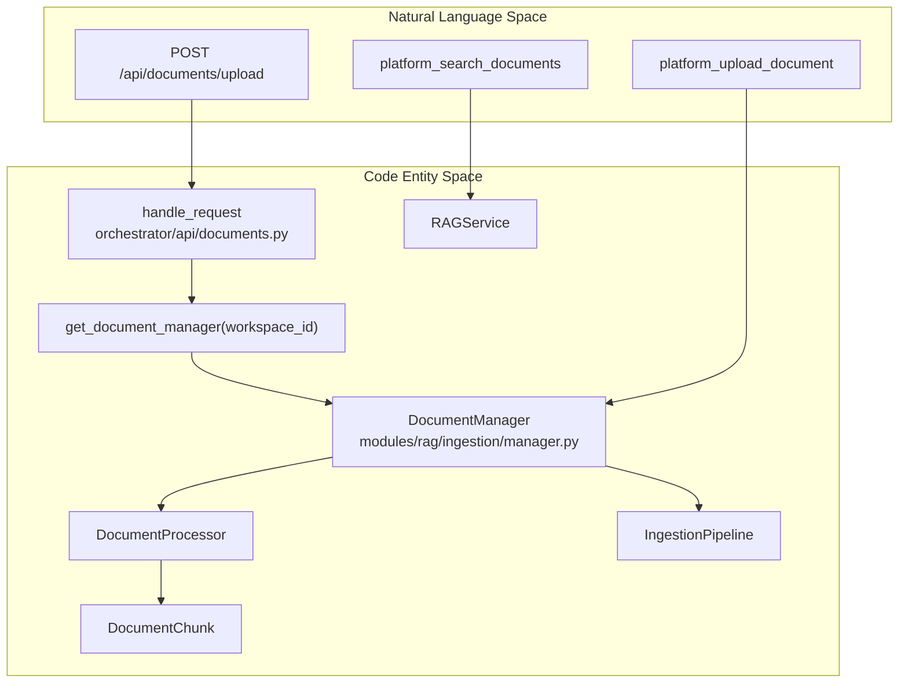
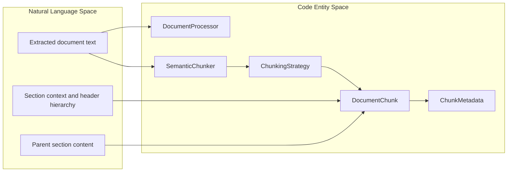

# Document Ingestion Pipeline

Relevant source files

The following files were used as context for generating this wiki page:

- [orchestrator/api/context.py](orchestrator/api/context.py)
- [orchestrator/api/documents.py](orchestrator/api/documents.py)
- [orchestrator/api/github_webhooks.py](orchestrator/api/github_webhooks.py)
- [orchestrator/api/models_endpoints.py](orchestrator/api/models_endpoints.py)
- [orchestrator/modules/rag/__init__.py](orchestrator/modules/rag/__init__.py)
- [orchestrator/modules/rag/ingestion/manager.py](orchestrator/modules/rag/ingestion/manager.py)
- [orchestrator/modules/rag/service.py](orchestrator/modules/rag/service.py)
- [orchestrator/modules/search/services/entity_extractor.py](orchestrator/modules/search/services/entity_extractor.py)
- [orchestrator/services/document_downloads.py](orchestrator/services/document_downloads.py)
- [orchestrator/tests/security/test_s5_closures.py](orchestrator/tests/security/test_s5_closures.py)
- [orchestrator/tests/test_auto_model_workspace_save.py](orchestrator/tests/test_auto_model_workspace_save.py)
- [orchestrator/tests/test_entity_extractor_no_vendor_key.py](orchestrator/tests/test_entity_extractor_no_vendor_key.py)
- [orchestrator/tests/test_f357_an_upload_dedupes_only_in_its_own_workspace.py](orchestrator/tests/test_f357_an_upload_dedupes_only_in_its_own_workspace.py)
- [orchestrator/tests/test_f450_only_the_platform_admin_changes_a_system_setting.py](orchestrator/tests/test_f450_only_the_platform_admin_changes_a_system_setting.py)
- [orchestrator/tests/test_f451_the_platform_default_needs_agents_read.py](orchestrator/tests/test_f451_the_platform_default_needs_agents_read.py)
- [orchestrator/tests/test_f453_a_document_download_is_the_callers_own.py](orchestrator/tests/test_f453_a_document_download_is_the_callers_own.py)
- [orchestrator/tests/test_f453_b_document_content_is_the_callers_own.py](orchestrator/tests/test_f453_b_document_content_is_the_callers_own.py)
- [orchestrator/tests/test_prd233_s4_storage_factory.py](orchestrator/tests/test_prd233_s4_storage_factory.py)

## Purpose and Scope

This page describes the document-ingestion components visible in the provided code: upload validation and type mapping in `orchestrator/api/documents.py`, processing data structures and setup in `DocumentProcessor` and `DocumentChunk` in `orchestrator/modules/rag/ingestion/manager.py`, and the RAG module’s public ingestion and retrieval exports. The shown excerpts do not include the complete upload handler or the remainder of `DocumentManager`, so details that depend on those implementations are not inferred here. [orchestrator/api/documents.py:78-95]() [orchestrator/api/documents.py:144-172]() [orchestrator/modules/rag/ingestion/manager.py:92-168]() [orchestrator/modules/rag/__init__.py:26-74]()

Sources: [orchestrator/api/documents.py:78-95](), [orchestrator/api/documents.py:144-172](), [orchestrator/modules/rag/ingestion/manager.py:92-168](), [orchestrator/modules/rag/__init__.py:26-74]()

---

## Pipeline Architecture & Data Flow

The code identifies `DocumentManager` as the main upload/storage entry point and exports ingestion components—including `DocumentProcessor`, `DocumentChunk`, and `IngestionPipeline`—from `modules.rag`. The API excerpt defines a workspace-aware `get_document_manager()` factory and begins the `/api/documents/upload` handler. The supplied excerpt ends while the handler is validating MIME and extension; subsequent behavior is not described here. [orchestrator/api/documents.py:78-118]() [orchestrator/api/documents.py:144-172]() [orchestrator/modules/rag/__init__.py:42-65]()

### System Data Flow: Natural Language Space to Code Entity Space

The diagram connects user-facing upload concepts and agent document actions to named API and ingestion symbols. `DocumentManager` is identified as the main upload entry point by the RAG module’s documentation and exports; the shown excerpts do not establish the internal calls between individual processing stages. [orchestrator/api/documents.py:109-118]() [orchestrator/api/documents.py:144-172]() [orchestrator/modules/rag/__init__.py:5-21]() [orchestrator/modules/rag/__init__.py:42-65]()

Sources: [orchestrator/api/documents.py:109-118](), [orchestrator/api/documents.py:144-172](), [orchestrator/modules/rag/__init__.py:5-21](), [orchestrator/modules/rag/__init__.py:42-65]()

### Component Boundaries

| Component | Role established by the shown code | Source |
|---|---|---|
| `handle_request` | FastAPI upload handler at `POST /api/documents/upload`; receives an `UploadFile`, form fields, request context, and database session. | [orchestrator/api/documents.py:144-154]() |
| `get_document_manager(workspace_id)` | Creates `DocumentManager` with database configuration, workspace ID, S3 Vectors setting, and documents bucket. | [orchestrator/api/documents.py:109-118]() |
| `processing_type(file_type)` | Maps listed API file types to `DocumentType` values, defaulting to `DocumentType.TEXT`. | [orchestrator/api/documents.py:88-95]() |
| `DocumentProcessor` | Initializes recursive text and Python code splitters and detects document types from MIME type and extension. | [orchestrator/modules/rag/ingestion/manager.py:154-189]() |
| `DocumentChunk` | Carries document ID, chunk index, content, optional embedding and metadata, parent content, and headers. | [orchestrator/modules/rag/ingestion/manager.py:134-152]() |
| `RAGService` | Exported as the RAG retrieval service; the module’s documented usage calls `retrieve()` for search. | [orchestrator/modules/rag/__init__.py:12-21]() [orchestrator/modules/rag/__init__.py:26-33]() |

Sources: [orchestrator/api/documents.py:88-118](), [orchestrator/api/documents.py:144-154](), [orchestrator/modules/rag/ingestion/manager.py:134-189](), [orchestrator/modules/rag/__init__.py:12-33]()

---

## Stage 1: Format Detection, MIME Validation & Workspace Context

The upload API defines a 50 MiB size limit and an allowlist associating detected MIME types with accepted filename extensions. In the visible portion of `handle_request`, the handler rejects a missing filename, reads the uploaded content, measures its byte length, rejects content larger than `MAX_UPLOAD_BYTES`, and detects MIME type with `magic.from_buffer(content, mime=True)`. The supplied excerpt ends while the handler is validating MIME and extension; subsequent behavior is not described here. [orchestrator/api/documents.py:120-136]() [orchestrator/api/documents.py:138-143]() [orchestrator/api/documents.py:144-172]()

The API’s `UPLOAD_FILE_TYPES` mapping classifies supported extensions for listing, while `processing_type()` translates those classifications into the ingestion enum. Separately, `DocumentProcessor.detect_file_type()` uses the file’s MIME type and extension to select a `DocumentType`. [orchestrator/api/documents.py:78-95]() [orchestrator/modules/rag/ingestion/manager.py:168-189]()

| Listed file type | Extensions | Processing type |
|---|---|---|
| `pdf` | `.pdf` | `DocumentType.PDF` |
| `markdown` | `.md`, `.markdown` | `DocumentType.MARKDOWN` |
| `text` | `.txt` | `DocumentType.TEXT` |
| `document` | `.doc`, `.docx` | `DocumentType.DOCX` |
| `json` | `.json` | `DocumentType.JSON` |
| `csv` | `.csv` | `DocumentType.CSV` |
| `spreadsheet` | `.xlsx`, `.xls` | `DocumentType.XLSX` |

The API mappings and fallback are defined in `UPLOAD_FILE_TYPES` and `processing_type()`. [orchestrator/api/documents.py:78-95]()

The upload handler obtains `RequestContext` through `get_request_context_hybrid`, and the endpoint declares the `documents:create` workspace permission dependency. `get_document_manager(workspace_id)` passes the workspace ID into `DocumentManager`; this establishes workspace context at the API/factory boundary, but the omitted implementation prevents a claim here about the precise deduplication query or its scope. [orchestrator/api/documents.py:36-38]() [orchestrator/api/documents.py:109-118]() [orchestrator/api/documents.py:144-153]()

Sources: [orchestrator/api/documents.py:36-38](), [orchestrator/api/documents.py:78-95](), [orchestrator/api/documents.py:109-118](), [orchestrator/api/documents.py:120-172](), [orchestrator/modules/rag/ingestion/manager.py:168-189]()

---

## Stage 2: Text Extraction & Transaction Safety

`DocumentProcessor` constructs a `RecursiveCharacterTextSplitter` with a 1,000-character chunk size and 200-character overlap, and a `PythonCodeTextSplitter` with the same configured size and overlap. Its visible `detect_file_type()` implementation checks MIME type and/or extension for PDF, DOCX, Markdown, Python, JSON, XLSX, and CSV, then falls back to `DocumentType.TEXT`. [orchestrator/modules/rag/ingestion/manager.py:154-189]()

The manager module also contains transaction and optional entity-table safeguards:

- `_rollback_step(conn, step, document_id)` attempts to roll back a failed processing step and logs a warning if rollback itself fails. [orchestrator/modules/rag/ingestion/manager.py:56-70]()
- `_kb_entities_table_exists(cursor)` checks whether `public.kb_entities` exists using `to_regclass`, memoizes the result, and returns `False` if the check raises an exception. [orchestrator/modules/rag/ingestion/manager.py:73-90]()

These helpers establish safeguards in the manager module; the shown excerpts do not include their call sites, so they do not establish which processing stages invoke them. [orchestrator/modules/rag/ingestion/manager.py:56-90]()

Sources: [orchestrator/modules/rag/ingestion/manager.py:56-90](), [orchestrator/modules/rag/ingestion/manager.py:154-189]()

---

## Stage 3: Chunk Representation & Contextual Fields

The manager defines `DocumentChunk` with fields for document identity, position, text, optional embedding and metadata, optional parent content, and header hierarchy. Its `to_dict()` method serializes the document ID, chunk index, content, metadata, parent content, and headers. [orchestrator/modules/rag/ingestion/manager.py:134-152]()

The RAG module exports `SemanticChunker`, `ChunkingStrategy`, `ChunkMetadata`, `SemanticChunk`, `DocumentChunker`, and `MultiModalChunker`. The provided files identify these public symbols but do not include the semantic chunker implementation or enough call-site code to establish which strategy is selected during ingestion. [orchestrator/modules/rag/__init__.py:34-41]() [orchestrator/modules/rag/__init__.py:92-99]()

### Chunking Concepts: Natural Language Space to Code Entity Space

This mapping relates document content and contextual annotations to the concrete chunk data structures named in the code. It does not imply an unshown invocation order between `DocumentProcessor`, `SemanticChunker`, and `DocumentChunk`. [orchestrator/modules/rag/ingestion/manager.py:134-168]() [orchestrator/modules/rag/__init__.py:34-41]()

Sources: [orchestrator/modules/rag/ingestion/manager.py:134-168](), [orchestrator/modules/rag/__init__.py:34-41]()

The API’s `_coverage_fields(doc)` reads `kept_pct` from `doc_metadata`. If it is an integer, the response fields include that percentage and a `partial` boolean computed by comparing it with `RAG_KEPT_WARN_PCT`; if it is not an integer, the helper returns an empty dictionary. The excerpt establishes this presentation behavior, not how `kept_pct` is calculated or stored. [orchestrator/api/documents.py:98-107]()

Sources: [orchestrator/api/documents.py:98-107](), [orchestrator/modules/rag/ingestion/manager.py:134-152]()

---

## Stage 4: Embedding Generation & Entity Extraction

`DocumentChunk` has an optional `embedding` field, and `DocumentManager` is documented as supporting embedding generation and storage. The RAG package exports ingestion and retrieval components, but the shown manager excerpt does not include the embedding-generation implementation, provider selection, batch sizing, or vector-write call sites. [orchestrator/modules/rag/ingestion/manager.py:3-11]() [orchestrator/modules/rag/ingestion/manager.py:134-152]() [orchestrator/modules/rag/__init__.py:42-65]()

The available `EntityExtractor` implementation first runs regex-based extraction and, when enabled and the input is under 8,000 characters, attempts LLM-based extraction. It deduplicates and limits the resulting entities. Its LLM manager is initialized lazily through `_manager()`, which calls `create_llm_manager()` with the `entity_extraction` service and request type. [orchestrator/modules/search/services/entity_extractor.py:39-69]() [orchestrator/modules/search/services/entity_extractor.py:77-118]()

The manager includes `_kb_entities_table_exists()` as a safe existence check for `public.kb_entities`; the supplied excerpt does not show whether or where document ingestion invokes `EntityExtractor` or persists extracted entities. [orchestrator/modules/rag/ingestion/manager.py:73-90]() [orchestrator/modules/search/services/entity_extractor.py:39-118]()

Sources: [orchestrator/modules/rag/ingestion/manager.py:3-11](), [orchestrator/modules/rag/ingestion/manager.py:73-90](), [orchestrator/modules/rag/ingestion/manager.py:134-152](), [orchestrator/modules/search/services/entity_extractor.py:39-118](), [orchestrator/modules/rag/__init__.py:42-65]()

---

## Storage & Retrieval Boundary

`get_document_manager(workspace_id)` configures `DocumentManager` with database connection settings, workspace identity, `S3_VECTORS_ENABLED`, and `S3_DOCUMENTS_BUCKET`. This establishes the storage configuration passed by the API factory; the provided excerpt does not show how `DocumentManager` writes document records, chunks, or vectors to a particular backend. [orchestrator/api/documents.py:109-118]()

The RAG module describes the overall system as upload, parse, chunk, embed, store, and search, and exports `RAGService` and `get_rag_service` for retrieval. `RAGResult` in `service.py` includes chunks, formatted context, token count, source names, query, diversity and information-gain scores, and a source map. [orchestrator/modules/rag/__init__.py:1-21]() [orchestrator/modules/rag/__init__.py:26-33]() [orchestrator/modules/rag/service.py:55-67]()

The `ToolResultFormatter` excerpt shows a downstream full-document read path: it looks up a document’s `file_path` and `filename`; for eligible text-file extensions it attempts an S3 download, then falls back to reading `document_chunks` ordered by chunk index and joining chunk content. This is a content-reassembly path, not evidence of the ingestion write implementation. [orchestrator/modules/tools/formatting/result_formatter.py:112-118]() [orchestrator/modules/tools/formatting/result_formatter.py:126-164]()

Sources: [orchestrator/api/documents.py:109-118](), [orchestrator/modules/rag/__init__.py:1-33](), [orchestrator/modules/rag/service.py:55-67](), [orchestrator/modules/tools/formatting/result_formatter.py:112-164]()

---