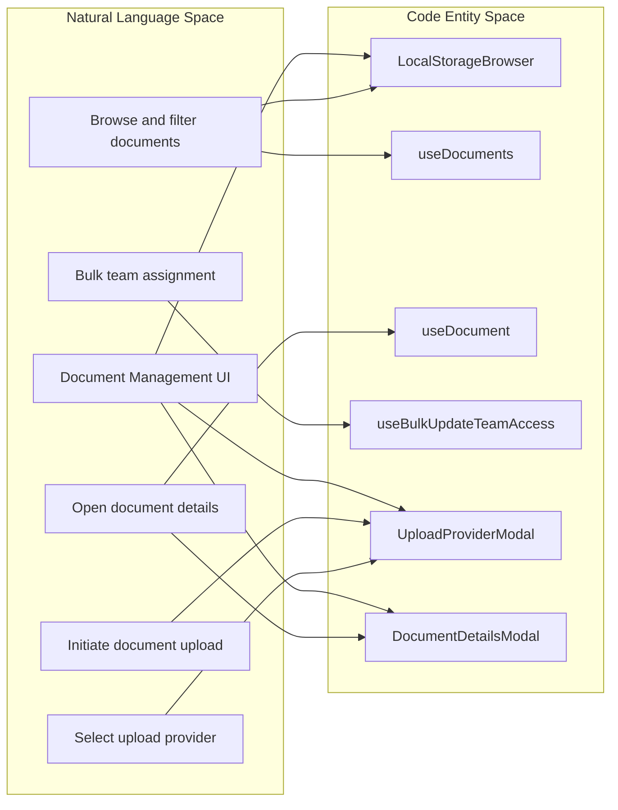
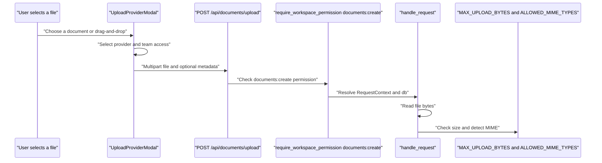
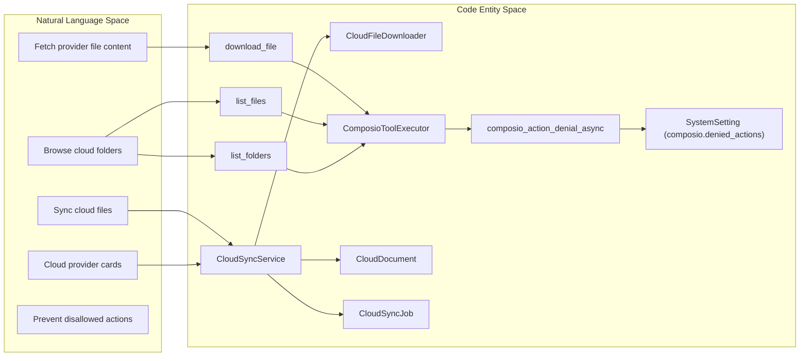
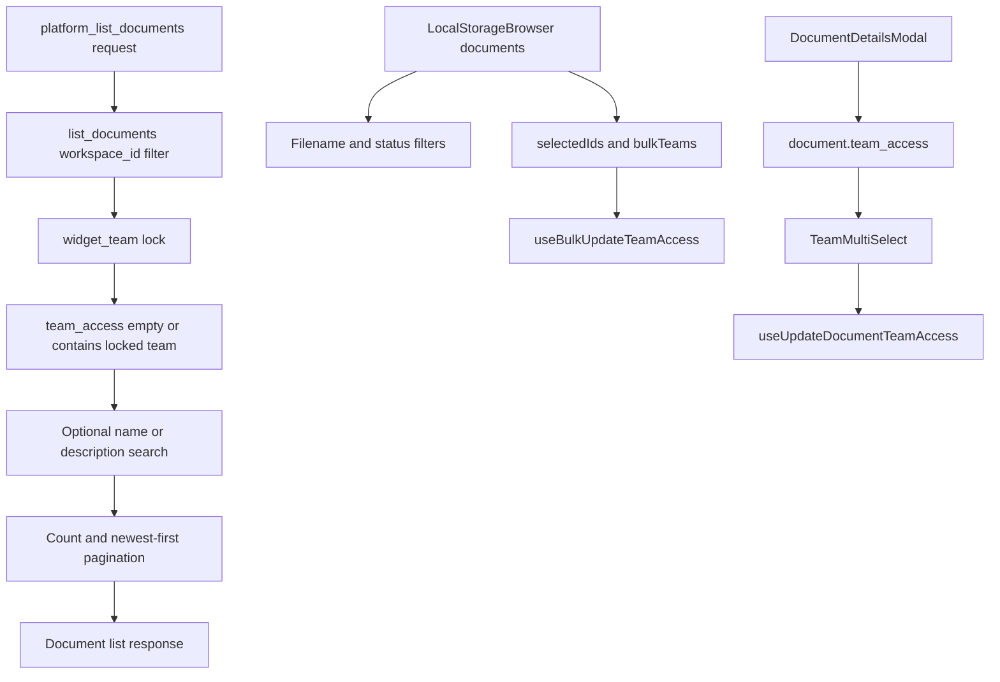

# Document Management

Relevant source files

The following files were used as context for generating this wiki page:

- [frontend/components/documents/delete-confirmation-modal.tsx](frontend/components/documents/delete-confirmation-modal.tsx)
- [frontend/components/documents/document-details-modal.tsx](frontend/components/documents/document-details-modal.tsx)
- [frontend/components/documents/local-storage-browser.tsx](frontend/components/documents/local-storage-browser.tsx)
- [frontend/components/documents/provider-browser.tsx](frontend/components/documents/provider-browser.tsx)
- [frontend/components/documents/team-multi-select.tsx](frontend/components/documents/team-multi-select.tsx)
- [frontend/components/documents/upload-provider-modal.tsx](frontend/components/documents/upload-provider-modal.tsx)
- [frontend/hooks/use-document-api.ts](frontend/hooks/use-document-api.ts)
- [frontend/lib/__tests__/socials-channels.test.ts](frontend/lib/__tests__/socials-channels.test.ts)
- [frontend/lib/__tests__/upload-outcome.test.ts](frontend/lib/__tests__/upload-outcome.test.ts)
- [frontend/lib/upload-outcome.ts](frontend/lib/upload-outcome.ts)
- [orchestrator/alembic/versions/prd158_cloud_default_team.py](orchestrator/alembic/versions/prd158_cloud_default_team.py)
- [orchestrator/api/cloud_documents.py](orchestrator/api/cloud_documents.py)
- [orchestrator/api/socials_channels.py](orchestrator/api/socials_channels.py)
- [orchestrator/core/composio/deny_list.py](orchestrator/core/composio/deny_list.py)
- [orchestrator/core/models/cloud_sync.py](orchestrator/core/models/cloud_sync.py)
- [orchestrator/modules/rag/chunking/semantic_chunker.py](orchestrator/modules/rag/chunking/semantic_chunker.py)
- [orchestrator/modules/rag/ingestion/coverage.py](orchestrator/modules/rag/ingestion/coverage.py)
- [orchestrator/modules/rag/services/cloud_file_downloader.py](orchestrator/modules/rag/services/cloud_file_downloader.py)
- [orchestrator/modules/rag/services/cloud_sync_service.py](orchestrator/modules/rag/services/cloud_sync_service.py)
- [orchestrator/services/composio_api_service.py](orchestrator/services/composio_api_service.py)
- [orchestrator/services/document_versions.py](orchestrator/services/document_versions.py)
- [orchestrator/tests/test_f072_cloud_download_receipt.py](orchestrator/tests/test_f072_cloud_download_receipt.py)
- [orchestrator/tests/test_f087_same_name_upload_replaces.py](orchestrator/tests/test_f087_same_name_upload_replaces.py)
- [orchestrator/tests/test_f088_uploads_and_newer_documents_win_near_ties.py](orchestrator/tests/test_f088_uploads_and_newer_documents_win_near_ties.py)
- [orchestrator/tests/test_prd251_composio_deny.py](orchestrator/tests/test_prd251_composio_deny.py)
- [orchestrator/tests/test_prd251w2_channels.py](orchestrator/tests/test_prd251w2_channels.py)

## Purpose and scope

Document management provides the workspace-facing API and UI for listing, uploading, and organizing documents used by the knowledge base. This page covers the evidenced upload validation path, document-list behavior, team scoping, cloud-provider synchronization components, and the frontend’s document query hooks. It does not describe downstream ingestion steps or pinning behavior because the supplied file excerpts do not include their implementations. [orchestrator/api/documents.py:78-172]()

Sources: [orchestrator/api/documents.py:78-172]()

---

## 1. Document Management UI and query hooks

The frontend document API hooks use React Query for document lists, individual document details, statistics, processing status, and search. `useDocuments(team)` includes the optional team value in its query key and calls `apiClient.getDocuments(team)`. `useDocument(documentId)` is enabled only when an ID is present and calls `apiClient.getDocument`. [frontend/hooks/use-document-api.ts:12-27]()[frontend/hooks/use-document-api.ts:39-62]()

The `LocalStorageBrowser` component accepts a document list and callbacks for upload, details, download, and delete; it also maintains search/status filters and bulk team-assignment state. [frontend/components/documents/local-storage-browser.tsx:34-57]()[frontend/components/documents/local-storage-browser.tsx:70-114]()

The `UploadProviderModal` component handles the initial document upload flow, allowing users to select a storage destination (manual upload or connected cloud providers) and assign team access. It manages the UI state for drag-and-drop, file selection, upload progress, and completion. [frontend/components/documents/upload-provider-modal.tsx:45-58]()[frontend/components/documents/upload-provider-modal.tsx:61-93]()

The `DocumentDetailsModal` displays detailed information about a selected document, including its filename, type, size, status, chunk count, team access, upload/processing dates, and processing stages. It also provides actions for downloading and deleting the document. [frontend/components/documents/document-details-modal.tsx:36-85]()[frontend/components/documents/document-details-modal.tsx:110-116]()

### UI responsibilities mapped to code entities

Sources: [frontend/components/documents/local-storage-browser.tsx:34-114]()[frontend/hooks/use-document-api.ts:39-62]()[frontend/components/documents/upload-provider-modal.tsx:45-58]()[frontend/components/documents/upload-provider-modal.tsx:61-93]()[frontend/components/documents/document-details-modal.tsx:36-85]()[frontend/components/documents/document-details-modal.tsx:110-116]()

### Query behavior

| Hook | Code-backed behavior |
|---|---|
| `useDocuments(team)` | Uses a query key containing the optional team, fetches through `apiClient.getDocuments(team)`, and sets a 30-second stale time. [frontend/hooks/use-document-api.ts:39-49]() |
| `useDocument(documentId)` | Fetches one document when `documentId` is truthy; uses a 30-second stale time. [frontend/hooks/use-document-api.ts:51-62]() |
| `useProcessingStatus(documentId)` | Calls `apiClient.processDocument` when an ID is present and polls every five seconds. [frontend/hooks/use-document-api.ts:92-103]() |
| `useProcessingQueue()` | Calls `apiClient.getProcessingQueue()` to fetch the processing queue status, polls every 30 seconds, and considers data fresh for 15 seconds. [frontend/hooks/use-document-api.ts:109-119]() |
| `useDocumentSearch(query, filters, enabled)` | Uses a query key containing the query and filters; runs only when enabled and the query exceeds two characters. Its query function calls `apiClient.getDocuments()`. [frontend/hooks/use-document-api.ts:121-133]() |
| `useSemanticSearch(query, options, enabled)` | Calls `apiClient.semanticSearch` and maps results into document name/type, relevance, excerpt, chunk, and source metadata fields. [frontend/hooks/use-document-api.ts:135-165]() |
| `useDocumentInsights(documentId)` | Fetches document details using `apiClient.getDocument` (as a placeholder until a dedicated insights API exists). [frontend/hooks/use-document-api.ts:171-179]() |
| `useDocumentAnalytics(timeRange)` | Calls `apiClient.getDocumentAnalytics` to fetch analytics data. [frontend/hooks/use-document-api.ts:185-193]() |

Sources: [frontend/hooks/use-document-api.ts:39-193]()

---

## 2. Upload flow and request validation

The upload route is `POST /api/documents/upload` under the `/api/documents` router. It requires the `documents:create` workspace permission and accepts a multipart file plus optional `description`, `tags`, and `team_access` fields. The route receives a hybrid-auth `RequestContext` and database session. [orchestrator/api/documents.py:24-38]()[orchestrator/api/documents.py:144-153]()

In the visible portion of the handler, the server rejects a missing filename, reads the uploaded content, enforces the 50 MB `MAX_UPLOAD_BYTES` limit, detects the MIME type from the file bytes using `magic.from_buffer`, and obtains the extension from the submitted filename. The excerpt ends during MIME validation, so it does not establish the remainder of the route’s persistence or processing behavior. [orchestrator/api/documents.py:138-172]()

The `UploadProviderModal` component orchestrates the frontend upload process. It allows users to select between manual upload (directly to Automatos storage) or connected cloud providers. It handles file selection, drag-and-drop, and displays upload progress. The `onUpload` prop is a callback that takes `files`, `providerId`, `connectionId`, and `teamAccess` to initiate the actual upload. [frontend/components/documents/upload-provider-modal.tsx:45-50]()[frontend/components/documents/upload-provider-modal.tsx:61-93]()[frontend/components/documents/upload-provider-modal.tsx:145-196]()

### Upload request path: user concepts to implementation symbols

Sources: [orchestrator/api/documents.py:24-38]()[orchestrator/api/documents.py:120-172]()[frontend/components/documents/upload-provider-modal.tsx:45-50]()[frontend/components/documents/upload-provider-modal.tsx:61-93]()[frontend/components/documents/upload-provider-modal.tsx:145-196]()

### File classification

The API maps filename extensions to list-facing types through `UPLOAD_FILE_TYPES`. A separate `processing_type(file_type)` function maps those values to `DocumentType` enum members. The accepted MIME-type allowlist is defined separately and associates detected MIME types with permitted extensions. [orchestrator/api/documents.py:78-95]()[orchestrator/api/documents.py:120-136]()

| Extension examples | List-facing type | Processing type |
|---|---|---|
| `.pdf` | `pdf` | `DocumentType.PDF` |
| `.md`, `.markdown` | `markdown` | `DocumentType.MARKDOWN` |
| `.txt` | `text` | `DocumentType.TEXT` |
| `.doc`, `.docx` | `document` | `DocumentType.DOCX` |
| `.json` | `json` | `DocumentType.JSON` |
| `.csv` | `csv` | `DocumentType.CSV` |
| `.xlsx`, `.xls` | `spreadsheet` | `DocumentType.XLSX` |

Sources: [orchestrator/api/documents.py:78-95]()

The ingestion module defines `DocumentStatus` values `PENDING`, `PROCESSING`, `COMPLETED`, and `FAILED`, along with `DocumentType` values including `PDF`, `DOCX`, `MARKDOWN`, `TEXT`, `PYTHON`, `JSON`, `XLSX`, and `CSV`. `DocumentMetadata` carries fields such as filename, file type, size, upload date, status, chunk count, tags, description, and creator. [orchestrator/modules/rag/ingestion/manager.py:92-127]()

Sources: [orchestrator/modules/rag/ingestion/manager.py:92-127]()

---

## 3. Document manager configuration and coverage metadata

`get_document_manager(workspace_id)` constructs a `DocumentManager` with the module-level database configuration, the supplied workspace ID, and S3-vector and bucket settings from application configuration. The API’s `_coverage_fields(doc)` helper reads `kept_pct` from `doc_metadata` and, when it is an integer, returns that percentage plus a `partial` flag determined by `RAG_KEPT_WARN_PCT`. [orchestrator/api/documents.py:98-118]()

The ingestion module’s `DocumentProcessor` initializes text and Python-code splitters with a 1,000-character chunk size and 200-character overlap. Its `detect_file_type` checks MIME type and extension to classify supported document types, falling back to text when no specific type matches. [orchestrator/modules/rag/ingestion/manager.py:154-190]()

The `SemanticChunker` class provides advanced chunking strategies like `SEMANTIC_SIMILARITY`, `INFORMATION_DENSITY`, `TOPIC_COHERENCE`, `HIERARCHICAL`, and `ADAPTIVE`. It uses mathematical components like `InformationTheory`, `VectorOperations`, and `StatisticalAnalysis` for intelligent text segmentation. While it has an `_embedding_manager`, embeddings are currently disabled for chunking in favor of keyword similarity for performance. [orchestrator/modules/rag/chunking/semantic_chunker.py:21-70]()[orchestrator/modules/rag/chunking/semantic_chunker.py:71-81]()

Sources: [orchestrator/api/documents.py:98-118]()[orchestrator/modules/rag/ingestion/manager.py:154-190]()[orchestrator/modules/rag/chunking/semantic_chunker.py:21-81]()

---

## 4. Cloud provider synchronization

Cloud synchronization is implemented by `CloudSyncService`, which is documented as coordinating cloud file/folder listing, downloads, ingestion, vector storage, and sync-state tracking. Its constructor receives a database session and initializes `EntityManager` and `ComposioToolExecutor`. The visible `list_folders` implementation checks the cloud-listing cache, resolves the provider connection and workspace, selects a provider-specific list action, executes it through `ComposioToolExecutor`, parses the response, and caches the folder result. [orchestrator/modules/rag/services/cloud_sync_service.py:1-9]()[orchestrator/modules/rag/services/cloud_sync_service.py:42-48]()[orchestrator/modules/rag/services/cloud_sync_service.py:51-123]()

`CloudFileDownloader` maps Google Drive, Dropbox, OneDrive, and Box to their respective download actions. It uses the Composio v3 REST API as its primary path and has a Google Drive SDK fallback when the REST result is missing or smaller than the configured expected-size threshold. It also includes logic to detect and prevent ingestion of download receipts (short blobs containing presigned URL signatures) instead of actual file content. [orchestrator/modules/rag/services/cloud_file_downloader.py:30-36]()[orchestrator/modules/rag/services/cloud_file_downloader.py:67-69]()[orchestrator/modules/rag/services/cloud_file_downloader.py:123-130]()[orchestrator/modules/rag/services/cloud_file_downloader.py:135-180]()

The `ComposioToolExecutor` is used by both `CloudSyncService` and `CloudFileDownloader` to interact with cloud storage providers via Composio actions. This executor is subject to the platform-wide Composio deny list, which prevents execution of certain actions (e.g., billing-related or external website operations) as configured in the `composio.denied_actions` system setting. [orchestrator/modules/rag/services/cloud_sync_service.py:21]()[orchestrator/modules/rag/services/cloud_file_downloader.py:26]()[orchestrator/core/composio/deny_list.py:1-16]()[orchestrator/core/composio/deny_list.py:51-52]()[orchestrator/tests/test_prd251_composio_deny.py:17-27]()

### Provider sync concepts mapped to code entities

Sources: [orchestrator/modules/rag/services/cloud_sync_service.py:1-9]()[orchestrator/modules/rag/services/cloud_sync_service.py:20-27]()[orchestrator/modules/rag/services/cloud_sync_service.py:42-48]()[orchestrator/modules/rag/services/cloud_sync_service.py:51-123]()[orchestrator/modules/rag/services/cloud_file_downloader.py:30-36]()[orchestrator/modules/rag/services/cloud_file_downloader.py:67-69]()[orchestrator/modules/rag/services/cloud_file_downloader.py:123-180]()[orchestrator/core/composio/deny_list.py:1-16]()[orchestrator/core/composio/deny_list.py:51-52]()[orchestrator/tests/test_prd251_composio_deny.py:17-27]()

The `UploadProviderModal` component in the frontend displays available cloud providers and their connection status, allowing users to select a connected provider for uploading. [frontend/components/documents/upload-provider-modal.tsx:150-192]()

Sources: [frontend/components/documents/upload-provider-modal.tsx:150-192]()

---

## 5. Document listing, details, and team scoping

The platform action `platform_list_documents` is registered as a read-level document action. Its parameters include `limit`, `search`, and `offset`; the action description specifies name/description filtering and newest-first pagination. [orchestrator/modules/tools/discovery/actions_documents.py:16-52]()

The `list_documents` handler begins from documents whose `workspace_id` matches the requested workspace. It bounds `limit` to 1–200, clamps `offset` to zero or greater, optionally filters by filename, original filename, or description, then counts and returns results ordered by upload date and ID descending. If a widget team lock is active, the query is additionally restricted to documents with empty `team_access` or access for the locked team. [orchestrator/modules/tools/discovery/handlers_documents.py:122-151]()

The `LocalStorageBrowser` component accepts document fields including `team_access`, status, chunk count, and the partial-ingestion indicators `kept_pct` and `partial`. It supports local filename and status filtering. Its comments state that team filtering is performed server-side, rather than against only the currently loaded client-side set. Bulk assignment submits selected document IDs and a team list through `useBulkUpdateTeamAccess`. [frontend/components/documents/local-storage-browser.tsx:34-48]()[frontend/components/documents/local-storage-browser.tsx:78-114]()

The `DocumentDetailsModal` displays a document's `team_access` and allows for its modification using the `TeamMultiSelect` component and the `useUpdateDocumentTeamAccess` hook. [frontend/components/documents/document-details-modal.tsx:52]()[frontend/components/documents/document-details-modal.tsx:122-124]()

The `TeamMultiSelect` component provides a reusable multi-select for a document's `team_access`, sourcing available teams from `/api/teams`. It allows for inline creation of new teams by admins and ensures that selected values are canonical normalized_name strings. [frontend/components/documents/team-multi-select.tsx:1-9]()[frontend/components/documents/team-multi-select.tsx:29-35]()

### Team scope and list flow

Sources: [orchestrator/modules/tools/discovery/actions_documents.py:16-52]()[orchestrator/modules/tools/discovery/handlers_documents.py:122-151]()[frontend/components/documents/local-storage-browser.tsx:34-48]()[frontend/components/documents/local-storage-browser.tsx:78-114]()[frontend/components/documents/document-details-modal.tsx:52]()[frontend/components/documents/document-details-modal.tsx:122-124]()[frontend/components/documents/team-multi-select.tsx:1-9]()[frontend/components/documents/team-multi-select.tsx:29-35]()

---

## 6. Platform document actions and pinning boundary

The document action registry exposes `platform_list_documents`, `platform_upload_document`, and `platform_search_documents` in the supplied excerpt. The upload action is write-level and describes adding text content to the workspace knowledge base; the search action is read-level and accepts a query, result limit, and optional team. [orchestrator/modules/tools/discovery/actions_documents.py:16-52]()[orchestrator/modules/tools/discovery/actions_documents.py:54-94]()[orchestrator/modules/tools/discovery/actions_documents.py:96-133]()

The file inventory names document-reading and pinning-related files, but their contents were not supplied. Pinning functions, storage semantics, and chat-context injection behavior cannot be verified from the available excerpts and are intentionally not specified here.

Sources: [orchestrator/modules/tools/discovery/actions_documents.py:16-52]()[orchestrator/modules/tools/discovery/actions_documents.py:54-133]()

---