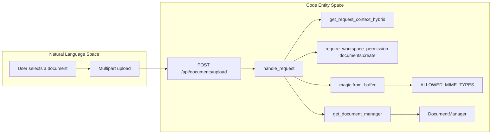
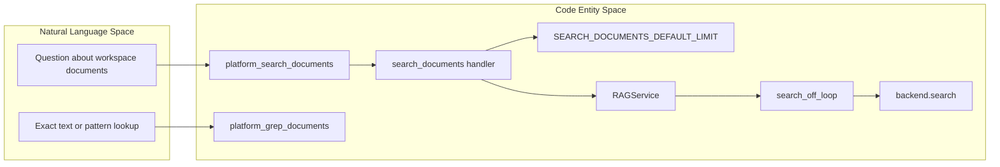

# Documents API Reference

Relevant source files

The following files were used as context for generating this wiki page:

- [orchestrator/api/context.py](orchestrator/api/context.py)
- [orchestrator/api/documents.py](orchestrator/api/documents.py)
- [orchestrator/api/github_webhooks.py](orchestrator/api/github_webhooks.py)
- [orchestrator/api/models_endpoints.py](orchestrator/api/models_endpoints.py)
- [orchestrator/modules/rag/__init__.py](orchestrator/modules/rag/__init__.py)
- [orchestrator/modules/rag/ingestion/manager.py](orchestrator/modules/rag/ingestion/manager.py)
- [orchestrator/modules/rag/service.py](orchestrator/modules/rag/service.py)
- [orchestrator/modules/search/services/entity_extractor.py](orchestrator/modules/search/services/entity_extractor.py)
- [orchestrator/modules/tools/discovery/actions_documents.py](orchestrator/modules/tools/discovery/actions_documents.py)
- [orchestrator/modules/tools/discovery/actions_read_document.py](orchestrator/modules/tools/discovery/actions_read_document.py)
- [orchestrator/modules/tools/discovery/handlers_documents.py](orchestrator/modules/tools/discovery/handlers_documents.py)
- [orchestrator/modules/tools/discovery/read_document_lookup.py](orchestrator/modules/tools/discovery/read_document_lookup.py)
- [orchestrator/services/document_downloads.py](orchestrator/services/document_downloads.py)
- [orchestrator/tests/security/test_s5_closures.py](orchestrator/tests/security/test_s5_closures.py)
- [orchestrator/tests/test_auto_model_workspace_save.py](orchestrator/tests/test_auto_model_workspace_save.py)
- [orchestrator/tests/test_entity_extractor_no_vendor_key.py](orchestrator/tests/test_entity_extractor_no_vendor_key.py)
- [orchestrator/tests/test_f027c_the_error_names_the_exact_call.py](orchestrator/tests/test_f027c_the_error_names_the_exact_call.py)
- [orchestrator/tests/test_f327_a_read_document_reads_exactly_the_document_asked_for.py](orchestrator/tests/test_f327_a_read_document_reads_exactly_the_document_asked_for.py)
- [orchestrator/tests/test_f357_an_upload_dedupes_only_in_its_own_workspace.py](orchestrator/tests/test_f357_an_upload_dedupes_only_in_its_own_workspace.py)
- [orchestrator/tests/test_f450_only_the_platform_admin_changes_a_system_setting.py](orchestrator/tests/test_f450_only_the_platform_admin_changes_a_system_setting.py)
- [orchestrator/tests/test_f451_the_platform_default_needs_agents_read.py](orchestrator/tests/test_f451_the_platform_default_needs_agents_read.py)
- [orchestrator/tests/test_f453_a_document_download_is_the_callers_own.py](orchestrator/tests/test_f453_a_document_download_is_the_callers_own.py)
- [orchestrator/tests/test_f453_b_document_content_is_the_callers_own.py](orchestrator/tests/test_f453_b_document_content_is_the_callers_own.py)
- [orchestrator/tests/test_prd233_s4_storage_factory.py](orchestrator/tests/test_prd233_s4_storage_factory.py)

## Purpose and Scope

Section 7.7 documents the visible document API and its related RAG and platform-action interfaces: upload validation and workspace configuration, document listing and semantic search actions, and context analytics. The supplied code excerpts do not show the remaining lines of `orchestrator/api/documents.py` or the cloud-document API implementation, so endpoint behavior not evidenced by those excerpts is not specified here.

Sources: [orchestrator/api/documents.py:1-38](), [orchestrator/modules/tools/discovery/actions_documents.py:1-15](), [orchestrator/api/context.py:1-24]()

---

## Architecture and Data Flow

The `/api/documents` router is the REST entry point shown in the provided excerpt. Its upload handler obtains a hybrid request context and database session, enforces the `documents:create` workspace permission, and configures a `DocumentManager` with the workspace ID and vector-storage settings. The RAG module exposes ingestion and retrieval components, while platform document actions register agent-facing operations such as listing and semantic search. [orchestrator/api/documents.py:24-38, 78-118, 144-153](), [orchestrator/modules/rag/__init__.py:5-21, 26-53](), [orchestrator/modules/tools/discovery/actions_documents.py:13-15, 16-52, 98-133]()

### Upload: Natural Language Space to Code Entity Space

**Diagram: Document upload request mapped to implementation entities**

Sources: [orchestrator/api/documents.py:30-38, 109-136, 144-172]()

The upload route accepts a file plus optional `description`, `tags`, and `team_access` form values. The handler reads the file bytes, rejects files over `MAX_UPLOAD_BYTES` (50 MiB), detects the MIME type from file content, and obtains the lowercased filename extension before validation. The allowlist maps accepted MIME types to extensions; the excerpt ends during validation, so subsequent upload and ingestion behavior is not detailed here. [orchestrator/api/documents.py:120-142, 144-172]()

The API maps recognized extensions to listed file types in `UPLOAD_FILE_TYPES`; `processing_type()` maps those types to ingestion `DocumentType` values, including CSV and spreadsheet types. `get_document_manager(workspace_id)` constructs a manager using the workspace ID and the configured S3 Vectors flag and documents bucket. [orchestrator/api/documents.py:78-118]()

Sources: [orchestrator/api/documents.py:78-95, 109-118, 120-172]()

### Search and retrieval: Natural Language Space to Code Entity Space

**Diagram: Agent knowledge search mapped to implementation entities**

Sources: [orchestrator/modules/tools/discovery/actions_documents.py:98-159](), [orchestrator/modules/tools/discovery/handlers_documents.py:17-20](), [orchestrator/modules/rag/service.py:107-135]()

The platform action `platform_search_documents` is described as retrieving passages that answer a question, with document ID and score; it accepts a required `query` and optional `limit` and `team`. Its documented default limit is 8, with a maximum of 25, matching the handler’s `SEARCH_DOCUMENTS_DEFAULT_LIMIT` and `SEARCH_DOCUMENTS_MAX_LIMIT`. `platform_grep_documents` is the separate action for literal-text or regular-expression lookups. [orchestrator/modules/tools/discovery/actions_documents.py:98-159](), [orchestrator/modules/tools/discovery/handlers_documents.py:17-20]()

The RAG service provides `search_off_loop()`, which runs the synchronous backend `search()` call in a dedicated `ThreadPoolExecutor`. The executor’s worker count comes from `DOCUMENT_SEARCH_THREADS`; copying the current context into the executor call preserves the caller’s context. [orchestrator/modules/rag/service.py:107-135]()

Sources: [orchestrator/modules/tools/discovery/actions_documents.py:98-159](), [orchestrator/modules/tools/discovery/handlers_documents.py:17-20](), [orchestrator/modules/rag/service.py:107-135]()

---

## API and Action Reference

### REST endpoints evidenced by the supplied excerpts

| Method and path | Purpose and behavior evidenced in the excerpt |
|---|---|
| `POST /api/documents/upload` | Accepts a multipart file and optional description, tags, and team access. Requires `documents:create`; checks for a filename, enforces the 50 MiB limit, and begins MIME validation. |
| `POST /api/context/add` | Accepts a context type, content, and optional metadata. Requires `documents:create`; returns a success response and calculated context metrics. |
| `GET /api/context/stats` | Returns RAG retrieval statistics, including query count, success rate, average response time, vector embeddings, system status, and last query time. |
| `GET /api/context/performance` | Returns RAG performance data for a requested time range constrained to `1h`, `24h`, `7d`, or `30d`. |
| `GET /api/context/sources` | Returns context source distribution. |
| `GET /api/context/queries/recent` | Returns recent context queries; `limit` is constrained to 1–50 and defaults to 10. |
| `GET /api/context/patterns` | Returns context patterns derived from RAG configurations. |

The upload route and its visible validation behavior are defined in `orchestrator/api/documents.py`. The context routes and their request dependencies and response behavior are defined in `orchestrator/api/context.py`. [orchestrator/api/documents.py:144-172](), [orchestrator/api/context.py:49-86, 88-172]()

Sources: [orchestrator/api/documents.py:144-172](), [orchestrator/api/context.py:49-86, 88-172]()

### Agent-facing document actions

| Action | Purpose and parameters evidenced in the registration |
|---|---|
| `platform_list_documents` | Lists workspace knowledge-base documents. Optional `limit`, `search`, and `offset` parameters are registered; the description says search matches names or descriptions and results are newest-first. |
| `platform_upload_document` | Adds text content already available to the agent. Requires `filename` and `content`; optional `description`. The action description limits the intended file types to Markdown, text, and JSON, and describes duplicate-content detection. |
| `platform_search_documents` | Searches document passages semantically. Requires `query`; optional `limit` and `team`. |
| `platform_grep_documents` | Searches literal document text using a regular expression. Optional `team`, `document_id`, and `limit` are among the visible parameters. |
| `platform_read_document` | Reads a document page by page. Supports `document_id`, `filename` or `document_name`, a zero-based `page`, and an optional chunk-index `offset`. |
| `platform_get_brand_kit` | Retrieves the workspace's brand kit, including effective color roles, suggestions, and the style profile. |
| `platform_update_brand_kit` | Updates fields in the workspace's brand kit. Accepts a dictionary of fields to update. |

These are `ActionDefinition` registrations, not REST route declarations. The excerpt shows the definitions and parameters; it does not provide a basis for treating their names as HTTP endpoints. [orchestrator/modules/tools/discovery/actions_documents.py:13-15, 16-52, 54-94, 98-159](), [orchestrator/modules/tools/discovery/actions_read_document.py:22-69](), [orchestrator/modules/tools/discovery/handlers_documents.py:49-68, 71-106]()

Sources: [orchestrator/modules/tools/discovery/actions_documents.py:13-15, 16-52, 54-94, 98-159](), [orchestrator/modules/tools/discovery/actions_read_document.py:22-69](), [orchestrator/modules/tools/discovery/handlers_documents.py:49-68, 71-106]()

---

## Ingestion and RAG Implementation

The RAG package identifies its principal flow as upload, parse, chunk, embed, store, and search. It exports `DocumentManager` for uploads and `RAGService` for retrieval, alongside document-processing, chunking, and configuration types. [orchestrator/modules/rag/__init__.py:5-21, 26-74]()

`DocumentManager`’s ingestion module defines `DocumentStatus` values (`PENDING`, `PROCESSING`, `COMPLETED`, `FAILED`), `DocumentType` values for PDF, DOCX, Markdown, text, Python, JSON, XLSX, and CSV, and metadata and chunk dataclasses. `DocumentProcessor` initializes recursive text and Python-code splitters with a chunk size of 1,000 and overlap of 200, and its file-type detection considers MIME type and extension. [orchestrator/modules/rag/ingestion/manager.py:92-127, 129-152, 154-189]()

For API uploads, `processing_type()` maps API-level categories to `DocumentType` values. In particular, the API-level `document`, `csv`, and `spreadsheet` categories map to `DOCX`, `CSV`, and `XLSX`, respectively. The excerpt establishes this mapping, but does not show the subsequent upload-handler call into `DocumentManager`. [orchestrator/api/documents.py:78-95]()

Sources: [orchestrator/modules/rag/__init__.py:5-21, 26-74](), [orchestrator/modules/rag/ingestion/manager.py:92-127, 129-189](), [orchestrator/api/documents.py:78-95]()

---

## Analytics and Workspace Scoping

`GET /api/context/stats` passes a workspace ID to `RAGService.get_retrieval_stats()`, except when `admin_all_workspaces` is set, in which case it passes `None` for an unfiltered administrator aggregate. The response exposes the resulting query count, success rate, average response time, embedding count, system status, and last-query time. [orchestrator/api/context.py:88-108]()

The context performance, sources, recent-query, and patterns routes delegate to corresponding `RAGService` methods. The supplied excerpt shows request validation and delegation; it does not establish that every one of these analytics methods applies the same workspace filter as the stats endpoint. [orchestrator/api/context.py:114-172]()

A security regression test asserts that reads of workspace-attributable `document_usage` analytics filter using `metadata->>'workspace_id' = :workspace_id`; it also asserts that writes include the caller’s workspace ID in metadata. [orchestrator/tests/security/test_s5_closures.py:34-50]()

Sources: [orchestrator/api/context.py:88-172](), [orchestrator/tests/security/test_s5_closures.py:34-50]()

---

## Retrieval Configuration and Search Instrumentation

`RAGConfig` reads RAG-related settings through memoized `_load_rag_settings()`. The loader fetches settings in one database session, caches successful reads, and returns an empty mapping on failure; `reset_rag_settings_cache()` clears the cache. [orchestrator/modules/rag/service.py:69-105]()

The service creates a dedicated search executor lazily. `search_off_loop()` submits the backend search call to that executor rather than running the synchronous call directly on the event loop. The service also imports retrieval tracing and document-seam substrate metric functions; the supplied excerpt identifies these instrumentation dependencies but does not show their invocation sites. [orchestrator/modules/rag/service.py:29-46, 107-135]()

Sources: [orchestrator/modules/rag/service.py:29-46, 69-105, 107-135]()

---

## Entity Extraction

`EntityExtractor` represents extracted entities and relationships with `ExtractedEntity` and `ExtractedRelationship` dataclasses. Its constructor does not create an LLM client. Instead, `_manager()` lazily calls `create_llm_manager()` for the `entity_extraction` service and request type. [orchestrator/modules/search/services/entity_extractor.py:17-40, 42-69]()

`extract_entities()` returns an empty list for blank or very short input, runs regex-based extraction, optionally runs LLM-based extraction for input shorter than 8,000 characters, deduplicates the results, and limits the returned entities to `max_entities`. LLM extraction errors are logged rather than propagated from that extraction step. [orchestrator/modules/search/services/entity_extractor.py:77-118]()

Sources: [orchestrator/modules/search/services/entity_extractor.py:17-40, 42-69, 77-118]()

---

## Endpoint Coverage Boundaries

The supplied material shows the start of `orchestrator/api/documents.py` and therefore does not evidence the implementations of document download, deletion, pins, or cloud connections. It also does not provide the route definitions for these capabilities. Their methods, paths, permissions, and response schemas are intentionally not inferred here.

Sources: [orchestrator/api/documents.py:1-172]()

---