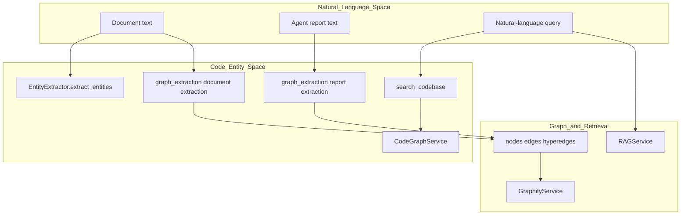
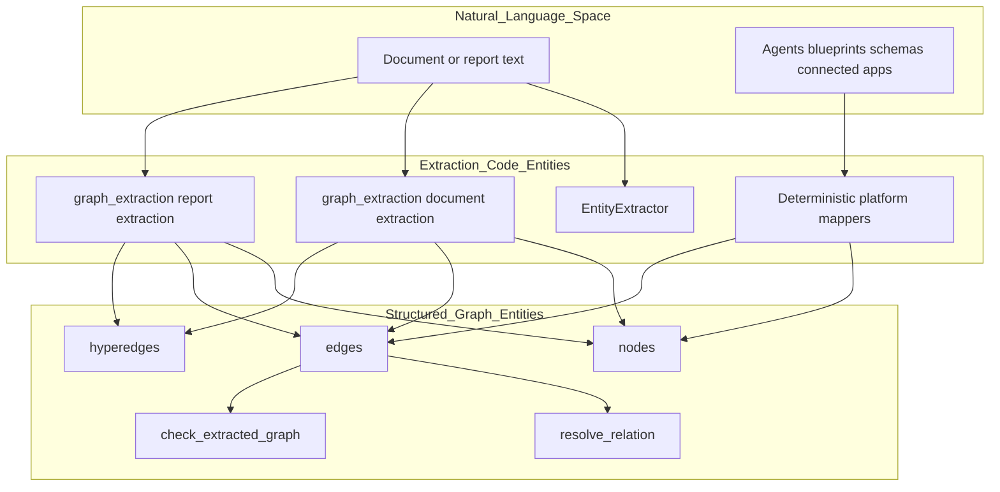
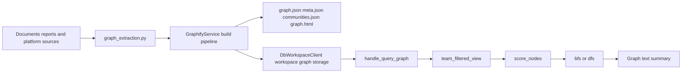

# Entity Extraction & Semantic Layer

Relevant source files

The following files were used as context for generating this wiki page:

- [orchestrator/api/context.py](orchestrator/api/context.py)
- [orchestrator/api/documents.py](orchestrator/api/documents.py)
- [orchestrator/api/github_webhooks.py](orchestrator/api/github_webhooks.py)
- [orchestrator/api/models_endpoints.py](orchestrator/api/models_endpoints.py)
- [orchestrator/modules/rag/__init__.py](orchestrator/modules/rag/__init__.py)
- [orchestrator/modules/rag/ingestion/manager.py](orchestrator/modules/rag/ingestion/manager.py)
- [orchestrator/modules/rag/service.py](orchestrator/modules/rag/service.py)
- [orchestrator/modules/search/services/entity_extractor.py](orchestrator/modules/search/services/entity_extractor.py)
- [orchestrator/services/document_downloads.py](orchestrator/services/document_downloads.py)
- [orchestrator/tests/security/test_s5_closures.py](orchestrator/tests/security/test_s5_closures.py)
- [orchestrator/tests/test_auto_model_workspace_save.py](orchestrator/tests/test_auto_model_workspace_save.py)
- [orchestrator/tests/test_entity_extractor_no_vendor_key.py](orchestrator/tests/test_entity_extractor_no_vendor_key.py)
- [orchestrator/tests/test_f357_an_upload_dedupes_only_in_its_own_workspace.py](orchestrator/tests/test_f357_an_upload_dedupes_only_in_its_own_workspace.py)
- [orchestrator/tests/test_f450_only_the_platform_admin_changes_a_system_setting.py](orchestrator/tests/test_f450_only_the_platform_admin_changes_a_system_setting.py)
- [orchestrator/tests/test_f451_the_platform_default_needs_agents_read.py](orchestrator/tests/test_f451_the_platform_default_needs_agents_read.py)
- [orchestrator/tests/test_f453_a_document_download_is_the_callers_own.py](orchestrator/tests/test_f453_a_document_download_is_the_callers_own.py)
- [orchestrator/tests/test_f453_b_document_content_is_the_callers_own.py](orchestrator/tests/test_f453_b_document_content_is_the_callers_own.py)
- [orchestrator/tests/test_prd233_s4_storage_factory.py](orchestrator/tests/test_prd233_s4_storage_factory.py)

## Purpose and Scope

The Entity Extraction & Semantic Layer turns text and platform data into structured entities and relationships, and connects those representations to graph and retrieval capabilities. This page covers `EntityExtractor`, knowledge-graph extraction and building, document-ingestion safeguards, semantic search services exposed to agents, and the graph-query path. [orchestrator/modules/search/services/entity_extractor.py:39-181](), [orchestrator/modules/knowledge/graph_extraction.py:1-21](), [orchestrator/modules/knowledge/graph_service.py:1-22](), [orchestrator/modules/agents/services/agent_platform_tools.py:1-12]()

Sources: [orchestrator/modules/search/services/entity_extractor.py:39-181](), [orchestrator/modules/knowledge/graph_extraction.py:1-21](), [orchestrator/modules/knowledge/graph_service.py:1-22](), [orchestrator/modules/agents/services/agent_platform_tools.py:1-12]()

---

## System Architecture & Bridging Spaces

The platform connects natural-language inputs—such as documents and agent reports—to code entities and structured graph representations. `EntityExtractor` is one extraction service; `graph_extraction.py` separately defines graph records for document and report content as well as deterministic platform mappers. `CodeGraphService` is exposed as an agent platform capability for codebase search. [orchestrator/modules/search/services/entity_extractor.py:39-181](), [orchestrator/modules/knowledge/graph_extraction.py:1-21](), [orchestrator/modules/agents/services/agent_platform_tools.py:5-8](), [orchestrator/modules/agents/services/agent_platform_tools.py:50-68]()

**Title: Natural Language to Code Entity Space Bridge Architecture**

Sources: [orchestrator/modules/search/services/entity_extractor.py:39-181](), [orchestrator/modules/knowledge/graph_extraction.py:1-21](), [orchestrator/modules/knowledge/graph_service.py:1-22](), [orchestrator/modules/agents/services/agent_platform_tools.py:50-68](), [orchestrator/modules/agents/services/agent_platform_tools.py:82-157]()

### Natural-language names and code entities

The following mappings make the natural-language capabilities searchable by their code symbols and route them to the services shown in the implementation. `AgentPlatformTools.get_available_tools()` declares `search_knowledge`, `semantic_search`, and `search_codebase`; its initializer creates `RAGService` and `CodeGraphService`. [orchestrator/modules/agents/services/agent_platform_tools.py:50-68](), [orchestrator/modules/agents/services/agent_platform_tools.py:82-157]()

| Natural-language capability | Code entity | Role |
|---|---|---|
| Search the platform knowledge base | `search_knowledge` | Tool exposed by `AgentPlatformTools.get_available_tools()`. [orchestrator/modules/agents/services/agent_platform_tools.py:82-109]() |
| Find semantically similar platform documents | `semantic_search` | Tool exposed by `AgentPlatformTools.get_available_tools()`. [orchestrator/modules/agents/services/agent_platform_tools.py:110-128]() |
| Search code symbols by name or meaning | `search_codebase` | Tool declaration supports fuzzy or semantic search and symbol-type filtering. [orchestrator/modules/agents/services/agent_platform_tools.py:129-157]() |
| Search document chunks | `RAGService` | Retrieval service instantiated by `AgentPlatformTools`. [orchestrator/modules/agents/services/agent_platform_tools.py:50-68]() |
| Search the indexed codebase | `CodeGraphService` | Code-graph service instantiated by `AgentPlatformTools`. [orchestrator/modules/agents/services/agent_platform_tools.py:50-68]() |
| Build and query the business knowledge graph | `GraphifyService` | Central graph build, cache, and export service. [orchestrator/modules/knowledge/graph_service.py:1-22]() |

Sources: [orchestrator/modules/agents/services/agent_platform_tools.py:50-68](), [orchestrator/modules/agents/services/agent_platform_tools.py:82-157](), [orchestrator/modules/knowledge/graph_service.py:1-22]()

---

## Entity & Relationship Extraction Pipeline

There are two distinct extraction paths. `EntityExtractor` provides entity extraction for search-related use. The knowledge-graph extraction module produces graph-shaped records from documents and reports using LLM extraction, and uses deterministic mappers for platform metadata. The graph extraction contract is a dictionary with `nodes`, `edges`, and `hyperedges`. [orchestrator/modules/search/services/entity_extractor.py:39-181](), [orchestrator/modules/knowledge/graph_extraction.py:1-21]()

**Title: Entity and Relationship Extraction Data Flow**

Sources: [orchestrator/modules/search/services/entity_extractor.py:39-181](), [orchestrator/modules/knowledge/graph_extraction.py:1-21](), [orchestrator/modules/knowledge/graph_extraction.py:41-101]()

### Extraction Mechanics in `EntityExtractor`

`EntityExtractor` initializes without eagerly requiring a static API key; LLM resolution is deferred to use through `create_llm_manager`. Its extraction implementation also includes regex and LLM paths, as described by the extractor’s functions. [orchestrator/modules/search/services/entity_extractor.py:39-181]() The `kb_entities` table check is a separate ingestion-manager safeguard: it caches the table-existence result and fails safe when the check cannot establish that the table exists. [orchestrator/modules/rag/ingestion/manager.py:50-89]()

| Component | Responsibility |
|---|---|
| `EntityExtractor` | Search-layer entity extraction service. [orchestrator/modules/search/services/entity_extractor.py:39-118]() |
| `_extract_with_regex` | Regex-based extraction path. [orchestrator/modules/search/services/entity_extractor.py:120-151]() |
| `_extract_with_llm` | LLM-based structured extraction path. [orchestrator/modules/search/services/entity_extractor.py:153-181]() |
| `_kb_entities_table_exists` | Checks for `public.kb_entities`, caches the result, and returns `False` on an exception. [orchestrator/modules/rag/ingestion/manager.py:73-89]() |

Sources: [orchestrator/modules/search/services/entity_extractor.py:39-181](), [orchestrator/modules/rag/ingestion/manager.py:50-89]()

### Knowledge-graph entities and relationships

`graph_extraction.py` defines helpers for stable, normalized node identifiers and for a common record shape. A node carries its `id`, `label`, `file_type`, `source_file`, optional `source_location`, `confidence`, `weight`, and `team_access`. An edge carries its source and target, canonical relation and human-readable relation label, confidence information, provenance, weight, and internal endpoint fields. [orchestrator/modules/knowledge/graph_extraction.py:38-101]()

For document extraction, the prompt directs the model to identify concepts, entities, processes, metrics, rules, and relationships. It requests JSONL records for nodes, edges, and hyperedges, limits relation values to the allowed vocabulary, and instructs extraction not to invent entities absent from the document. [orchestrator/modules/knowledge/graph_extraction.py:107-155]()

| Graph record | Principal fields or role |
|---|---|
| Node | `id`, `label`, `file_type`, `source_file`, `source_location`, `confidence`, `weight`, `team_access`. [orchestrator/modules/knowledge/graph_extraction.py:51-71]() |
| Edge | `source`, `target`, `relation`, `relation_label`, `confidence`, `confidence_score`, provenance, and `weight`. [orchestrator/modules/knowledge/graph_extraction.py:74-101]() |
| Hyperedge | Represents a shared concept or flow involving multiple node IDs, as described in the extraction prompt. [orchestrator/modules/knowledge/graph_extraction.py:118-145]() |
| Empty extraction result | `_empty_graph()` returns empty `nodes`, `edges`, and `hyperedges` lists. [orchestrator/modules/knowledge/graph_extraction.py:47-49]() |

Sources: [orchestrator/modules/knowledge/graph_extraction.py:38-101](), [orchestrator/modules/knowledge/graph_extraction.py:107-155]()

### Graph build, storage, and access

`GraphifyService` is the central integration point for graphify usage. Its documented pipeline collects sources, extracts and merges graph data, builds a graph, clusters and analyzes it, exports results, updates cache and snapshots, generates a report, and prunes history. The service exports workspace graph artifacts including `graph.json`, `meta.json`, `communities.json`, and `graph.html`. [orchestrator/modules/knowledge/graph_service.py:1-22](), [orchestrator/modules/knowledge/graph_service.py:40-61](), [orchestrator/modules/knowledge/graph_service.py:66-88]()

Graph-query handlers load the workspace graph through `get_graph_service()`, apply team visibility filtering, score nodes against the question, and traverse from the highest-scoring node using BFS or DFS. [orchestrator/modules/tools/discovery/handlers_graph.py:46-75](), [orchestrator/modules/tools/discovery/handlers_graph.py:126-183]()

**Title: GraphifyService Build and Query Path**

Sources: [orchestrator/modules/knowledge/graph_service.py:1-22](), [orchestrator/modules/knowledge/graph_service.py:40-61](), [orchestrator/modules/knowledge/graph_service.py:66-88](), [orchestrator/modules/tools/discovery/handlers_graph.py:46-75](), [orchestrator/modules/tools/discovery/handlers_graph.py:126-183]()

---

## Semantic Chunking & Coverage Metrics

Document ingestion uses document-type-aware processing and includes semantic chunking support. `DocumentProcessor` configures recursive text and Python-code splitters, while `SemanticChunker` and `ChunkingStrategy` are imported when available. The ingestion manager also defines document chunk fields for parent content and header hierarchy. [orchestrator/modules/rag/ingestion/manager.py:35-45](), [orchestrator/modules/rag/ingestion/manager.py:108-166]()

The documents API maps accepted file extensions to document types and uses `processing_type()` to map those types to ingestion `DocumentType` values. `_coverage_fields()` exposes an integer `kept_pct` from document metadata and marks a document partial when the value is below `RAG_KEPT_WARN_PCT`. [orchestrator/api/documents.py:78-106]()

| Concern | Implementation |
|---|---|
| Semantic chunking availability | Conditional import of `SemanticChunker` and `ChunkingStrategy`. [orchestrator/modules/rag/ingestion/manager.py:39-45]() |
| Recursive text and code splitting | `DocumentProcessor` configures `RecursiveCharacterTextSplitter` and `PythonCodeTextSplitter`. [orchestrator/modules/rag/ingestion/manager.py:154-166]() |
| Chunk context | `DocumentChunk` includes `parent_content` and `headers`. [orchestrator/modules/rag/ingestion/manager.py:134-152]() |
| Ingestion type mapping | `processing_type()` maps API file categories to `DocumentType` values. [orchestrator/api/documents.py:78-95]() |
| Coverage status | `_coverage_fields()` returns `kept_pct` and a `partial` flag using the configured threshold. [orchestrator/api/documents.py:98-106]() |

Sources: [orchestrator/modules/rag/ingestion/manager.py:35-45](), [orchestrator/modules/rag/ingestion/manager.py:108-166](), [orchestrator/api/documents.py:78-106]()

---

## Agent Integration & Platform Tooling

`AgentPlatformTools` creates a `RAGService` and `CodeGraphService`, and declares three search tools: `search_knowledge`, `semantic_search`, and `search_codebase`. The codebase-search tool accepts a query and supports `fuzzy` or `semantic` search, along with symbol-type and file-type parameters. [orchestrator/modules/agents/services/agent_platform_tools.py:50-68](), [orchestrator/modules/agents/services/agent_platform_tools.py:82-157]()

`RAGService` wraps existing context optimization and semantic chunking components rather than duplicating their implementations. It defines `RAGResult` with retrieved chunks, formatted context, token count, sources, query, and retrieval metrics. [orchestrator/modules/rag/service.py:1-10](), [orchestrator/modules/rag/service.py:55-67]()

Graph query operations are exposed through graph handlers, including the natural-language `handle_query_graph` entry point. That handler loads a workspace graph, applies team filtering, scores candidate nodes against query terms, and traverses from the leading node. [orchestrator/modules/tools/discovery/handlers_graph.py:126-183]()

| Agent-facing capability | Service or handler |
|---|---|
| `search_knowledge` | Declared by `AgentPlatformTools.get_available_tools()` for knowledge-base search. [orchestrator/modules/agents/services/agent_platform_tools.py:82-109]() |
| `semantic_search` | Declared by `AgentPlatformTools.get_available_tools()` for semantically similar platform-document search. [orchestrator/modules/agents/services/agent_platform_tools.py:110-128]() |
| `search_codebase` | Declared by `AgentPlatformTools.get_available_tools()` for code-symbol and semantic search. [orchestrator/modules/agents/services/agent_platform_tools.py:129-157]() |
| Graph question answering | `handle_query_graph` scores graph nodes and traverses the graph for a natural-language question. [orchestrator/modules/tools/discovery/handlers_graph.py:126-183]() |
| Result presentation | `ToolResultFormatter` provides a unified formatter for tool results across chatbot, agent, and workflow consumers. [orchestrator/modules/tools/formatting/result_formatter.py:20-25]() |

Sources: [orchestrator/modules/agents/services/agent_platform_tools.py:50-68](), [orchestrator/modules/agents/services/agent_platform_tools.py:82-157](), [orchestrator/modules/rag/service.py:1-10](), [orchestrator/modules/rag/service.py:55-67](), [orchestrator/modules/tools/discovery/handlers_graph.py:126-183](), [orchestrator/modules/tools/formatting/result_formatter.py:20-25]()

---