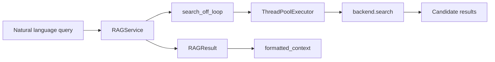
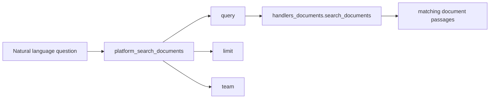
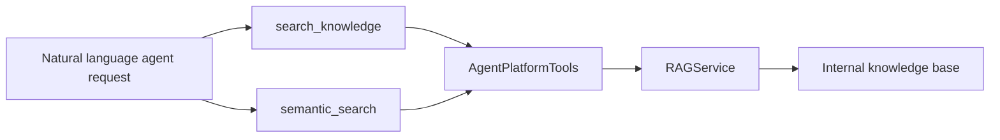
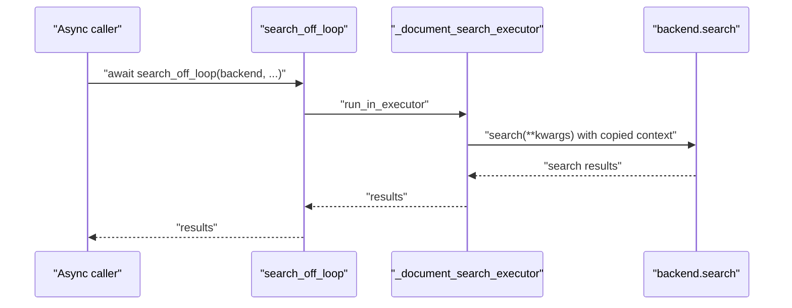

# RAG Retrieval System

Relevant source files

The following files were used as context for generating this wiki page:

- [frontend/components/knowledge/CodeGraphPanel.tsx](frontend/components/knowledge/CodeGraphPanel.tsx)
- [frontend/components/knowledge/CodeGraphVisualization.tsx](frontend/components/knowledge/CodeGraphVisualization.tsx)
- [orchestrator/api/codegraph.py](orchestrator/api/codegraph.py)
- [orchestrator/api/context.py](orchestrator/api/context.py)
- [orchestrator/api/documents.py](orchestrator/api/documents.py)
- [orchestrator/api/github_webhooks.py](orchestrator/api/github_webhooks.py)
- [orchestrator/api/models_endpoints.py](orchestrator/api/models_endpoints.py)
- [orchestrator/core/llm/clients/embedding_bounds.py](orchestrator/core/llm/clients/embedding_bounds.py)
- [orchestrator/core/llm/clients/openai_embedding.py](orchestrator/core/llm/clients/openai_embedding.py)
- [orchestrator/core/llm/embedding_manager.py](orchestrator/core/llm/embedding_manager.py)
- [orchestrator/core/llm/rerank_manager.py](orchestrator/core/llm/rerank_manager.py)
- [orchestrator/modules/agents/services/agent_platform_tools.py](orchestrator/modules/agents/services/agent_platform_tools.py)
- [orchestrator/modules/codegraph/codegraph_service.py](orchestrator/modules/codegraph/codegraph_service.py)
- [orchestrator/modules/codegraph/github_auth.py](orchestrator/modules/codegraph/github_auth.py)
- [orchestrator/modules/memory/__init__.py](orchestrator/modules/memory/__init__.py)
- [orchestrator/modules/rag/__init__.py](orchestrator/modules/rag/__init__.py)
- [orchestrator/modules/rag/config.py](orchestrator/modules/rag/config.py)
- [orchestrator/modules/rag/ingestion/manager.py](orchestrator/modules/rag/ingestion/manager.py)
- [orchestrator/modules/rag/service.py](orchestrator/modules/rag/service.py)
- [orchestrator/modules/search/optimization/context_optimizer.py](orchestrator/modules/search/optimization/context_optimizer.py)
- [orchestrator/modules/search/services/entity_extractor.py](orchestrator/modules/search/services/entity_extractor.py)
- [orchestrator/modules/search/vector_store/backends/s3_vectors_mock.py](orchestrator/modules/search/vector_store/backends/s3_vectors_mock.py)
- [orchestrator/modules/tools/discovery/actions_codegraph.py](orchestrator/modules/tools/discovery/actions_codegraph.py)
- [orchestrator/modules/tools/discovery/handlers_codegraph.py](orchestrator/modules/tools/discovery/handlers_codegraph.py)
- [orchestrator/modules/tools/formatting/result_formatter.py](orchestrator/modules/tools/formatting/result_formatter.py)
- [orchestrator/services/document_downloads.py](orchestrator/services/document_downloads.py)
- [orchestrator/tests/security/test_s5_closures.py](orchestrator/tests/security/test_s5_closures.py)
- [orchestrator/tests/test_auto_model_workspace_save.py](orchestrator/tests/test_auto_model_workspace_save.py)
- [orchestrator/tests/test_entity_extractor_no_vendor_key.py](orchestrator/tests/test_entity_extractor_no_vendor_key.py)
- [orchestrator/tests/test_f105_embedding_calls_are_bounded.py](orchestrator/tests/test_f105_embedding_calls_are_bounded.py)
- [orchestrator/tests/test_f357_an_upload_dedupes_only_in_its_own_workspace.py](orchestrator/tests/test_f357_an_upload_dedupes_only_in_its_own_workspace.py)
- [orchestrator/tests/test_f450_only_the_platform_admin_changes_a_system_setting.py](orchestrator/tests/test_f450_only_the_platform_admin_changes_a_system_setting.py)
- [orchestrator/tests/test_f451_the_platform_default_needs_agents_read.py](orchestrator/tests/test_f451_the_platform_default_needs_agents_read.py)
- [orchestrator/tests/test_f453_a_document_download_is_the_callers_own.py](orchestrator/tests/test_f453_a_document_download_is_the_callers_own.py)
- [orchestrator/tests/test_f453_b_document_content_is_the_callers_own.py](orchestrator/tests/test_f453_b_document_content_is_the_callers_own.py)
- [orchestrator/tests/test_prd154_s8_codegraph.py](orchestrator/tests/test_prd154_s8_codegraph.py)
- [orchestrator/tests/test_prd165_s4_codegraph.py](orchestrator/tests/test_prd165_s4_codegraph.py)
- [orchestrator/tests/test_prd183_s4_codegraph_reindex.py](orchestrator/tests/test_prd183_s4_codegraph_reindex.py)
- [orchestrator/tests/test_prd233_s4_storage_factory.py](orchestrator/tests/test_prd233_s4_storage_factory.py)

## Purpose and Scope

Section 7.4 documents how Automatos AI retrieves knowledge-base material for agent and platform use. The visible implementation identifies `RAGService` as the retrieval service, exposes retrieval configuration for query enhancement, RRF fusion, and reranking, and provides document-search tools with workspace/team scoping. The service also returns a structured `RAGResult` with chunks, formatted context, token count, sources, and optional citation metadata. [orchestrator/modules/rag/service.py:55-67](), [orchestrator/modules/rag/service.py:159-180](), [orchestrator/modules/agents/services/agent_platform_tools.py:90-127]()

This page covers the retrieval service boundary, search execution, configuration, filters exposed by document tools, result shape, and the available evaluation and observability surfaces. The supplied source excerpts do not show the full candidate-search implementation or the implementation details of the referenced filters, fusion, reranking, and optimizer components; those internals are therefore not inferred here. [orchestrator/modules/rag/service.py:1-10](), [orchestrator/modules/rag/service.py:107-135](), [orchestrator/modules/rag/service.py:159-180]()

Sources: [orchestrator/modules/rag/service.py:1-10](), [orchestrator/modules/rag/service.py:55-67](), [orchestrator/modules/rag/service.py:107-135](), [orchestrator/modules/rag/service.py:159-180](), [orchestrator/modules/agents/services/agent_platform_tools.py:90-127]()

---

## Architecture Overview

`RAGService` is the retrieval orchestration boundary. The shown service code defines `RAGResult`, loads RAG-related settings, and provides `search_off_loop()` to run a synchronous document backend’s `search()` on a dedicated thread pool while preserving the caller’s `contextvars`. The thread-pool size comes from `DOCUMENT_SEARCH_THREADS`. [orchestrator/modules/rag/service.py:55-67](), [orchestrator/modules/rag/service.py:107-135]()

The service imports the existing context optimizer and semantic chunker as components rather than introducing duplicate implementations. The provided excerpt establishes this architectural intent, but does not expose the retrieval method’s complete call graph or the detailed behavior of those components. [orchestrator/modules/rag/service.py:1-10]()

**Diagram: Retrieval Service and Code Entities**

Sources: [orchestrator/modules/rag/service.py:55-67](), [orchestrator/modules/rag/service.py:107-135]()

### Natural Language Space to Code Entity Space

The agent-facing document search action turns a natural-language question into a `platform_search_documents` request. Its declaration describes the intent as retrieving passages that answer questions about document contents; the action accepts `query`, `limit`, and optional `team`. The excerpt shows registration and metadata, not the handler’s complete retrieval call path. [orchestrator/modules/agents/services/agent_platform_tools.py:90-109]()

**Diagram: Document Question to Registered Action**

Sources: [orchestrator/modules/agents/services/agent_platform_tools.py:90-109]()

### Natural Language Space to Code Entity Space: Agent Tools

`AgentPlatformTools` constructs a `RAGService` and advertises `search_knowledge` and `semantic_search` as agent tools. Their declarations accept a natural-language `query` and a result `limit`; the module description restricts these platform research tools to internal knowledge bases. [orchestrator/modules/agents/services/agent_platform_tools.py:1-12](), [orchestrator/modules/agents/services/agent_platform_tools.py:50-67](), [orchestrator/modules/agents/services/agent_platform_tools.py:90-127]()

**Diagram: Agent Search Tool Mapping**

Sources: [orchestrator/modules/agents/services/agent_platform_tools.py:1-12](), [orchestrator/modules/agents/services/agent_platform_tools.py:50-67](), [orchestrator/modules/agents/services/agent_platform_tools.py:90-127]()

---

## `RAGService` and Core Components

`RAGResult` is the result data structure shown in the service excerpt. Its fields include retrieved `chunks`, `formatted_context`, `total_tokens`, `sources`, the original `query`, optional `diversity_score` and `information_gain`, and `sources_map` for citation-related source metadata. [orchestrator/modules/rag/service.py:55-67]()

| Component | Role established by the provided source |
|---|---|
| `RAGService` | Retrieval service module; its header states it uses the existing optimizer and chunker components. [orchestrator/modules/rag/service.py:1-10]() |
| `RAGResult` | Carries chunks, formatted context, token and source data, query, and optional scoring/citation fields. [orchestrator/modules/rag/service.py:55-67]() |
| `_load_rag_settings()` | Loads `SystemSetting` key/value pairs in one session and memoizes a successful read. [orchestrator/modules/rag/service.py:69-99]() |
| `search_off_loop()` | Runs `backend.search(**kwargs)` in the dedicated document-search executor, carrying the caller’s context. [orchestrator/modules/rag/service.py:107-135]() |
| `AgentPlatformTools` | Creates a `RAGService` and declares agent-facing knowledge and semantic search tools. [orchestrator/modules/agents/services/agent_platform_tools.py:50-67](), [orchestrator/modules/agents/services/agent_platform_tools.py:90-127]() |
| `platform_search_documents` | Registered read-level action for searching knowledge-base passages, with optional team narrowing. [orchestrator/modules/agents/services/agent_platform_tools.py:90-109]() |

The service imports `fire_retrieval_score` and retrieval status constants from the tracing seam, and imports a documents-seam substrate metric recorder. The excerpt describes the substrate recording as fire-and-forget and non-blocking. [orchestrator/modules/rag/service.py:29-46]()

Sources: [orchestrator/modules/rag/service.py:1-10](), [orchestrator/modules/rag/service.py:29-46](), [orchestrator/modules/rag/service.py:55-67](), [orchestrator/modules/rag/service.py:69-99](), [orchestrator/modules/rag/service.py:107-135](), [orchestrator/modules/agents/services/agent_platform_tools.py:50-67](), [orchestrator/modules/agents/services/agent_platform_tools.py:90-127]()

---

## Configuration Management: `RAGConfig`

`RAGConfig` exposes configuration fields for chunk sizing, token limits, diversity, minimum similarity, query enhancement, RRF fusion, reranking, and the RRF constant. The visible defaults include `enable_rrf_fusion=True` and `rrf_k=60`. Query enhancement and reranking are optional booleans whose comments state that unset values are resolved during `__post_init__`; the excerpt does not include that method, so it does not establish the resolved defaults. [orchestrator/modules/rag/service.py:159-180]()

RAG settings are loaded from `SystemSetting` records in a single database session. Only a successful read is cached; on a load exception the function logs an error and returns an empty mapping, allowing callers to fall back to their defaults. `reset_rag_settings_cache()` clears the memoized settings. [orchestrator/modules/rag/service.py:69-105]()

| Configuration field | Meaning shown by the source |
|---|---|
| `chunk_size`, `min_chunk_size`, `max_chunk_size` | Chunk-size configuration fields. [orchestrator/modules/rag/service.py:159-168]() |
| `max_tokens` | Token-limit configuration field. [orchestrator/modules/rag/service.py:159-168]() |
| `diversity`, `min_similarity` | Diversity and similarity configuration fields. [orchestrator/modules/rag/service.py:159-168]() |
| `enable_query_enhancement` | Optional feature switch; unset is resolved in `__post_init__`. [orchestrator/modules/rag/service.py:169-176]() |
| `enable_rrf_fusion` | RRF-fusion switch, initialized to `True`. [orchestrator/modules/rag/service.py:175-176]() |
| `enable_reranking` | Optional reranking switch; unset is resolved in `__post_init__`. [orchestrator/modules/rag/service.py:177-179]() |
| `rrf_k` | RRF constant, initialized to `60`. [orchestrator/modules/rag/service.py:180-180]()

Sources: [orchestrator/modules/rag/service.py:69-105](), [orchestrator/modules/rag/service.py:159-180]()

---

## Search Execution and Backend Boundary

The service describes document backend searches as synchronous and uses a dedicated `ThreadPoolExecutor` to keep them off the asyncio event loop. `_document_search_executor()` lazily initializes the pool with `config.DOCUMENT_SEARCH_THREADS` workers. `search_off_loop()` creates a partial that runs `backend.search` inside a copied context and submits it through `run_in_executor`. [orchestrator/modules/rag/service.py:107-135]()

This boundary is relevant to latency and isolation: document searches use their own executor rather than the default executor, and each call carries the caller’s context. The excerpt does not show the concrete backend selection or its query implementation. [orchestrator/modules/rag/service.py:107-135]()

**Diagram: Synchronous Backend Search Off the Event Loop**

Sources: [orchestrator/modules/rag/service.py:107-135]()

---

## Hybrid Search, RRF Fusion, and Reranking

The visible `RAGConfig` declares switches for RRF fusion and reranking, plus `rrf_k`. This establishes that the service supports configuration for these retrieval stages; the provided source excerpt does not show dense/sparse candidate generation, the RRF scoring algorithm, or the reranker call site. Accordingly, the settings should not be taken as evidence of a particular sparse-search backend or scoring formula. [orchestrator/modules/rag/service.py:169-180]()

The service header says it reuses existing optimization and semantic chunking components rather than duplicating them. The excerpts do not provide enough implementation to describe how candidates are combined, how ranks are fused, or how reranking affects ordering. [orchestrator/modules/rag/service.py:1-10]()

Sources: [orchestrator/modules/rag/service.py:1-10](), [orchestrator/modules/rag/service.py:169-180]()

---

## Retrieval Filters and Workspace/Team Scope

`search_knowledge` is an agent tool for searching the Automatos knowledge base. Its declaration includes an optional `scope` parameter, which can be `past_work` to narrow the search to past work. [orchestrator/modules/agents/services/agent_platform_tools.py:80-80](), [orchestrator/modules/agents/services/agent_platform_tools.py:90-109]()

At the API boundary, document upload requires `documents:create` permission and obtains a hybrid request context. Its `get_document_manager(workspace_id)` factory passes the workspace ID into `DocumentManager`, along with vector-storage configuration. [orchestrator/api/documents.py:109-118](), [orchestrator/api/documents.py:144-153]()

Sources: [orchestrator/modules/agents/services/agent_platform_tools.py:80-80](), [orchestrator/modules/agents/services/agent_platform_tools.py:90-109](), [orchestrator/api/documents.py:109-118](), [orchestrator/api/documents.py:144-153]()

---

## Result Formatting and Context Optimization

`RAGResult` provides the service-level structure for retrieved content and source attribution, including `formatted_context`, token count, source names, and `sources_map`. The service imports the platform token counter as `_count_tokens`, but the shown excerpt does not include its use in a retrieval method. [orchestrator/modules/rag/service.py:23-26](), [orchestrator/modules/rag/service.py:55-67]()

The service module’s header states that it uses the existing `ContextOptimizer` for knapsack, MMR, and entropy optimization. The supplied source excerpt does not show the optimizer invocation or its exact selection behavior. [orchestrator/modules/rag/service.py:1-10]()

`ToolResultFormatter` supports document-result formatting. Its shown helper methods clean hash-prefixed filenames, truncate excerpts at sentence or paragraph boundaries, retrieve text files from S3, and fetch full document content from S3 when possible, falling back to reassembling content from `document_chunks`. [orchestrator/modules/tools/formatting/result_formatter.py:21-68](), [orchestrator/modules/tools/formatting/result_formatter.py:70-95](), [orchestrator/modules/tools/formatting/result_formatter.py:112-168]()

Sources: [orchestrator/modules/rag/service.py:1-10](), [orchestrator/modules/rag/service.py:23-26](), [orchestrator/modules/rag/service.py:55-67](), [orchestrator/modules/tools/formatting/result_formatter.py:21-68](), [orchestrator/modules/tools/formatting/result_formatter.py:70-95](), [orchestrator/modules/tools/formatting/result_formatter.py:112-168]()

---

## Retrieval Evaluation and Observability

The service imports `fire_retrieval_score` and status constants for hit, empty, and error retrieval outcomes. It also imports a documents-seam substrate metric recorder described as fire-and-forget and non-blocking. The provided excerpt does not show where these functions are called or how a retrieval score is calculated. [orchestrator/modules/rag/service.py:29-46]()

`GET /api/context/stats` obtains the `RAGService` and calls `get_retrieval_stats()` with a workspace ID, except when the request context represents an all-workspaces administrator. The response includes query count, retrieval success rate, average response time, vector embedding count, system status, and last query time. [orchestrator/api/context.py:88-108]()

The supplied files do not show a retrieval recall-evaluation dataset, benchmark runner, or test asserting recall metrics. The stats endpoint reports operational retrieval metrics; it should not be treated as a recall evaluation by itself. [orchestrator/api/context.py:88-108]()

Sources: [orchestrator/modules/rag/service.py:29-46](), [orchestrator/api/context.py:88-108]()

---

## API and Agent Integration

The `/api/documents` router is mounted with document-management routes. The shown `POST /upload` route requires `documents:create` permission and obtains a hybrid request context. Its `get_document_manager(workspace_id)` factory passes the workspace ID into `DocumentManager`, along with vector-storage configuration. [orchestrator/api/documents.py:30-30](), [orchestrator/api/documents.py:109-118](), [orchestrator/api/documents.py:144-172]()

`AgentPlatformTools` exposes `search_knowledge` and `semantic_search` to agents. These are distinct interfaces in the shown source; the excerpts do not establish that they call identical retrieval paths. [orchestrator/modules/agents/services/agent_platform_tools.py:90-127]()

| Interface | Purpose shown in source |
|---|---|
| `POST /api/documents/upload` | Accept and process a document upload. [orchestrator/api/documents.py:144-172]() |
| `search_knowledge` | Agent tool for searching platform documentation and knowledge-base information. [orchestrator/modules/agents/services/agent_platform_tools.py:90-109]() |
| `semantic_search` | Agent tool for finding semantically similar content across platform documents. [orchestrator/modules/agents/services/agent_platform_tools.py:110-127]() |
| `GET /api/context/stats` | Return retrieval and context statistics for the request workspace or an administrator-wide scope. [orchestrator/api/context.py:88-108]()

Sources: [orchestrator/api/documents.py:30-30](), [orchestrator/api/documents.py:109-118](), [orchestrator/api/documents.py:144-172](), [orchestrator/modules/agents/services/agent_platform_tools.py:90-127](), [orchestrator/api/context.py:88-108]()

---