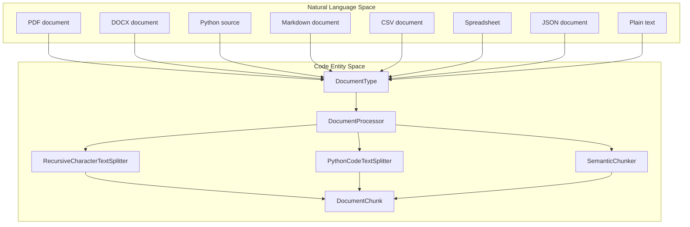
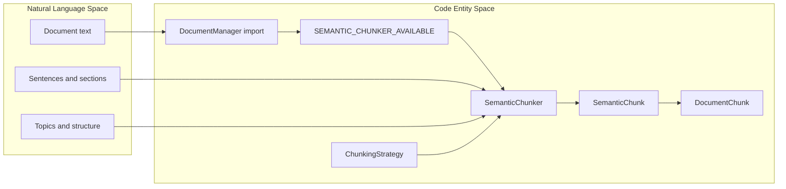

# Semantic Chunking Strategies

Relevant source files

The following files were used as context for generating this wiki page:

- [orchestrator/api/context.py](orchestrator/api/context.py)
- [orchestrator/api/documents.py](orchestrator/api/documents.py)
- [orchestrator/api/github_webhooks.py](orchestrator/api/github_webhooks.py)
- [orchestrator/api/models_endpoints.py](orchestrator/api/models_endpoints.py)
- [orchestrator/modules/rag/__init__.py](orchestrator/modules/rag/__init__.py)
- [orchestrator/modules/rag/ingestion/manager.py](orchestrator/modules/rag/ingestion/manager.py)
- [orchestrator/modules/rag/service.py](orchestrator/modules/rag/service.py)
- [orchestrator/modules/search/services/entity_extractor.py](orchestrator/modules/search/services/entity_extractor.py)
- [orchestrator/services/document_downloads.py](orchestrator/services/document_downloads.py)
- [orchestrator/tests/security/test_s5_closures.py](orchestrator/tests/security/test_s5_closures.py)
- [orchestrator/tests/test_auto_model_workspace_save.py](orchestrator/tests/test_auto_model_workspace_save.py)
- [orchestrator/tests/test_entity_extractor_no_vendor_key.py](orchestrator/tests/test_entity_extractor_no_vendor_key.py)
- [orchestrator/tests/test_f357_an_upload_dedupes_only_in_its_own_workspace.py](orchestrator/tests/test_f357_an_upload_dedupes_only_in_its_own_workspace.py)
- [orchestrator/tests/test_f450_only_the_platform_admin_changes_a_system_setting.py](orchestrator/tests/test_f450_only_the_platform_admin_changes_a_system_setting.py)
- [orchestrator/tests/test_f451_the_platform_default_needs_agents_read.py](orchestrator/tests/test_f451_the_platform_default_needs_agents_read.py)
- [orchestrator/tests/test_f453_a_document_download_is_the_callers_own.py](orchestrator/tests/test_f453_a_document_download_is_the_callers_own.py)
- [orchestrator/tests/test_f453_b_document_content_is_the_callers_own.py](orchestrator/tests/test_f453_b_document_content_is_the_callers_own.py)
- [orchestrator/tests/test_prd233_s4_storage_factory.py](orchestrator/tests/test_prd233_s4_storage_factory.py)

## Purpose and Scope

This page describes how document text is divided into chunks for knowledge-base ingestion, including configured chunk sizes and overlap, the semantic strategy names used by `SemanticChunker`, and the parent and header fields available for context expansion. `DocumentProcessor` has default character-based splitters, while `RAGConfig` exposes chunk-size settings; the semantic strategies are implemented in `SemanticChunker` [orchestrator/modules/rag/ingestion/manager.py:40-44](), [orchestrator/modules/rag/service.py:162-168](), [orchestrator/modules/rag/chunking/semantic_chunker.py:22-70]().

This page focuses on chunking behavior and its data flow. It does not document the broader retrieval and ranking pipeline.

Sources:
- [orchestrator/modules/rag/ingestion/manager.py:40-44]()
- [orchestrator/modules/rag/service.py:162-168]()
- [orchestrator/modules/rag/chunking/semantic_chunker.py:22-70]()

---

## Chunking Architecture Overview

`DocumentManager` ingestion uses document-type handling and chunking components, including `RecursiveCharacterTextSplitter`, `PythonCodeTextSplitter`, and—when importable—`SemanticChunker`. The default character splitters use a chunk size of 1,000 characters and overlap of 200 characters; they are configured with `length_function=len` [orchestrator/modules/rag/ingestion/manager.py:159-166](). The API’s upload-type mapping distinguishes formats including PDF, Markdown, JSON, DOCX, CSV, and spreadsheets [orchestrator/api/documents.py:89-96]().

### Document Ingestion and Chunking Data Flow (Natural Language to Code Entity Space)

Sources:
- [orchestrator/api/documents.py:89-96]()
- [orchestrator/modules/rag/ingestion/manager.py:159-166]()
- [orchestrator/modules/rag/ingestion/manager.py:98-107]()
- [orchestrator/modules/rag/ingestion/manager.py:154-166]()

---

## Chunk Size and Overlap

The default `DocumentProcessor` configuration sets both the recursive text splitter and the Python code splitter to `chunk_size=1000` and `chunk_overlap=200` [orchestrator/modules/rag/ingestion/manager.py:159-166](). For the recursive splitter, the length function is `len`, so these values are character-based in that configuration [orchestrator/modules/rag/ingestion/manager.py:159-162]().

Separately, the RAG configuration model defines `chunk_size`, `min_chunk_size`, and `max_chunk_size` fields [orchestrator/modules/rag/service.py:162-168](). The context API’s `RAGConfigCreate` request model defaults to `chunk_size=1000` and `chunk_overlap=200`; the update model makes both fields optional [orchestrator/api/context.py:29-45](). These settings are distinct configuration surfaces: the shown `DocumentProcessor` constructor establishes its own splitter defaults, while the API models describe configurable RAG settings.

| Setting | Shown default or behavior | Code location |
|---|---|---|
| Recursive text splitter size | 1,000 | [orchestrator/modules/rag/ingestion/manager.py:159-162]() |
| Recursive text splitter overlap | 200 | [orchestrator/modules/rag/ingestion/manager.py:159-162]() |
| Python code splitter size | 1,000 | [orchestrator/modules/rag/ingestion/manager.py:163-166]() |
| Python code splitter overlap | 200 | [orchestrator/modules/rag/ingestion/manager.py:163-166]() |
| RAG configuration size fields | `chunk_size`, `min_chunk_size`, `max_chunk_size` | [orchestrator/modules/rag/service.py:162-168]() |
| Context API create defaults | `chunk_size=1000`, `chunk_overlap=200` | [orchestrator/api/context.py:29-34]() |

Sources:
- [orchestrator/modules/rag/ingestion/manager.py:159-166]()
- [orchestrator/modules/rag/service.py:162-168]()
- [orchestrator/api/context.py:29-45]()

---

## Semantic Chunking Strategies Implementation

`DocumentManager` attempts to import `SemanticChunker` and `ChunkingStrategy` from `modules.rag.chunking.semantic_chunker`; it sets `SEMANTIC_CHUNKER_AVAILABLE` according to whether that import succeeds [orchestrator/modules/rag/ingestion/manager.py:40-44](). The chunking module defines the strategy names and implementation [orchestrator/modules/rag/chunking/semantic_chunker.py:22-70]().

The strategies below describe the named approaches exposed by that module. Their exact thresholds and algorithm details belong to `semantic_chunker.py`; they are not inferred from the splitter defaults or the API configuration fields.

### Semantic Strategy Selection and Data Flow (Natural Language to Code Entity Space)

Sources:
- [orchestrator/modules/rag/ingestion/manager.py:40-44]()
- [orchestrator/modules/rag/chunking/semantic_chunker.py:22-70]()
- [orchestrator/modules/rag/ingestion/manager.py:138-152]()

### 1. Semantic Similarity (`SEMANTIC_SIMILARITY`)

The semantic-similarity strategy uses similarity between adjacent sentences to determine chunk boundaries. Its implementation and strategy parameters are defined in `SemanticChunker` [orchestrator/modules/rag/chunking/semantic_chunker.py:55-70](), [orchestrator/modules/rag/chunking/semantic_chunker.py:107-133]().

Sources:
- [orchestrator/modules/rag/chunking/semantic_chunker.py:55-70]()
- [orchestrator/modules/rag/chunking/semantic_chunker.py:107-133]()

### 2. Information Density (`INFORMATION_DENSITY`)

The information-density strategy is a named `SemanticChunker` strategy. Its implementation uses information-density calculations to inform segmentation [orchestrator/modules/rag/chunking/semantic_chunker.py:22-29](), [orchestrator/modules/rag/chunking/semantic_chunker.py:130-152]().

Sources:
- [orchestrator/modules/rag/chunking/semantic_chunker.py:22-29]()
- [orchestrator/modules/rag/chunking/semantic_chunker.py:130-152]()

### 3. Topic Coherence (`TOPIC_COHERENCE`)

The topic-coherence strategy groups text according to topical continuity. The strategy implementation and keyword extraction helper are located in `semantic_chunker.py` [orchestrator/modules/rag/chunking/semantic_chunker.py:153-173]().

Sources:
- [orchestrator/modules/rag/chunking/semantic_chunker.py:153-173]()

### 4. Hierarchical Strategy (`HIERARCHICAL`)

The hierarchical strategy is one of the named chunking strategies [orchestrator/modules/rag/chunking/semantic_chunker.py:22-29](). Independently of that strategy, the ingestion model’s `DocumentChunk` includes `parent_content` and `headers` fields, which can carry parent-section content and heading hierarchy [orchestrator/modules/rag/ingestion/manager.py:138-152]().

Sources:
- [orchestrator/modules/rag/chunking/semantic_chunker.py:22-29]()
- [orchestrator/modules/rag/ingestion/manager.py:138-152]()

### 5. Adaptive Strategy (`ADAPTIVE`)

The adaptive strategy is another named `SemanticChunker` strategy [orchestrator/modules/rag/chunking/semantic_chunker.py:22-29](). The strategy’s algorithm is defined in the semantic chunker module [orchestrator/modules/rag/chunking/semantic_chunker.py:174-210]().

Sources:
- [orchestrator/modules/rag/chunking/semantic_chunker.py:22-29]()
- [orchestrator/modules/rag/chunking/semantic_chunker.py:174-210]()

---

## Coverage, Re-Ingestion & F086/F087 Safeguards

The upload API exposes document coverage information from `doc_metadata.kept_pct`. If that value is an integer, `_coverage_fields` returns both the percentage and a `partial` flag determined by the configured `RAG_KEPT_WARN_PCT` threshold [orchestrator/api/documents.py:99-108]().

Sources:
- [orchestrator/api/documents.py:99-108]()

---

## Parent-Child Expansion & Metadata

`DocumentChunk` carries `document_id`, `chunk_index`, `content`, optional `embedding`, metadata, `parent_content`, and `headers`. Its `to_dict()` method includes the chunk content, metadata, parent content, and headers [orchestrator/modules/rag/ingestion/manager.py:138-152]().

| Field | Role |
|---|---|
| `document_id` | Identifies the source document for the chunk [orchestrator/modules/rag/ingestion/manager.py:138-139](). |
| `chunk_index` | Stores the chunk’s index within the document [orchestrator/modules/rag/ingestion/manager.py:138-139](). |
| `content` | Holds the chunk text [orchestrator/modules/rag/ingestion/manager.py:138-139](). |
| `embedding` | Optional vector associated with the chunk [orchestrator/modules/rag/ingestion/manager.py:138-140](). |
| `metadata` | Optional chunk metadata; serialized as an empty mapping when absent [orchestrator/modules/rag/ingestion/manager.py:140-152](). |
| `parent_content` | Optional parent-section content for context expansion [orchestrator/modules/rag/ingestion/manager.py:141-152](). |
| `headers` | Optional heading hierarchy, described in the model as `h1`, `h2`, and `h3` [orchestrator/modules/rag/ingestion/manager.py:142-152](). |

The model provides fields for parent content and header hierarchy; the shown definitions do not establish when retrieval expands a child chunk with its parent. That retrieval-time behavior should be documented with the retrieval implementation rather than inferred from the data model alone.

Sources:
- [orchestrator/modules/rag/ingestion/manager.py:138-152]()

---