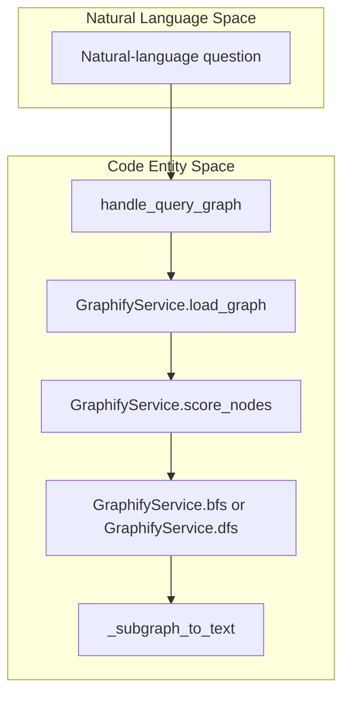
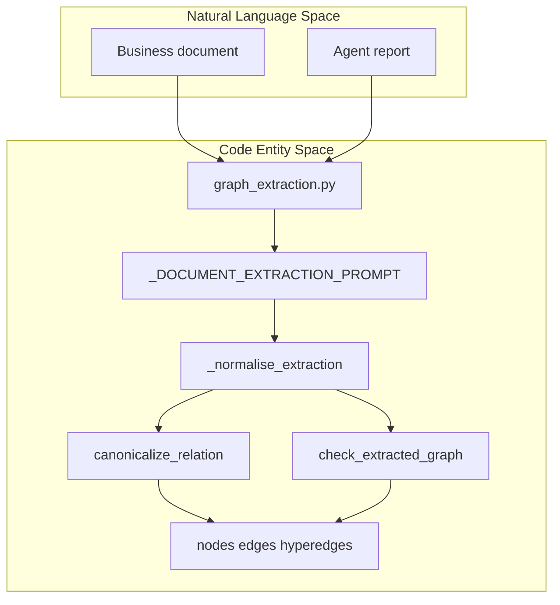

# Knowledge Graphs & Structured Data

Relevant source files

The following files were used as context for generating this wiki page:

- [orchestrator/api/shopify.py](orchestrator/api/shopify.py)
- [orchestrator/modules/knowledge/graph_edge_rules.py](orchestrator/modules/knowledge/graph_edge_rules.py)
- [orchestrator/modules/knowledge/graph_extraction.py](orchestrator/modules/knowledge/graph_extraction.py)
- [orchestrator/modules/knowledge/graph_relations.py](orchestrator/modules/knowledge/graph_relations.py)
- [orchestrator/modules/knowledge/graph_service.py](orchestrator/modules/knowledge/graph_service.py)
- [orchestrator/modules/tools/discovery/handlers_graph.py](orchestrator/modules/tools/discovery/handlers_graph.py)
- [orchestrator/tests/helpers_graph_extraction.py](orchestrator/tests/helpers_graph_extraction.py)
- [orchestrator/tests/test_api_key_domain_check.py](orchestrator/tests/test_api_key_domain_check.py)
- [orchestrator/tests/test_f206_a_graph_extraction_fits_its_cap.py](orchestrator/tests/test_f206_a_graph_extraction_fits_its_cap.py)
- [orchestrator/tests/test_f312_a_a_person_is_never_produced.py](orchestrator/tests/test_f312_a_a_person_is_never_produced.py)
- [orchestrator/tests/test_f312_b_a_claim_of_effect_needs_the_documents_words.py](orchestrator/tests/test_f312_b_a_claim_of_effect_needs_the_documents_words.py)
- [orchestrator/tests/test_f312_c_blend_components_are_part_of_the_blend.py](orchestrator/tests/test_f312_c_blend_components_are_part_of_the_blend.py)
- [orchestrator/tests/test_f312_d_a_supplier_edge_points_from_the_supplier.py](orchestrator/tests/test_f312_d_a_supplier_edge_points_from_the_supplier.py)
- [orchestrator/tests/test_f312_f_a_nodes_role_decides_what_its_edges_may_say.py](orchestrator/tests/test_f312_f_a_nodes_role_decides_what_its_edges_may_say.py)
- [orchestrator/tests/test_graph_relation_vocab.py](orchestrator/tests/test_graph_relation_vocab.py)
- [orchestrator/tests/test_issue_1073_graph_event_loop.py](orchestrator/tests/test_issue_1073_graph_event_loop.py)
- [orchestrator/tests/test_prd183_s1_catalog_webhook.py](orchestrator/tests/test_prd183_s1_catalog_webhook.py)
- [orchestrator/tests/test_prd183_s5_vertical_provision.py](orchestrator/tests/test_prd183_s5_vertical_provision.py)
- [orchestrator/tests/test_prd189_s3_webhook_debounce.py](orchestrator/tests/test_prd189_s3_webhook_debounce.py)

## Purpose and Scope

This page gives a high-level view of Automatos AI’s graph and structured-data subsystems: the business knowledge graph, code graph, NL2SQL database knowledge, and e-commerce catalog synchronization. It connects these areas to the code entities visible in the supplied sources; see the child pages for subsystem details. [orchestrator/modules/knowledge/graph_service.py:1-24]()

Sources: `orchestrator/modules/knowledge/graph_service.py`

## High-Level Architecture

The business graph path combines structured extraction, graph construction and workspace-scoped querying. `graph_extraction.py` describes LLM extraction for documents and reports alongside deterministic mappings; `GraphifyService` centralizes graph build, cache and export; graph handlers load and traverse a workspace graph for natural-language questions. [orchestrator/modules/knowledge/graph_extraction.py:1-21](), [orchestrator/modules/knowledge/graph_service.py:1-24](), [orchestrator/modules/tools/discovery/handlers_graph.py:126-185]()

The code graph and NL2SQL are separate topics in this section, but the supplied files do not show their implementations. See their child pages for those details. [orchestrator/modules/knowledge/graph_service.py:1-24]()

**Diagram: Natural-language graph query to graph-service entities**

The query handler loads the workspace graph, scores nodes against question terms, traverses from a selected node using BFS or DFS, and produces a text summary. [orchestrator/modules/tools/discovery/handlers_graph.py:126-185](), [orchestrator/modules/knowledge/graph_service.py:47-53]()

Sources: `orchestrator/modules/tools/discovery/handlers_graph.py`, `orchestrator/modules/knowledge/graph_service.py`

**Diagram: Natural-language business knowledge to extraction entities**

The extraction module documents LLM-based extraction of graph structures from documents and reports, with relation handling and edge-rule checks. [orchestrator/modules/knowledge/graph_extraction.py:1-21](), [orchestrator/modules/knowledge/graph_extraction.py:103-125]()

Sources: `orchestrator/modules/knowledge/graph_extraction.py`

## 25.1 Business Knowledge Graph (Graphify)

`GraphifyService` is the central point for graph build, cache and export. Its documented pipeline collects sources, extracts and merges data, builds and clusters the graph, then exports graph artifacts and reports. Document and report extraction returns nodes, edges and hyperedges; the extraction path also uses controlled relation vocabulary and edge rules. [orchestrator/modules/knowledge/graph_service.py:1-24](), [orchestrator/modules/knowledge/graph_extraction.py:1-21](), [orchestrator/modules/knowledge/graph_relations.py:1-27](), [orchestrator/modules/knowledge/graph_edge_rules.py:1-30]()

Graph queries are workspace-scoped, and the graph handler applies team visibility filtering before scoring and traversal. [orchestrator/modules/tools/discovery/handlers_graph.py:53-75](), [orchestrator/modules/tools/discovery/handlers_graph.py:149-164]()

For details, see [Business Knowledge Graph (Graphify)](#25.1).

Sources: `orchestrator/modules/knowledge/graph_service.py`, `orchestrator/modules/knowledge/graph_extraction.py`, `orchestrator/modules/knowledge/graph_relations.py`, `orchestrator/modules/knowledge/graph_edge_rules.py`, `orchestrator/modules/tools/discovery/handlers_graph.py`

## 25.2 Code Graph

The Code Graph is a distinct subsystem in this wiki’s scope. The supplied code excerpts do not include its indexing service, API, or frontend implementation, so this parent page does not describe those internals.

For details, see [Code Graph](#25.2).

Sources: `orchestrator/modules/knowledge/graph_service.py`

## 25.3 NL2SQL & Database Knowledge

NL2SQL and database knowledge are a separate structured-data area in this wiki’s scope. The supplied excerpts do not include the database-knowledge API or NL2SQL query pipeline, so their behavior is documented on the child page rather than inferred here.

For details, see [NL2SQL & Database Knowledge](#25.3).

Sources: `orchestrator/modules/knowledge/graph_service.py`

## 25.4 Graph Queries for Agents

`handlers_graph.py` defines platform graph handlers, including `handle_query_graph`. The query handler accepts a natural-language question, loads the workspace graph, applies team filtering, scores candidate nodes, and traverses the graph with BFS by default or DFS when requested. [orchestrator/modules/tools/discovery/handlers_graph.py:1-5](), [orchestrator/modules/tools/discovery/handlers_graph.py:126-185]()

For details, see [Graph Queries for Agents](#25.4).

Sources: `orchestrator/modules/tools/discovery/handlers_graph.py`

## E-Commerce Catalog Synchronization

The Shopify integration exposes provisioning, connection, event-forwarding and sync routes. Its event payload includes a shop, event name and optional data. [orchestrator/api/shopify.py:1-12](), [orchestrator/api/shopify.py:131-145]()

Catalog webhook tests describe the catalog-specific path: a catalog event resolves the workspace and triggers a catalog re-sync through `map_shopify_catalog` and `import_graph`; non-catalog events do not trigger that sync. The tests also document debouncing of catalog re-sync dispatch per workspace. [orchestrator/tests/test_prd183_s1_catalog_webhook.py:12-22](), [orchestrator/tests/test_prd183_s1_catalog_webhook.py:125-173]()

Shopify sync routes resolve the target workspace from authenticated request context, rejecting a mismatched requested workspace for callers without cross-workspace admin access. [orchestrator/api/shopify.py:63-84]()

Sources: `orchestrator/api/shopify.py`, `orchestrator/tests/test_prd183_s1_catalog_webhook.py`

---