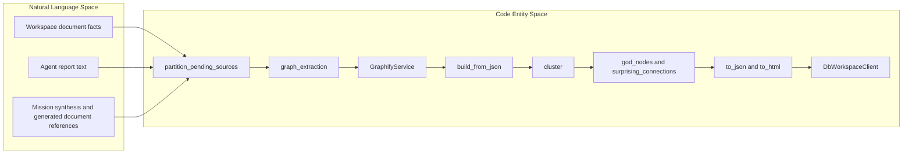
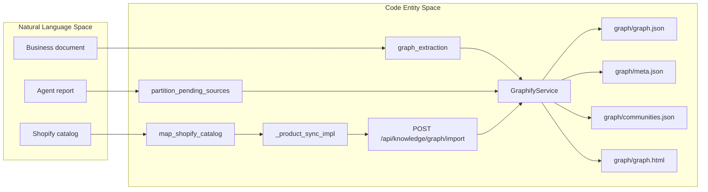
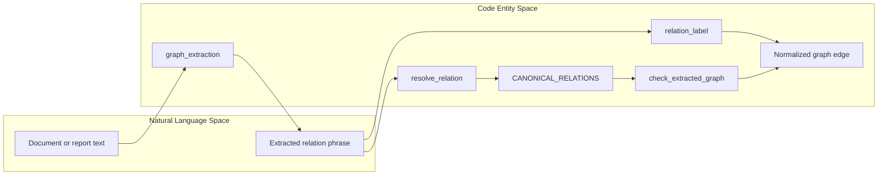
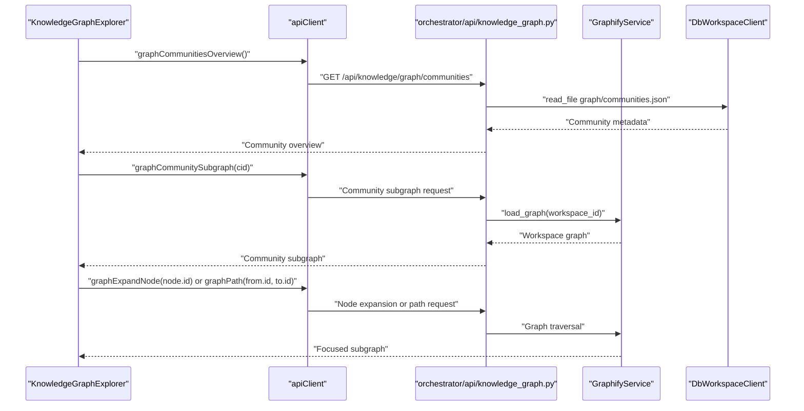
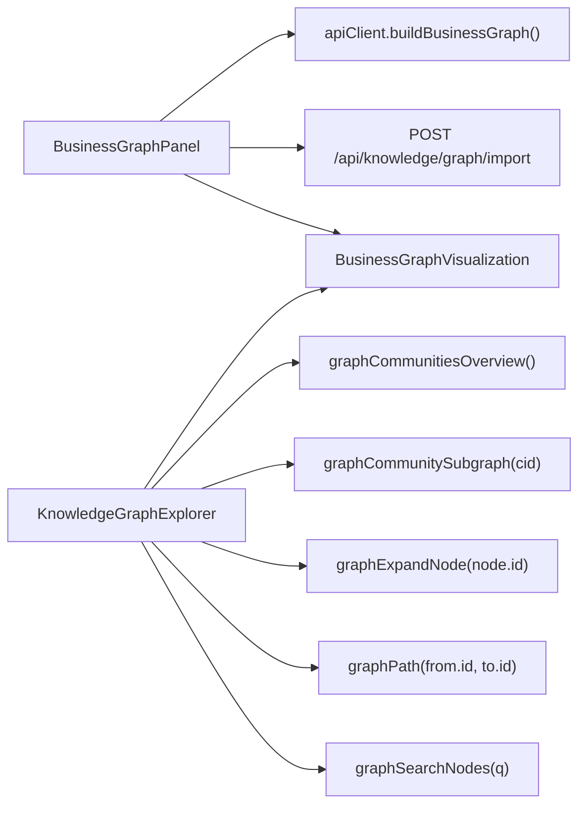

# Business Knowledge Graph (Graphify)

Relevant source files

The following files were used as context for generating this wiki page:

- [.gitattributes](.gitattributes)
- [frontend/components/knowledge/BusinessGraphPanel.tsx](frontend/components/knowledge/BusinessGraphPanel.tsx)
- [frontend/components/knowledge/BusinessGraphVisualization.tsx](frontend/components/knowledge/BusinessGraphVisualization.tsx)
- [frontend/components/knowledge/KnowledgeGraphExplorer.tsx](frontend/components/knowledge/KnowledgeGraphExplorer.tsx)
- [frontend/lib/__tests__/lucide-imports.test.ts](frontend/lib/__tests__/lucide-imports.test.ts)
- [orchestrator/api/knowledge_graph.py](orchestrator/api/knowledge_graph.py)
- [orchestrator/api/shopify.py](orchestrator/api/shopify.py)
- [orchestrator/modules/knowledge/graph_edge_rules.py](orchestrator/modules/knowledge/graph_edge_rules.py)
- [orchestrator/modules/knowledge/graph_extraction.py](orchestrator/modules/knowledge/graph_extraction.py)
- [orchestrator/modules/knowledge/graph_relations.py](orchestrator/modules/knowledge/graph_relations.py)
- [orchestrator/modules/knowledge/graph_service.py](orchestrator/modules/knowledge/graph_service.py)
- [orchestrator/modules/tools/discovery/handlers_graph.py](orchestrator/modules/tools/discovery/handlers_graph.py)
- [orchestrator/tests/helpers_graph_extraction.py](orchestrator/tests/helpers_graph_extraction.py)
- [orchestrator/tests/test_api_key_domain_check.py](orchestrator/tests/test_api_key_domain_check.py)
- [orchestrator/tests/test_f206_a_graph_extraction_fits_its_cap.py](orchestrator/tests/test_f206_a_graph_extraction_fits_its_cap.py)
- [orchestrator/tests/test_f312_a_a_person_is_never_produced.py](orchestrator/tests/test_f312_a_a_person_is_never_produced.py)
- [orchestrator/tests/test_f312_b_a_claim_of_effect_needs_the_documents_words.py](orchestrator/tests/test_f312_b_a_claim_of_effect_needs_the_documents_words.py)
- [orchestrator/tests/test_f312_c_blend_components_are_part_of_the_blend.py](orchestrator/tests/test_f312_c_blend_components_are_part_of_the_blend.py)
- [orchestrator/tests/test_f312_d_a_supplier_edge_points_from_the_supplier.py](orchestrator/tests/test_f312_d_a_supplier_edge_points_from_the_supplier.py)
- [orchestrator/tests/test_f312_f_a_nodes_role_decides_what_its_edges_may_say.py](orchestrator/tests/test_f312_f_a_nodes_role_decides_what_its_edges_may_say.py)
- [orchestrator/tests/test_graph_relation_vocab.py](orchestrator/tests/test_graph_relation_vocab.py)
- [orchestrator/tests/test_issue_1073_graph_event_loop.py](orchestrator/tests/test_issue_1073_graph_event_loop.py)
- [orchestrator/tests/test_prd183_s1_catalog_webhook.py](orchestrator/tests/test_prd183_s1_catalog_webhook.py)
- [orchestrator/tests/test_prd183_s5_vertical_provision.py](orchestrator/tests/test_prd183_s5_vertical_provision.py)
- [orchestrator/tests/test_prd189_s3_webhook_debounce.py](orchestrator/tests/test_prd189_s3_webhook_debounce.py)
- [orchestrator/tests/test_repo_line_endings.py](orchestrator/tests/test_repo_line_endings.py)
- [services/cli-host/automatos_cli_host/__main__.py](services/cli-host/automatos_cli_host/__main__.py)
- [services/cli-host/automatos_cli_host/sandbox.py](services/cli-host/automatos_cli_host/sandbox.py)
- [services/cli-host/tests/test_platform_guard.py](services/cli-host/tests/test_platform_guard.py)
- [services/cli-host/tests/test_session_on_windows.py](services/cli-host/tests/test_session_on_windows.py)

## Purpose and Scope

This page describes the workspace business knowledge graph: how `GraphifyService` builds and caches graphs, how extraction represents business facts, how graph exports and community reports are organized, how clients drill into graph clusters, and how the `BusinessGraphPanel` presents the graph. It also covers the Shopify catalog-sync path where it is supported by the provided code. [orchestrator/modules/knowledge/graph_service.py:1-22](), [orchestrator/modules/knowledge/graph_extraction.py:1-10](), [orchestrator/api/knowledge_graph.py:1-10](), [frontend/components/knowledge/BusinessGraphPanel.tsx:66-88](), [orchestrator/tests/test_prd183_s1_catalog_webhook.py:12-16]()

Sources: [orchestrator/modules/knowledge/graph_service.py:1-22](), [orchestrator/modules/knowledge/graph_extraction.py:1-10](), [orchestrator/api/knowledge_graph.py:1-10](), [frontend/components/knowledge/BusinessGraphPanel.tsx:66-88](), [orchestrator/tests/test_prd183_s1_catalog_webhook.py:12-16]()

---

## 1. GraphifyService Architecture & Lifecycle

`GraphifyService` is the centralized integration point for graphify operations. Its module describes the lifecycle as source collection, extraction and merge, graph construction, clustering and analysis, export and cache, snapshot and diff, report generation, and history pruning. The module imports graphify’s construction, clustering, export, and traversal helpers, along with workspace storage and graph-specific relation, provenance, and clustering utilities. [orchestrator/modules/knowledge/graph_service.py:1-22](), [orchestrator/modules/knowledge/graph_service.py:37-62]()

### 1.1 Build, cache, export, and incremental updates

The service defines workspace graph artefact paths under `graph/`: `graph.json`, `meta.json`, `communities.json`, and `graph.html`. It also names a latest diff, dated graph snapshots, and dated build reports. The cache has a maximum size of 20 entries, and incremental work is debounced for 60 seconds. [orchestrator/modules/knowledge/graph_service.py:66-88]()

Pending sources are partitioned by `partition_pending_sources()`. A `document` pending contributes its `id`; `mission_synthesis` and `generated_document` pendings contribute their `document_id`, falling back to `id`; and a `report` pending contributes text for report extraction. Reports without non-empty text are skipped. Other pending types are left to their own rebuild paths. [orchestrator/modules/knowledge/graph_service.py:90-143]()

The graph-service module describes the exported `graph.json` as NetworkX `node_link_data`, and the API accepts that format for graph import. An import can either replace the workspace graph or merge incoming nodes and edges into the existing graph; clustering, analysis, and derived exports are rerun as part of import. [orchestrator/modules/knowledge/graph_service.py:13-20](), [orchestrator/api/knowledge_graph.py:32-46]()

The service’s pipeline description includes snapshots and diffs, report generation, and history pruning. The available module excerpt names the dated snapshot and report paths but does not show the implementations or the exact report-generation algorithm. [orchestrator/modules/knowledge/graph_service.py:8-20]()

### 1.2 Provenance and source scope

Graph extraction’s node and edge constructors include `source_file`; the node constructor also accepts `source_location`, and the edge constructor includes both `source_file` and `source_location`. This metadata supports tracing extracted facts back to their originating material. The graph service imports provenance helpers named `stamp_source_document` and `prune_document_facts`; their implementations are not included in the provided file excerpts. [orchestrator/modules/knowledge/graph_extraction.py:51-100](), [orchestrator/modules/knowledge/graph_service.py:55-60]()

The service also defines team-visibility helpers. `node_is_visible()` makes a node visible when the requesting agent has no team restriction, when the node has no `team_access` restriction, or when the agent’s team is listed; `team_filtered_view()` provides the graph-level filtering entry point. [orchestrator/modules/knowledge/graph_service.py:146-175]()

**Diagram: Graph build and export path**

Sources: [orchestrator/modules/knowledge/graph_service.py:8-20](), [orchestrator/modules/knowledge/graph_service.py:37-62](), [orchestrator/modules/knowledge/graph_service.py:90-143](), [orchestrator/modules/knowledge/graph_extraction.py:1-10]()

**Diagram: Business facts mapped to graph entities and persisted artefacts**

Sources: [orchestrator/modules/knowledge/graph_extraction.py:1-10](), [orchestrator/modules/knowledge/graph_service.py:13-20](), [orchestrator/modules/knowledge/graph_service.py:90-143](), [orchestrator/api/knowledge_graph.py:32-46](), [orchestrator/tests/test_prd183_s1_catalog_webhook.py:12-16]()

### 1.3 Shopify catalog graph updates

The Shopify catalog graph is produced from catalog data—products, variants, collections, and vendors—by `map_shopify_catalog` and imported through `import_graph` from `_product_sync_impl`. It is not produced by re-extracting documents. [orchestrator/tests/test_prd183_s1_catalog_webhook.py:12-16]()

The regression test documents the event-flow distinction: catalog-shaped Shopify webhook events dispatch a catalog resync for the workspace resolved from the shop domain, while non-catalog events do not trigger that resync. The same test explains that the earlier generic incremental pending path did not recognize Shopify-shaped pending data. [orchestrator/tests/test_prd183_s1_catalog_webhook.py:3-16](), [orchestrator/tests/test_prd183_s1_catalog_webhook.py:125-173]()

Shopify sync routes use `_resolve_sync_workspace()` to constrain the target workspace: cross-workspace admins may select an explicit workspace, while other callers are pinned to their authenticated workspace and receive a 403 for a mismatch. [orchestrator/api/shopify.py:63-84]()

Sources: [orchestrator/tests/test_prd183_s1_catalog_webhook.py:3-16](), [orchestrator/tests/test_prd183_s1_catalog_webhook.py:125-173](), [orchestrator/api/shopify.py:63-84]()

---

## 2. LLM Graph Extraction & Canonical Relations

`graph_extraction.py` provides structured graph extraction from documents and reports using an LLM, and deterministic mappings for platform metadata. Its documented output shape is `nodes`, `edges`, and `hyperedges`. The extraction module loads the configured Graphify model through `Config().GRAPHIFY_MODEL`, reads an extraction timeout from the `knowledge_graph` system-setting category, and imports relation normalization and extracted-graph checking helpers. [orchestrator/modules/knowledge/graph_extraction.py:1-10](), [orchestrator/modules/knowledge/graph_extraction.py:18-30]()

### 2.1 Extraction records

The document prompt asks the model to identify concepts, entities, processes, metrics, rules, and relationships. It requests one JSON object per line for nodes, edges, and hyperedges, and instructs the model to prioritize important entities and relationships, avoid hallucinating entities, and use allowed relation types. [orchestrator/modules/knowledge/graph_extraction.py:107-155]()

Nodes carry an identifier, label, `file_type`, source file and location, confidence, weight, and optional `team_access`. Edges carry source and target IDs, a relation and display label, confidence and score, source metadata, weight, and internal source/target fields. [orchestrator/modules/knowledge/graph_extraction.py:51-100]()

The prompt distinguishes `EXTRACTED`, `INFERRED`, and `AMBIGUOUS` confidence labels and asks for confidence scores that reflect the certainty of implied or uncertain relationships. It also describes when to emit a hyperedge for a shared concept or flow involving three or more nodes. [orchestrator/modules/knowledge/graph_extraction.py:123-145]()

### 2.2 Controlled relation vocabulary and direction

`graph_relations.py` defines a bounded canonical vocabulary. Relations include `uses`, `part_of`, `member_of`, `depends_on`, `produces`, `supplies`, `buys`, `responsible_for`, `substitutes_for`, `causes`, `enables`, `blocks`, `mitigates`, `measures`, `governed_by`, `precedes`, `triggers`, `has_property`, `references`, and `related_to`. The module’s glosses define each relation in source-to-target direction. [orchestrator/modules/knowledge/graph_relations.py:36-65]()

The module supplies direct synonym mappings and inverse synonym mappings. Inverse phrases such as `contains` and `supplied_by` represent the opposite reading direction and are mapped to the appropriate canonical relation with direction handled separately. Unknown or blank relation text falls back to `related_to`, as pinned by the relation-vocabulary tests. [orchestrator/modules/knowledge/graph_relations.py:67-123](), [orchestrator/tests/test_graph_relation_vocab.py:72-90]()

The tests also pin an important representation rule: canonicalization changes the machine-readable `relation` while retaining the original or explicitly supplied phrase as `relation_label`. For example, `is unavailable` maps to `has_property` while remaining available as the display label. [orchestrator/tests/test_graph_relation_vocab.py:93-118]()

| Relation | Meaning in source → target direction |
|---|---|
| `part_of` | Source is a component or item of target. |
| `supplies` | Source supplies target. |
| `buys` | Source buys, orders, or takes target. |
| `responsible_for` | Source owns or handles target. |
| `depends_on` | Source needs target. |
| `related_to` | Fallback relation for otherwise unmatched text. |

Sources: [orchestrator/modules/knowledge/graph_relations.py:40-65]()

### 2.3 Edge validation boundary

The extraction module imports `check_extracted_graph` from `graph_edge_rules` and `resolve_relation` from `graph_relations`, establishing those modules as part of the extraction path. The provided contents do not include `graph_edge_rules.py` or the relevant function bodies in `graph_extraction.py`; specific validation rules beyond the documented relation vocabulary should therefore be verified in those implementations rather than inferred here. [orchestrator/modules/knowledge/graph_extraction.py:18-22]()

The relation vocabulary module explains that the edge endpoints and the cases where an edge is refused or turned around are defined in `graph_edge_rules`. The detailed endpoint rules are not present in the provided file contents. [orchestrator/modules/knowledge/graph_relations.py:25-26]()

**Diagram: Natural-language facts normalized into graph relations**

Sources: [orchestrator/modules/knowledge/graph_extraction.py:18-22](), [orchestrator/modules/knowledge/graph_extraction.py:107-155](), [orchestrator/modules/knowledge/graph_relations.py:36-65](), [orchestrator/tests/test_graph_relation_vocab.py:93-118]()

---

## 3. Cluster-First Drill-In API & Community Reports

The knowledge graph API describes the workspace graph as the canonical graph surface. Graph lifecycle REST operations cover import, rebuild, and delete; agents query the graph through `platform_graph_*` tools rather than the removed entity-explorer endpoints. [orchestrator/api/knowledge_graph.py:1-10]()

### 3.1 Graph lifecycle API

| Operation | Behavior |
|---|---|
| `POST /api/knowledge/graph/import` | Accepts a `.json` NetworkX `node_link_data` graph, checks the upload size and JSON shape, and imports it for the authenticated workspace. `merge` selects merge rather than replacement behavior. |
| `POST /api/knowledge/graph/build` | Triggers `GraphifyService.build_graph()` for the authenticated workspace. |
| `DELETE /api/knowledge/graph` | Deletes the primary graph artefacts and removes the workspace entry from the service cache. |

These routes require workspace permissions for graph creation or deletion, and derive the workspace from the hybrid request context. [orchestrator/api/knowledge_graph.py:12-22](), [orchestrator/api/knowledge_graph.py:29-46](), [orchestrator/api/knowledge_graph.py:85-119]()

### 3.2 Cluster-first drill-in

The API’s cluster-first design is intended to avoid sending the entire `graph.json` to the browser. The documented drill-in sequence is communities, a community subgraph, node expansion, path lookup, and search-to-focus. The API excerpt defines `_load_ws_graph()` to load the workspace graph or return 404, and `_read_communities()` to read `graph/communities.json` or return an error when community data is missing or corrupt. [orchestrator/api/knowledge_graph.py:122-155]()

`GET /api/knowledge/graph/communities` is the cluster-first entry point. Its documented purpose is to return a community overview, including IDs and member counts and, when available, titles and summaries. [orchestrator/api/knowledge_graph.py:158-166]()

`KnowledgeGraphExplorer` calls `graphCommunitiesOverview()` to populate the community list. It calls `graphCommunitySubgraph()` to load a selected cluster, `graphExpandNode()` to extend a view around a node, `graphPath()` to request a path between selected nodes, and `graphSearchNodes()` to find candidates for search-to-focus. The provided API excerpt does not show the backend route implementations for all of these operations. [frontend/components/knowledge/KnowledgeGraphExplorer.tsx:77-103](), [frontend/components/knowledge/KnowledgeGraphExplorer.tsx:105-145]()

### 3.3 Agent graph queries and visibility

`handle_query_graph()` accepts a natural-language question and optional traversal mode, depth, and token budget. It loads the workspace graph, applies team filtering, scores graph nodes against terms from the question, selects a starting node, traverses using BFS or DFS, and returns a text summary. [orchestrator/modules/tools/discovery/handlers_graph.py:121-184]()

Graph handlers resolve an agent’s team and use `team_filtered_view()` before querying. The graph service’s visibility rule allows nodes with no `team_access` restriction to remain visible and restricts nodes with team access to agents in the permitted team. [orchestrator/modules/tools/discovery/handlers_graph.py:53-75](), [orchestrator/modules/knowledge/graph_service.py:151-175]()

### 3.4 Community reports and build artefacts

The graph-service module lists `communities.json` as community labels and members, `meta.json` as summary statistics, and dated Markdown build reports under `graph/reports/{date}_build.md`. It also documents daily graph snapshots, a latest diff, and a maximum of 30 history snapshots by default, configurable through the `knowledge_graph.max_history_snapshots` system setting. [orchestrator/modules/knowledge/graph_service.py:13-20](), [orchestrator/modules/knowledge/graph_service.py:81-88]()

The provided excerpt describes the build-report artefact and pipeline stage but does not show how report text is composed or the precise fields included in a report. [orchestrator/modules/knowledge/graph_service.py:8-20]()

**Diagram: Cluster-first graph exploration**

Sources: [orchestrator/api/knowledge_graph.py:122-166](), [orchestrator/api/knowledge_graph.py:130-155](), [frontend/components/knowledge/KnowledgeGraphExplorer.tsx:77-145]()

---

## 4. UI Components & Visualization Layer

The frontend provides a workspace graph panel and a cluster-first explorer. `BusinessGraphPanel` owns graph-level UI state, build and import actions, data queries, and the visualization wiring. `KnowledgeGraphExplorer` provides community-first drill-in and subgraph interactions. Both use `BusinessGraphVisualization` as the graph renderer. [frontend/components/knowledge/BusinessGraphPanel.tsx:66-88](), [frontend/components/knowledge/KnowledgeGraphExplorer.tsx:21-28](), [frontend/components/knowledge/BusinessGraphVisualization.tsx:121-140]()

### 4.1 `BusinessGraphPanel`

`BusinessGraphPanel` obtains the active `workspaceId` from `useWorkspace()`. Its ephemeral state includes text search, a minimum confidence threshold, selected community and node, import and build status, import errors, and drag state. It also uses `useGraphPrefs(workspaceId, 'knowledge')` for persisted graph preferences. [frontend/components/knowledge/BusinessGraphPanel.tsx:68-87]()

The panel’s import flow uploads a `.json` file to `/api/knowledge/graph/import` as multipart form data, includes the merge value, adds workspace and Clerk authorization headers when available, and invalidates `business-graph` queries after a successful import. Its build action calls `apiClient.buildBusinessGraph()` and invalidates the same query family on success. [frontend/components/knowledge/BusinessGraphPanel.tsx:90-137](), [frontend/components/knowledge/BusinessGraphPanel.tsx:139-158](), [frontend/components/knowledge/BusinessGraphPanel.tsx:182-194]()

The panel defines workspace-scoped React Query keys for graph data and metadata. The shown query excerpt reads `graph/meta.json` through `apiClient.getWorkspaceFileContent()`; the remaining query implementation and rendering logic are not included in the provided excerpt. [frontend/components/knowledge/BusinessGraphPanel.tsx:54-59](), [frontend/components/knowledge/BusinessGraphPanel.tsx:196-206]()

### 4.2 `KnowledgeGraphExplorer`

The explorer queries community overview data with a workspace-scoped query key. Selecting a community resets visualization focus and loads its subgraph; expanding a node merges returned nodes and links into the current subgraph; path lookup replaces the current view with path results; and search requests matching nodes before a selected match is expanded into a focused view. [frontend/components/knowledge/KnowledgeGraphExplorer.tsx:77-103](), [frontend/components/knowledge/KnowledgeGraphExplorer.tsx:105-160]()

When a community is active, the explorer derives its title from the overview, falling back to `Cluster {id}`. It also supports editing a community label and invalidates the community query after a successful label update. [frontend/components/knowledge/KnowledgeGraphExplorer.tsx:170-187]()

### 4.3 `BusinessGraphVisualization`

`BusinessGraphVisualization` is a client-side force-directed renderer that dynamically loads `react-force-graph-2d` without server-side rendering. Its input model includes graph nodes and links; props support community selection, minimum confidence, visible node types, visible relations, and type- or community-based colouring. [frontend/components/knowledge/BusinessGraphVisualization.tsx:28-38](), [frontend/components/knowledge/BusinessGraphVisualization.tsx:44-79]()

The component exposes `zoomToFit()` and `resetFocus()` through `BusinessGraphHandle`. It also observes container resizing, supports clearing focus with Escape, and filters nodes and links according to the supplied type and relation visibility sets. [frontend/components/knowledge/BusinessGraphVisualization.tsx:81-84](), [frontend/components/knowledge/BusinessGraphVisualization.tsx:148-187]()

The component documentation describes click-to-focus, hover tooltips, directional edge particles on focused subgraphs, high-degree “god-node” highlighting, and adaptive labels. [frontend/components/knowledge/BusinessGraphVisualization.tsx:3-17]()

**Diagram: UI components and graph data paths**

Sources: [frontend/components/knowledge/BusinessGraphPanel.tsx:90-137](), [frontend/components/knowledge/BusinessGraphPanel.tsx:182-194](), [frontend/components/knowledge/KnowledgeGraphExplorer.tsx:77-160](), [frontend/components/knowledge/BusinessGraphVisualization.tsx:121-140]()

---