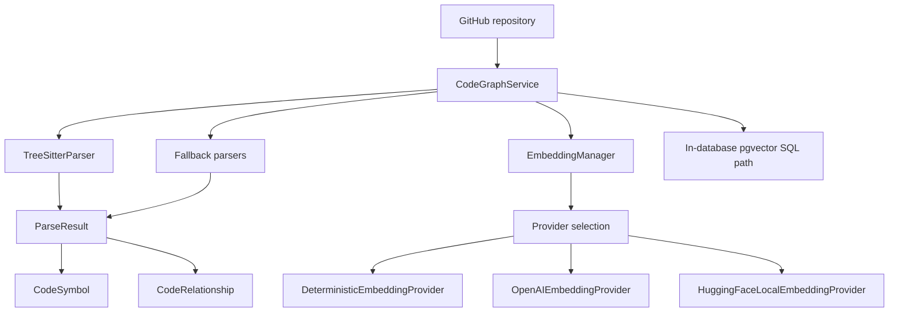
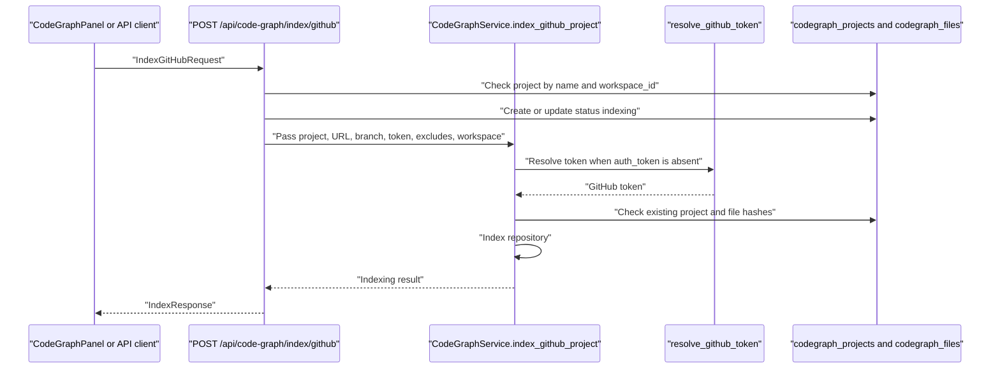
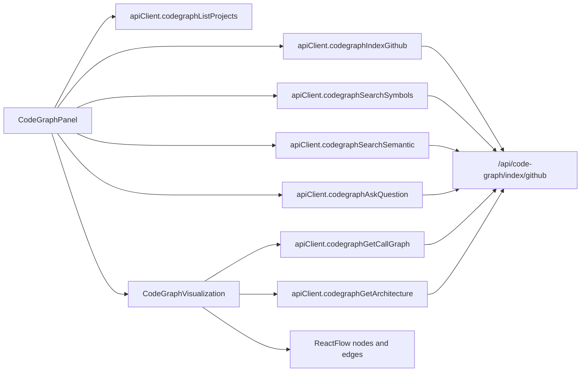
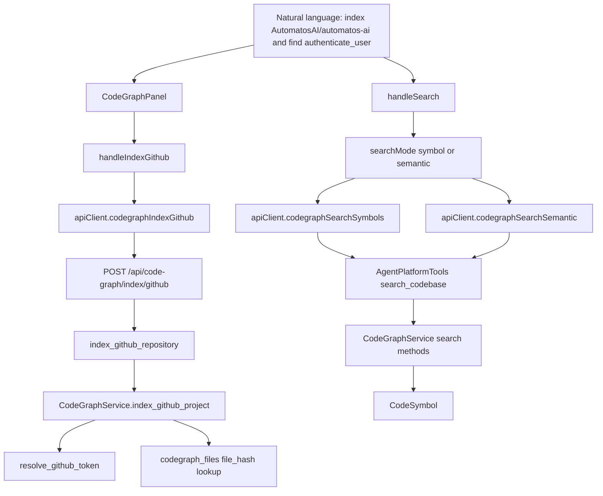
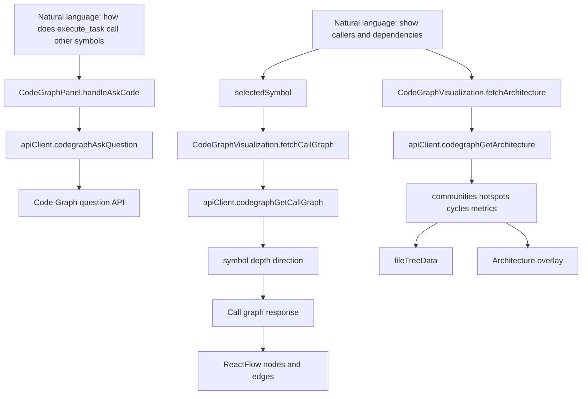

# Code Graph

Relevant source files

The following files were used as context for generating this wiki page:

- [frontend/components/knowledge/CodeGraphPanel.tsx](frontend/components/knowledge/CodeGraphPanel.tsx)
- [frontend/components/knowledge/CodeGraphVisualization.tsx](frontend/components/knowledge/CodeGraphVisualization.tsx)
- [orchestrator/api/codegraph.py](orchestrator/api/codegraph.py)
- [orchestrator/core/llm/clients/embedding_bounds.py](orchestrator/core/llm/clients/embedding_bounds.py)
- [orchestrator/core/llm/clients/openai_embedding.py](orchestrator/core/llm/clients/openai_embedding.py)
- [orchestrator/core/llm/embedding_manager.py](orchestrator/core/llm/embedding_manager.py)
- [orchestrator/core/llm/rerank_manager.py](orchestrator/core/llm/rerank_manager.py)
- [orchestrator/modules/agents/services/agent_platform_tools.py](orchestrator/modules/agents/services/agent_platform_tools.py)
- [orchestrator/modules/codegraph/codegraph_service.py](orchestrator/modules/codegraph/codegraph_service.py)
- [orchestrator/modules/codegraph/github_auth.py](orchestrator/modules/codegraph/github_auth.py)
- [orchestrator/modules/memory/__init__.py](orchestrator/modules/memory/__init__.py)
- [orchestrator/modules/rag/config.py](orchestrator/modules/rag/config.py)
- [orchestrator/modules/search/optimization/context_optimizer.py](orchestrator/modules/search/optimization/context_optimizer.py)
- [orchestrator/modules/search/vector_store/backends/s3_vectors_mock.py](orchestrator/modules/search/vector_store/backends/s3_vectors_mock.py)
- [orchestrator/modules/tools/discovery/actions_codegraph.py](orchestrator/modules/tools/discovery/actions_codegraph.py)
- [orchestrator/modules/tools/discovery/handlers_codegraph.py](orchestrator/modules/tools/discovery/handlers_codegraph.py)
- [orchestrator/modules/tools/formatting/result_formatter.py](orchestrator/modules/tools/formatting/result_formatter.py)
- [orchestrator/tests/test_f105_embedding_calls_are_bounded.py](orchestrator/tests/test_f105_embedding_calls_are_bounded.py)
- [orchestrator/tests/test_prd154_s8_codegraph.py](orchestrator/tests/test_prd154_s8_codegraph.py)
- [orchestrator/tests/test_prd165_s4_codegraph.py](orchestrator/tests/test_prd165_s4_codegraph.py)
- [orchestrator/tests/test_prd183_s4_codegraph_reindex.py](orchestrator/tests/test_prd183_s4_codegraph_reindex.py)

## Purpose and Scope

The **Code Graph** subsystem indexes GitHub repositories into searchable code entities and relationships. It supports symbol and semantic search, exposes code-graph operations through the REST API and agent platform actions, and provides frontend project management and graph visualization. This page covers `CodeGraphService`, GitHub authentication and reindexing, API and agent integration, the `CodeGraphPanel`, and embedding and rerank managers. [orchestrator/modules/codegraph/codegraph_service.py:1-7](), [orchestrator/api/codegraph.py:1-6](), [frontend/components/knowledge/CodeGraphPanel.tsx:49-81]()

Sources: [orchestrator/modules/codegraph/codegraph_service.py:1-7](), [orchestrator/api/codegraph.py:1-6](), [frontend/components/knowledge/CodeGraphPanel.tsx:49-81]()

---

## 1. Core Services & Indexing Engine

`CodeGraphService` is the backend service for indexing and searching repositories. It receives a SQLAlchemy session, initializes the centralized embedding manager, configures a parser, and selects supported source-file extensions. [orchestrator/modules/codegraph/codegraph_service.py:68-114]()

### Key Classes and Data Structures

* `CodeSymbol` describes a code entity with a symbol type, name and qualified name, file path, line number, signature, optional docstring, snippet, and metadata. [orchestrator/modules/codegraph/codegraph_service.py:35-46]()
* `CodeRelationship` describes a directed relationship between qualified symbols. Relationship types include `calls`, `imports`, `extends`, `implements`, and `references`. [orchestrator/modules/codegraph/codegraph_service.py:49-56]()
* `ParseResult` groups a file’s symbols and relationships with its hash, line count, and language. [orchestrator/modules/codegraph/codegraph_service.py:58-66]()

Sources: [orchestrator/modules/codegraph/codegraph_service.py:35-66]()

### Parser Architecture & Vector Storage

`CodeGraphService` attempts to initialize `TreeSitterParser`; when available, it builds language-extension mappings from the parser’s supported languages. If tree-sitter is unavailable, it falls back to Python, TypeScript, and JavaScript extensions. [orchestrator/modules/codegraph/codegraph_service.py:87-114]()

The service sets `_vector_store` to `None`; the implementation comment identifies the in-database `pgvector` SQL path as the standard path for semantic search when that wrapper is absent. [orchestrator/modules/codegraph/codegraph_service.py:81-85]() Search-query logging is separated into `modules.codegraph.query_log`; the PRD-154 regression test checks that a failed query-log insert is rolled back without causing symbol search to fail. [orchestrator/modules/codegraph/codegraph_service.py:26-30](), [orchestrator/tests/test_prd154_s8_codegraph.py:68-95](), [orchestrator/tests/test_prd154_s8_codegraph.py:156-167]()

### Embedding & Rerank Integration

`CodeGraphService.__init__` obtains an embedding manager through `create_embedding_manager()`. [orchestrator/modules/codegraph/codegraph_service.py:73-79]() `EmbeddingManager` reads embedding settings, falls back to application configuration when needed, resolves provider credentials from workspace keys, credential lookup, or environment variables, and can use `DeterministicEmbeddingProvider` when embeddings are disabled or a key is unavailable. [orchestrator/core/llm/embedding_manager.py:56-67](), [orchestrator/core/llm/embedding_manager.py:83-114](), [orchestrator/core/llm/embedding_manager.py:116-145]()

`RerankManager` is a Cohere API reranker with lazy configuration. It reads a Cohere key from system settings or configuration and the rerank model from the `embeddings` setting; without a key, or if a request fails, it returns identity-order results with zero relevance scores. Its async HTTP client is rebound when the running event loop changes. [orchestrator/core/llm/rerank_manager.py:35-46](), [orchestrator/core/llm/rerank_manager.py:47-93](), [orchestrator/core/llm/rerank_manager.py:95-111](), [orchestrator/core/llm/rerank_manager.py:113-183]()

The provided code excerpts do not establish that `RerankManager` is invoked by `CodeGraphService`; treat it as a shared ranking capability, not as a confirmed stage in CodeGraph search.

Sources: [orchestrator/modules/codegraph/codegraph_service.py:73-114](), [orchestrator/core/llm/embedding_manager.py:56-67](), [orchestrator/core/llm/embedding_manager.py:83-145](), [orchestrator/core/llm/rerank_manager.py:35-46](), [orchestrator/core/llm/rerank_manager.py:47-93](), [orchestrator/core/llm/rerank_manager.py:95-183]()

### Diagram: Code Indexing Components

Sources: [orchestrator/modules/codegraph/codegraph_service.py:35-66](), [orchestrator/modules/codegraph/codegraph_service.py:73-114](), [orchestrator/core/llm/embedding_manager.py:15-24](), [orchestrator/core/llm/embedding_manager.py:83-157]()

---

## 2. GitHub Authentication & Reindexing

`index_github_project()` accepts a project name, GitHub URL, branch, optional auth token, exclude patterns, and optional workspace ID. If no token is supplied, it calls `resolve_github_token()` to obtain one before starting indexing. [orchestrator/modules/codegraph/codegraph_service.py:123-153]()

The service looks up the project by name and workspace. If an existing project is marked `indexing`, it resets that record to `pending`; when a project already exists, it loads stored file hashes from `codegraph_files` for incremental indexing. [orchestrator/modules/codegraph/codegraph_service.py:155-180]()

The API indexing endpoint also creates or updates the project record as `indexing` before starting background work. It rejects duplicate work when the project is already indexing, applies a per-workspace `git_clone` rate limit, and passes the request’s GitHub URL, branch, token, and exclude patterns into the indexing flow. [orchestrator/api/codegraph.py:116-144](), [orchestrator/api/codegraph.py:146-189]()

`github_auth.py` is the token-resolution module used by `index_github_project()`. The existing page describes its App-token/PAT fallback and token caching behavior; those implementation details are referenced here, but the module’s contents were not included in the supplied excerpts. [orchestrator/modules/codegraph/codegraph_service.py:147-152](), [orchestrator/modules/codegraph/github_auth.py:20-48]()

### Reindexing & Auto-Reindex Configuration

The visible service code establishes workspace-scoped project lookup and incremental file-hash loading for existing projects. [orchestrator/modules/codegraph/codegraph_service.py:155-180]() The existing page also identifies `set_auto_reindex()` and workspace-scoped write actions as PRD-183 capabilities; their definitions are in files listed as additional cluster files but not shown in the supplied excerpts. [orchestrator/tests/test_prd183_s4_codegraph_reindex.py:1-180]()

### Diagram: GitHub Indexing and Token Resolution

Sources: [orchestrator/api/codegraph.py:116-189](), [orchestrator/modules/codegraph/codegraph_service.py:123-180]()

---

## 3. REST API & Platform Actions

### REST Endpoints (`api/codegraph.py`)

The router is mounted at `/api/code-graph`. The API defines request and response models for GitHub indexing, search results, and project metadata. [orchestrator/api/codegraph.py:28-76]() The visible `POST /index/github` endpoint requires the `knowledge:create` workspace permission, uses hybrid request context and a database-backed `CodeGraphService`, and rate-limits Git clone operations per workspace. [orchestrator/api/codegraph.py:105-144]()

The supplied API excerpt shows the indexing route and its setup path. The existing page’s references to project listing, search, call-graph, and architecture routes are retained as API surface pointers; their route definitions are outside the excerpt provided here. [orchestrator/api/codegraph.py:28-141]()

### Platform Actions & Agent Search

`AgentPlatformTools` constructs `CodeGraphService` alongside the RAG service and exposes `search_codebase` as an agent tool. Its advertised inputs include a natural-language or symbol query, optional project name, `fuzzy` or `semantic` search type, symbol type, and file extension. [orchestrator/modules/agents/services/agent_platform_tools.py:50-67](), [orchestrator/modules/agents/services/agent_platform_tools.py:128-157]()

The PRD-154 regression test records a previous defect where the `search_type` argument was advertised but ignored, and verifies semantic search through the service’s pgvector fallback. [orchestrator/tests/test_prd154_s8_codegraph.py:1-17](), [orchestrator/tests/test_prd154_s8_codegraph.py:169-176]()

The existing page lists additional `platform_codegraph_*` actions for listing projects, searching, retrieving symbols, call graphs, dependencies, architecture, indexing, reindexing, and toggling auto-reindex. Their action definitions and handlers are in the additional files named below, which were not shown in full in the supplied material. [orchestrator/modules/tools/discovery/actions_codegraph.py:11-158](), [orchestrator/modules/tools/discovery/handlers_codegraph.py:50-58](), [orchestrator/tests/test_prd183_s4_codegraph_reindex.py:75-180]()

| Action | Permission | Purpose |
|---|---|---|
| `platform_codegraph_list_projects` | `read` | List projects indexed for the workspace. [orchestrator/modules/tools/discovery/actions_codegraph.py:14-30]() |
| `platform_codegraph_search` | `read` | Search symbols by name or semantic meaning. [orchestrator/modules/tools/discovery/actions_codegraph.py:32-57]() |
| `platform_codegraph_get_symbol` | `read` | Retrieve symbol details. [orchestrator/modules/tools/discovery/actions_codegraph.py:59-83]() |
| `platform_codegraph_call_graph` | `read` | Inspect calls and callers. [orchestrator/modules/tools/discovery/actions_codegraph.py:85-110]() |
| `platform_codegraph_dependencies` | `read` | Inspect dependencies or dependents. [orchestrator/modules/tools/discovery/actions_codegraph.py:112-134]() |
| `platform_codegraph_architecture` | `read` | Retrieve architecture-oriented graph data. [orchestrator/modules/tools/discovery/actions_codegraph.py:136-158]() |
| `platform_codegraph_index` | `write` | Add a repository to the index. [orchestrator/tests/test_prd183_s4_codegraph_reindex.py:75-112]() |
| `platform_codegraph_reindex` | `write` | Reindex an existing project. [orchestrator/tests/test_prd183_s4_codegraph_reindex.py:114-132]() |
| `platform_codegraph_set_auto_reindex` | `write` | Toggle automatic reindexing. [orchestrator/tests/test_prd183_s4_codegraph_reindex.py:139-180]() |

Sources: [orchestrator/api/codegraph.py:28-76](), [orchestrator/api/codegraph.py:105-144](), [orchestrator/modules/agents/services/agent_platform_tools.py:50-67](), [orchestrator/modules/agents/services/agent_platform_tools.py:128-157](), [orchestrator/modules/tools/discovery/actions_codegraph.py:11-158](), [orchestrator/tests/test_prd154_s8_codegraph.py:1-17]()

---

## 4. Frontend Visualization & Control Panel

### `CodeGraphPanel`

`CodeGraphPanel` maintains project, indexing, search, and natural-language-question state. On mount it loads projects and selects the first available project when none is selected. [frontend/components/knowledge/CodeGraphPanel.tsx:49-81](), [frontend/components/knowledge/CodeGraphPanel.tsx:100-117]()

The GitHub indexing handler validates the project name and URL, splits the exclude-pattern input, calls `apiClient.codegraphIndexGithub()`, then reloads projects. While any project is in the `indexing` state, the panel refreshes the project list every five seconds. [frontend/components/knowledge/CodeGraphPanel.tsx:83-98](), [frontend/components/knowledge/CodeGraphPanel.tsx:119-160]()

The search handler calls `codegraphSearchSymbols()` for symbol mode or `codegraphSearchSemantic()` for semantic mode. The natural-language question handler resolves the selected project’s ID and calls `codegraphAskQuestion()`. [frontend/components/knowledge/CodeGraphPanel.tsx:162-197](), [frontend/components/knowledge/CodeGraphPanel.tsx:199-215]()

### `CodeGraphVisualization`

`CodeGraphVisualization` uses React Flow nodes and edges to present code relationships. Its state includes graph type, traversal depth and direction, architecture view mode, selected node, fullscreen mode, and file-tree state. [frontend/components/knowledge/CodeGraphVisualization.tsx:87-113]()

When a project ID is available, it fetches architecture data and derives file-tree entries from community members. For a selected symbol, it calls `apiClient.codegraphGetCallGraph()` with the selected symbol, depth, and direction. [frontend/components/knowledge/CodeGraphVisualization.tsx:124-173](), [frontend/components/knowledge/CodeGraphVisualization.tsx:175-203]()

### Diagram: Frontend Code Graph Data Flow

Sources: [frontend/components/knowledge/CodeGraphPanel.tsx:83-98](), [frontend/components/knowledge/CodeGraphPanel.tsx:100-215](), [frontend/components/knowledge/CodeGraphVisualization.tsx:124-203]()

---

## 5. Natural Language Space to Code Entity Space Bridges

These diagrams map user-facing questions and search intents to named Code Graph functions and UI/API symbols. They distinguish the natural-language input from the code entities and service operations that handle it. [frontend/components/knowledge/CodeGraphPanel.tsx:162-215](), [orchestrator/modules/agents/services/agent_platform_tools.py:128-157]()

### Bridge 1: Repository Indexing & Symbol Search

A user’s request to index a repository and find a symbol maps to the panel’s GitHub indexing and search handlers. Agent requests can enter through the `search_codebase` tool, which exposes both fuzzy and semantic modes. [frontend/components/knowledge/CodeGraphPanel.tsx:119-197](), [orchestrator/modules/agents/services/agent_platform_tools.py:128-157]()

### Diagram: Natural Language to Indexing and Search Entities

Sources: [frontend/components/knowledge/CodeGraphPanel.tsx:119-197](), [orchestrator/api/codegraph.py:105-144](), [orchestrator/api/codegraph.py:146-189](), [orchestrator/modules/codegraph/codegraph_service.py:123-180](), [orchestrator/modules/agents/services/agent_platform_tools.py:128-157]()

### Bridge 2: Natural-Language Code Questions to Graph Views

A question about code can enter `CodeGraphPanel.handleAskCode()` and be submitted using the selected project ID. For structural inspection, `CodeGraphVisualization.fetchCallGraph()` submits a symbol, depth, and direction, while architecture data is loaded through `fetchArchitecture()`. [frontend/components/knowledge/CodeGraphPanel.tsx:199-215](), [frontend/components/knowledge/CodeGraphVisualization.tsx:124-136](), [frontend/components/knowledge/CodeGraphVisualization.tsx:175-185]()

### Diagram: Natural Language to Search and Visualization Entities

Sources: [frontend/components/knowledge/CodeGraphPanel.tsx:199-215](), [frontend/components/knowledge/CodeGraphVisualization.tsx:34-51](), [frontend/components/knowledge/CodeGraphVisualization.tsx:124-173](), [frontend/components/knowledge/CodeGraphVisualization.tsx:175-203]()

---