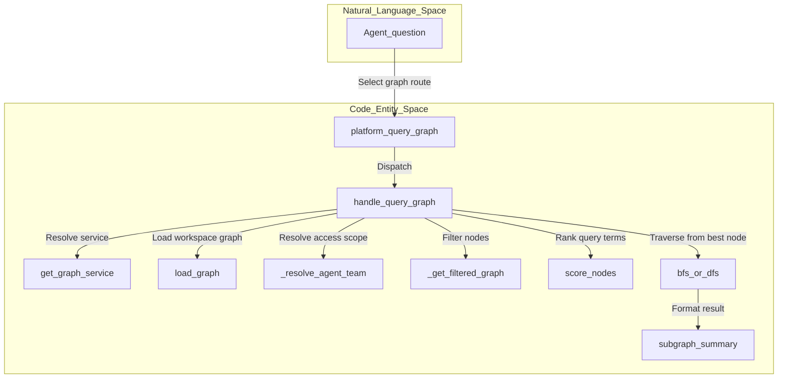
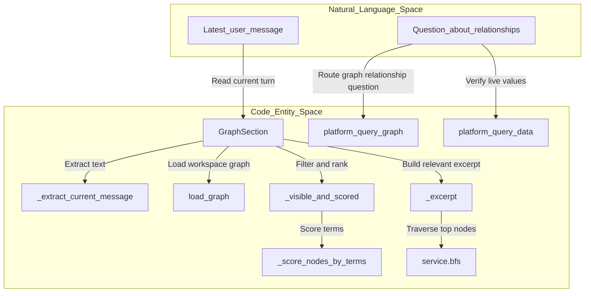
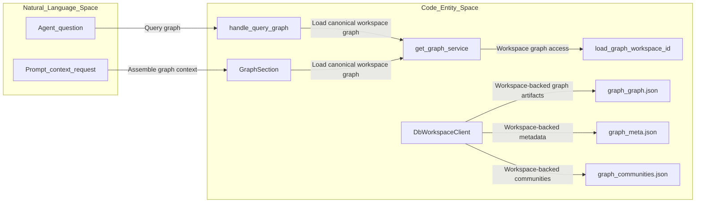

# Graph Queries for Agents

Relevant source files

The following files were used as context for generating this wiki page:

- [orchestrator/api/shopify.py](orchestrator/api/shopify.py)
- [orchestrator/consumers/chatbot/knowledge_prefetch.py](orchestrator/consumers/chatbot/knowledge_prefetch.py)
- [orchestrator/core/seeds/utterances/graph.yaml](orchestrator/core/seeds/utterances/graph.yaml)
- [orchestrator/modules/context/sections/documents_inventory.py](orchestrator/modules/context/sections/documents_inventory.py)
- [orchestrator/modules/context/sections/graph_context.py](orchestrator/modules/context/sections/graph_context.py)
- [orchestrator/modules/knowledge/graph_edge_rules.py](orchestrator/modules/knowledge/graph_edge_rules.py)
- [orchestrator/modules/knowledge/graph_extraction.py](orchestrator/modules/knowledge/graph_extraction.py)
- [orchestrator/modules/knowledge/graph_relations.py](orchestrator/modules/knowledge/graph_relations.py)
- [orchestrator/modules/knowledge/graph_service.py](orchestrator/modules/knowledge/graph_service.py)
- [orchestrator/modules/tools/data_routes.py](orchestrator/modules/tools/data_routes.py)
- [orchestrator/modules/tools/discovery/actions_analytics.py](orchestrator/modules/tools/discovery/actions_analytics.py)
- [orchestrator/modules/tools/discovery/actions_data_routes.py](orchestrator/modules/tools/discovery/actions_data_routes.py)
- [orchestrator/modules/tools/discovery/actions_field.py](orchestrator/modules/tools/discovery/actions_field.py)
- [orchestrator/modules/tools/discovery/actions_graph.py](orchestrator/modules/tools/discovery/actions_graph.py)
- [orchestrator/modules/tools/discovery/handlers_graph.py](orchestrator/modules/tools/discovery/handlers_graph.py)
- [orchestrator/tests/helpers_graph_extraction.py](orchestrator/tests/helpers_graph_extraction.py)
- [orchestrator/tests/test_api_key_domain_check.py](orchestrator/tests/test_api_key_domain_check.py)
- [orchestrator/tests/test_f077c_a_number_question_goes_to_the_database.py](orchestrator/tests/test_f077c_a_number_question_goes_to_the_database.py)
- [orchestrator/tests/test_f078_the_prompt_names_the_connected_database.py](orchestrator/tests/test_f078_the_prompt_names_the_connected_database.py)
- [orchestrator/tests/test_f155_a_widget_turns_prompt_carries_only_what_its_key_may_read.py](orchestrator/tests/test_f155_a_widget_turns_prompt_carries_only_what_its_key_may_read.py)
- [orchestrator/tests/test_f206_a_graph_extraction_fits_its_cap.py](orchestrator/tests/test_f206_a_graph_extraction_fits_its_cap.py)
- [orchestrator/tests/test_f227_each_question_is_searched_on_its_own.py](orchestrator/tests/test_f227_each_question_is_searched_on_its_own.py)
- [orchestrator/tests/test_f302_b_a_shop_question_always_reaches_the_database.py](orchestrator/tests/test_f302_b_a_shop_question_always_reaches_the_database.py)
- [orchestrator/tests/test_f312_a_a_person_is_never_produced.py](orchestrator/tests/test_f312_a_a_person_is_never_produced.py)
- [orchestrator/tests/test_f312_a_auto_reaches_for_the_knowledge_graph.py](orchestrator/tests/test_f312_a_auto_reaches_for_the_knowledge_graph.py)
- [orchestrator/tests/test_f312_b_a_claim_of_effect_needs_the_documents_words.py](orchestrator/tests/test_f312_b_a_claim_of_effect_needs_the_documents_words.py)
- [orchestrator/tests/test_f312_b_the_graph_tools_name_the_graphs_own_relations.py](orchestrator/tests/test_f312_b_the_graph_tools_name_the_graphs_own_relations.py)
- [orchestrator/tests/test_f312_c_blend_components_are_part_of_the_blend.py](orchestrator/tests/test_f312_c_blend_components_are_part_of_the_blend.py)
- [orchestrator/tests/test_f312_d_a_supplier_edge_points_from_the_supplier.py](orchestrator/tests/test_f312_d_a_supplier_edge_points_from_the_supplier.py)
- [orchestrator/tests/test_f312_f_a_nodes_role_decides_what_its_edges_may_say.py](orchestrator/tests/test_f312_f_a_nodes_role_decides_what_its_edges_may_say.py)
- [orchestrator/tests/test_f330_b_a_question_turn_holds_no_connection_while_the_documents_are_searched.py](orchestrator/tests/test_f330_b_a_question_turn_holds_no_connection_while_the_documents_are_searched.py)
- [orchestrator/tests/test_graph_relation_vocab.py](orchestrator/tests/test_graph_relation_vocab.py)
- [orchestrator/tests/test_issue_1073_graph_event_loop.py](orchestrator/tests/test_issue_1073_graph_event_loop.py)
- [orchestrator/tests/test_prd183_s1_catalog_webhook.py](orchestrator/tests/test_prd183_s1_catalog_webhook.py)
- [orchestrator/tests/test_prd183_s5_vertical_provision.py](orchestrator/tests/test_prd183_s5_vertical_provision.py)
- [orchestrator/tests/test_prd189_s3_webhook_debounce.py](orchestrator/tests/test_prd189_s3_webhook_debounce.py)

## Purpose and Scope

This page describes how agents query the workspace knowledge graph, how graph context is assembled into prompts, and how the graph service provides a canonical per-workspace graph. It focuses on `handlers_graph` query behavior, the `GraphSection` context section, graph platform-action definitions, access filtering, and graph storage. [orchestrator/modules/tools/discovery/handlers_graph.py:1-18](), [orchestrator/modules/context/sections/graph_context.py:1-17](), [orchestrator/modules/knowledge/graph_service.py:1-19]()

Sources: `orchestrator/modules/tools/discovery/handlers_graph.py`, `orchestrator/modules/context/sections/graph_context.py`, `orchestrator/modules/knowledge/graph_service.py`

---

## 1. Platform Graph Actions (`handlers_graph`)

Graph handlers use the standard `(db, workspace_id, params)` signature expected by `PlatformActionExecutor`. `handlers_graph` obtains the graph service through a lazy import in `_get_service()`, which avoids importing the service at module load time. [orchestrator/modules/tools/discovery/handlers_graph.py:1-6](), [orchestrator/modules/tools/discovery/handlers_graph.py:41-50]()

The graph action catalog defines read actions including `platform_graph_path`, `platform_graph_communities`, and `platform_graph_stats`. The path action accepts required `source` and `target` labels and describes finding the shortest path between concepts; the community action accepts an optional `community_id`; and the stats action has no parameters. [orchestrator/modules/tools/discovery/actions_graph.py:15-26](), [orchestrator/modules/tools/discovery/actions_graph.py:27-57](), [orchestrator/modules/tools/discovery/actions_graph.py:59-111]()

The graph query route is exposed to the chat tool surface as `platform_query_graph`; the `ToolsSection` regression tests assert that it is available when a workspace graph is present and absent when the graph is empty. The supplied tests demonstrate the route’s presence on that surface but do not include the route’s full registration or handler implementation. [orchestrator/tests/test_f302_b_a_shop_question_always_reaches_the_database.py:1-13](), [orchestrator/tests/test_f302_b_a_shop_question_always_reaches_the_database.py:67-77](), [orchestrator/tests/test_f302_b_a_shop_question_always_reaches_the_database.py:87-119]()

### Natural-language graph query flow

`handle_query_graph` requires a non-empty `question`, defaults to BFS traversal, uses depth `2` and a text-summary token budget of `1500` unless overridden, and loads the workspace graph through `load_graph`. It resolves the agent’s retrieval team, filters the graph, scores nodes against the question terms, traverses from the highest-scoring node, and prepares a summary. If no graph is built, it returns an error; if no nodes are scorable, it returns a successful response indicating that condition. [orchestrator/modules/tools/discovery/handlers_graph.py:126-169](), [orchestrator/modules/tools/discovery/handlers_graph.py:172-185]()

The handler accepts `mode="dfs"` to choose DFS; all other mode values take the BFS branch. The graph service supplies the scoring and traversal operations, while the handler selects the starting node and coordinates the query. [orchestrator/modules/tools/discovery/handlers_graph.py:145-147](), [orchestrator/modules/tools/discovery/handlers_graph.py:162-183]()

**Diagram: Natural-language question to graph-query code path**

Sources: `orchestrator/modules/tools/discovery/handlers_graph.py:41-50`, `orchestrator/modules/tools/discovery/handlers_graph.py:126-185`, `orchestrator/tests/test_f302_b_a_shop_question_always_reaches_the_database.py:87-119`

### Team visibility and edge interpretation

`_resolve_agent_team` uses `retrieval_team` to derive the graph scope. When an agent ID is supplied, it looks up `Agent.team`; if no agent ID is supplied, or lookup fails, it resolves the unrestricted/default team value. `_get_filtered_graph` delegates node filtering to `team_filtered_view`. [orchestrator/modules/tools/discovery/handlers_graph.py:53-76]()

The graph service’s visibility rule treats nodes with no `team_access` restriction as visible to all teams; an unrestricted agent team sees all nodes; otherwise, a node is visible only when the agent’s team is in its `team_access` list. [orchestrator/modules/knowledge/graph_service.py:151-168]()

For neighbor results, `_neighbor_entry` reports the neighbor label and attributes, direction, edge description, confidence, weight, and edge attributes. It uses `direction_from` and `describe_edge` so the returned relationship reflects the extracted edge direction, even though the graph is undirected. `_find_node_by_label` searches first by exact node ID, then by case-insensitive exact label, and finally by case-insensitive label substring. [orchestrator/modules/tools/discovery/handlers_graph.py:78-96](), [orchestrator/modules/tools/discovery/handlers_graph.py:98-118]()

Sources: `orchestrator/modules/tools/discovery/handlers_graph.py:53-118`, `orchestrator/modules/knowledge/graph_service.py:151-168`

---

## 2. Prompt Context Integration (`GraphContext`)

`GraphSection` injects business knowledge-graph context into agent prompts. It has the section name `business_graph`, priority `45`, and a token limit of `800`. Its `render` method delegates to `_build` and catches failures, logging them and returning an empty string rather than failing prompt assembly. [orchestrator/modules/context/sections/graph_context.py:47-63]()

`_build` skips graph context for a widget turn unless the widget key has the `documents:read` scope. Otherwise, it extracts the latest user message (falling back to `task_description`), loads the graph for `ctx.workspace_id`, and returns no section when the message or graph is empty. [orchestrator/modules/context/sections/graph_context.py:65-84](), [orchestrator/modules/context/sections/graph_context.py:140-148]()

For a non-empty graph, the section resolves the agent team, keeps message terms longer than two characters, and runs team filtering and term scoring in `asyncio.to_thread`. If the top score meets `_RELEVANCE_THRESHOLD` (`0.3`), it builds an excerpt from BFS neighborhoods around up to three top-scoring nodes, at depth two. [orchestrator/modules/context/sections/graph_context.py:32-35](), [orchestrator/modules/context/sections/graph_context.py:85-105](), [orchestrator/modules/context/sections/graph_context.py:118-137]()

In `CHATBOT` mode, and outside widget turns, `_route_line` adds a graph-availability instruction even when no relevant excerpt is produced. The line directs agents to use `platform_query_graph` for questions spanning documents or asking how things relate, and to check live orders or figures with `platform_query_data`. Widget turns do not receive this line. [orchestrator/modules/context/sections/graph_context.py:38-44](), [orchestrator/modules/context/sections/graph_context.py:104-116]()

**Diagram: prompt context bridges user language to graph code entities**

Sources: `orchestrator/modules/context/sections/graph_context.py:32-44`, `orchestrator/modules/context/sections/graph_context.py:65-105`, `orchestrator/modules/context/sections/graph_context.py:118-157`

### Context behavior and boundaries

The excerpt is assembled from the union of BFS neighborhoods around the top-scoring nodes. A BFS failure for one starting node is logged and does not prevent attempts for the remaining nodes. The combined nodes and edges are rendered through `subgraph_to_text` with the graph-section token budget. [orchestrator/modules/context/sections/graph_context.py:118-137]()

The graph excerpt is not the only way the agent learns that a graph is available: the route line is constructed separately and is included in chatbot mode when the graph has at least one node and the turn is not a widget turn. [orchestrator/modules/context/sections/graph_context.py:77-84](), [orchestrator/modules/context/sections/graph_context.py:101-116]()

Sources: `orchestrator/modules/context/sections/graph_context.py:77-116`, `orchestrator/modules/context/sections/graph_context.py:118-137`

---

## 3. Graph Single-Store Policy

The graph service is described as the single point of contact for Graphify, with graphify usage funneled through `GraphifyService` so graph changes remain centralized. Its documented pipeline collects sources, extracts and merges graph data, builds and clusters the graph, analyzes it, exports and caches it, then snapshots and reports on changes. [orchestrator/modules/knowledge/graph_service.py:1-11](), [orchestrator/modules/knowledge/graph_service.py:40-61]()

The service documents workspace graph artifacts under `/graph/`: `graph.json`, `meta.json`, `communities.json`, `graph.html`, `latest_diff.json`, dated history snapshots, and dated build reports. The service imports `DbWorkspaceClient` for graph storage, while `GraphSection` and `handle_query_graph` obtain the graph through `get_graph_service().load_graph(workspace_id)`. [orchestrator/modules/knowledge/graph_service.py:13-20](), [orchestrator/modules/knowledge/graph_service.py:55-57](), [orchestrator/modules/context/sections/graph_context.py:77-83](), [orchestrator/modules/tools/discovery/handlers_graph.py:149-152]()

This is the single-store policy at the query boundary: both prompt context and the graph query handler load the workspace graph through the graph service, rather than constructing separate query-specific graph stores. The supplied code excerpts establish this shared service access path and workspace-file artifact layout; they do not show the implementation of the storage client or the complete graph build/load methods. [orchestrator/modules/context/sections/graph_context.py:77-83](), [orchestrator/modules/tools/discovery/handlers_graph.py:46-50](), [orchestrator/modules/tools/discovery/handlers_graph.py:149-152](), [orchestrator/modules/knowledge/graph_service.py:5-19]()

**Diagram: workspace graph storage and shared query access path**

Sources: `orchestrator/modules/knowledge/graph_service.py:5-19`, `orchestrator/modules/knowledge/graph_service.py:55-57`, `orchestrator/modules/knowledge/graph_service.py:70-83`, `orchestrator/modules/tools/discovery/handlers_graph.py:46-50`, `orchestrator/modules/tools/discovery/handlers_graph.py:149-152`, `orchestrator/modules/context/sections/graph_context.py:77-83`

### Query-path comparison

| Consumer | Graph access | Purpose |
|---|---|---|
| `handle_query_graph` | `get_graph_service()` then `load_graph(str(workspace_id))` | Score the question’s terms, traverse from a selected node, and return a bounded text summary. [orchestrator/modules/tools/discovery/handlers_graph.py:126-164]() |
| `GraphSection` | `get_graph_service()` then `load_graph(str(ctx.workspace_id))` | Filter and score the graph for the current message, then optionally add a BFS excerpt to prompt context. [orchestrator/modules/context/sections/graph_context.py:65-105]() |
| Graph storage | `DbWorkspaceClient`; artifacts documented under `/graph/` | Store workspace graph exports and related graph metadata. [orchestrator/modules/knowledge/graph_service.py:13-19](), [orchestrator/modules/knowledge/graph_service.py:55-57]() |

Sources: `orchestrator/modules/tools/discovery/handlers_graph.py:126-164`, `orchestrator/modules/context/sections/graph_context.py:65-105`, `orchestrator/modules/knowledge/graph_service.py:13-19`, `orchestrator/modules/knowledge/graph_service.py:55-57`

---