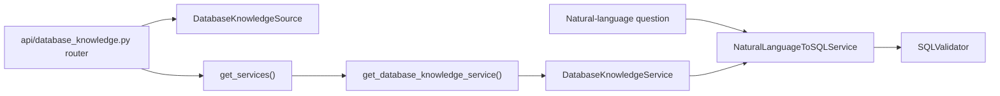
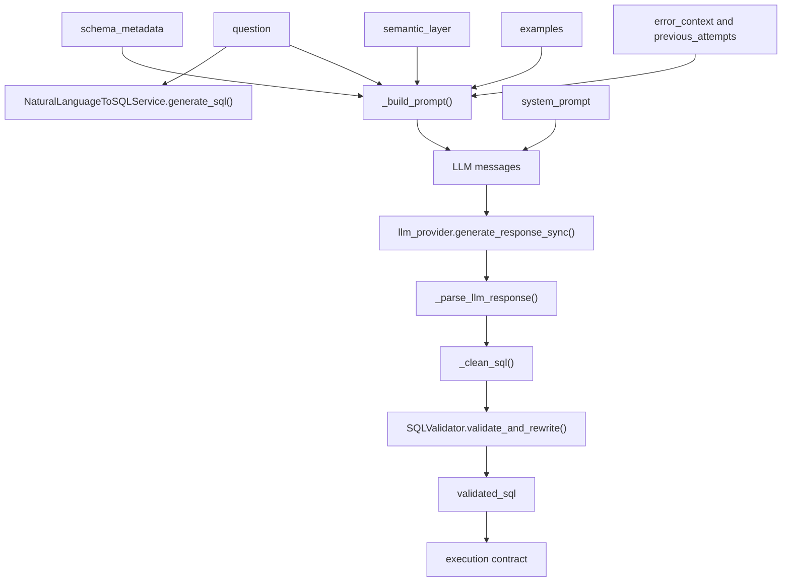
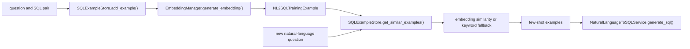
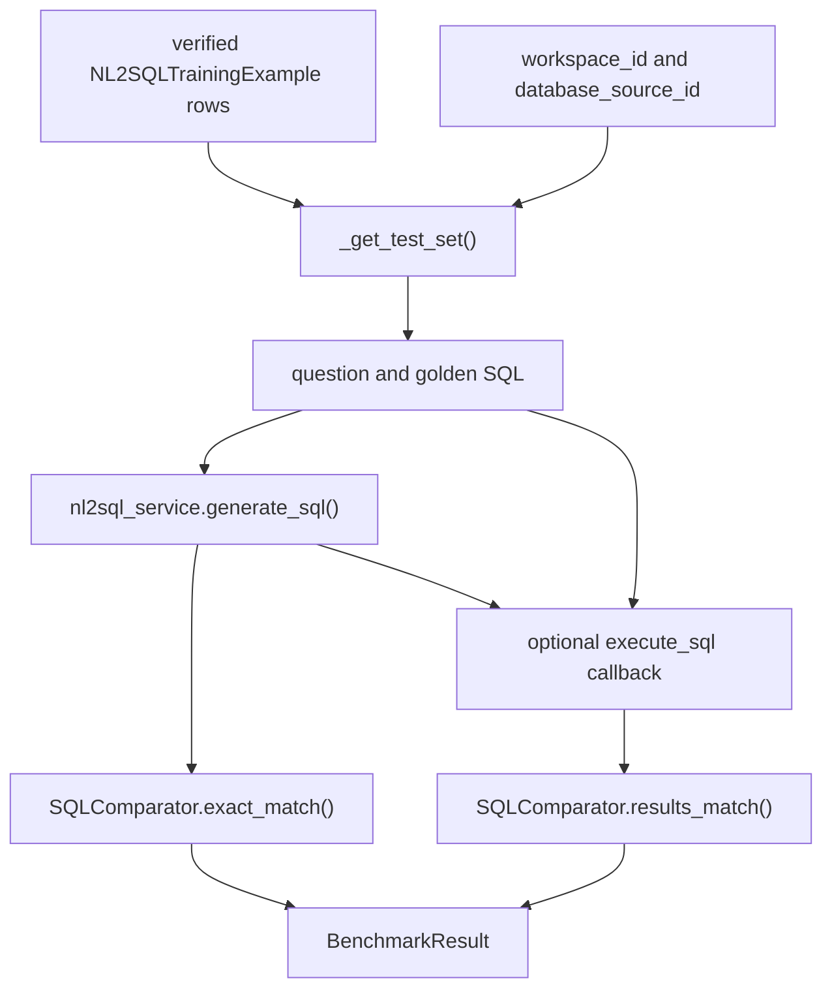

# NL2SQL & Database Knowledge

Relevant source files

The following files were used as context for generating this wiki page:

- [frontend/components/knowledge/DatabaseQueryExplorer.tsx](frontend/components/knowledge/DatabaseQueryExplorer.tsx)
- [orchestrator/alembic/versions/20260612_nl2sql_example_embedding.py](orchestrator/alembic/versions/20260612_nl2sql_example_embedding.py)
- [orchestrator/api/database_knowledge.py](orchestrator/api/database_knowledge.py)
- [orchestrator/core/models/database_knowledge.py](orchestrator/core/models/database_knowledge.py)
- [orchestrator/modules/memory/tests/conftest.py](orchestrator/modules/memory/tests/conftest.py)
- [orchestrator/modules/nl2sql/__init__.py](orchestrator/modules/nl2sql/__init__.py)
- [orchestrator/modules/nl2sql/benchmarks/runner.py](orchestrator/modules/nl2sql/benchmarks/runner.py)
- [orchestrator/modules/nl2sql/query/nl2sql_service.py](orchestrator/modules/nl2sql/query/nl2sql_service.py)
- [orchestrator/modules/nl2sql/service.py](orchestrator/modules/nl2sql/service.py)
- [orchestrator/modules/nl2sql/tests/test_validator.py](orchestrator/modules/nl2sql/tests/test_validator.py)
- [orchestrator/modules/nl2sql/training/example_store.py](orchestrator/modules/nl2sql/training/example_store.py)
- [orchestrator/tests/test_1060_a_training_example_belongs_to_its_source.py](orchestrator/tests/test_1060_a_training_example_belongs_to_its_source.py)
- [orchestrator/tests/test_f077b_a_grouped_answer_names_what_it_groups_by.py](orchestrator/tests/test_f077b_a_grouped_answer_names_what_it_groups_by.py)
- [orchestrator/tests/test_f172_saved_examples_carry_embeddings.py](orchestrator/tests/test_f172_saved_examples_carry_embeddings.py)
- [orchestrator/tests/test_nl2sql_accuracy_stack.py](orchestrator/tests/test_nl2sql_accuracy_stack.py)
- [orchestrator/tests/test_nl2sql_training_loop.py](orchestrator/tests/test_nl2sql_training_loop.py)
- [orchestrator/tests/test_nl2sql_validation_path.py](orchestrator/tests/test_nl2sql_validation_path.py)
- [orchestrator/tests/test_prd199_nl2sql.py](orchestrator/tests/test_prd199_nl2sql.py)

## Purpose and Scope

This section documents the database-knowledge API and NL2SQL subsystem: how database sources are registered and scoped, how natural-language questions are turned into SQL, how schema and semantic information ground generation, how examples support few-shot training, and how generation quality is benchmarked. The implementation is centered on `orchestrator/api/database_knowledge.py`, `DatabaseKnowledgeService`, `NaturalLanguageToSQLService`, and `SQLExampleStore`. [orchestrator/api/database_knowledge.py:1-39](), [orchestrator/modules/nl2sql/service.py:1-11](), [orchestrator/modules/nl2sql/query/nl2sql_service.py:1-7](), [orchestrator/modules/nl2sql/training/example_store.py:1-16]()

Sources: [orchestrator/api/database_knowledge.py:1-39](), [orchestrator/modules/nl2sql/service.py:1-11](), [orchestrator/modules/nl2sql/query/nl2sql_service.py:1-7](), [orchestrator/modules/nl2sql/training/example_store.py:1-16]()

---

## 1. Database Knowledge API & Data Models

The database knowledge API is mounted at `/api/knowledge/sources/database`. It obtains a hybrid request context and database session for its routes, and initializes shared database-knowledge, cache, and tool-integration services through `get_services()`. [orchestrator/api/database_knowledge.py:15-39](), [orchestrator/api/database_knowledge.py:42-58]()

### Core SQLAlchemy Models

`DatabaseKnowledgeSource` stores a source’s workspace association, credential reference, dialect, schema metadata, semantic layer, cache settings, status, and timestamps. Its `workspace_id` is a required foreign key to `workspaces.id`; its schema and semantic-layer data are JSON fields. [orchestrator/core/models/database_knowledge.py:28-87]()

`DatabaseQueryAudit` records the natural-language query, generated and validated SQL, execution metrics, success or failure information, cache data, and query metadata. The source model relates to its query-audit records. [orchestrator/core/models/database_knowledge.py:84-135]()

The model module also defines `SemanticMetric` and `SemanticDimension` records for business-level metrics and grouping or filtering dimensions. The canonical semantic-layer JSON format consumed by the NL2SQL reader is documented by the productization tests as an instructions-first structure with `metrics` and `dimensions` dictionaries. [orchestrator/core/models/database_knowledge.py:137-184](), [orchestrator/tests/test_prd199_nl2sql.py:8-13](), [orchestrator/tests/test_prd199_nl2sql.py:145-157]()

### API Endpoints & Introspection

`GET /api/knowledge/sources/database/` lists sources filtered by the current request’s `workspace_id`; `active_only` optionally filters to active sources. The response includes source identifiers and metadata, including dialect, status, last introspection time, and a count derived from stored schema tables. [orchestrator/api/database_knowledge.py:73-108]()

`POST /api/knowledge/sources/database/` requires the `knowledge:create` workspace permission. It creates a source through `DatabaseKnowledgeService.add_database_source`, re-reads the persisted source within the request workspace, and attempts introspection. If introspection raises an `HTTPException`, the handler retains the source and records an error for the response path rather than discarding the source. It then creates database tools and makes a best-effort attempt to schedule a graph update for the new database schema. [orchestrator/api/database_knowledge.py:111-174]()

`get_services()` uses `get_database_knowledge_service()` as the shared construction site for the service, then initializes the database cache and tool integration. The API module imports `DatabaseIntrospectionService`, credential resolution, and hybrid workspace-context dependencies for its database-source management paths. [orchestrator/api/database_knowledge.py:21-34](), [orchestrator/api/database_knowledge.py:47-58]()

Sources: [orchestrator/api/database_knowledge.py:15-58](), [orchestrator/api/database_knowledge.py:73-108](), [orchestrator/api/database_knowledge.py:111-174](), [orchestrator/core/models/database_knowledge.py:28-135](), [orchestrator/core/models/database_knowledge.py:137-184](), [orchestrator/tests/test_prd199_nl2sql.py:8-13](), [orchestrator/tests/test_prd199_nl2sql.py:145-157]()

---

## 2. NL2SQL Service & Query Pipeline

`DatabaseKnowledgeService` is the source-management and query-service layer. Its constructor accepts a credential resolver, LLM provider, RAG service, context-engineering service, and audit service; it also initializes a schema cache and a PandasAI analytics service. `NaturalLanguageToSQLService` generates SQL from a natural-language question and schema metadata. [orchestrator/modules/nl2sql/service.py:60-80](), [orchestrator/modules/nl2sql/query/nl2sql_service.py:63-76]()

### Natural Language Space to Code Entity Space Mapping

The diagram connects the user-facing concepts to code entities shown in the supplied implementation. It describes the API’s source-management path and the SQL-generation service boundary; it does not imply a specific API query-route call sequence, which is outside the supplied route excerpt. [orchestrator/api/database_knowledge.py:38-58](), [orchestrator/modules/nl2sql/service.py:60-80](), [orchestrator/modules/nl2sql/query/nl2sql_service.py:63-76]()

**Diagram: Database knowledge source management and NL2SQL generation entities**

Sources: [orchestrator/api/database_knowledge.py:38-58](), [orchestrator/core/models/database_knowledge.py:28-63](), [orchestrator/modules/nl2sql/service.py:60-80](), [orchestrator/modules/nl2sql/query/nl2sql_service.py:63-76](), [orchestrator/modules/nl2sql/__init__.py:34-47]()

### Schema Grounding & Prompt Construction

`NaturalLanguageToSQLService.generate_sql()` accepts the question, schema metadata, an optional semantic layer, dialect, few-shot examples, prior error context and attempts, an optional system prompt, and an optional original owner question. It passes those inputs to `_build_prompt()`, creates user and optional system messages, and calls `llm_provider.generate_response_sync()`. [orchestrator/modules/nl2sql/query/nl2sql_service.py:77-121]()

After receiving the model response, `generate_sql()` parses the response, cleans the SQL for the selected dialect, and adds metadata including referenced tables, question, dialect, whether error context was present, and attempt number. On generation failure it returns an empty SQL string, an explanatory failure message, and metadata with `success=False`, rather than returning an executable error-shaped query. [orchestrator/modules/nl2sql/query/nl2sql_service.py:123-148]()

The prompt builder selects relevant tables from schema metadata. The query service imports `finds_tables_by_value` from the schema-grounding module, and the main service imports the `grounded` helper; the supplied excerpts establish these integration points but do not expose their full grounding algorithms. [orchestrator/modules/nl2sql/query/nl2sql_service.py:16-16](), [orchestrator/modules/nl2sql/query/nl2sql_service.py:150-165](), [orchestrator/modules/nl2sql/service.py:34-39]()

The supplied validation-path tests pin an important execution contract: validation must precede execution, and execution must use `validated_sql`, not the raw generated SQL. They also test rejection of non-`SELECT` statements, rejection of references to tables outside the supplied schema, and insertion or capping of `LIMIT`. [orchestrator/tests/test_nl2sql_validation_path.py:26-39](), [orchestrator/tests/test_nl2sql_validation_path.py:105-155]()

**Diagram: Natural-language prompt inputs and guarded SQL path**

Sources: [orchestrator/modules/nl2sql/query/nl2sql_service.py:77-148](), [orchestrator/modules/nl2sql/query/nl2sql_service.py:150-165](), [orchestrator/modules/nl2sql/service.py:34-39](), [orchestrator/tests/test_nl2sql_validation_path.py:26-39](), [orchestrator/tests/test_nl2sql_validation_path.py:105-155]()

### Schema and Semantic-Layer Grounding

A database source stores schema metadata, schema version and hash, last-introspected time, and a semantic-layer JSON field. Those fields provide persistent source-level context for NL2SQL operations. [orchestrator/core/models/database_knowledge.py:49-63]()

The NL2SQL reader’s semantic-layer contract is a dictionary shape: `instructions`, `metrics` keyed by metric name with SQL and description, and `dimensions` grouped by category. The productization tests check that this format is consumable by the reader and that missing semantic-layer data yields an empty document with `instructions`, `metrics`, and `dimensions`. [orchestrator/tests/test_prd199_nl2sql.py:8-13](), [orchestrator/tests/test_prd199_nl2sql.py:121-157]()

The same tests specify that semantic-layer updates are workspace-scoped, persisted on a live database session, committed, and followed by schema-cache invalidation. The supplied test excerpt verifies those expectations at the service boundary. [orchestrator/tests/test_prd199_nl2sql.py:59-89](), [orchestrator/tests/test_prd199_nl2sql.py:92-109]()

Sources: [orchestrator/core/models/database_knowledge.py:49-63](), [orchestrator/tests/test_prd199_nl2sql.py:8-13](), [orchestrator/tests/test_prd199_nl2sql.py:59-109](), [orchestrator/tests/test_prd199_nl2sql.py:121-157]()

---

## 3. Example Store & Few-Shot RAG Training

`SQLExampleStore` stores question/SQL pairs for retrieval as few-shot examples. Its documented usage supports adding an example and retrieving similar examples for a database source. The store has separate collection names for examples, DDL, and documentation. [orchestrator/modules/nl2sql/training/example_store.py:1-16](), [orchestrator/modules/nl2sql/training/example_store.py:53-63]()

### Adding and Retrieving Examples

`add_example()` accepts a question, SQL statement, database-source ID, workspace ID, optional table list, verification state and source, creator, and metadata. It generates an example ID and attempts to create a question embedding with `EmbeddingManager.generate_embedding()`. When successful, it stores the embedding as a JSON-compatible float list along with the training-example record; embedding failure is logged and does not prevent the example from being stored. [orchestrator/modules/nl2sql/training/example_store.py:95-107](), [orchestrator/modules/nl2sql/training/example_store.py:114-160]()

`get_similar_examples()` scopes its initial query by both `workspace_id` and `database_source_id`. Its documented retrieval behavior uses embedding similarity when available and falls back to keyword matching. The API accepts a result limit, minimum similarity threshold, and `verified_only` flag. [orchestrator/modules/nl2sql/training/example_store.py:162-184]()

The training-loop tests verify that the embedding vector is persisted, that a failed embedding does not prevent storage, and that embedding similarity can rank a semantically close pair above a keyword-overlapping pair. [orchestrator/tests/test_nl2sql_training_loop.py:33-80](), [orchestrator/tests/test_nl2sql_training_loop.py:91-131]()

### Read-Only Check-In Behavior

Example storage is suppressed when `only_reading()` is active: the `add_example` wrapper returns an empty ID without writing. The usage counter helper also avoids updating usage count and `last_used_at` in that mode. The module documents this as protection against storing or crediting model-generated SQL examples during read-only check-ins. [orchestrator/modules/nl2sql/training/example_store.py:14-16](), [orchestrator/modules/nl2sql/training/example_store.py:25-50]()

**Diagram: Example training and retrieval entities**

Sources: [orchestrator/modules/nl2sql/training/example_store.py:25-50](), [orchestrator/modules/nl2sql/training/example_store.py:53-63](), [orchestrator/modules/nl2sql/training/example_store.py:95-107](), [orchestrator/modules/nl2sql/training/example_store.py:114-184](), [orchestrator/modules/nl2sql/query/nl2sql_service.py:77-114]()

Sources: [orchestrator/modules/nl2sql/training/example_store.py:1-16](), [orchestrator/modules/nl2sql/training/example_store.py:25-50](), [orchestrator/modules/nl2sql/training/example_store.py:53-63](), [orchestrator/modules/nl2sql/training/example_store.py:95-184](), [orchestrator/tests/test_nl2sql_training_loop.py:33-131]()

---

## 4. Automated Benchmarks Runner

`NL2SQLBenchmarkRunner` evaluates generated SQL against verified golden examples. `BenchmarkResult` records the number of tests, exact-match rate, execution-match rate, per-example details, and a timestamp. [orchestrator/modules/nl2sql/benchmarks/runner.py:25-41]()

### Benchmark Workflow

1. **Test-set selection:** If callers do not provide examples, `run_benchmark()` asks `_get_test_set()` for a deterministic random subset of verified examples. The selection is scoped by workspace and database-source ID. [orchestrator/modules/nl2sql/benchmarks/runner.py:43-67](), [orchestrator/modules/nl2sql/benchmarks/runner.py:150-182]()
2. **SQL generation:** For each example, the runner calls `nl2sql_service.generate_sql()` with the question, schema metadata, and dialect. [orchestrator/modules/nl2sql/benchmarks/runner.py:72-82]()
3. **Exact comparison:** The runner records an exact-match signal using `SQLComparator.exact_match()`. The implementation comments describe exact match as a secondary signal. [orchestrator/modules/nl2sql/benchmarks/runner.py:83-85]()
4. **Execution comparison:** If an `execute_sql` callback is provided, the runner executes both the golden SQL and generated SQL through that callback and compares their result sets with `SQLComparator.results_match()`. Without an executor, execution match is recorded as unmeasured (`None`). [orchestrator/modules/nl2sql/benchmarks/runner.py:86-114]()
5. **Result aggregation:** The runner produces rates and details for the test cases it processed. [orchestrator/modules/nl2sql/benchmarks/runner.py:115-148]()

**Diagram: Benchmark runner data flow**

Sources: [orchestrator/modules/nl2sql/benchmarks/runner.py:25-53](), [orchestrator/modules/nl2sql/benchmarks/runner.py:59-148](), [orchestrator/modules/nl2sql/benchmarks/runner.py:150-183]()

Sources: [orchestrator/modules/nl2sql/benchmarks/runner.py:25-53](), [orchestrator/modules/nl2sql/benchmarks/runner.py:59-148](), [orchestrator/modules/nl2sql/benchmarks/runner.py:150-183]()

---

## 5. Tenancy Safety & Security

### Workspace-Scoped Sources

`DatabaseKnowledgeService._get_source(source_id, workspace_id)` filters by source ID and, when a workspace ID is supplied, by `workspace_id`. A missing result raises `ValueError`; the service documentation states that another workspace’s source will not be returned on the scoped path. [orchestrator/modules/nl2sql/service.py:82-111]()

The database-source listing route filters records by the authenticated request context’s workspace ID. Source creation passes `ctx.workspace_id` to `add_database_source`, and the creation path re-reads the persisted source using both workspace ID and source ID before introspection. [orchestrator/api/database_knowledge.py:73-90](), [orchestrator/api/database_knowledge.py:111-155]()

### Credential Handling

When adding a database source, `add_database_source()` retrieves the credential through `CredentialStore`, decrypts its encrypted data with `EncryptionService`, and closes the credential-session block afterward. The supplied validation-path test specification also requires that credentials not be surfaced in logger format strings. [orchestrator/modules/nl2sql/service.py:113-142](), [orchestrator/tests/test_nl2sql_validation_path.py:26-33]()

### Training-Example Isolation

`SQLExampleStore.get_similar_examples()` filters examples by workspace and database-source ID. The supplied training-example route tests specify that verification and deletion are constrained to the requested example ID, workspace, and source; an example belonging to another source is treated as not found rather than modified. [orchestrator/modules/nl2sql/training/example_store.py:162-184](), [orchestrator/tests/test_1060_a_training_example_belongs_to_its_source.py:1-9](), [orchestrator/tests/test_1060_a_training_example_belongs_to_its_source.py:152-193]()

### Read-Only Validation Contract

The validation-path tests specify that generated SQL must be validated before execution and that the execution path uses the validated SQL. They also test rejection of write statements and unlisted tables, and enforcement of a maximum `LIMIT`. [orchestrator/tests/test_nl2sql_validation_path.py:26-39](), [orchestrator/tests/test_nl2sql_validation_path.py:105-155]()

Sources: [orchestrator/modules/nl2sql/service.py:82-111](), [orchestrator/modules/nl2sql/service.py:113-142](), [orchestrator/api/database_knowledge.py:73-90](), [orchestrator/api/database_knowledge.py:111-155](), [orchestrator/modules/nl2sql/training/example_store.py:162-184](), [orchestrator/tests/test_1060_a_training_example_belongs_to_its_source.py:1-9](), [orchestrator/tests/test_1060_a_training_example_belongs_to_its_source.py:152-193](), [orchestrator/tests/test_nl2sql_validation_path.py:26-39](), [orchestrator/tests/test_nl2sql_validation_path.py:105-155]()

---