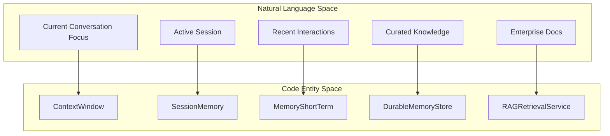
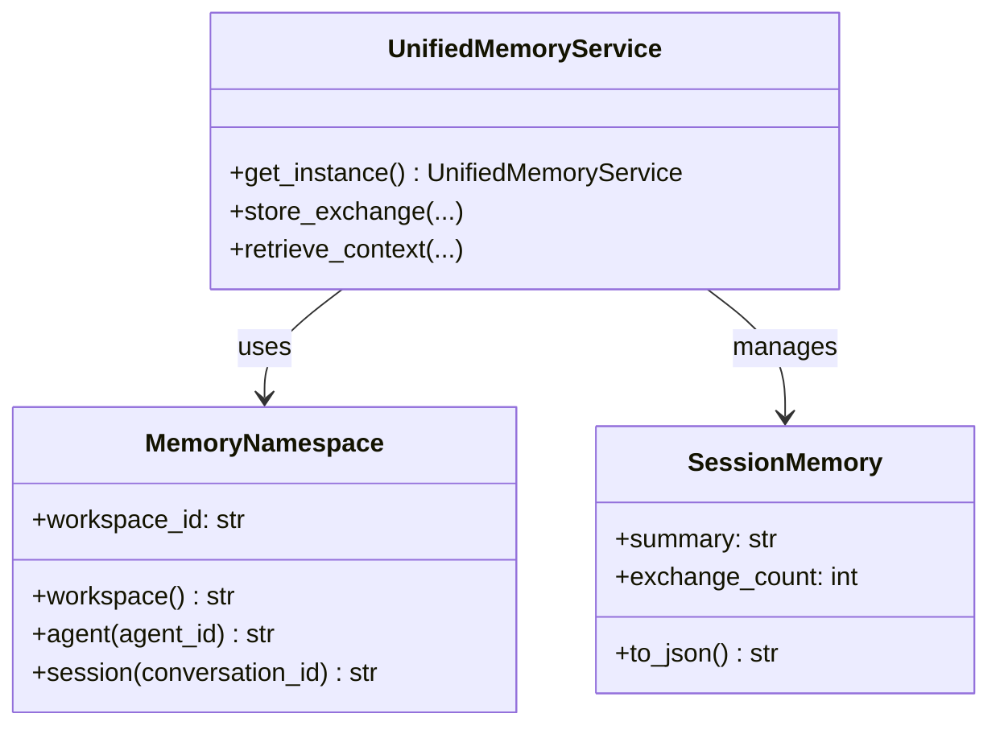
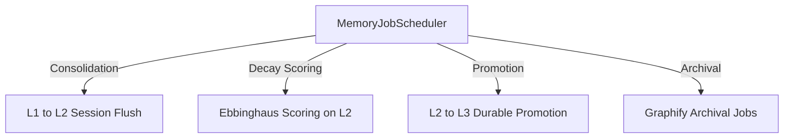
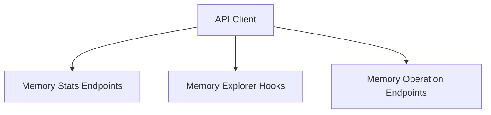

# Memory System

<details>
<summary>Relevant source files</summary>

The following files were used as context for generating this wiki page:

- [orchestrator/consumers/chatbot/integration.py](orchestrator/consumers/chatbot/integration.py)
- [orchestrator/consumers/chatbot/prompt_analyzer.py](orchestrator/consumers/chatbot/prompt_analyzer.py)
- [orchestrator/consumers/chatbot/smart_memory.py](orchestrator/consumers/chatbot/smart_memory.py)
- [orchestrator/consumers/chatbot/smart_orchestrator.py](orchestrator/consumers/chatbot/smart_orchestrator.py)
- [orchestrator/modules/context/sections/memory.py](orchestrator/modules/context/sections/memory.py)
- [orchestrator/modules/memory/context_router.py](orchestrator/modules/memory/context_router.py)
- [orchestrator/modules/memory/unified_memory_service.py](orchestrator/modules/memory/unified_memory_service.py)
- [orchestrator/tests/test_f155_a_widget_turn_recalls_only_its_agents_memories.py](orchestrator/tests/test_f155_a_widget_turn_recalls_only_its_agents_memories.py)
- [orchestrator/tests/test_l3_distill_input.py](orchestrator/tests/test_l3_distill_input.py)
- [orchestrator/tests/test_memory_restart_and_isolation.py](orchestrator/tests/test_memory_restart_and_isolation.py)
- [orchestrator/tests/test_memory_single_write_path.py](orchestrator/tests/test_memory_single_write_path.py)
- [orchestrator/tests/test_memory_stored_sse.py](orchestrator/tests/test_memory_stored_sse.py)
- [orchestrator/tests/test_p2w1_semantic_l2_recall.py](orchestrator/tests/test_p2w1_semantic_l2_recall.py)
- [orchestrator/tests/test_recall_relevance_floor.py](orchestrator/tests/test_recall_relevance_floor.py)
- [orchestrator/tests/test_smart_orchestrator_store_exchange.py](orchestrator/tests/test_smart_orchestrator_store_exchange.py)
- [orchestrator/tests/test_unified_memory.py](orchestrator/tests/test_unified_memory.py)
- [orchestrator/tests/test_us011_context_budgets.py](orchestrator/tests/test_us011_context_budgets.py)

</details>


The Memory System provides a multi-layered memory architecture designed to support AI workflows by managing context, user facts, temporal data, and organizational knowledge across persistence tiers. It centralizes memory access through `UnifiedMemoryService` [orchestrator/modules/memory/unified_memory_service.py:161-191](), enforces workspace and agent scoping via `MemoryNamespace` [orchestrator/modules/memory/unified_memory_service.py:38-46](), and intelligently routes queries for efficient retrieval using `ContextRouter` [orchestrator/modules/memory/context_router.py:1-24]().

For prompt assembly involving memory context, refer to [Context Service](#4), and for multi-agent memory integration within missions, see [Missions & Multi-Agent Coordination](#22).

Sources: [orchestrator/modules/memory/unified_memory_service.py:1-21](), [orchestrator/modules/memory/context_router.py:1-24]()

---

## 3.1 Five-Layer Memory Architecture

Automatos AI employs a five-layered memory hierarchy that organizes information by persistence scope, latency, and decay characteristics: L0 (Focus/Context Window), L1 (Working Memory/Redis Session Cache), L2 (Short-Term Memory/Postgres), L3 (Long-Term Memory/Durable Store), and L4 (Organizational Knowledge/RAG and NL2SQL).

This hierarchical design balances fast access to recent context with scalable long-term knowledge management, enabling agents to maintain relevant memory without overwhelming token budgets. For comprehensive details on each layer, see [Five-Layer Memory Architecture](#3.1).

### Diagram: Memory Stack Layers and Code Components

Sources: [orchestrator/modules/memory/unified_memory_service.py:8-13]()

---

## 3.2 UnifiedMemoryService

The `UnifiedMemoryService` [orchestrator/modules/memory/unified_memory_service.py:161-191]() is the singleton, centralized API managing all memory operations for practical platform use. It provides a consistent interface across all memory tiers, enforcing workspace and agent scoping through the `MemoryNamespace` dataclass [orchestrator/modules/memory/unified_memory_service.py:38-46]() to avoid key collisions and data leaks.

The service maintains a Redis client for L1 working memory caching and an in-process `DurableMemoryStore` instance for L3 long-term storage, while database sessions for L2 short-term persistence are acquired per-request [orchestrator/modules/memory/unified_memory_service.py:161-191](). For API usage contracts and implementation details, see [UnifiedMemoryService](#3.2).

### Diagram: UnifiedMemoryService and Core Data Structures

Sources: [orchestrator/modules/memory/unified_memory_service.py:38-191]()

---

## 3.3 Context Router

The `ContextRouter` [orchestrator/modules/memory/context_router.py:1-24]() is an intelligent pre-LLM analysis layer responsible for query signal detection and context assembly. Using fast regexes (<10ms, no I/O), it classifies the incoming user query into flags such as `is_temporal`, `is_personal_fact`, `is_session_continuation`, and `is_knowledge_query` [orchestrator/modules/memory/context_router.py:61-77]().

Based on detected signals, the router fetches relevant data shards from memory layers, assembling a budget-aware `ContextBundle` [orchestrator/modules/memory/context_router.py:83-100]() that respects token limits and section priority weights. For advanced signal routing mechanics, see [Context Router](#3.3).

### Diagram: Context Router Query Mapping to Code Entities
```mermaid
graph TB
    subgraph "Natural Language Space"
        UserQuery[""What did we discuss last week about my preferences?""]
    end

    subgraph "Code Entity Space"
        Analyzer[""ContextRouter.analyze_query()""]
        Signals[""ContextSignals""]
        Retriever[""ContextRouter.retrieve_context()""]
        Bundle[""ContextBundle""]
    end

    UserQuery --> Analyzer
    Analyzer --> Signals
    Signals --> Retriever
    Retriever --> Bundle
```
Sources: [orchestrator/modules/memory/context_router.py:1-24]()

---

## 3.4 Memory Lifecycle & Consolidation

Memory management includes automated lifecycle processes scheduled via background jobs in `MemoryJobScheduler` [orchestrator/services/memory_jobs.py:32-44](). These routines handle session consolidation (L1 → L2), Ebbinghaus-based decay scoring on L2 rows, promotion of important short-term items to L3 long-term storage, and periodic archival tasks.

These background processes ensure relevant context is maintained dynamically as user interactions evolve, preventing unbounded data growth while preserving crucial facts. For specific job execution flows and schedules, see [Memory Lifecycle & Consolidation](#3.4).

### Diagram: Memory Job Execution Lifecycle

Sources: [orchestrator/services/memory_jobs.py:32-44]()

---

## 3.5 Daily Logs & Temporal Memory

Daily logs capture workspace and agent activity summaries, offering temporal context beyond typical session memory. This data supports temporal retrieval for queries involving time-sensitive references and informs recall ranking models [orchestrator/modules/memory/unified_memory_service.py:72-74]().

Scheduled cleanups maintain efficient daily log sizes while retaining episodic recollections spanning multiple sessions. For deep dives into temporal indexing and log maintenance, see [Daily Logs & Temporal Memory](#3.5).

### Diagram: Daily Log and Temporal Retrieval Flow

Sources: [orchestrator/modules/memory/unified_memory_service.py:72-74]()

---

## 3.6 SmartMemoryManager

The `SmartMemoryManager` [orchestrator/consumers/chatbot/smart_memory.py:66-76]() is an intelligent memory coordinator used primarily for chatbot scenarios. It manages two-tier retrieval by recalling global workspace memories and agent-specific facts, conditionally restricting recall in widget mode, and executes fact extraction to store user preferences.

It integrates directly with the chat prompt building pipeline via `MemorySection` [orchestrator/modules/context/sections/memory.py:36-50](), executing background storage writes asynchronously to avoid blocking interactive responses [orchestrator/consumers/chatbot/smart_orchestrator.py:36-52](). The `_classify_memory_tier` method [orchestrator/consumers/chatbot/smart_memory.py:112-141]() determines whether a memory should be stored globally or for a specific agent, ensuring a single write per layer [orchestrator/tests/test_memory_single_write_path.py:1-12](). For implementation specifications, see [SmartMemoryManager](#3.6).

### Diagram: SmartMemoryManager Integration
```mermaid
graph LR
    ChatTurn[""Chat Turn""] --> SmartMgr[""SmartMemoryManager""]
    SmartMgr --> Unified[""UnifiedMemoryService""]
    SmartMgr --> Cache[""In-Memory Cache""]
    SmartMgr --> TierClassifier[""_classify_memory_tier()""]
    TierClassifier -->|""global""| Unified
    TierClassifier -->|""agent""| Unified
```
Sources: [orchestrator/consumers/chatbot/smart_memory.py:66-76](), [orchestrator/modules/context/sections/memory.py:36-50](), [orchestrator/consumers/chatbot/smart_orchestrator.py:36-52](), [orchestrator/consumers/chatbot/smart_memory.py:112-141](), [orchestrator/tests/test_memory_single_write_path.py:1-12]()

---

## 3.7 Memory API Reference

The platform exposes administrative and agent-facing memory APIs [orchestrator/api/memory_stats.py:33-46]() for searching memories, retrieving memory statistics, inspecting memory states via explorer tools, and performing lifecycle operations such as session refreshing and daily summary triggers.

These endpoints facilitate external integrations and monitoring. For complete endpoint routes and request/response models, see [Memory API Reference](#3.7).

### Diagram: Memory API Surface

Sources: [orchestrator/api/memory_stats.py:33-46]()

---

# Summary

The Memory System of Automatos AI provides a multi-tier memory architecture backed by centralized services and intelligent routing. The `UnifiedMemoryService` [orchestrator/modules/memory/unified_memory_service.py:161-191]() ensures consistent scoping across all persistence tiers, the `ContextRouter` [orchestrator/modules/memory/context_router.py:1-24]() optimizes query retrieval before prompt assembly, and the `SmartMemoryManager` [orchestrator/consumers/chatbot/smart_memory.py:66-76]() delivers an intelligent assistant facade. 

For detailed information on each component, refer to the linked child pages:

- [Five-Layer Memory Architecture](#3.1)
- [UnifiedMemoryService](#3.2)
- [Context Router](#3.3)
- [Memory Lifecycle & Consolidation](#3.4)
- [Daily Logs & Temporal Memory](#3.5)
- [SmartMemoryManager](#3.6)
- [Memory API Reference](#3.7)

Sources: [orchestrator/modules/memory/unified_memory_service.py:1-191](), [orchestrator/modules/memory/context_router.py:1-24](), [orchestrator/consumers/chatbot/smart_memory.py:66-76]()

---