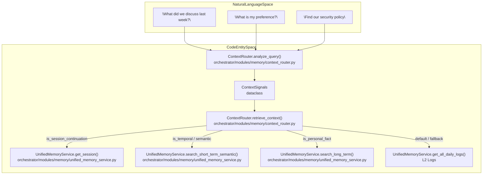
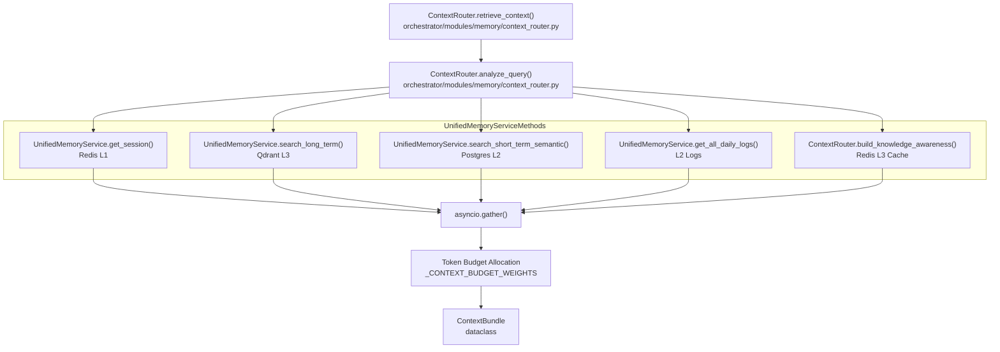

# Context Router

<details>
<summary>Relevant source files</summary>

The following files were used as context for generating this wiki page:

- [orchestrator/consumers/chatbot/integration.py](orchestrator/consumers/chatbot/integration.py)
- [orchestrator/consumers/chatbot/prompt_analyzer.py](orchestrator/consumers/chatbot/prompt_analyzer.py)
- [orchestrator/consumers/chatbot/smart_memory.py](orchestrator/consumers/chatbot/smart_memory.py)
- [orchestrator/consumers/chatbot/smart_orchestrator.py](orchestrator/consumers/chatbot/smart_orchestrator.py)
- [orchestrator/modules/context/sections/memory.py](orchestrator/modules/context/sections/memory.py)
- [orchestrator/modules/memory/context_router.py](orchestrator/modules/memory/context_router.py)
- [orchestrator/modules/memory/unified_memory_service.py](orchestrator/modules/memory/unified_memory_service.py)
- [orchestrator/tests/test_f155_a_widget_turn_recalls_only_its_agents_memories.py](orchestrator/tests/test_f155_a_widget_turn_recalls_only_its_agents_memories.py)
- [orchestrator/tests/test_l3_distill_input.py](orchestrator/tests/test_l3_distill_input.py)
- [orchestrator/tests/test_memory_restart_and_isolation.py](orchestrator/tests/test_memory_restart_and_isolation.py)
- [orchestrator/tests/test_memory_single_write_path.py](orchestrator/tests/test_memory_single_write_path.py)
- [orchestrator/tests/test_memory_stored_sse.py](orchestrator/tests/test_memory_stored_sse.py)
- [orchestrator/tests/test_p2w1_semantic_l2_recall.py](orchestrator/tests/test_p2w1_semantic_l2_recall.py)
- [orchestrator/tests/test_recall_relevance_floor.py](orchestrator/tests/test_recall_relevance_floor.py)
- [orchestrator/tests/test_smart_orchestrator_store_exchange.py](orchestrator/tests/test_smart_orchestrator_store_exchange.py)
- [orchestrator/tests/test_unified_memory.py](orchestrator/tests/test_unified_memory.py)
- [orchestrator/tests/test_us011_context_budgets.py](orchestrator/tests/test_us011_context_budgets.py)

</details>


## Purpose and Scope

The **Context Router** is a pre-LLM context assembly layer that analyzes user queries to determine which memory layers should be fetched *before* the agent sees the prompt [orchestrator/modules/memory/context_router.py:5-7](). It performs two core functions:

1.  **Signal detection** (`analyze_query()`): Fast regex-based classification of queries into categories (temporal, personal fact, session continuation, knowledge query, live data) with a target latency under 10 ms [orchestrator/modules/memory/context_router.py:9-11]().
2.  **Context assembly** (`retrieve_context()`): Fetches relevant data from L1 (session), L2 (short-term), and L3 (long-term) memory layers based on detected signals, respecting token budget constraints [orchestrator/modules/memory/context_router.py:10-12]().

This module lives at `orchestrator/modules/memory/context_router.py` and replaces scattered memory retrieval logic with a unified, signal-driven dispatch mechanism [orchestrator/modules/memory/context_router.py:1-24]().

Sources: [orchestrator/modules/memory/context_router.py:1-24]()

---

## Architecture Overview & Code Entity Mapping

The Context Router bridges natural language user queries to precise database and memory service routines via the `ContextRouter` class and `UnifiedMemoryService` [orchestrator/modules/memory/context_router.py:14-24]().

Title: Natural Language Space to Code Entity Space - Router Dispatch

Sources: [orchestrator/modules/memory/context_router.py:14-24](), [orchestrator/modules/memory/unified_memory_service.py:161-191]()

---

## Signal Detection & `analyze_query()`

The `analyze_query()` method inspects string queries using pre-compiled regular expression patterns without triggering any network I/O or database lookups [orchestrator/modules/memory/context_router.py:9-11]().

Title: Natural Language Space to Code Entity Space - Signal Matchers
```mermaid
graph TB
    subgraph "NaturalLanguageSpace"
        Q1["\"last week\", \"yesterday\", \"ago\""]
        Q2["\"my preference\", \"i prefer\", \"remember that\""]
        Q3["\"as we just discussed\", \"going back to\""]
        Q4["\"find the document\", \"search policy\""]
    end

    subgraph "CodeEntitySpace"
        Query["ContextRouter.analyze_query()<br/>orchestrator/modules/memory/context_router.py"]
        
        R1["_TEMPORAL_PATTERNS<br/>re.Pattern"]
        R2["_PERSONAL_FACT_PATTERNS<br/>re.Pattern"]
        R3["_SESSION_PATTERNS<br/>re.Pattern"]
        R4["_KNOWLEDGE_PATTERNS<br/>re.Pattern"]
        
        Res["ContextSignals<br/>dataclass"]
    end

    Q1 --> Query
    Q2 --> Query
    Q3 --> Query
    Q4 --> Query

    Query --> R1
    Query --> R2
    Query --> R3
    Query --> R4

    R1 --> Res
    R2 --> Res
    R3 --> Res
    R4 --> Res
```
Sources: [orchestrator/modules/memory/context_router.py:106-181]()

### ContextSignals Dataclass

The output is encapsulated in the `ContextSignals` immutable dataclass [orchestrator/modules/memory/context_router.py:61-77]():

| Field | Type | Description |
| :--- | :--- | :--- |
| `is_temporal` | `bool` | Relative time reference detected (e.g. "last week") |
| `is_personal_fact` | `bool` | User identity/preference query (e.g. "my email") |
| `is_session_continuation` | `bool` | Reference to current conversation (e.g. "as we just discussed") |
| `is_knowledge_query` | `bool` | Document/policy lookup (e.g. "find the onboarding guide") |
| `is_live_data` | `bool` | Real-time metrics query (e.g. "current MRR") |
| `temporal_window` | `Optional[Tuple[datetime, datetime]]` | Absolute time range if `is_temporal=True` |

Sources: [orchestrator/modules/memory/context_router.py:61-77]()

---

## Context Assembly & `retrieve_context()`

The `retrieve_context()` asynchronous method coordinates parallel execution across memory tiers using `UnifiedMemoryService` [orchestrator/modules/memory/context_router.py:381-525]().

Title: Concurrent Fetch Orchestration

Sources: [orchestrator/modules/memory/context_router.py:381-525](), [orchestrator/modules/memory/unified_memory_service.py:161-191]()

---

## Semantic L2 Recall & Budget Management

### Semantic L2 Recall
Every non-temporal query triggers vector-based retrieval on the L2 memory mirror via `search_short_term_semantic()`, ensuring relevant historical insights are retrieved by meaning rather than rigid substring matching [orchestrator/tests/test_p2w1_semantic_l2_recall.py:1-17]().

### Token Budget Allocations
The router strictly limits size through weighted proportions of the usable window (defined as 80% of total model capacity) [orchestrator/modules/memory/context_router.py:45-54]():

| Section Key | Weight | Purpose |
| :--- | :--- | :--- |
| `session` | 0.10 | L1 working session state |
| `long_term` | 0.15 | L3 durable facts |
| `temporal` | 0.10 | L2 short-term search results |
| `daily` | 0.08 | Daily activity summaries |
| `awareness` | 0.05 | Knowledge awareness text cache |
| `tools` | 0.20 | Reserved headroom for tool schemas |
| `system_prompt` | 0.12 | Reserved headroom for persona |

Sources: [orchestrator/modules/memory/context_router.py:45-54]()

---

## Integration with MemorySection

The Context Router feeds directly into `MemorySection` within the unified prompt builder (`ContextService`) [orchestrator/modules/context/sections/memory.py:7-10]().

1.  **Router First**: `MemorySection.render()` invokes `ContextRouter.retrieve_context()` to produce a structured `ContextBundle` [orchestrator/modules/context/sections/memory.py:103-125](). This path is taken for chat turns, but not for widget mode or autonomous work [orchestrator/modules/context/sections/memory.py:91-98]().
2.  **Fallback**: If the router path is not taken (e.g., widget mode, autonomous work, or router failure), `MemorySection` falls back to `SmartMemoryManager.retrieve_memories()` [orchestrator/modules/context/sections/memory.py:103-104](). For autonomous work, it also builds knowledge awareness separately using `ContextRouter().build_knowledge_awareness()` [orchestrator/modules/context/sections/memory.py:105-106](), [orchestrator/modules/context/sections/memory.py:131-140]().
3.  **Widget Mode Behavior**: In widget mode, the Context Router is skipped entirely, and memory retrieval is restricted to agent-specific memories via `SmartMemoryManager`, excluding workspace-wide memories and daily logs [orchestrator/modules/context/sections/memory.py:91-98]().
4.  **Ranking & Filtering**: Retrieved items pass through relevance floors and filters to enforce tenant security and recency scoring [orchestrator/modules/memory/context_router.py:500-501]().

Sources: [orchestrator/modules/context/sections/memory.py:32-172]()

---