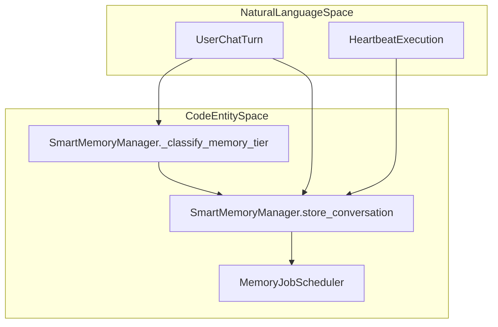
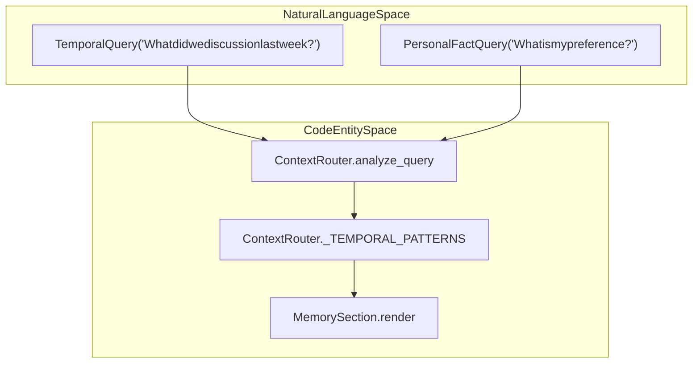
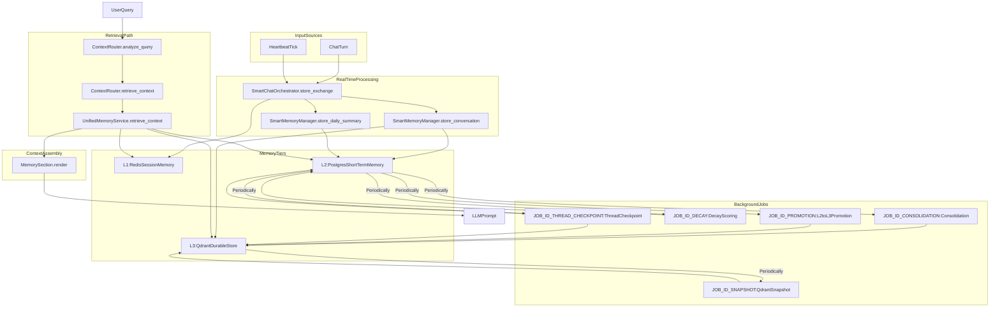
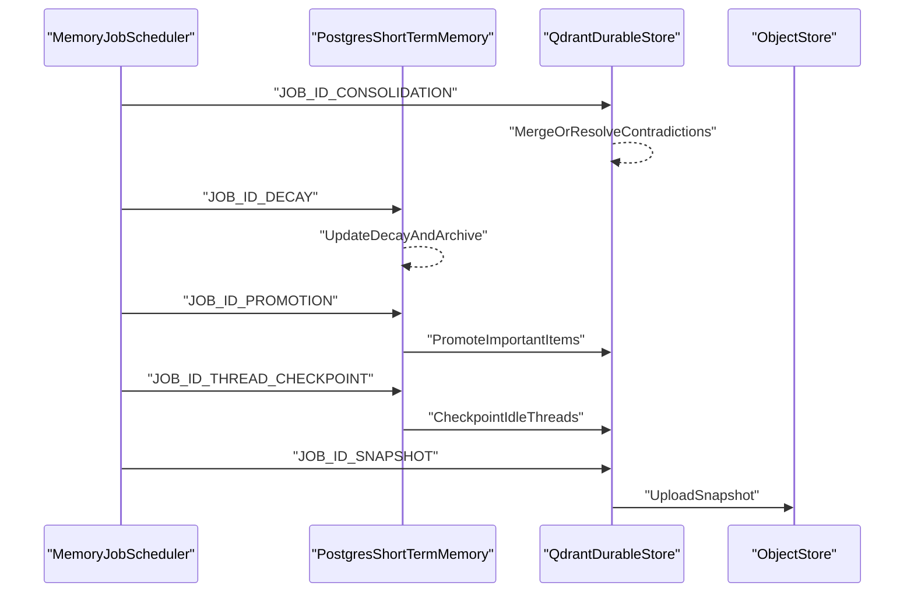

# Daily Logs & Temporal Memory

Relevant source files

The following files were used as context for generating this wiki page:

- [docs/PRDS/PRD-228-FLEET-STATE.md](docs/PRDS/PRD-228-FLEET-STATE.md)
- [frontend/components/agents/__tests__/use-fleet-state.test.tsx](frontend/components/agents/__tests__/use-fleet-state.test.tsx)
- [frontend/components/command-center/__tests__/board-event-stream.test.tsx](frontend/components/command-center/__tests__/board-event-stream.test.tsx)
- [frontend/hooks/use-board-event-stream.ts](frontend/hooks/use-board-event-stream.ts)
- [frontend/lib/chat/api.ts](frontend/lib/chat/api.ts)
- [orchestrator/alembic/versions/prd206_chat_summary.py](orchestrator/alembic/versions/prd206_chat_summary.py)
- [orchestrator/api/fleet.py](orchestrator/api/fleet.py)
- [orchestrator/services/audit_retention.py](orchestrator/services/audit_retention.py)
- [orchestrator/services/board_events.py](orchestrator/services/board_events.py)
- [orchestrator/services/escalation_service.py](orchestrator/services/escalation_service.py)
- [orchestrator/services/memory_archival_job.py](orchestrator/services/memory_archival_job.py)
- [orchestrator/services/memory_jobs.py](orchestrator/services/memory_jobs.py)
- [orchestrator/services/watch_actions.py](orchestrator/services/watch_actions.py)
- [orchestrator/services/watch_rerun.py](orchestrator/services/watch_rerun.py)
- [orchestrator/tests/test_board_dispatch.py](orchestrator/tests/test_board_dispatch.py)
- [orchestrator/tests/test_board_sse_listen_notify.py](orchestrator/tests/test_board_sse_listen_notify.py)
- [orchestrator/tests/test_p2w2_audit_retention.py](orchestrator/tests/test_p2w2_audit_retention.py)
- [orchestrator/tests/test_p2w2_governance_audit.py](orchestrator/tests/test_p2w2_governance_audit.py)
- [orchestrator/tests/test_p2w2_governance_policy_budget.py](orchestrator/tests/test_p2w2_governance_policy_budget.py)
- [orchestrator/tests/test_prd197_substrate.py](orchestrator/tests/test_prd197_substrate.py)
- [orchestrator/tests/test_prd204_rerun.py](orchestrator/tests/test_prd204_rerun.py)
- [orchestrator/tests/test_prd204_run_verdict.py](orchestrator/tests/test_prd204_run_verdict.py)
- [orchestrator/tests/test_prd204_silent_holes.py](orchestrator/tests/test_prd204_silent_holes.py)
- [orchestrator/tests/test_prd204_watch_actions.py](orchestrator/tests/test_prd204_watch_actions.py)
- [orchestrator/tests/test_prd206_thread_checkpoint.py](orchestrator/tests/test_prd206_thread_checkpoint.py)
- [orchestrator/tests/test_prd224_ticket_watch_actions.py](orchestrator/tests/test_prd224_ticket_watch_actions.py)

## Purpose and Scope

Daily logs provide time-indexed activity tracking for workspaces, enabling agents to answer temporal queries like "what did we work on earlier today?" or "what happened yesterday?". The system maintains a structured journal of activities extracted from chat exchanges and heartbeat executions, stored across the multi-tier memory architecture.

Daily logs primarily occupy **L2 (Short-term/Postgres)** and **L3 (Long-term/Durable)** memory tiers. For the overall memory architecture, see [Memory System](). For the unified service managing these operations, see [UnifiedMemoryService]().

Sources: `[orchestrator/modules/memory/unified_memory_service.py:72-74]()`, `[orchestrator/services/memory_jobs.py:32-43]()`

---

## Architecture Overview

The system utilizes a combination of real-time extraction during chat turns and background consolidation jobs to maintain temporal awareness.

### Natural Language to Code Entity Mapping: Temporal Capture

Sources: `[orchestrator/consumers/chatbot/smart_memory.py:109-140]()`, `[orchestrator/services/memory_jobs.py:32-43]()`

### Natural Language to Code Entity Mapping: Temporal Retrieval

Sources: `[orchestrator/modules/memory/context_router.py:61-78]()`, `[orchestrator/modules/memory/context_router.py:107-126]()`, `[orchestrator/modules/context/sections/memory.py:36-74]()`

**Daily Log Pipeline Architecture**

Sources: `[orchestrator/consumers/chatbot/smart_memory.py:109-140]()`, `[orchestrator/consumers/chatbot/smart_orchestrator.py:114-165]()`, `[orchestrator/modules/memory/context_router.py:1-24]()`, `[orchestrator/modules/memory/context_router.py:107-126]()`, `[orchestrator/modules/memory/unified_memory_service.py:72-78]()`, `[orchestrator/modules/context/sections/memory.py:36-74]()`, `[orchestrator/services/memory_jobs.py:32-43]()`, `[orchestrator/services/memory_jobs.py:67-173]()`

---

## Dual-Tier Storage Strategy

Daily logs are mirrored across tiers to balance fast temporal lookups with long-term semantic retrieval.

| Tier | Technology | Purpose | Retention |
|------|------------|---------|-----------|
| **L2** | PostgreSQL (`memory_short_term` table) | Verbatim transcripts and episodic logs. | Ebbinghaus decay (default 0.3 threshold) `[orchestrator/services/memory_jobs.py:11-13]()` |
| **L3** | Qdrant (Durable Store) | Distilled daily facts and summaries. | Long-term via `MemoryNamespace.daily()` `[orchestrator/modules/memory/unified_memory_service.py:72-74]()` |

### Memory Namespacing
All daily logs are scoped using the `MemoryNamespace` utility to prevent cross-workspace leaks (`[orchestrator/modules/memory/unified_memory_service.py:38-121]()`).
- **Daily Logs (L2):** `mem:{workspace_id}:daily` `[orchestrator/modules/memory/unified_memory_service.py:72-74]()`
- **L2 Mirror (L3):** `mem:{workspace_id}:l2` `[orchestrator/modules/memory/unified_memory_service.py:76-78]()`

Sources: `[orchestrator/modules/memory/unified_memory_service.py:38-121]()`, `[orchestrator/services/memory_jobs.py:11-13]()`

---

## Retrieval, Recall Ranking & Temporal Awareness

The `ContextRouter` (`[orchestrator/modules/memory/context_router.py:1-24]()`) is the primary mechanism for detecting when an agent needs temporal information.

### Signal Detection & Recall
The router uses compiled regex patterns (`_TEMPORAL_PATTERNS`) to detect keywords like "yesterday", "last week", or "recently" (`[orchestrator/modules/memory/context_router.py:107-126]()`). If temporal signals are flagged, the system prioritizes fetching daily logs and time-indexed memories.

### Retrieval Flow
1. **ContextRouter** analyzes the query for temporal signals (`[orchestrator/modules/memory/context_router.py:1-24]()`).
2. **MemorySection** (Priority 6) invokes retrieval methods via `SmartMemoryManager.retrieve_memories()` (`[orchestrator/modules/context/sections/memory.py:36-74]()`).
3. The system fetches daily logs and injects them into the system prompt context.

Sources: `[orchestrator/modules/memory/context_router.py:1-24]()`, `[orchestrator/modules/memory/context_router.py:107-126]()`, `[orchestrator/modules/context/sections/memory.py:36-74]()`

---

## Memory Lifecycle & Cleanup Jobs

The `MemoryJobScheduler` manages the aging and promotion of temporal data to ensure the system doesn't become cluttered with irrelevant episodic details.

### Background Jobs
- **Consolidation (Periodic):** Merges near-duplicate L3 memories and resolves contradictions based on recency and confidence (`[orchestrator/services/memory_jobs.py:67-75]()`). This job runs at an interval defined by `MEMORY_CONSOLIDATION_INTERVAL_SECONDS` (default 3600 seconds) `[orchestrator/services/memory_jobs.py:57-59]()`.
- **Decay Scoring (Hourly):** Applies Ebbinghaus retention scoring to L2 rows, archiving items falling below threshold (`[orchestrator/services/memory_jobs.py:77-85]()`). This job runs at an interval defined by `MEMORY_DECAY_INTERVAL_SECONDS` (default 3600 seconds) `[orchestrator/services/memory_jobs.py:60-62]()`.
- **L2→L3 Promotion (Daily):** Promotes important L2 items to L3 durable storage based on importance policy (`[orchestrator/services/memory_jobs.py:87-96]()`). This job runs daily at the hour specified by `MEMORY_PROMOTION_HOUR_UTC` (default 3 UTC) `[orchestrator/services/memory_jobs.py:63-65]()`.
- **Thread Checkpoint (Every 15m):** Summarizes recently idle chat threads and moves new decisions/open loops into L3 (`[orchestrator/services/memory_jobs.py:160-167]()`). This job runs at an interval defined by `THREAD_CHECKPOINT_SWEEP_INTERVAL_SECONDS` (default 900 seconds) `[orchestrator/services/memory_jobs.py:166-167]()`.
- **Qdrant Snapshot (Daily):** Takes snapshots of Qdrant memory planes (durable + field) and uploads them to the object store, pruning both sides to the retention window (`[orchestrator/services/memory_jobs.py:129-144]()`). This job runs daily at the hour specified by `MEMORY_SNAPSHOT_CRON_HOUR_UTC` (default 4 UTC) `[orchestrator/services/memory_jobs.py:134-135]()`.
- **Audit Retention Sweep (Daily):** Prunes audit logs past their retention period (`[orchestrator/services/memory_jobs.py:114-127]()`). This job runs at an interval defined by `AUDIT_RETENTION_SWEEP_INTERVAL_SECONDS` (default 86400 seconds) `[orchestrator/services/memory_jobs.py:117-119]()`.
- **Substrate Metrics Prune (Daily):** Prunes substrate telemetry rows past retention (`[orchestrator/services/memory_jobs.py:146-158]()`). This job runs at an interval defined by `SUBSTRATE_METRICS_PRUNE_INTERVAL_SECONDS` (default 86400 seconds) `[orchestrator/services/memory_jobs.py:149-150]()`.

**Memory Maintenance Flow**

Sources: `[orchestrator/services/memory_jobs.py:32-43]()`, `[orchestrator/services/memory_jobs.py:57-173]()`

---

## Distillation vs. Verbatim Storage

When a chat turn occurs, the `SmartMemoryManager` (`[orchestrator/consumers/chatbot/smart_memory.py:66-88]()`) performs a dual-write:

1.  **Distillation:** Extracts typed facts (e.g., `user_fact`, `preference`) from the exchange using an LLM (`[orchestrator/consumers/chatbot/smart_memory.py:109-140]()`) stored in **L3**.
2.  **Transcript:** The verbatim exchange is stored in **L2** for immediate temporal recall.

The `SmartChatOrchestrator.store_exchange()` method orchestrates this process, ensuring that L1 session memory is updated and L2/L3 writes occur in the background (`[orchestrator/consumers/chatbot/smart_orchestrator.py:114-165]()`). The `test_chat_turn_writes_l2_exactly_once` and `test_chat_turn_writes_l3_exactly_once` tests confirm that L2 and L3 writes happen exactly once per turn, preventing duplicate entries (`[orchestrator/tests/test_memory_single_write_path.py:135-165]()`, `[orchestrator/tests/test_memory_single_write_path.py:167-170]()`).

Sources: `[orchestrator/consumers/chatbot/smart_memory.py:66-140]()`, `[orchestrator/consumers/chatbot/smart_orchestrator.py:114-165]()`, `[orchestrator/tests/test_memory_single_write_path.py:135-165]()`, `[orchestrator/tests/test_memory_single_write_path.py:167-170]()`

---

## Code Entity Reference

| Entity | Location | Purpose |
|--------|----------|---------|
| `MemoryNamespace` | `[orchestrator/modules/memory/unified_memory_service.py:38-121]()` | Scopes memory keys for workspaces and agents. |
| `ContextRouter` | `[orchestrator/modules/memory/context_router.py:1-24]()` | Detects temporal signals in user queries. |
| `MemoryJobScheduler` | `[orchestrator/services/memory_jobs.py:32-43]()` | Manages decay, promotion, and consolidation jobs. |
| `SmartMemoryManager` | `[orchestrator/consumers/chatbot/smart_memory.py:66-88]()` | Handles real-time distillation and storage of chat facts. |
| `SmartChatOrchestrator` | `[orchestrator/consumers/chatbot/smart_orchestrator.py:114-165]()` | Orchestrates conversation state and storage flows. |
| `_TEMPORAL_PATTERNS` | `[orchestrator/modules/memory/context_router.py:107-126]()` | Regex patterns for detecting temporal queries. |

Sources: `[orchestrator/modules/memory/unified_memory_service.py:38-121]()`, `[orchestrator/modules/memory/context_router.py:1-126]()`, `[orchestrator/services/memory_jobs.py:32-43]()`, `[orchestrator/consumers/chatbot/smart_memory.py:66-140]()`, `[orchestrator/consumers/chatbot/smart_orchestrator.py:114-165]()`

---