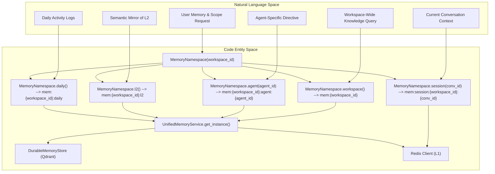
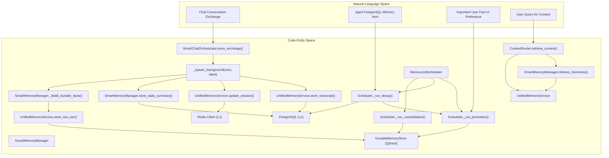

# Five-Layer Memory Architecture

Relevant source files

The following files were used as context for generating this wiki page:

- [orchestrator/consumers/chatbot/integration.py](orchestrator/consumers/chatbot/integration.py)
- [orchestrator/consumers/chatbot/prompt_analyzer.py](orchestrator/consumers/chatbot/prompt_analyzer.py)
- [orchestrator/consumers/chatbot/smart_memory.py](orchestrator/consumers/chatbot/smart_memory.py)
- [orchestrator/consumers/chatbot/smart_orchestrator.py](orchestrator/consumers/chatbot/smart_orchestrator.py)
- [orchestrator/modules/context/sections/memory.py](orchestrator/modules/context/sections/memory.py)
- [orchestrator/modules/memory/context_router.py](orchestrator/modules/memory/context_router.py)
- [orchestrator/modules/memory/unified_memory_service.py](orchestrator/modules/memory/unified_memory_service.py)
- [orchestrator/tests/test_f155_a_widget_turn_recalls_only_its_agents_memories.py](orchestrator/tests/test_f155_a_widget_turn_recalls_only_its_agents_memories.py)
- [orchestrator/tests/test_l3_distill_input.py](orchestrator/tests/test_l3_distill_input.py)
- [orchestrator/tests/test_memory_restart_and_isolation.py](orchestrator/tests/test_memory_restart_and_isolation.py)
- [orchestrator/tests/test_memory_single_write_path.py](orchestrator/tests/test_memory_single_write_path.py)
- [orchestrator/tests/test_memory_stored_sse.py](orchestrator/tests/test_memory_stored_sse.py)
- [orchestrator/tests/test_p2w1_semantic_l2_recall.py](orchestrator/tests/test_p2w1_semantic_l2_recall.py)
- [orchestrator/tests/test_recall_relevance_floor.py](orchestrator/tests/test_recall_relevance_floor.py)
- [orchestrator/tests/test_smart_orchestrator_store_exchange.py](orchestrator/tests/test_smart_orchestrator_store_exchange.py)
- [orchestrator/tests/test_unified_memory.py](orchestrator/tests/test_unified_memory.py)
- [orchestrator/tests/test_us011_context_budgets.py](orchestrator/tests/test_us011_context_budgets.py)

This page documents the hierarchical memory system in Automatos AI, which organizes agent memory into five distinct layers (L0–L4) ranging from immediate conversational focus to long-term organizational knowledge. The architecture coordinates across ephemeral context windows, Redis session stores, PostgreSQL short-term mirrors, Qdrant durable vector spaces, and external RAG/NL2SQL organizational knowledge sources via the centralized `UnifiedMemoryService` [orchestrator/modules/memory/unified_memory_service.py:1-21]() and `ContextRouter` [orchestrator/modules/memory/context_router.py:1-24]().

---

## Purpose and Scope

The Automatos AI memory subsystem solves the multi-tier retention problem in autonomous agent runtimes. Rather than relying solely on flat prompt history or unbounded vector search, it enforces a strict 5-layer separation:
1. **L0: Focus** — Ephemeral token context window.
2. **L1: Working Memory** — Low-latency Redis session cache (`SessionMemory`) persisting 24-hour conversational thread context [orchestrator/modules/memory/unified_memory_service.py:128-134]().
3. **L2: Short-Term Memory** — PostgreSQL-backed verbatim transcripts and daily logs subjected to Ebbinghaus retention scoring and decay [orchestrator/tests/test_unified_memory.py:47]().
4. **L3: Long-Term Memory** — In-process durable Qdrant store (`DurableMemoryStore`) housing distilled typed facts (`MemoryNamespace`) [orchestrator/modules/memory/unified_memory_service.py:38-79]().
5. **L4: Organizational Knowledge** — Tool-driven RAG and NL2SQL pipelines managed by `RAGService` [orchestrator/modules/memory/context_router.py:160-174]().

Sources: [orchestrator/modules/memory/unified_memory_service.py:1-21](), [orchestrator/modules/memory/context_router.py:1-24](), [orchestrator/tests/test_unified_memory.py:47](), [orchestrator/modules/memory/context_router.py:160-174]()

---

## The Five-Layer Memory Stack

The stack is structured hierarchically, allowing efficient promotion, decay, and context retrieval without cross-tenant leakage.

| Layer | Storage Backend | Retention Window | Core Code Entity | Access Method |
|-------|----------------|------------------|------------------|---------------|
| **L0** | LLM Context Window | Current Turn | `messages` list | Direct prompt assembly [orchestrator/modules/context/sections/memory.py:32-51]() |
| **L1** | Redis | 24 Hours | `SessionMemory` | `UnifiedMemoryService.get_session()` [orchestrator/modules/memory/unified_memory_service.py:128-154]() |
| **L2** | PostgreSQL | Decaying (Ebbinghaus) | `MemoryItem` / `MemoryNamespace.l2()` | `search_short_term()` / semantic mirror [orchestrator/modules/memory/unified_memory_service.py:76-78]() |
| **L3** | Qdrant (In-process) | Indefinite (Distilled) | `DurableMemoryStore` / `MemoryNamespace` | `store_long_term()` / `search_long_term()` [orchestrator/modules/memory/unified_memory_service.py:38-79]() |
| **L4** | Vector DB / SQL | Indefinite | `RAGService` / `NL2SQL` | Tool execution / `ContextRouter.build_knowledge_awareness()` [orchestrator/modules/memory/context_router.py:160-174]() |

Sources: [orchestrator/modules/memory/unified_memory_service.py:8-14](), [orchestrator/modules/memory/unified_memory_service.py:128-154](), [orchestrator/modules/memory/unified_memory_service.py:76-78](), [orchestrator/modules/memory/context_router.py:160-174]()

---

## Namespace Isolation & UnifiedMemoryService

To prevent cross-tenant data leaks and unify disparate storage APIs, all memory operations route through `UnifiedMemoryService` while scoping identifiers via `MemoryNamespace` [orchestrator/modules/memory/unified_memory_service.py:38-121]().

Title: "Natural Language Space to Code Entity Space: Memory Namespacing and Service Architecture"

Sources: [orchestrator/modules/memory/unified_memory_service.py:38-121](), [orchestrator/modules/memory/unified_memory_service.py:161-190]()

### Key Classes and Methods
- `MemoryNamespace`: A frozen dataclass that builds standardized, scoped strings for Redis and Qdrant to eliminate string formatting errors [orchestrator/modules/memory/unified_memory_service.py:38-121](). It provides methods like `workspace()`, `agent(agent_id)`, `recipe(recipe_id)`, `workflow(workflow_id)`, `daily()`, `l2()`, `session(conversation_id)`, and `cache_key()` for different memory scopes [orchestrator/modules/memory/unified_memory_service.py:52-92]().
- `UnifiedMemoryService`: Singleton orchestrator managing one shared `DurableMemoryStore` and Redis client [orchestrator/modules/memory/unified_memory_service.py:161-190](). Database sessions are acquired per-request to secure multi-tenancy [orchestrator/modules/memory/unified_memory_service.py:161-169](). It exposes methods like `store_long_term()`, `search_long_term()`, `update_session()`, and `retrieve_context()` [orchestrator/modules/memory/unified_memory_service.py:19-20]().

Sources: [orchestrator/modules/memory/unified_memory_service.py:38-121](), [orchestrator/modules/memory/unified_memory_service.py:161-190](), [orchestrator/modules/memory/unified_memory_service.py:52-92](), [orchestrator/modules/memory/unified_memory_service.py:19-20]()

---

## Context Router & Signal Detection

The `ContextRouter` provides an intelligent pre-LLM context assembly layer [orchestrator/modules/memory/context_router.py:1-24](). It executes regex-based signal detection (`analyze_query`) in under 10ms without I/O [orchestrator/modules/memory/context_router.py:5-10](), followed by targeted multi-tier context assembly (`retrieve_context`) [orchestrator/modules/memory/context_router.py:11-24]().

### Extracted Signals and Budget Allocation
- `ContextSignals`: Dataclass containing boolean flags (`is_temporal`, `is_personal_fact`, `is_session_continuation`, `is_knowledge_query`, `is_live_data`) and temporal windows [orchestrator/modules/memory/context_router.py:61-77](). These flags determine which memory layers should be consulted [orchestrator/modules/memory/context_router.py:65-66]().
- `ContextBundle`: Assembled prompt sections (`session_summary`, `long_term_memories`, `temporal_results`, `daily_logs`, `knowledge_awareness`) constrained by token budgets [orchestrator/modules/memory/context_router.py:83-100]().
- **Budget Weights (`_CONTEXT_BUDGET_WEIGHTS`)**: Allocates fractions of an 80% usable context window (`session`: 0.10, `long_term`: 0.15, `temporal`: 0.10, `daily`: 0.08, `awareness`: 0.05, reserving 20% for tools and system prompts) [orchestrator/modules/memory/context_router.py:45-54]().

Sources: [orchestrator/modules/memory/context_router.py:5-100](), [orchestrator/modules/memory/context_router.py:61-77](), [orchestrator/modules/memory/context_router.py:65-66](), [orchestrator/modules/memory/context_router.py:83-100](), [orchestrator/modules/memory/context_router.py:45-54]()

---

## Memory Lifecycle & Consolidation

The `SmartChatOrchestrator` schedules memory writes as fire-and-forget background tasks to avoid blocking streaming responses [orchestrator/consumers/chatbot/smart_orchestrator.py:30-53](). This ensures that L3 durable writes, L2 transcript storage, L1 session updates, and daily summaries do not introduce latency [orchestrator/tests/test_smart_orchestrator_store_exchange.py:127-145](). The `SmartMemoryManager` handles the classification of memory tiers, ensuring that a chat turn writes to L1 and L2 exactly once, and that L3 facts are distilled and stored appropriately [orchestrator/tests/test_memory_single_write_path.py:120-166]().

Title: "Natural Language Space to Code Entity Space: Memory Lifecycle and Background Jobs"

Sources: [orchestrator/consumers/chatbot/smart_orchestrator.py:30-53](), [orchestrator/tests/test_smart_orchestrator_store_exchange.py:127-145](), [orchestrator/tests/test_memory_single_write_path.py:120-166](), [orchestrator/consumers/chatbot/smart_memory.py:109-137](), [orchestrator/modules/memory/unified_memory_service.py:161-190]()

### Scheduled Operations
- **Consolidation**: Runs periodically via `MemoryJobScheduler` to merge near-duplicate L3 memories and supersede contradictory facts by recency and confidence [orchestrator/services/memory_jobs.py:32-75]().
- **Decay Scoring**: Hourly job executing Ebbinghaus retention scoring on PostgreSQL L2 rows, archiving items falling below the threshold (default `0.3`) [orchestrator/tests/test_unified_memory.py:48](), [orchestrator/services/memory_jobs.py:77-86]().
- **L2→L3 Promotion**: Daily job promoting high-signal L2 items (`user_fact`, `preference`, `procedure`) verbatim into the L3 durable Qdrant store [orchestrator/tests/test_unified_memory.py:51](), [orchestrator/services/memory_jobs.py:87-96]().
- **Thread Checkpoints**: Periodic background sweeps summarize idle threads into `chats.summary` and push new decisions/open loops into L3 via the S1 write contract [orchestrator/services/memory_jobs.py:160-173]().

Sources: [orchestrator/tests/test_unified_memory.py:48](), [orchestrator/tests/test_unified_memory.py:51](), [orchestrator/services/memory_jobs.py:32-173]()

---