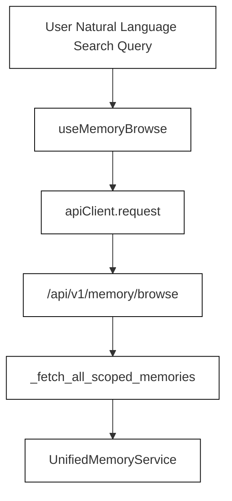
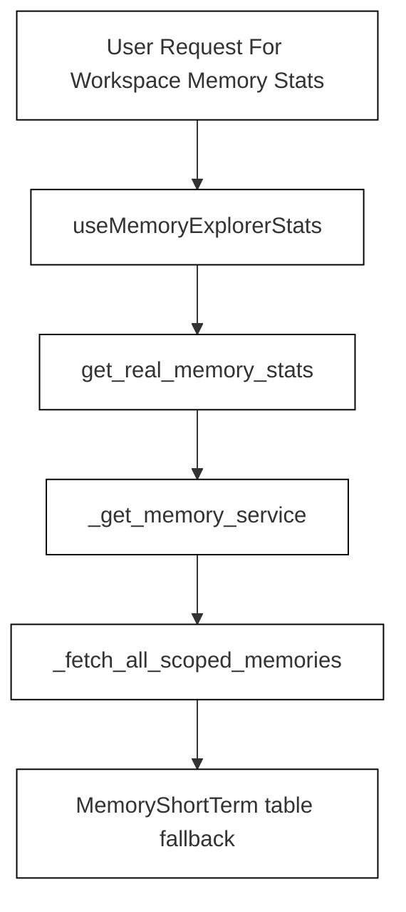

# Memory API Reference

Relevant source files

The following files were used as context for generating this wiki page:

- [frontend/components/activity/memory-card.tsx](frontend/components/activity/memory-card.tsx)
- [frontend/components/activity/memory/health-banner.tsx](frontend/components/activity/memory/health-banner.tsx)
- [frontend/components/activity/memory/index.ts](frontend/components/activity/memory/index.ts)
- [frontend/components/activity/memory/memory-sidebar.tsx](frontend/components/activity/memory/memory-sidebar.tsx)
- [frontend/components/activity/projects/index.ts](frontend/components/activity/projects/index.ts)
- [frontend/hooks/use-memory-explorer-api.ts](frontend/hooks/use-memory-explorer-api.ts)
- [orchestrator/api/memory_stats.py](orchestrator/api/memory_stats.py)

## Purpose and Scope

This page documents the programmatic interfaces for interacting with the layered memory system in Automatos AI. It covers Python class methods, data structures, REST endpoints exposed by the memory subsystem, frontend React Query hooks, UI components, and security boundaries.

Sources: [orchestrator/api/memory_stats.py:1-45]()

---

## Overview

The memory API is exposed through primary service classes, REST endpoints, and frontend hooks:

- **`UnifiedMemoryService`**: Central singleton managing all memory operations across L1/L2/L3 layers with database sessions acquired per request [orchestrator/modules/memory/unified_memory_service.py:161-190]().
- **`MemoryNamespace`**: Helper for building standardized, scoped `user_id` strings to prevent memory leakage between workspaces and agents [orchestrator/modules/memory/unified_memory_service.py:38-121]().
- **`SmartMemoryManager`**: Handles intelligent retrieval (global vs. agent-specific) and background storage for the chat interface [orchestrator/consumers/chatbot/smart_memory.py:66-100]().
- **`ContextRouter`**: Pre-LLM layer that analyzes queries to decide which memory layers to fetch [orchestrator/modules/memory/context_router.py:1-24]().

All memory operations are asynchronous. Memory writes (distilled facts) are handled in background tasks to avoid blocking streaming responses [orchestrator/consumers/chatbot/smart_orchestrator.py:36-52]().

Sources: [orchestrator/modules/memory/unified_memory_service.py:161-190](), [orchestrator/consumers/chatbot/smart_memory.py:66-100](), [orchestrator/consumers/chatbot/smart_orchestrator.py:36-52]()

---

## MemoryNamespace & Scoping

### Purpose
`MemoryNamespace` builds standardized `user_id` strings for the durable store (L3) and Redis keys (L1) [orchestrator/modules/memory/unified_memory_service.py:38-46](). All memory consumers must use this helper instead of raw string concatenation to prevent scope inconsistencies.

### Key Scopes
| Scope Helper | Format | Description |
|--------------|--------|-------------|
| `workspace()` | `mem:{workspace_id}` | Workspace-wide facts (L3 global) [orchestrator/modules/memory/unified_memory_service.py:52-55](). |
| `agent(id)` | `mem:{ws_id}:agent:{id}` | Agent-specific long-term memories [orchestrator/modules/memory/unified_memory_service.py:56-59](). |
| `recipe(id)` | `mem:{ws_id}:recipe:{id}` | Recipe learnings (L3 per-recipe) [orchestrator/modules/memory/unified_memory_service.py:60-63](). |
| `recipe_agent(recipe_id, agent_id)` | `mem:{ws_id}:recipe:{recipe_id}:agent:{agent_id}` | Per-agent step memories within a recipe (L3) [orchestrator/modules/memory/unified_memory_service.py:64-67](). |
| `workflow(id)` | `mem:{ws_id}:workflow:{id}` | Workflow execution memories (L3 per-workflow) [orchestrator/modules/memory/unified_memory_service.py:68-71](). |
| `daily()` | `mem:{workspace_id}:daily` | Daily activity logs (L2) [orchestrator/modules/memory/unified_memory_service.py:72-75](). |
| `l2()` | `mem:{workspace_id}:l2` | Semantic mirror of L2 short-term rows [orchestrator/modules/memory/unified_memory_service.py:76-79](). |
| `session(id)` | `mem:session:{ws_id}:{id}` | Session cache key (L1 Redis) [orchestrator/modules/memory/unified_memory_service.py:82-85](). |
| `cache_key(agent_id, query_hash)` | `mem:cache:{ws_id}:{scope}:{query_hash}` | Cache key for L3 durable-store search results cached in Redis [orchestrator/modules/memory/unified_memory_service.py:87-91](). |

Sources: [orchestrator/modules/memory/unified_memory_service.py:38-121]()

---

## Memory API Reference (REST & Auth Architecture)

### Memory Explorer REST Endpoints
**Prefix:** `/api/v1/memory` [orchestrator/api/memory_stats.py:33-36]()

The Memory Explorer is a workspace-scoped feature that allows users to browse and search their agent's memories [orchestrator/api/memory_stats.py:27-36](). Under PRD-77 and PRD-143, read operations (`/browse`, `/health`, `/stats/real`, `/layers`) are tenant-isolated via hybrid auth (`get_request_context_hybrid`), allowing authenticated workspace members to view their own data without super-admin permissions [orchestrator/api/memory_stats.py:27-36](). Destructive operations remain protected by `admin_router` under `require_super_admin` [orchestrator/api/memory_stats.py:37-45]().

| Endpoint | Method | Access Level | Description |
|----------|--------|--------------|-------------|
| `/api/v1/memory/stats/real` | `GET` | Workspace Member | Aggregated stats across Mem0 (L3) and local L2 tables [orchestrator/api/memory_stats.py:141-168](). |
| `/api/v1/memory/browse` | `GET` | Workspace Member | Browse memories with pagination, search, and filtering [orchestrator/api/memory_stats.py:200-203](). |
| `/api/v1/memory/health` | `GET` | Workspace Member | Get health status of memory services [orchestrator/api/memory_stats.py:240-243](). |
| `/api/v1/memory/{memory_id}` | `DELETE` | Super Admin | Delete a single memory by ID [orchestrator/api/memory_stats.py:327-330](). |
| `/api/v1/memory/consolidate` | `POST` | Super Admin | Trigger memory consolidation for a workspace [orchestrator/api/memory_stats.py:298-301](). |

Sources: [orchestrator/api/memory_stats.py:27-45](), [orchestrator/api/memory_stats.py:141-168]()

---

## Frontend Hooks & UI Integration

The frontend integrates with the Memory API via React Query hooks defined in `use-memory-explorer-api.ts` and UI components under `components/activity/memory/` [frontend/hooks/use-memory-explorer-api.ts:1-8]().

### Key Hooks & Components
- `useMemoryBrowse(filters)`: Queries browse endpoints with support for pagination, search queries, and tier scoping [frontend/hooks/use-memory-explorer-api.ts:106-122]().
- `useMemoryHealth()`: Fetches service health and connectivity metrics [frontend/hooks/use-memory-explorer-api.ts:127-134]().
- `useMemoryExplorerStats()`: Retrieves real system statistics from `/api/v1/memory/stats/real` [frontend/hooks/use-memory-explorer-api.ts:139-146]().
- `useDeleteMemory()`: Provides a mutation hook to delete a single memory by its ID [frontend/hooks/use-memory-explorer-api.ts:153-170]().
- `useConsolidateMemories()`: Provides a mutation hook to consolidate (merge) multiple memories into one [frontend/hooks/use-memory-explorer-api.ts:175-197]().
- `HealthBanner`: Displays summary cards for total memories, health status, search hit rate, and latest activity [frontend/components/activity/memory/health-banner.tsx:7-58]().
- `MemorySidebar`: Renders a sidebar for browsing and searching memories, grouped by date, with filter chips for content types [frontend/components/activity/memory/memory-sidebar.tsx:89-184]().
- `MemoryCard`: Displays an individual memory item with its content, score, tier, and metadata [frontend/components/activity/memory-card.tsx:35-142]().

Sources: [frontend/hooks/use-memory-explorer-api.ts:1-197](), [frontend/components/activity/memory/health-banner.tsx:7-58](), [frontend/components/activity/memory/memory-sidebar.tsx:89-184](), [frontend/components/activity/memory-card.tsx:35-142]()

### Diagram: Natural Language Space to Code Entity Space - Explorer API & UI

Sources: [frontend/hooks/use-memory-explorer-api.ts:106-122](), [orchestrator/api/memory_stats.py:86-138]()

---

## Implementation Details

### UnifiedMemoryService
The `UnifiedMemoryService` acts as the single entry point for all memory operations [orchestrator/modules/memory/unified_memory_service.py:5](). It manages the `DurableMemoryStore` (L3, in-process Qdrant) and a Redis client (L1 session and caching) [orchestrator/modules/memory/unified_memory_service.py:187-190](). Database sessions for L2 (Postgres) are acquired per-request to prevent cross-tenant data leaks [orchestrator/modules/memory/unified_memory_service.py:167-168]().

Sources: [orchestrator/modules/memory/unified_memory_service.py:5](), [orchestrator/modules/memory/unified_memory_service.py:167-190]()

### SmartMemoryManager
The `SmartMemoryManager` provides intelligent memory management for the chatbot [orchestrator/consumers/chatbot/smart_memory.py:66-76](). It integrates with `UnifiedMemoryService` for memory operations [orchestrator/consumers/chatbot/smart_memory.py:90-99]().

Sources: [orchestrator/consumers/chatbot/smart_memory.py:66-99]()

### Diagram: Natural Language Space to Code Entity Space - Stats & Fallback Engine

Sources: [frontend/hooks/use-memory-explorer-api.ts:139-146](), [orchestrator/api/memory_stats.py:141-168]()

---

## Error Handling & Fallbacks

The memory system implements multiple safety layers to guarantee that agent execution and UI exploration never hard-crash due to downstream service interruptions:

1. **Durable Store Fallback**: If the Qdrant-backed `DurableMemoryStore` is unavailable, `memory_stats.py` automatically falls back to local `MemoryShortTerm` Postgres records [orchestrator/api/memory_stats.py:141-168]().
2. **Transient Error Handling**: Cached settings and fallback stores ensure connection failures gracefully revert to default behaviors without poisoning the cache state [orchestrator/api/memory_stats.py:159-160]().

Sources: [orchestrator/api/memory_stats.py:141-168]()

---