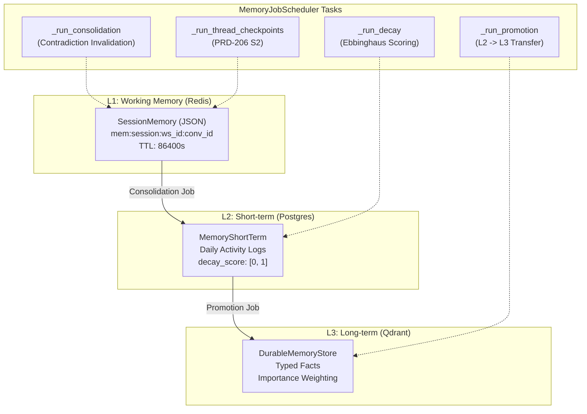
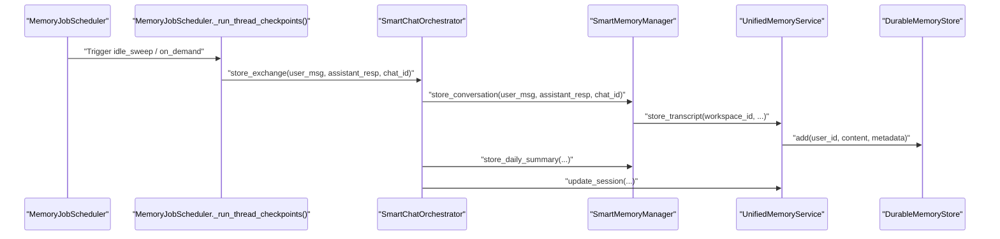

# Memory Lifecycle & Consolidation

<details>
<summary>Relevant source files</summary>

The following files were used as context for generating this wiki page:

- [docs/PRDS/PRD-228-FLEET-STATE.md](docs/PRDS/PRD-228-FLEET-STATE.md)
- [frontend/components/agents/__tests__/use-fleet-state.test.tsx](frontend/components/agents/__tests__/use-fleet-state.test.tsx)
- [frontend/components/command-center/__tests__/board-event-stream.test.tsx](frontend/components/command-center/__tests__/board-event-stream.test.tsx)
- [frontend/components/missions/__tests__/field-viz-error-boundary.test.tsx](frontend/components/missions/__tests__/field-viz-error-boundary.test.tsx)
- [frontend/components/missions/__tests__/mission-field-viz-utils.test.ts](frontend/components/missions/__tests__/mission-field-viz-utils.test.ts)
- [frontend/components/missions/field-viz-error-boundary.tsx](frontend/components/missions/field-viz-error-boundary.tsx)
- [frontend/hooks/use-board-event-stream.ts](frontend/hooks/use-board-event-stream.ts)
- [frontend/lib/chat/api.ts](frontend/lib/chat/api.ts)
- [orchestrator/alembic/versions/prd206_chat_summary.py](orchestrator/alembic/versions/prd206_chat_summary.py)
- [orchestrator/api/fleet.py](orchestrator/api/fleet.py)
- [orchestrator/core/ports/context.py](orchestrator/core/ports/context.py)
- [orchestrator/core/qdrant_writes.py](orchestrator/core/qdrant_writes.py)
- [orchestrator/modules/context/adapters/redis_context.py](orchestrator/modules/context/adapters/redis_context.py)
- [orchestrator/modules/context/adapters/vector_field.py](orchestrator/modules/context/adapters/vector_field.py)
- [orchestrator/modules/context/instrumentation.py](orchestrator/modules/context/instrumentation.py)
- [orchestrator/modules/memory/durable_store.py](orchestrator/modules/memory/durable_store.py)
- [orchestrator/modules/tools/discovery/handlers_field.py](orchestrator/modules/tools/discovery/handlers_field.py)
- [orchestrator/services/audit_retention.py](orchestrator/services/audit_retention.py)
- [orchestrator/services/board_events.py](orchestrator/services/board_events.py)
- [orchestrator/services/escalation_service.py](orchestrator/services/escalation_service.py)
- [orchestrator/services/memory_archival_job.py](orchestrator/services/memory_archival_job.py)
- [orchestrator/services/memory_jobs.py](orchestrator/services/memory_jobs.py)
- [orchestrator/services/watch_actions.py](orchestrator/services/watch_actions.py)
- [orchestrator/services/watch_rerun.py](orchestrator/services/watch_rerun.py)
- [orchestrator/tests/test_board_dispatch.py](orchestrator/tests/test_board_dispatch.py)
- [orchestrator/tests/test_board_sse_listen_notify.py](orchestrator/tests/test_board_sse_listen_notify.py)
- [orchestrator/tests/test_f103_field_write_retried_once.py](orchestrator/tests/test_f103_field_write_retried_once.py)
- [orchestrator/tests/test_f103_memory_write_not_lost_silently.py](orchestrator/tests/test_f103_memory_write_not_lost_silently.py)
- [orchestrator/tests/test_p2w2_audit_retention.py](orchestrator/tests/test_p2w2_audit_retention.py)
- [orchestrator/tests/test_p2w2_governance_audit.py](orchestrator/tests/test_p2w2_governance_audit.py)
- [orchestrator/tests/test_p2w2_governance_policy_budget.py](orchestrator/tests/test_p2w2_governance_policy_budget.py)
- [orchestrator/tests/test_prd154_s7_field.py](orchestrator/tests/test_prd154_s7_field.py)
- [orchestrator/tests/test_prd166_field_scoring.py](orchestrator/tests/test_prd166_field_scoring.py)
- [orchestrator/tests/test_prd178_field_trace_readonly.py](orchestrator/tests/test_prd178_field_trace_readonly.py)
- [orchestrator/tests/test_prd197_substrate.py](orchestrator/tests/test_prd197_substrate.py)
- [orchestrator/tests/test_prd204_rerun.py](orchestrator/tests/test_prd204_rerun.py)
- [orchestrator/tests/test_prd204_run_verdict.py](orchestrator/tests/test_prd204_run_verdict.py)
- [orchestrator/tests/test_prd204_silent_holes.py](orchestrator/tests/test_prd204_silent_holes.py)
- [orchestrator/tests/test_prd204_watch_actions.py](orchestrator/tests/test_prd204_watch_actions.py)
- [orchestrator/tests/test_prd206_thread_checkpoint.py](orchestrator/tests/test_prd206_thread_checkpoint.py)
- [orchestrator/tests/test_prd224_ticket_watch_actions.py](orchestrator/tests/test_prd224_ticket_watch_actions.py)
- [orchestrator/tests/test_vector_field.py](orchestrator/tests/test_vector_field.py)

</details>


## Purpose & Scope

The memory lifecycle and consolidation subsystem manages the automated transition, retention, and maintenance of information across the platform's multi-tier storage layers (`L0` through `L4`). It prevents unbounded database growth, resolves conflicting facts via contradiction-based merging, handles Ebbinghaus time-based decay, promotes high-signal items into the durable vector space, and safeguards against network timeouts during high-load write operations.

Sources: [orchestrator/modules/memory/unified_memory_service.py:1-21](), [orchestrator/services/memory_jobs.py:1-22]()

---

## 1. Overview & Architecture

Memories in Automatos AI follow a defined lifecycle coordinated by `UnifiedMemoryService` [orchestrator/modules/memory/unified_memory_service.py:161-170]() and background workers registered on `MemoryJobScheduler` [orchestrator/services/memory_jobs.py:32-44]().

### Memory Stack Tiers
*   **L0 (Focus)**: Immediate prompt context window (stateless per execution).
*   **L1 (Working / Session)**: Redis-backed conversation cache persisting across browser refreshes within a 24-hour window via `SessionMemory` [orchestrator/modules/memory/unified_memory_service.py:128-134]().
*   **L2 (Short-term)**: Postgres-backed daily activity logs and transcripts subject to decay scoring [orchestrator/services/memory_jobs.py:11-13]().
*   **L3 (Long-term)**: Durable facts stored in an in-process Qdrant vector instance (`DurableMemoryStore`), distilled from transcripts or stored directly [orchestrator/modules/memory/unified_memory_service.py:186-190](), [orchestrator/modules/memory/durable_store.py:77-84]().
*   **L4 (Organizational Knowledge)**: RAG and NL2SQL data accessed on demand via tools.

Title: "Memory Transition & Background Jobs (Code Entity Space)"


Sources: [orchestrator/modules/memory/unified_memory_service.py:8-13](), [orchestrator/modules/memory/unified_memory_service.py:82-85](), [orchestrator/services/memory_jobs.py:4-44]()

---

## 2. L1 Working Memory & Consolidation

### Session State Implementation
`SessionMemory` tracks summary metrics, exchange counts, and status flags per conversation in Redis [orchestrator/modules/memory/unified_memory_service.py:128-140](). Namespaces are rigidly constructed via `MemoryNamespace` to prevent cross-tenant collisions [orchestrator/modules/memory/unified_memory_service.py:38-46]().

```python
@dataclass
class SessionMemory:
    summary: str = ""
    exchange_count: int = 0
    last_updated: str = ""
    ended: bool = False
```
*Cited from [orchestrator/modules/memory/unified_memory_service.py:128-140]().*

### Contradiction-Based Consolidation
The periodic consolidation task (`_run_consolidation`) executes contradiction-based invalidation [orchestrator/services/memory_jobs.py:6-9](). Per workspace, near-duplicate L3 memories merge into one canonical record, and contradictions are superseded by recency and confidence [orchestrator/services/memory_jobs.py:7-9](). This process replaces the older L1 session-decision scan.

Sources: [orchestrator/modules/memory/unified_memory_service.py:38-46](), [orchestrator/modules/memory/unified_memory_service.py:128-140](), [orchestrator/services/memory_jobs.py:6-9]()

---

## 3. L2 Short-term Memory & Ebbinghaus Decay

### Ebbinghaus Decay Scoring
The background daemon `JOB_ID_DECAY` runs hourly to recompute the `decay_score` for all active L2 records [orchestrator/services/memory_jobs.py:36]().
*   **Decay Formula**: Evaluates retention drop-off using an Ebbinghaus curve based on elapsed time since `last_accessed`.
*   **Archival Threshold**: Records falling below the retention threshold (default `0.3`) are archived [orchestrator/services/memory_jobs.py:11-13]().

### Semantic L2 Mirroring
Daily logs are organized under `MemoryNamespace.daily()` [orchestrator/modules/memory/unified_memory_service.py:72-74](). Additionally, short-term data is semantically mirrored into the durable store's `l2` namespace (`MemoryNamespace.l2()`) to allow vector search queries across recent execution transcripts [orchestrator/modules/memory/unified_memory_service.py:76-79]().

Sources: [orchestrator/modules/memory/unified_memory_service.py:72-79](), [orchestrator/services/memory_jobs.py:11-13](), [orchestrator/services/memory_jobs.py:78-85]()

---

## 4. Promotion to L3 Long-term Memory & Durable Store

### L3 Promotion Logic
The `JOB_ID_PROMOTION` task runs daily to evaluate and promote qualifying L2 items into the durable L3 vector collection (`durable_memory`) [orchestrator/services/memory_jobs.py:37, 89-96]().
*   **Importance Checks**: Items meeting the type-aware importance policy are stored verbatim [orchestrator/services/memory_jobs.py:15-17]().
*   **Content Hashing**: Deduplication checks occur via content hashing prior to vector insertion [orchestrator/services/memory_jobs.py:18]().

### Robust Write Guarantees & Thread Checkpoints
To prevent blocking client requests during high-concurrency event loops, background tasks and distillation workflows handle memory extraction asynchronously via `_spawn_background` [orchestrator/consumers/chatbot/smart_orchestrator.py:36-53](). The `SmartChatOrchestrator.store_exchange` method schedules these writes as fire-and-forget tasks, ensuring the main request thread is not blocked by potentially slow L3 writes [orchestrator/tests/test_smart_orchestrator_store_exchange.py:92-122](). This ensures that L1 session updates, L2 transcript storage, and L3 fact distillation are all handled asynchronously [orchestrator/tests/test_smart_orchestrator_store_exchange.py:125-143]().

The `_run_thread_checkpoints` job, scheduled to run every 15 minutes, is responsible for checkpointing recently-idle chat threads. This involves summarizing the chat onto `chats.summary` and promoting new decisions or open loops into L3. The batch cap bounds LLM spend per sweep, and the `checkpointed_at` watermark prevents already-checkpointed threads from being re-processed [orchestrator/services/memory_jobs.py:160-173]().

Title: "Thread Checkpoint & Distillation Flow (Natural Language to Code Entities)"


Sources: [orchestrator/services/memory_jobs.py:15-19](), [orchestrator/modules/memory/durable_store.py:77-84](), [orchestrator/consumers/chatbot/smart_orchestrator.py:36-53](), [orchestrator/services/memory_jobs.py:160-173](), [orchestrator/tests/test_smart_orchestrator_store_exchange.py:92-122](), [orchestrator/tests/test_smart_orchestrator_store_exchange.py:125-143]()

---

## 5. Background Maintenance Daemons

`MemoryJobScheduler` orchestrates recurring background operations via APScheduler [orchestrator/services/memory_jobs.py:32-44]().

| Job Constant ID | Frequency | Responsible Service / Routine | Purpose |
| :--- | :--- | :--- | :--- |
| `JOB_ID_CONSOLIDATION` | Config interval (default 3600s) | `_run_consolidation()` | Contradiction-based invalidation and near-duplicate merging [orchestrator/services/memory_jobs.py:35, 67-75]() |
| `JOB_ID_DECAY` | Hourly (configurable) | `_run_decay()` | Ebbinghaus retention scoring and short-term archiving [orchestrator/services/memory_jobs.py:36, 78-85]() |
| `JOB_ID_PROMOTION` | Daily (UTC hour) | `_run_promotion()` | High-signal L2 to L3 durable promotion [orchestrator/services/memory_jobs.py:37, 89-96]() |
| `JOB_ID_ARCHIVAL` | Monthly | `_run_archival()` | Archiving stale L2/L3 records into workspace knowledge graphs [orchestrator/services/memory_jobs.py:38, 98-112]() |
| `JOB_ID_AUDIT_RETENTION` | Daily (interval) | `_run_audit_retention()` | Pruning expired audit trail rows [orchestrator/services/memory_jobs.py:39, 117-127]() |
| `JOB_ID_SNAPSHOT` | Daily | `_run_snapshot()` | Backing up Qdrant memory planes to object store [orchestrator/services/memory_jobs.py:40, 129-144]() |
| `JOB_ID_SUBSTRATE_PRUNE` | Daily (interval) | `_run_substrate_prune()` | Truncating outdated substrate telemetry records [orchestrator/services/memory_jobs.py:41, 146-158]() |
| `JOB_ID_THREAD_CHECKPOINT` | 15 mins (configurable) | `_run_thread_checkpoints()` | Checkpointing recently-idle chat threads into L3 and summaries [orchestrator/services/memory_jobs.py:42, 160-173]() |

Sources: [orchestrator/services/memory_jobs.py:32-173](), [orchestrator/modules/memory/thread_checkpoint.py:1-20]()

---