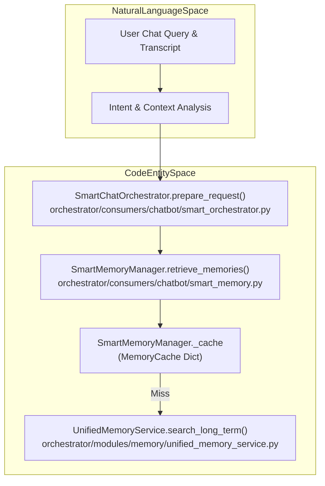
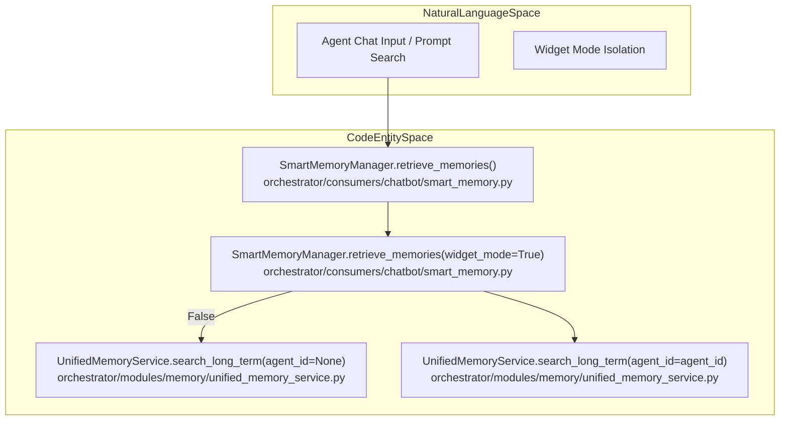

# SmartMemoryManager

Relevant source files

The following files were used as context for generating this wiki page:

- [orchestrator/consumers/chatbot/integration.py](orchestrator/consumers/chatbot/integration.py)
- [orchestrator/consumers/chatbot/prompt_analyzer.py](orchestrator/consumers/chatbot/prompt_analyzer.py)
- [orchestrator/consumers/chatbot/smart_memory.py](orchestrator/consumers/chatbot/smart_memory.py)
- [orchestrator/consumers/chatbot/smart_orchestrator.py](orchestrator/consumers/chatbot/smart_orchestrator.py)
- [orchestrator/modules/context/sections/memory.py](orchestrator/modules/context/sections/memory.py)
- [orchestrator/modules/memory/context_router.py](orchestrator/modules/memory/context_router.py)
- [orchestrator/modules/memory/unified_memory_service.py](orchestrator/modules/memory/unified_memory_service.py)
- [orchestrator/tests/test_f155_a_widget_turn_recalls_only_its_agents_memories.py](orchestrator/tests/test_f155_a_widget_turn_recalls_only_its_agents_memories.py)
- [orchestrator/tests/test_l3_distill_input.py](orchestrator/tests/test_l3_distill_input.py)
- [orchestrator/tests/test_memory_restart_and_isolation.py](orchestrator/tests/test_memory_restart_and_isolation.py)
- [orchestrator/tests/test_memory_single_write_path.py](orchestrator/tests/test_memory_single_write_path.py)
- [orchestrator/tests/test_memory_stored_sse.py](orchestrator/tests/test_memory_stored_sse.py)
- [orchestrator/tests/test_p2w1_semantic_l2_recall.py](orchestrator/tests/test_p2w1_semantic_l2_recall.py)
- [orchestrator/tests/test_recall_relevance_floor.py](orchestrator/tests/test_recall_relevance_floor.py)
- [orchestrator/tests/test_smart_orchestrator_store_exchange.py](orchestrator/tests/test_smart_orchestrator_store_exchange.py)
- [orchestrator/tests/test_unified_memory.py](orchestrator/tests/test_unified_memory.py)
- [orchestrator/tests/test_us011_context_budgets.py](orchestrator/tests/test_us011_context_budgets.py)

The `SmartMemoryManager` (`orchestrator/consumers/chatbot/smart_memory.py`) provides intelligent memory management for chatbot interactions in Automatos AI [orchestrator/consumers/chatbot/smart_memory.py:1-13](). It orchestrates two-tier memory retrieval (global workspace memories + agent-specific memories), performs smart storage classification via distillation using canonical write contracts (`modules.memory.write_contract`), and handles caching and background persistence [orchestrator/consumers/chatbot/smart_memory.py:6-12](). This system acts as the high-level manager bridging the chat interface and the `UnifiedMemoryService` (`orchestrator/modules/memory/unified_memory_service.py`) [orchestrator/consumers/chatbot/smart_memory.py:78-100]().

For lower-level memory storage operations, see [UnifiedMemoryService](3.2). For prompt assembly with memory injection, see [Context Service](4).

Sources:
- [orchestrator/consumers/chatbot/smart_memory.py:1-13]()
- [orchestrator/consumers/chatbot/smart_memory.py:78-100]()
- [orchestrator/modules/memory/unified_memory_service.py:1-21]()

---

## Architecture & Data Flow

The `SmartMemoryManager` is the primary interface used by the `SmartChatOrchestrator` (`orchestrator/consumers/chatbot/smart_orchestrator.py`) to interact with the multi-layered memory system [orchestrator/consumers/chatbot/smart_orchestrator.py:114-161](). It abstracts the complexity of searching across different namespaces and handles the logic for extracting user-specific facts like names and preferences [orchestrator/consumers/chatbot/smart_memory.py:66-76]().

### Diagram: Natural Language Space to Code Entity Space (Retrieval & Orchestration)

Sources:
- [orchestrator/consumers/chatbot/smart_orchestrator.py:167-188]()
- [orchestrator/consumers/chatbot/smart_memory.py:66-99]()
- [orchestrator/consumers/chatbot/smart_memory.py:142-166]()

---

## Core Classes and Data Structures

### UserContext
A dataclass that holds extracted user facts from memories (`orchestrator/consumers/chatbot/smart_memory.py`) [orchestrator/consumers/chatbot/smart_memory.py:42-55](). This is used to personalize the system prompt by identifying names and preferences [orchestrator/consumers/chatbot/smart_memory.py:70-74]().

| Field | Type | Description |
|-------|------|-------------|
| `name` | `Optional[str]` | User's name extracted from memories |
| `preferences` | `List[str]` | User preferences (`"I prefer..."`, `"I like..."`) |
| `facts` | `List[str]` | General facts about the user |
| `recent_topics` | `List[str]` | Recently discussed topics |
| `last_interaction` | `Optional[datetime]` | Timestamp of the previous session |

Sources:
- [orchestrator/consumers/chatbot/smart_memory.py:42-55]()

### MemoryResult
The unified return type for retrieval operations (`orchestrator/consumers/chatbot/smart_memory.py`), containing both raw data and processed context [orchestrator/consumers/chatbot/smart_memory.py:57-64]().

| Field | Type | Description |
|-------|------|-------------|
| `memories` | `List[Dict[str, Any]]` | Raw memory items from the durable store |
| `user_context` | `UserContext` | Extracted user context |
| `formatted_context` | `str` | LLM-ready formatted string |
| `retrieval_time_ms` | `float` | Query execution time |

Sources:
- [orchestrator/consumers/chatbot/smart_memory.py:57-64]()

---

## Two-Tier Memory Retrieval and Widget Mode

The system performs parallel or scoped searches across two distinct tiers to provide both general user context and agent-specific patterns.

### Retrieval Logic
1. **Global Tier**: Searches memories scoped to the `workspace_id` (`orchestrator/modules/memory/unified_memory_service.py`). These contain facts about the user that apply across all agents.
2. **Agent Tier**: Searches memories scoped to the `workspace_id` AND `agent_id` (`orchestrator/modules/memory/unified_memory_service.py`). These contain patterns specific to how the user interacts with a particular agent.

### Diagram: Natural Language Space to Code Entity Space (Two-Tier Retrieval Execution)

Sources:
- [orchestrator/consumers/chatbot/smart_memory.py:157-193]()
- [orchestrator/modules/memory/unified_memory_service.py:111-121]()

### Widget Mode Isolation
When `widget_mode` is enabled, `SmartMemoryManager.retrieve_memories()` restricts retrieval to the **Agent Tier** only, preventing external widget users from accessing global workspace memories (`orchestrator/consumers/chatbot/smart_memory.py`). This is crucial for maintaining privacy and relevance in embedded contexts. The `MemorySection` also skips the `ContextRouter` and daily logs in widget mode, ensuring only agent-specific memories are recalled (`orchestrator/modules/context/sections/memory.py`).

Sources:
- [orchestrator/consumers/chatbot/smart_memory.py:157-193]()
- [orchestrator/modules/context/sections/memory.py:95-103]()

---

## Memory Storage, Distillation, and Write Contracts

The system uses a distillation pattern to ensure only durable, high-value facts reach the L3 memory layer, rather than raw interaction logs.

### Distillation and Write Contract
Before storage, conversation exchanges are processed to extract typed facts using canonical schemas defined in `modules.memory.write_contract` [orchestrator/consumers/chatbot/smart_memory.py:26-36]():
* **Taxonomy**: Facts are categorized into types such as `user_fact`, `preference`, `business_fact`, `procedure`, `tool_outcome`, or `task_learning` (`orchestrator/consumers/chatbot/smart_memory.py`).
* **Importance**: Scores are assigned to filter noise (`0.0` to `1.0`).
* **Exclusion Validation**: Checks ensure transient or excluded statements are dropped (`orchestrator/consumers/chatbot/smart_memory.py`).

Sources:
- [orchestrator/consumers/chatbot/smart_memory.py:26-36]()
- [orchestrator/consumers/chatbot/smart_memory.py:102-111]()

### Tier Selection Rules
The `_classify_memory_tier()` method determines if a memory belongs to the `global` workspace namespace or the `agent` namespace (`orchestrator/consumers/chatbot/smart_memory.py`) [orchestrator/consumers/chatbot/smart_memory.py:112-141]().
* **Agent Tier**: Selected when strong agent-scoped instructions are present (e.g., `"always cc"`, `"default channel"`, `"for this agent"`) [orchestrator/consumers/chatbot/smart_memory.py:132-137]().
* **Global Tier**: The default single workspace namespace for all other exchanges, avoiding double-writing [orchestrator/consumers/chatbot/smart_memory.py:116-140]().

Sources:
- [orchestrator/consumers/chatbot/smart_memory.py:112-141]()
- [orchestrator/tests/test_memory_stored_sse.py:109-132]()

---

## Chat Orchestrator Integration & SSE Status

The `SmartChatOrchestrator` uses `SmartMemoryManager` during the `prepare_request` phase to fetch context and the `store_exchange` phase to persist learnings (`orchestrator/consumers/chatbot/smart_orchestrator.py`) [orchestrator/consumers/chatbot/smart_orchestrator.py:148-188]().

### Preparation & Background Storage
1. Calls `retrieve_memories()` to obtain relevant context during request preparation (`orchestrator/consumers/chatbot/smart_orchestrator.py`) [orchestrator/consumers/chatbot/smart_orchestrator.py:167-188]().
2. Injects memory bundles into the `ContextService` prompt assembly pipeline via components like `MemorySection` (`orchestrator/modules/context/sections/memory.py`) [orchestrator/modules/context/sections/memory.py:36-74]().
3. Persists exchanges asynchronously in background tasks via `_spawn_background()` in `SmartChatOrchestrator` (`orchestrator/consumers/chatbot/smart_orchestrator.py`) [orchestrator/consumers/chatbot/smart_orchestrator.py:36-53]() to prevent blocking real-time streaming responses [orchestrator/consumers/chatbot/smart_orchestrator.py:39-43](). This ensures that memory writes do not delay the user's response.
4. Integrates with `SmartChatIntegration` (`orchestrator/consumers/chatbot/integration.py`) as a drop-in component for `StreamingChatService` [orchestrator/consumers/chatbot/integration.py:33-68]().
5. Tracks honest memory storage state via `_last_tier` and `_last_l3_facts_stored` to govern SSE `memory_stored` events (`orchestrator/consumers/chatbot/smart_memory.py`) [orchestrator/consumers/chatbot/smart_memory.py:82-88]().

Sources:
- [orchestrator/consumers/chatbot/smart_orchestrator.py:36-53]()
- [orchestrator/consumers/chatbot/smart_orchestrator.py:148-188]()
- [orchestrator/consumers/chatbot/integration.py:33-141]()
- [orchestrator/modules/context/sections/memory.py:36-74]()
- [orchestrator/consumers/chatbot/smart_memory.py:82-88]()
- [orchestrator/tests/test_memory_stored_sse.py:58-87]()
- [orchestrator/tests/test_smart_orchestrator_store_exchange.py:92-143]()
- [orchestrator/tests/test_memory_single_write_path.py:112-165]()

---