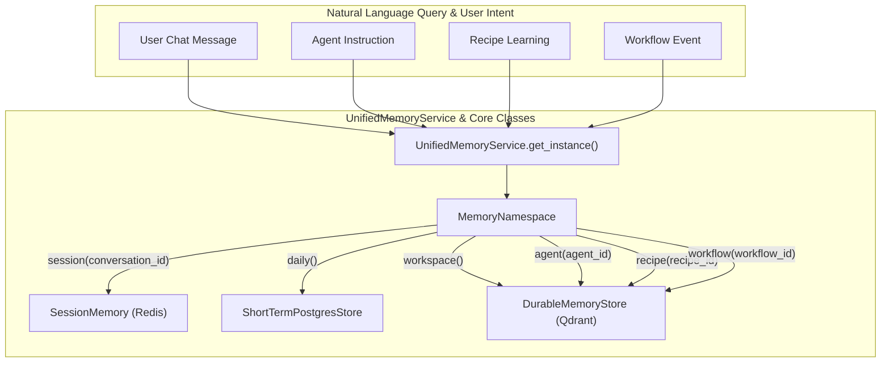
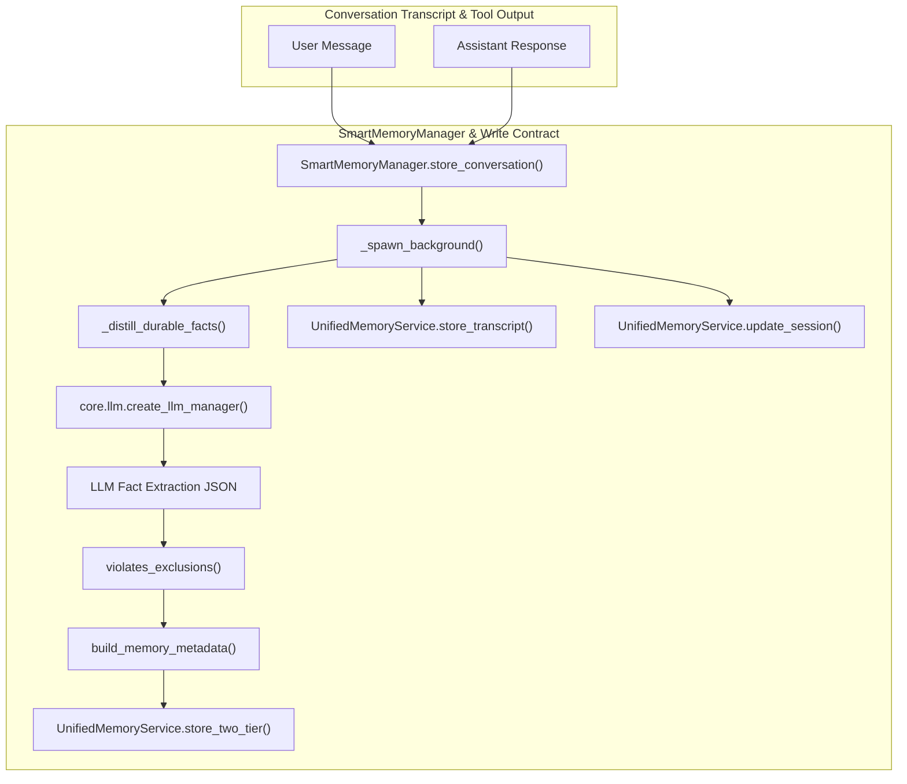

# UnifiedMemoryService

Relevant source files

The following files were used as context for generating this wiki page:

- [orchestrator/consumers/chatbot/integration.py](orchestrator/consumers/chatbot/integration.py)
- [orchestrator/consumers/chatbot/prompt_analyzer.py](orchestrator/consumers/chatbot/prompt_analyzer.py)
- [orchestrator/consumers/chatbot/smart_memory.py](orchestrator/consumers/chatbot/smart_memory.py)
- [orchestrator/consumers/chatbot/smart_orchestrator.py](orchestrator/consumers/chatbot/smart_orchestrator.py)
- [orchestrator/modules/context/sections/memory.py](orchestrator/modules/context/sections/memory.py)
- [orchestrator/modules/memory/context_router.py](orchestrator/modules/memory/context_router.py)
- [orchestrator/modules/memory/unified_memory_service.py](orchestrator/modules/memory/unified_memory_service.py)
- [orchestrator/tests/test_f155_a_widget_turn_recalls_only_its_agents_memories.py](orchestrator/tests/test_f155_a_widget_turn_recalls_only_its_agents_memories.py)
- [orchestrator/tests/test_l3_distill_input.py](orchestrator/tests/test_l3_distill_input.py)
- [orchestrator/tests/test_memory_restart_and_isolation.py](orchestrator/tests/test_memory_restart_and_isolation.py)
- [orchestrator/tests/test_memory_single_write_path.py](orchestrator/tests/test_memory_single_write_path.py)
- [orchestrator/tests/test_memory_stored_sse.py](orchestrator/tests/test_memory_stored_sse.py)
- [orchestrator/tests/test_p2w1_semantic_l2_recall.py](orchestrator/tests/test_p2w1_semantic_l2_recall.py)
- [orchestrator/tests/test_recall_relevance_floor.py](orchestrator/tests/test_recall_relevance_floor.py)
- [orchestrator/tests/test_smart_orchestrator_store_exchange.py](orchestrator/tests/test_smart_orchestrator_store_exchange.py)
- [orchestrator/tests/test_unified_memory.py](orchestrator/tests/test_unified_memory.py)
- [orchestrator/tests/test_us011_context_budgets.py](orchestrator/tests/test_us011_context_budgets.py)

The `UnifiedMemoryService` is the centralized memory management service providing a single entry point for all memory operations across the Automatos AI platform [orchestrator/modules/memory/unified_memory_service.py:1-21](). It coordinates a 5-layer memory stack (L0–L4), ensuring consistent workspace scoping, strict tenancy protection, and adherence to the platform-wide memory write contract [orchestrator/modules/memory/unified_memory_service.py:1-21]().

**Scope**: This page documents the core API and implementation of `UnifiedMemoryService`, the `MemoryNamespace` utility, the memory write contract, multi-tier operations (L1 session, L2 short-term, L3 durable store), background memory jobs, and integration with the `ContextRouter`.

---

## 1. UnifiedMemoryService Architecture & Singleton Pattern

`UnifiedMemoryService` is structured as a thread-safe singleton accessed via `get_instance()` [orchestrator/modules/memory/unified_memory_service.py:173-178](). It instantiates a single shared `DurableMemoryStore` (in-process Qdrant) and a Redis client interface [orchestrator/modules/memory/unified_memory_service.py:161-191](). To prevent cross-tenant data leaks, database sessions are never stored on the singleton instance; instead, they are acquired per-request from the application session pool [orchestrator/modules/memory/unified_memory_service.py:161-195]().

### Memory Tier Routing Architecture

Title: "UnifiedMemoryService Component Routing"

Sources: [orchestrator/modules/memory/unified_memory_service.py:1-21](), [orchestrator/modules/memory/unified_memory_service.py:161-195](), [orchestrator/modules/memory/unified_memory_service.py:52-85]()

---

## 2. MemoryNamespace: Standardized Scoping

The `MemoryNamespace` class is a frozen dataclass responsible for constructing standardized, scoped identifiers for Redis keys and durable store operations [orchestrator/modules/memory/unified_memory_service.py:38-46](). All memory consumers utilize this helper to prevent `user_id` format inconsistencies across subsystems.

### Namespace Methods and Patterns

| Scope | Method | Pattern Format | Description |
|-------|--------|----------------|-------------|
| Workspace-wide | `workspace()` | `mem:{workspace_id}` | L3 Global durable facts [orchestrator/modules/memory/unified_memory_service.py:52-55]() |
| Agent-specific | `agent(agent_id)` | `mem:{workspace_id}:agent:{agent_id}` | L3 Per-agent durable memories [orchestrator/modules/memory/unified_memory_service.py:56-59]() |
| Recipe learnings | `recipe(recipe_id)` | `mem:{workspace_id}:recipe:{recipe_id}` | L3 Per-recipe execution patterns [orchestrator/modules/memory/unified_memory_service.py:60-63]() |
| Recipe Agent Step | `recipe_agent(recipe_id, agent_id)` | `mem:{workspace_id}:recipe:{recipe_id}:agent:{agent_id}` | L3 Step-level agent memory [orchestrator/modules/memory/unified_memory_service.py:64-67]() |
| Workflow execution | `workflow(workflow_id)` | `mem:{workspace_id}:workflow:{workflow_id}` | L3 Workflow state records [orchestrator/modules/memory/unified_memory_service.py:68-71]() |
| Daily logs | `daily()` | `mem:{workspace_id}:daily` | L2 daily activity summaries [orchestrator/modules/memory/unified_memory_service.py:72-75]() |
| L2 mirror | `l2()` | `mem:{workspace_id}:l2` | Semantic mirror for short-term rows [orchestrator/modules/memory/unified_memory_service.py:76-79]() |
| Session cache | `session(conversation_id)` | `mem:session:{workspace_id}:{conversation_id}` | L1 Redis session key [orchestrator/modules/memory/unified_memory_service.py:82-85]() |
| Cache search | `cache_key(agent_id, query_hash)` | `mem:cache:{workspace_id}:{scope}:{query_hash}` | L3 search results cached in Redis [orchestrator/modules/memory/unified_memory_service.py:88-92]() |
| Cache pattern | `cache_pattern()` | `mem:cache:{workspace_id}:*` | Pattern for cache invalidation [orchestrator/modules/memory/unified_memory_service.py:94-96]() |
| Awareness cache | `awareness()` | `mem:awareness:{workspace_id}` | Knowledge awareness text cache key [orchestrator/modules/memory/unified_memory_service.py:99-101]() |
| Profile cache | `profile()` | `mem:profile:{workspace_id}` | User profile cache key [orchestrator/modules/memory/unified_memory_service.py:104-106]() |
| Resolve durable ID | `resolve(agent_id)` | `mem:{workspace_id}:agent:{agent_id}` or `mem:{workspace_id}` | Resolves the correct durable-store `user_id` for a given scope [orchestrator/modules/memory/unified_memory_service.py:109-121]() |

Sources: [orchestrator/modules/memory/unified_memory_service.py:38-121]()

---

## 3. L3 Durable Memory & Write Contract (`DurableMemoryStore`)

The memory write contract guarantees that all memories written to L3 share a canonical metadata format and are validated against sensitive credential exclusions [orchestrator/consumers/chatbot/smart_memory.py:26-36](). The underlying `DurableMemoryStore` communicates directly with an in-process Qdrant vector database (`durable_memory` collection) without remote HTTP hops or circuit breakers [orchestrator/modules/memory/unified_memory_service.py:185-189]().

### Write Contract and Distillation Pipeline

The `SmartMemoryManager` handles the distillation of conversation exchanges into durable facts before they are stored in L3 [orchestrator/consumers/chatbot/smart_memory.py:64-74](). This process involves:
1.  **Distillation**: An LLM extracts typed facts (`fact`, `type`, `importance`) from user messages and assistant responses [orchestrator/consumers/chatbot/smart_memory.py:109-138](), [orchestrator/tests/test_l3_distill_input.py:1-20]().
2.  **Validation**: The extracted facts are checked against exclusion lists via `violates_exclusions()` to prevent storing sensitive information [orchestrator/consumers/chatbot/smart_memory.py:30-36]().
3.  **Metadata Building**: Canonical metadata is built for the facts via `build_memory_metadata()` [orchestrator/consumers/chatbot/smart_memory.py:30-36]().
4.  **Storage**: Methods like `UnifiedMemoryService.store_two_tier()` persist the facts to L3 [orchestrator/tests/test_l3_distill_input.py:103-105]().

This process ensures that only relevant, structured, and safe information is stored in the long-term memory. L1 (`update_session()`) and L2 (`store_transcript()`) writes are handled exactly once per chat turn, avoiding duplicate entries [orchestrator/tests/test_memory_single_write_path.py:120-166](), [orchestrator/tests/test_smart_orchestrator_store_exchange.py:127-145]().

Title: "Write Contract and Distillation Pipeline"

Sources: [orchestrator/modules/memory/unified_memory_service.py:1-21](), [orchestrator/consumers/chatbot/smart_memory.py:30-36](), [orchestrator/consumers/chatbot/smart_memory.py:64-74](), [orchestrator/tests/test_l3_distill_input.py:1-20](), [orchestrator/tests/test_l3_distill_input.py:103-105](), [orchestrator/tests/test_memory_single_write_path.py:120-166](), [orchestrator/tests/test_smart_orchestrator_store_exchange.py:127-145]()

---

## 4. Memory Tiers & Operational Flow

The memory system operates across five distinct abstraction tiers, managed centrally through `UnifiedMemoryService` [orchestrator/modules/memory/unified_memory_service.py:8-14]():

-   **L0 (Focus / Context Window)**: Managed directly by the prompt builder and context service; transient prompt state [orchestrator/modules/memory/unified_memory_service.py:8-10]().
-   **L1 (Working Memory)**: Stored in Redis via the `SessionMemory` dataclass, tracking running summaries and exchange counts for 24-hour windows [orchestrator/modules/memory/unified_memory_service.py:127-140](). This memory is updated via `UnifiedMemoryService.update_session` [orchestrator/tests/test_memory_single_write_path.py:100-102]().
-   **L2 (Short-Term Memory)**: Postgres rows coupled with a semantic vector mirror (`mem:{ws}:l2`), undergoing time-based decay scoring and threshold-based archiving [orchestrator/modules/memory/unified_memory_service.py:11-12](), [orchestrator/services/memory_jobs.py:11-13](). Chat transcripts are stored here via `UnifiedMemoryService.store_transcript` [orchestrator/tests/test_memory_single_write_path.py:162-163]().
-   **L3 (Long-Term Durable Store)**: Qdrant store holding typed, distilled facts (`decision`, `open_loop`, `thread_summary`, `user_fact`, `preference`, `procedure`) [orchestrator/modules/memory/unified_memory_service.py:12-13](). Facts are stored via `UnifiedMemoryService.store_two_tier` [orchestrator/tests/test_l3_distill_input.py:103-105]().
-   **L4 (Organizational Knowledge / RAG)**: On-demand vector search over workspace documents and structured data models [orchestrator/modules/memory/unified_memory_service.py:13-14]().

Sources: [orchestrator/modules/memory/unified_memory_service.py:8-14](), [orchestrator/modules/memory/unified_memory_service.py:127-140](), [orchestrator/services/memory_jobs.py:11-13](), [orchestrator/tests/test_memory_single_write_path.py:100-102](), [orchestrator/tests/test_memory_single_write_path.py:162-163](), [orchestrator/tests/test_l3_distill_input.py:103-105]()

---

## 5. Background Memory Jobs (`MemoryJobScheduler`)

The `MemoryJobScheduler` registers recurring asynchronous maintenance jobs on the shared scheduler to sustain memory hygiene, retention limits, and knowledge promotion [orchestrator/services/memory_jobs.py:32-43]():

-   **Contradiction Consolidation**: Periodically merges near-duplicate L3 memories into canonical records, replacing contradicted entries using recency and confidence scores [orchestrator/services/memory_jobs.py:6-9]().
-   **Decay Scoring**: Hourly job applying Ebbinghaus retention curves to L2 rows, archiving entries that fall below the retention threshold (default `0.3`) [orchestrator/services/memory_jobs.py:11-13]().
-   **L2→L3 Promotion**: Daily evaluation sweep that promotes high-signal L2 items into permanent L3 durable storage based on type importance policies [orchestrator/services/memory_jobs.py:15-18]().
-   **Thread Checkpointing**: Periodically flushes idle chat threads to summarize conversation history and extract open loops into L3 storage [orchestrator/services/memory_jobs.py:160-170]().

Memory writes from chat turns are scheduled as fire-and-forget background tasks via `_spawn_background()` to avoid blocking the streaming response [orchestrator/consumers/chatbot/smart_orchestrator.py:36-52](), [orchestrator/tests/test_smart_orchestrator_store_exchange.py:94-124](). This ensures that the user experience remains fluid even when memory operations are slow.

Sources: [orchestrator/services/memory_jobs.py:32-173](), [orchestrator/consumers/chatbot/smart_orchestrator.py:36-52](), [orchestrator/tests/test_smart_orchestrator_store_exchange.py:94-124]()

---

## 6. Context Router & Retrieval Integration (`ContextRouter`, `MemorySection`)

The `ContextRouter` intercepts incoming queries to perform fast regex signal detection (<10 ms, no I/O) and determine which memory layers to query [orchestrator/modules/memory/context_router.py:5-12]().

### Signal Classification & Budget Allocation
Query analysis extracts boolean flags via `ContextSignals`:
-   `is_temporal`: Triggers L2 time-window search [orchestrator/modules/memory/context_router.py:71]()
-   `is_personal_fact`: Targets L3 user facts and preferences [orchestrator/modules/memory/context_router.py:72]()
-   `is_session_continuation`: Fetches L1 session summaries [orchestrator/modules/memory/context_router.py:73]()
-   `is_knowledge_query`: Invokes L4 document retrieval [orchestrator/modules/memory/context_router.py:74]()
-   `is_live_data`: Indicates a query for real-time data [orchestrator/modules/memory/context_router.py:75]()

Retrieved segments are assembled into a budget-constrained `ContextBundle` where usable window fractions (default 80% of total capacity) are distributed across memory sections using strict proportional weights [orchestrator/modules/memory/context_router.py:37-54](). The `MemorySection` in the `ContextService` utilizes the `ContextRouter` for chat turns to retrieve a rich context bundle, falling back to `SmartMemoryManager` if the router is not applicable (e.g., for widget mode or autonomous work) [orchestrator/modules/context/sections/memory.py:91-101](), [orchestrator/modules/context/sections/memory.py:137-159](). For widget turns, only agent-specific memories are recalled, bypassing workspace-wide memories and daily logs [orchestrator/modules/context/sections/memory.py:91-98](), [orchestrator/tests/test_f155_a_widget_turn_recalls_only_its_agents_memories.py:64-72]().

Sources: [orchestrator/modules/memory/context_router.py:5-101](), [orchestrator/modules/memory/context_router.py:37-54](), [orchestrator/modules/context/sections/memory.py:91-101](), [orchestrator/modules/context/sections/memory.py:137-159](), [orchestrator/tests/test_f155_a_widget_turn_recalls_only_its_agents_memories.py:64-72]()

---