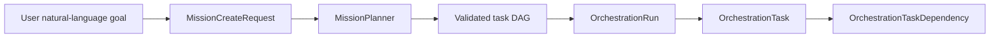
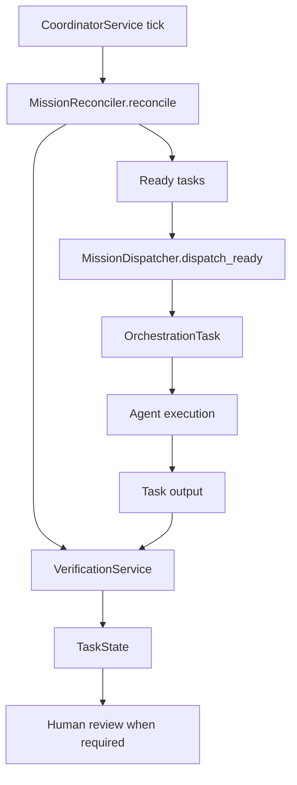

# Missions & Multi-Agent Coordination

Relevant source files

The following files were used as context for generating this wiki page:

- [frontend/components/missions/__tests__/approve-body.test.ts](frontend/components/missions/__tests__/approve-body.test.ts)
- [frontend/components/missions/__tests__/mission-retry.test.tsx](frontend/components/missions/__tests__/mission-retry.test.tsx)
- [frontend/components/missions/__tests__/mission-stats.test.ts](frontend/components/missions/__tests__/mission-stats.test.ts)
- [frontend/components/missions/approve-body.ts](frontend/components/missions/approve-body.ts)
- [frontend/components/missions/create-mission-modal.tsx](frontend/components/missions/create-mission-modal.tsx)
- [frontend/components/missions/index.ts](frontend/components/missions/index.ts)
- [frontend/components/missions/mission-budget-bar.tsx](frontend/components/missions/mission-budget-bar.tsx)
- [frontend/components/missions/mission-card.tsx](frontend/components/missions/mission-card.tsx)
- [frontend/components/missions/mission-detail-page.tsx](frontend/components/missions/mission-detail-page.tsx)
- [frontend/components/missions/mission-field-inspector.tsx](frontend/components/missions/mission-field-inspector.tsx)
- [frontend/components/missions/mission-field-panel.tsx](frontend/components/missions/mission-field-panel.tsx)
- [frontend/components/missions/mission-field-viz.tsx](frontend/components/missions/mission-field-viz.tsx)
- [frontend/components/tools/tool-actions-modal.tsx](frontend/components/tools/tool-actions-modal.tsx)
- [frontend/components/tools/tool-details-modal.tsx](frontend/components/tools/tool-details-modal.tsx)
- [frontend/components/workflows/templates-tab.tsx](frontend/components/workflows/templates-tab.tsx)
- [frontend/hooks/use-missions-api.ts](frontend/hooks/use-missions-api.ts)
- [frontend/stores/mission-store.ts](frontend/stores/mission-store.ts)
- [frontend/types/missions.ts](frontend/types/missions.ts)
- [orchestrator/alembic/versions/prd123_checkpoint_count.py](orchestrator/alembic/versions/prd123_checkpoint_count.py)
- [orchestrator/api/mission_retry.py](orchestrator/api/mission_retry.py)
- [orchestrator/api/missions.py](orchestrator/api/missions.py)
- [orchestrator/core/models/orchestration.py](orchestrator/core/models/orchestration.py)
- [orchestrator/core/models/orchestration_enums.py](orchestrator/core/models/orchestration_enums.py)
- [orchestrator/modules/coordination/credit_pause.py](orchestrator/modules/coordination/credit_pause.py)
- [orchestrator/modules/coordination/dispatcher.py](orchestrator/modules/coordination/dispatcher.py)
- [orchestrator/modules/coordination/one_step_at_a_time.py](orchestrator/modules/coordination/one_step_at_a_time.py)
- [orchestrator/modules/coordination/planner.py](orchestrator/modules/coordination/planner.py)
- [orchestrator/modules/coordination/reconciler.py](orchestrator/modules/coordination/reconciler.py)
- [orchestrator/modules/coordination/verification.py](orchestrator/modules/coordination/verification.py)
- [orchestrator/services/coordinator_service.py](orchestrator/services/coordinator_service.py)
- [orchestrator/tests/test_f247_a_mission_out_of_credit_pauses_and_resumes.py](orchestrator/tests/test_f247_a_mission_out_of_credit_pauses_and_resumes.py)
- [orchestrator/tests/test_f267_b_no_step_starts_while_another_is_redone.py](orchestrator/tests/test_f267_b_no_step_starts_while_another_is_redone.py)
- [orchestrator/tests/test_w1s1_hotpath_telemetry.py](orchestrator/tests/test_w1s1_hotpath_telemetry.py)

## Purpose and scope

The Mission orchestration layer turns a user’s natural-language goal into a task plan, coordinates its execution by agents, and tracks progress through verification and human review. This parent page outlines how the planning, coordination, data, and UI pieces fit together; implementation details are covered in the linked child pages. [orchestrator/modules/coordination/planner.py:5-12](), [orchestrator/services/coordinator_service.py:5-13]()

Sources: [orchestrator/modules/coordination/planner.py:5-12](), [orchestrator/services/coordinator_service.py:5-13]()

## Core orchestration flow

The API uses “mission” terminology, while the database and backend use “orchestration.” A mission’s goal and plan are represented by an `OrchestrationRun`; its work is represented by `OrchestrationTask` records and dependencies. The planner first tries a matching template, then can fall back to LLM decomposition and validate the resulting task graph. [orchestrator/api/missions.py:1-6](), [orchestrator/core/models/orchestration.py:39-69](), [orchestrator/core/models/orchestration.py:156-198](), [orchestrator/modules/coordination/planner.py:5-12]()

The coordinator is described as database-authoritative and stateless across ticks. It connects planning, dispatch, reconciliation, and verification; the dispatcher can send ready tasks in parallel, while the reconciler checks completed work and detects stalls. Verification provides feedback on task outputs, and human approval is available as part of the mission lifecycle. [orchestrator/services/coordinator_service.py:5-13](), [orchestrator/modules/coordination/dispatcher.py:5-13](), [orchestrator/modules/coordination/reconciler.py:5-12](), [orchestrator/modules/coordination/verification.py:5-11](), [orchestrator/core/models/orchestration_enums.py:29-39]()

### Natural-language goal to orchestration entities

**Goal and plan representation**

Sources: [orchestrator/api/missions.py:80-125](), [orchestrator/modules/coordination/planner.py:5-12](), [orchestrator/core/models/orchestration.py:39-69](), [orchestrator/core/models/orchestration.py:156-198]()

### Mission execution and review

**Coordinator components and lifecycle**

Sources: [orchestrator/services/coordinator_service.py:5-13](), [orchestrator/modules/coordination/dispatcher.py:5-13](), [orchestrator/modules/coordination/reconciler.py:5-12](), [orchestrator/modules/coordination/verification.py:5-11](), [orchestrator/core/models/orchestration_enums.py:48-59]()

## Mission data model (#22.1)

`OrchestrationRun` is the top-level mission record, with fields for the goal, plan, configuration, lifecycle state, and budget tracking. Tasks belong to a run and have their own states; `RunState` and `TaskState` define the lifecycle vocabulary. [orchestrator/core/models/orchestration.py:39-49](), [orchestrator/core/models/orchestration.py:66-113](), [orchestrator/core/models/orchestration.py:156-167](), [orchestrator/core/models/orchestration_enums.py:29-59]()

For the tables, state transitions, budget fields, and `orchestration_state` service, see [Mission Data Model](#22.1).

Sources: [orchestrator/core/models/orchestration.py:39-113](), [orchestrator/core/models/orchestration.py:156-198](), [orchestrator/core/models/orchestration_enums.py:29-59]()

## Coordinator Service & Dispatcher (#22.2)

`CoordinatorService` is the orchestration layer’s tick-loop entry point, connecting the planner, dispatcher, reconciler, and verifier. `MissionDispatcher` claims and dispatches tasks, while `MissionReconciler` checks completed tasks, detects stalls, and helps advance run state. The coordinator’s power-mode defaults specify fallback limits for tool iterations, LLM tier, and timeout. [orchestrator/services/coordinator_service.py:5-13](), [orchestrator/services/coordinator_service.py:91-107](), [orchestrator/modules/coordination/dispatcher.py:5-13](), [orchestrator/modules/coordination/reconciler.py:5-12]()

For the tick loop, topological dispatch, locking, stall detection, and power modes, see [Coordinator Service & Dispatcher](#22.2).

Sources: [orchestrator/services/coordinator_service.py:5-13](), [orchestrator/services/coordinator_service.py:91-107](), [orchestrator/modules/coordination/dispatcher.py:5-13](), [orchestrator/modules/coordination/reconciler.py:5-12]()

## Mission Planning & Verification (#22.3)

`MissionPlanner` tries template matching before LLM decomposition, validates the resulting plan, and retries decomposition when validation fails. `VerificationService` combines deterministic checks with an LLM review; its feedback is advisory, and the service documentation states that tasks are not rejected or retried based on verification scores. [orchestrator/modules/coordination/planner.py:5-12](), [orchestrator/modules/coordination/planner.py:162-174](), [orchestrator/modules/coordination/verification.py:5-16]()

For plan templates, agent matching, validation, replanning, and verification behavior, see [Mission Planning & Verification](#22.3).

Sources: [orchestrator/modules/coordination/planner.py:5-12](), [orchestrator/modules/coordination/planner.py:162-174](), [orchestrator/modules/coordination/verification.py:5-16]()

## Mission UI & Human Review (#22.4)

The create-mission modal collects a goal and offers templates, power modes, attachments, and a “Check each step with me” option. The detail page brings together mission status, task progress, the DAG canvas, activity, field, and deliverables panels; the missions API exposes lifecycle and review routes. [frontend/components/missions/create-mission-modal.tsx:70-123](), [frontend/components/missions/mission-detail-page.tsx:29-39](), [orchestrator/api/missions.py:8-23]()

For the mission list and detail surfaces, visualizations, and human review flows, see [Mission UI & Human Review](#22.4).

Sources: [frontend/components/missions/create-mission-modal.tsx:70-123](), [frontend/components/missions/mission-detail-page.tsx:29-39](), [orchestrator/api/missions.py:8-23]()

## Shared Context, Budget & Telemetry (#22.5)

The mission record includes budget configuration and spent-budget fields, and the dispatcher tracks task and run token usage. The reconciler can capture task failures and retry recoveries through `MissionMemoryService`. The mission UI also exposes a field panel for viewing shared-context patterns. [orchestrator/core/models/orchestration.py:95-113](), [orchestrator/modules/coordination/dispatcher.py:5-13](), [orchestrator/modules/coordination/reconciler.py:67-90](), [frontend/components/missions/mission-field-panel.tsx:115-149]()

For shared field context, budget admission, usage attribution, and mission memory, see [Shared Context, Budget & Telemetry](#22.5).

Sources: [orchestrator/core/models/orchestration.py:95-113](), [orchestrator/modules/coordination/dispatcher.py:5-13](), [orchestrator/modules/coordination/reconciler.py:67-90](), [frontend/components/missions/mission-field-panel.tsx:115-149]()

## Mission Platform Actions & Plan Edits (#22.6)

The missions API supports lifecycle operations including approval, rejection, pause, resume, and replan. Plan edits use a separate plan-edit route before approval; the approval request model explicitly rejects edits submitted through its body. [orchestrator/api/missions.py:8-23](), [orchestrator/api/missions.py:128-162]()

For platform action handlers, plan edits, resume actions, and mission widget scopes, see [Mission Platform Actions & Plan Edits](#22.6).

Sources: [orchestrator/api/missions.py:8-23](), [orchestrator/api/missions.py:128-162]()

---