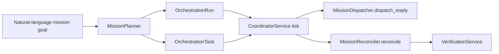
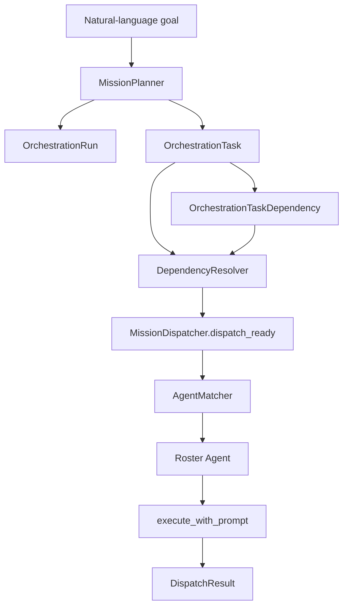
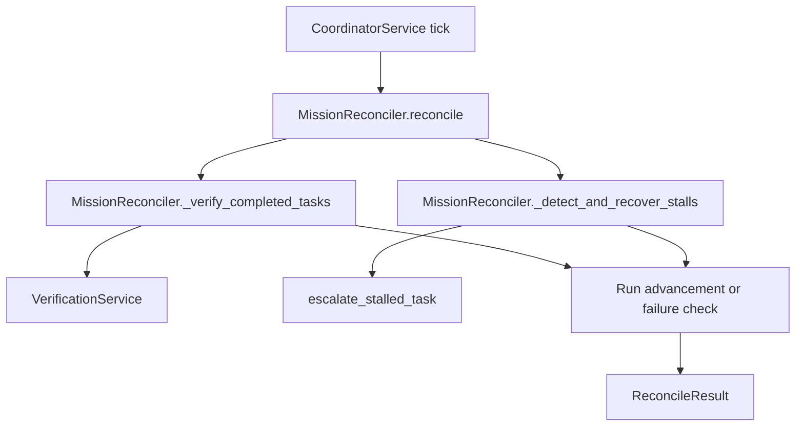

# Coordinator Service & Dispatcher

Relevant source files

The following files were used as context for generating this wiki page:

- [frontend/components/missions/__tests__/approve-body.test.ts](frontend/components/missions/__tests__/approve-body.test.ts)
- [frontend/components/missions/__tests__/mission-retry.test.tsx](frontend/components/missions/__tests__/mission-retry.test.tsx)
- [frontend/components/missions/__tests__/mission-stats.test.ts](frontend/components/missions/__tests__/mission-stats.test.ts)
- [frontend/components/missions/approve-body.ts](frontend/components/missions/approve-body.ts)
- [frontend/components/missions/create-mission-modal.tsx](frontend/components/missions/create-mission-modal.tsx)
- [frontend/components/missions/index.ts](frontend/components/missions/index.ts)
- [frontend/components/missions/mission-budget-bar.tsx](frontend/components/missions/mission-budget-bar.tsx)
- [frontend/components/missions/mission-card.tsx](frontend/components/missions/mission-card.tsx)
- [frontend/components/missions/mission-detail-page.tsx](frontend/components/missions/mission-detail-page.tsx)
- [frontend/components/missions/mission-field-inspector.tsx](frontend/components/missions/mission-field-inspector.tsx)
- [frontend/components/missions/mission-field-panel.tsx](frontend/components/missions/mission-field-panel.tsx)
- [frontend/components/missions/mission-field-viz.tsx](frontend/components/missions/mission-field-viz.tsx)
- [frontend/components/tools/tool-actions-modal.tsx](frontend/components/tools/tool-actions-modal.tsx)
- [frontend/components/tools/tool-details-modal.tsx](frontend/components/tools/tool-details-modal.tsx)
- [frontend/components/workflows/templates-tab.tsx](frontend/components/workflows/templates-tab.tsx)
- [frontend/hooks/use-missions-api.ts](frontend/hooks/use-missions-api.ts)
- [frontend/stores/mission-store.ts](frontend/stores/mission-store.ts)
- [frontend/types/missions.ts](frontend/types/missions.ts)
- [orchestrator/alembic/versions/prd123_checkpoint_count.py](orchestrator/alembic/versions/prd123_checkpoint_count.py)
- [orchestrator/api/mission_retry.py](orchestrator/api/mission_retry.py)
- [orchestrator/api/missions.py](orchestrator/api/missions.py)
- [orchestrator/core/models/orchestration.py](orchestrator/core/models/orchestration.py)
- [orchestrator/core/models/orchestration_enums.py](orchestrator/core/models/orchestration_enums.py)
- [orchestrator/modules/coordination/credit_pause.py](orchestrator/modules/coordination/credit_pause.py)
- [orchestrator/modules/coordination/dispatcher.py](orchestrator/modules/coordination/dispatcher.py)
- [orchestrator/modules/coordination/one_step_at_a_time.py](orchestrator/modules/coordination/one_step_at_a_time.py)
- [orchestrator/modules/coordination/planner.py](orchestrator/modules/coordination/planner.py)
- [orchestrator/modules/coordination/reconciler.py](orchestrator/modules/coordination/reconciler.py)
- [orchestrator/modules/coordination/verification.py](orchestrator/modules/coordination/verification.py)
- [orchestrator/services/coordinator_service.py](orchestrator/services/coordinator_service.py)
- [orchestrator/tests/test_f247_a_mission_out_of_credit_pauses_and_resumes.py](orchestrator/tests/test_f247_a_mission_out_of_credit_pauses_and_resumes.py)
- [orchestrator/tests/test_f267_b_no_step_starts_while_another_is_redone.py](orchestrator/tests/test_f267_b_no_step_starts_while_another_is_redone.py)
- [orchestrator/tests/test_w1s1_hotpath_telemetry.py](orchestrator/tests/test_w1s1_hotpath_telemetry.py)

## Purpose and Scope

This page describes the mission coordination execution path: the stateless `CoordinatorService` tick loop, task dispatch through `MissionDispatcher`, optimistic task claiming, reconciliation and stall detection, and per-mission power-mode defaults. The coordinator connects planning, dispatch, reconciliation, and verification while treating the database as the authoritative source of mission state. [orchestrator/services/coordinator_service.py:5-17]()

Sources: [orchestrator/services/coordinator_service.py:5-17]()

---

## Coordinator Service & Tick Loop

`CoordinatorService` is the mission lifecycle coordinator. Its documented responsibilities include a five-second tick loop and coordinating the planner, dispatcher, reconciler, and verifier. It is designed to be stateless: each tick reads current state from the database and obtains its own `SessionLocal` session rather than retaining a session on the singleton. [orchestrator/services/coordinator_service.py:5-12]()

### Tick responsibilities

The tick is the recurring opportunity to progress active mission work. The coordinator’s documented processing components are:

1. **Planning:** `MissionPlanner` decomposes a goal into a task plan. The planner’s documented responsibilities include template matching, LLM decomposition as a fallback, and structural plan validation. [orchestrator/services/coordinator_service.py:62-66]() [orchestrator/modules/coordination/planner.py:5-15]()
2. **Dispatch:** `MissionDispatcher.dispatch_ready()` is the dispatch entry point identified by the coordinator’s design notes. The dispatcher supports parallel dispatch up to the mission’s concurrency limit. [orchestrator/services/coordinator_service.py:9-12]() [orchestrator/modules/coordination/dispatcher.py:5-13]()
3. **Reconciliation:** `MissionReconciler.reconcile()` checks completed task outputs, detects and recovers stalls, and checks whether the run can advance. [orchestrator/modules/coordination/reconciler.py:5-12,128-144]()
4. **Verification:** Completed task outputs flow through `VerificationService`; the reconciler’s verification phase handles those tasks before its stall and run-completion checks. [orchestrator/modules/coordination/reconciler.py:133-160]() [orchestrator/modules/coordination/verification.py:5-12]()

The coordinator module also documents parallel dispatch through `MissionDispatcher.dispatch_ready()` and `asyncio.gather()`. The coordinator’s per-tick session model and database-authoritative design allow later ticks to re-read mission state rather than relying on process-local task state. [orchestrator/services/coordinator_service.py:9-12]()

### State and persistence

The mission record is represented by `OrchestrationRun`, stored in `orchestration_runs`; its state includes lifecycle status, plan and config, concurrency settings, token usage, and budget fields. Tasks are represented by `OrchestrationTask`, stored in `orchestration_tasks`, and carry their own state and assignment information. [orchestrator/core/models/orchestration.py:39-49,67-83,95-113,156-167,194-218]()

The run and task state enums include lifecycle states such as `RUNNING`, `PAUSED`, `VERIFYING`, and terminal run states, as well as task states such as `QUEUED`, `ASSIGNED`, `RUNNING`, `COMPLETED`, `VERIFIED`, `FAILED`, `STALLED`, and `RETRYING`. Notably, `completed` is not a terminal task state; verification is a separate step. [orchestrator/core/models/orchestration_enums.py:29-59]()

### Coordinator flow: natural-language goal to code entities

The diagram connects the user’s goal and mission processing concepts to the concrete classes and methods named in the code. The shown code documents the component responsibilities and relationships; the exact tick method body is not included in the supplied source excerpt. [orchestrator/services/coordinator_service.py:5-17,54-73]() [orchestrator/modules/coordination/planner.py:5-15]() [orchestrator/modules/coordination/dispatcher.py:5-13]() [orchestrator/modules/coordination/reconciler.py:5-12]()

**Diagram: Mission goal and coordinator components**

Sources: [orchestrator/services/coordinator_service.py:5-17,54-73]() [orchestrator/modules/coordination/planner.py:5-15]() [orchestrator/modules/coordination/dispatcher.py:5-13]() [orchestrator/modules/coordination/reconciler.py:5-12]()

---

## Mission Dispatcher & Topological Routing

`MissionDispatcher` is a stateless dispatcher: its inputs come from the database, and the caller manages transactions. Its documented role is to send orchestration tasks to roster agents, dispatching up to `max_concurrent` tasks simultaneously. It uses `AgentMatcher` to select an agent, creates a board task before dispatch for kanban visibility, and stores output and token tracking on the task and run. [orchestrator/modules/coordination/dispatcher.py:5-13,128-133]()

### Ready tasks, dependencies, and concurrency

The dispatcher imports `DependencyResolver`, which supplies dependency-related coordination, and exposes `count_active_tasks()` to count tasks in `ASSIGNED` or `RUNNING` states. Its module documentation describes `dispatch_ready()` as dispatching up to the mission’s `max_concurrent` tasks per tick. Together, these components support DAG-aware dispatch while limiting simultaneous active work. [orchestrator/modules/coordination/dispatcher.py:5-13,45-57,135-154]()

The task model includes a `sequence_number`, while dependencies are represented by the orchestration dependency model imported by the coordinator and dispatcher. The available excerpts do not show the full dependency-resolution or ready-task query implementation, so details beyond the documented topological dispatch responsibility are not inferred here. [orchestrator/core/models/orchestration.py:156-198]() [orchestrator/services/coordinator_service.py:36-42]() [orchestrator/modules/coordination/dispatcher.py:45-57]()

### Agent matching and dispatch outcomes

`AgentMatcher` is the dispatcher’s agent-selection component. The dispatcher documentation states that if no agent matches, the task fails with `NO_AGENT_AVAILABLE`. Dispatch attempts are represented by the immutable `DispatchResult`, which can report whether work was dispatched, the task and agent identifiers, a skipped reason, or an error. [orchestrator/modules/coordination/dispatcher.py:9-13,47,111-120]()

### Natural-language request to dispatch entities

This diagram maps a goal and its decomposed tasks to code entities used in the mission path. The planner source documents goal decomposition into a task DAG; the dispatcher source documents `dispatch_ready()`, `AgentMatcher`, and execution through `execute_with_prompt()`. [orchestrator/modules/coordination/planner.py:5-15]() [orchestrator/modules/coordination/dispatcher.py:5-13,45-57,128-133]()

**Diagram: Goal decomposition and task dispatch**

Sources: [orchestrator/modules/coordination/planner.py:5-15]() [orchestrator/modules/coordination/dispatcher.py:5-13,45-57,111-120,128-133]() [orchestrator/core/models/orchestration.py:156-167]()

---

## Optimistic Locking

The dispatcher documents an optimistic claim pattern: a raw SQL conditional `UPDATE` checks `version_id` to prevent double dispatch. The task model also declares `version_id` as its SQLAlchemy optimistic-locking column. These mechanisms protect task claiming when concurrent workers or overlapping ticks contend for the same task. [orchestrator/modules/coordination/dispatcher.py:8-12,172-180]() [orchestrator/core/models/orchestration.py:136-140]()

### Claiming a queued task

`MissionDispatcher.claim_task()` is the atomic claim entry point. Its documented contract is to claim a queued task using optimistic locking, with the task and selected `agent_id` supplied by the caller. The conditional update succeeds only when the expected version still matches; a competing claim that has already changed the row cannot claim the same version. [orchestrator/modules/coordination/dispatcher.py:172-180]()

The supplied excerpt does not include the remainder of `claim_task()`’s implementation, so this page does not specify the exact SQL predicates, state transitions, or post-update ORM refresh behavior. [orchestrator/modules/coordination/dispatcher.py:172-180]()

Sources: [orchestrator/modules/coordination/dispatcher.py:8-12,172-180]() [orchestrator/core/models/orchestration.py:136-140]()

---

## Reconciler & Stall Detection

`MissionReconciler` is stateless and reads mission data from the database. A reconciliation pass handles completed-task verification, stall detection and recovery, and run advancement or failure checks. The caller manages the database transaction. [orchestrator/modules/coordination/reconciler.py:5-12,120-144]()

### Verification and reconciliation order

`reconcile()` first invokes `_verify_completed_tasks()`, then `_detect_and_recover_stalls()`, and then escalates detected stalls. Its documented final checks determine whether tasks are terminal and whether the run should advance or fail. The method returns a `ReconcileResult` containing stall counts, task verification/failure counts, and run advancement information. [orchestrator/modules/coordination/reconciler.py:100-112,128-160]()

Verification is advisory: `VerificationService` performs deterministic checks and a cross-model LLM review, and its documented policy is not to reject or retry tasks based on verification scores. Feedback is retained for downstream consumers. [orchestrator/modules/coordination/verification.py:5-12]()

### Stall thresholds and recovery

The reconciler documents two stall thresholds:

- **`ASSIGNED`:** a task stuck for more than 60 seconds is considered stalled.
- **`RUNNING`:** a task stuck for more than 300 seconds is considered stalled.

Stalled tasks are subject to recovery and can be escalated. During reconciliation, detected stalls lead to a query for tasks in `STALLED` state and calls to `escalate_stalled_task()` for those tasks. The event enum includes `STALL_DETECTED` and `TASK_STALLED` for stall-related event reporting. [orchestrator/modules/coordination/reconciler.py:5-9,158-184]() [orchestrator/core/models/orchestration_enums.py:115-125]()

**Table: Reconciliation checks**

| Check | Behavior |
|---|---|
| Completed-task verification | Processes completed task outputs through the verification phase. [orchestrator/modules/coordination/reconciler.py:133-155]() |
| Assigned-task stall | Detects `ASSIGNED` tasks beyond the 60-second threshold. [orchestrator/modules/coordination/reconciler.py:5-9]() |
| Running-task stall | Detects `RUNNING` tasks beyond the 300-second threshold. [orchestrator/modules/coordination/reconciler.py:5-9]() |
| Stall escalation | Queries stalled tasks and invokes `escalate_stalled_task()`. [orchestrator/modules/coordination/reconciler.py:163-184]() |
| Run advancement or failure | Checks whether the run can advance or must fail after task reconciliation. [orchestrator/modules/coordination/reconciler.py:5-9,133-144]() |

### Reconciliation flow

**Diagram: Task completion, verification, and stall recovery**

Sources: [orchestrator/services/coordinator_service.py:5-17,70-73]() [orchestrator/modules/coordination/reconciler.py:100-112,128-184]() [orchestrator/modules/coordination/verification.py:5-12]()

---

## Power Modes & Execution Limits

Mission power modes define fallback caps for tool iterations, forced LLM tier, and task timeout. The defaults are `light`, `standard`, and `max`; operators can retune live values through `system_settings` in the `power_modes` category. The stored setting takes precedence when present, with the hardcoded values acting as fallback defaults. [orchestrator/services/coordinator_service.py:91-107]()

| Power mode | Maximum tool iterations | Forced LLM tier | Timeout (seconds) | Source |
|---|---:|---|---:|---|
| `light` | 5 | `system_llm` | 120 | [orchestrator/services/coordinator_service.py:103-105]() |
| `standard` | 10 | None | 240 | [orchestrator/services/coordinator_service.py:103-106]() |
| `max` | 50 | `orchestrator_llm` | 600 | [orchestrator/services/coordinator_service.py:103-107]() |

If `power_mode` is absent from mission config, `standard` is the documented default. Power mode does **not** determine the token budget: the coordinator’s documented policy resolves that from the agent’s maximum output-token setting, then the model registry ceiling, then `DEFAULT_MAX_OUTPUT_TOKENS`. [orchestrator/services/coordinator_service.py:91-99]()

The mission creation UI includes a `PowerModePicker` and a separate “Pause on budget exceeded” option. These are distinct controls: the backend power-mode defaults govern execution caps, while the UI presents a separate budget-pause setting. [frontend/components/missions/create-mission-modal.tsx:70-75,103-115]()

Sources: [orchestrator/services/coordinator_service.py:91-107]() [frontend/components/missions/create-mission-modal.tsx:70-75,103-115]()

---