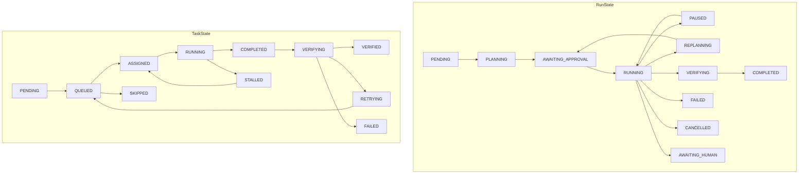
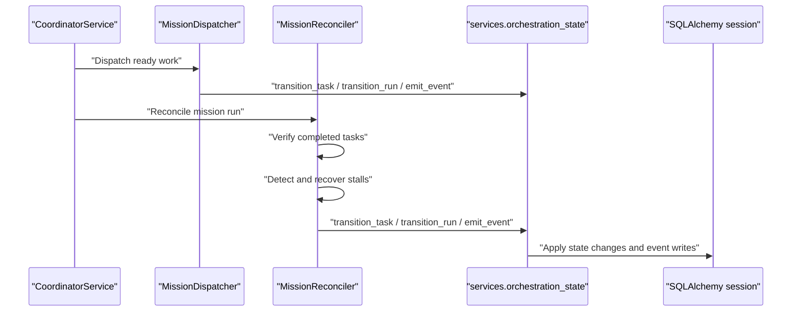
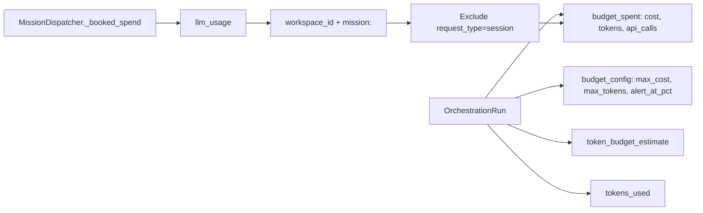
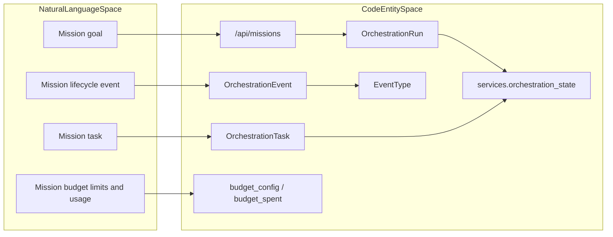
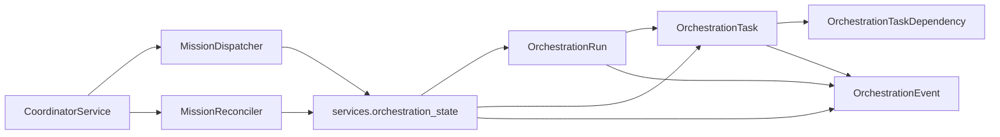

# Mission Data Model

Relevant source files

The following files were used as context for generating this wiki page:

- [frontend/components/activity/board/__tests__/review-verdict.test.tsx](frontend/components/activity/board/__tests__/review-verdict.test.tsx)
- [frontend/components/activity/board/approval-effect.ts](frontend/components/activity/board/approval-effect.ts)
- [frontend/components/activity/board/review-verdict.tsx](frontend/components/activity/board/review-verdict.tsx)
- [frontend/components/activity/board/ticket-actions-menu.tsx](frontend/components/activity/board/ticket-actions-menu.tsx)
- [frontend/components/missions/__tests__/approve-body.test.ts](frontend/components/missions/__tests__/approve-body.test.ts)
- [frontend/components/missions/__tests__/mission-retry.test.tsx](frontend/components/missions/__tests__/mission-retry.test.tsx)
- [frontend/components/missions/__tests__/mission-stats.test.ts](frontend/components/missions/__tests__/mission-stats.test.ts)
- [frontend/components/missions/approve-body.ts](frontend/components/missions/approve-body.ts)
- [frontend/components/missions/create-mission-modal.tsx](frontend/components/missions/create-mission-modal.tsx)
- [frontend/components/missions/index.ts](frontend/components/missions/index.ts)
- [frontend/components/missions/mission-budget-bar.tsx](frontend/components/missions/mission-budget-bar.tsx)
- [frontend/components/missions/mission-card.tsx](frontend/components/missions/mission-card.tsx)
- [frontend/components/missions/mission-detail-page.tsx](frontend/components/missions/mission-detail-page.tsx)
- [frontend/components/missions/mission-field-inspector.tsx](frontend/components/missions/mission-field-inspector.tsx)
- [frontend/components/missions/mission-field-panel.tsx](frontend/components/missions/mission-field-panel.tsx)
- [frontend/components/missions/mission-field-viz.tsx](frontend/components/missions/mission-field-viz.tsx)
- [frontend/components/tools/tool-actions-modal.tsx](frontend/components/tools/tool-actions-modal.tsx)
- [frontend/components/tools/tool-details-modal.tsx](frontend/components/tools/tool-details-modal.tsx)
- [frontend/components/widgets/CodingCanvasWidget/CanvasTerminal.tsx](frontend/components/widgets/CodingCanvasWidget/CanvasTerminal.tsx)
- [frontend/components/workflows/templates-tab.tsx](frontend/components/workflows/templates-tab.tsx)
- [frontend/hooks/use-missions-api.ts](frontend/hooks/use-missions-api.ts)
- [frontend/hooks/use-scheduled-tasks-api.ts](frontend/hooks/use-scheduled-tasks-api.ts)
- [frontend/hooks/use-ticket-deep-link.ts](frontend/hooks/use-ticket-deep-link.ts)
- [frontend/lib/chat/runtime-canvas.ts](frontend/lib/chat/runtime-canvas.ts)
- [frontend/stores/mission-store.ts](frontend/stores/mission-store.ts)
- [frontend/types/missions.ts](frontend/types/missions.ts)
- [orchestrator/alembic/versions/prd123_checkpoint_count.py](orchestrator/alembic/versions/prd123_checkpoint_count.py)
- [orchestrator/api/mission_retry.py](orchestrator/api/mission_retry.py)
- [orchestrator/api/missions.py](orchestrator/api/missions.py)
- [orchestrator/api/scheduled_tasks.py](orchestrator/api/scheduled_tasks.py)
- [orchestrator/core/models/orchestration.py](orchestrator/core/models/orchestration.py)
- [orchestrator/core/models/orchestration_enums.py](orchestrator/core/models/orchestration_enums.py)
- [orchestrator/modules/coordination/credit_pause.py](orchestrator/modules/coordination/credit_pause.py)
- [orchestrator/modules/coordination/dispatcher.py](orchestrator/modules/coordination/dispatcher.py)
- [orchestrator/modules/coordination/one_step_at_a_time.py](orchestrator/modules/coordination/one_step_at_a_time.py)
- [orchestrator/modules/coordination/planner.py](orchestrator/modules/coordination/planner.py)
- [orchestrator/modules/coordination/reconciler.py](orchestrator/modules/coordination/reconciler.py)
- [orchestrator/modules/coordination/verification.py](orchestrator/modules/coordination/verification.py)
- [orchestrator/services/board_task_bridge.py](orchestrator/services/board_task_bridge.py)
- [orchestrator/services/cli_ticket_lane.py](orchestrator/services/cli_ticket_lane.py)
- [orchestrator/services/coordinator_service.py](orchestrator/services/coordinator_service.py)
- [orchestrator/services/orchestration_board_bridge.py](orchestrator/services/orchestration_board_bridge.py)
- [orchestrator/services/orchestration_state.py](orchestrator/services/orchestration_state.py)
- [orchestrator/services/scheduled_task_service.py](orchestrator/services/scheduled_task_service.py)
- [orchestrator/tests/test_f094_a_step_card_ends_on_its_sessions_outcome.py](orchestrator/tests/test_f094_a_step_card_ends_on_its_sessions_outcome.py)
- [orchestrator/tests/test_f143_a_rejected_plan_is_cancelled_not_failed.py](orchestrator/tests/test_f143_a_rejected_plan_is_cancelled_not_failed.py)
- [orchestrator/tests/test_f188_b_the_payoff_moves_boom_on.py](orchestrator/tests/test_f188_b_the_payoff_moves_boom_on.py)
- [orchestrator/tests/test_f247_a_mission_out_of_credit_pauses_and_resumes.py](orchestrator/tests/test_f247_a_mission_out_of_credit_pauses_and_resumes.py)
- [orchestrator/tests/test_f267_b_no_step_starts_while_another_is_redone.py](orchestrator/tests/test_f267_b_no_step_starts_while_another_is_redone.py)
- [orchestrator/tests/test_w1s1_hotpath_telemetry.py](orchestrator/tests/test_w1s1_hotpath_telemetry.py)

## Purpose and Scope
This page describes the persisted mission-orchestration model: the run, task, and event concepts; the run and task state vocabularies; budget-related fields; and how orchestration code uses the state service. The REST API calls these records “missions,” while the database and backend use orchestration terminology. [orchestrator/core/models/orchestration.py:39-49]() [orchestrator/api/missions.py:5-6]()

Sources: [orchestrator/core/models/orchestration.py:39-49]() [orchestrator/api/missions.py:5-6]()

---

## Core Entities

The orchestration models are SQLAlchemy records backed by PostgreSQL types, including JSONB and UUID. A run owns its tasks, and events provide typed lifecycle vocabulary for recording run and task activity. [orchestrator/core/models/orchestration.py:12-27]() [orchestrator/core/models/orchestration_enums.py:70-145]()

### 1. `OrchestrationRun`

`OrchestrationRun` is the top-level mission execution record in the `orchestration_runs` table. It stores the mission goal, plan snapshot, configuration, lifecycle state, execution limits, budget fields, and timestamps. Its `workspace_id` foreign key scopes the row to a workspace, and its `version_id` is configured as SQLAlchemy’s optimistic-locking version column. [orchestrator/core/models/orchestration.py:39-49]() [orchestrator/core/models/orchestration.py:52-83]() [orchestrator/core/models/orchestration.py:95-139]()

| Field | Role |
|---|---|
| `id` | UUID primary key with a database-generated default. [orchestrator/core/models/orchestration.py:51-56]() |
| `workspace_id` | Required foreign key to `workspaces.id`, with an index and cascade deletion. [orchestrator/core/models/orchestration.py:58-64]() |
| `goal` | Required natural-language mission objective. [orchestrator/core/models/orchestration.py:66-69]() |
| `plan` | Nullable JSONB plan snapshot. The planner’s purpose is to decompose goals into a task DAG and validate its structure. [orchestrator/core/models/orchestration.py:66-69]() [orchestrator/modules/coordination/planner.py:5-12]() |
| `config` | Nullable JSONB configuration, defaulting to an empty JSON object. [orchestrator/core/models/orchestration.py:66-70]() |
| `state`, `state_type` | Run lifecycle state and coarse-grained state category. [orchestrator/core/models/orchestration.py:71-83]() |
| `created_by` | Required creator identifier, documented in the model as a Clerk user ID. [orchestrator/core/models/orchestration.py:85-87]() |
| `assigned_coordinator_id` | Nullable foreign key to `agents.id`; deletion of the agent sets this field to null. [orchestrator/core/models/orchestration.py:88-93]() |
| `output_summary` | Nullable JSONB output summary. [orchestrator/core/models/orchestration.py:95-99]() |
| `token_budget_estimate`, `tokens_used` | Estimated token budget and accumulated token count. [orchestrator/core/models/orchestration.py:95-99]() |
| `max_retries`, `max_concurrent` | Run-level execution limits, with database defaults of 3. [orchestrator/core/models/orchestration.py:100-103]() |
| `replan_count` | Counter for replanning attempts. [orchestrator/core/models/orchestration.py:104-105]() |
| `stop_reason`, `stop_detail` | Optional stop metadata. [orchestrator/core/models/orchestration.py:107-109]() |
| `budget_config`, `budget_spent` | JSONB budget configuration and usage totals. [orchestrator/core/models/orchestration.py:111-113]() |
| `linked_prd`, `completion_evidence`, `deadline`, `risks` | Optional or defaulted fields for the mission operating contract. [orchestrator/core/models/orchestration.py:115-119]() |
| `started_at`, `completed_at`, `created_at`, `updated_at` | Run lifecycle and persistence timestamps. [orchestrator/core/models/orchestration.py:121-134]() |
| `version_id` | Version counter used by SQLAlchemy optimistic locking. [orchestrator/core/models/orchestration.py:136-139]() |

The run model constrains `state` to the defined `RunState` values. [orchestrator/core/models/orchestration.py:141-147]() The planner can produce a plan from templates or LLM decomposition, then validate task count, agent references, and DAG structure. [orchestrator/modules/coordination/planner.py:5-12]()

### 2. `OrchestrationTask`

`OrchestrationTask` is an individual unit of mission work in `orchestration_tasks`. It belongs to a run through `run_id`, has a sequence number and desired agent role, and tracks its own state. The model explicitly notes that `completed` is not terminal: task completion must be distinguished from verification. [orchestrator/core/models/orchestration.py:156-167]() [orchestrator/core/models/orchestration.py:176-212]()

| Field | Role |
|---|---|
| `id` | UUID primary key with a database-generated default. [orchestrator/core/models/orchestration.py:169-174]() |
| `run_id` | Required foreign key to `orchestration_runs.id`, with cascade deletion and an index. [orchestrator/core/models/orchestration.py:176-182]() |
| `title`, `description` | Task label and optional task description. [orchestrator/core/models/orchestration.py:184-186]() |
| `task_type` | Task classification, defaulting to `llm_generation`. [orchestrator/core/models/orchestration.py:187-192]() |
| `sequence_number` | Integer ordering value for the task within its mission. [orchestrator/core/models/orchestration.py:194-196]() |
| `agent_role` | Optional desired agent role; the model describes it as a role resolved to an actual agent. [orchestrator/core/models/orchestration.py:197-199]() |
| `state`, `state_type` | Task lifecycle state and coarse-grained state category. [orchestrator/core/models/orchestration.py:200-212]() |
| `assigned_agent_id` | Nullable foreign key to `agents.id`, set to null if the agent is deleted. [orchestrator/core/models/orchestration.py:214-218]() |

### 3. Dependencies and Events

The orchestration model module also defines `OrchestrationTaskDependency` and `OrchestrationEvent`; the coordinator and API import these alongside the run and task models. [orchestrator/core/models/orchestration.py:5-8]() [orchestrator/services/coordinator_service.py:36-42]() [orchestrator/api/missions.py:53-59]()

`EventType` provides typed values for run lifecycle, task lifecycle, system, consistency-check, archival, permission, and clarification events. `ActorType` identifies event actors such as the system, coordinator, agent, verifier, human, scheduler, and reconciler. [orchestrator/core/models/orchestration_enums.py:70-80]() [orchestrator/core/models/orchestration_enums.py:99-157]()

Sources: [orchestrator/core/models/orchestration.py:39-49]() [orchestrator/core/models/orchestration.py:51-147]() [orchestrator/core/models/orchestration.py:156-218]() [orchestrator/core/models/orchestration_enums.py:70-157]() [orchestrator/modules/coordination/planner.py:5-12]() [orchestrator/services/coordinator_service.py:36-42]() [orchestrator/api/missions.py:53-59]()

---

## State Machine Architecture & Enums

The model stores explicit state strings alongside a coarse `state_type`. `StateType` has `initial`, `active`, `blocked`, and `terminal` categories. `RunState` and `TaskState` define the more specific lifecycle values used by orchestration code. [orchestrator/core/models/orchestration_enums.py:14-23]() [orchestrator/core/models/orchestration_enums.py:25-60]() [orchestrator/core/models/orchestration.py:71-83]() [orchestrator/core/models/orchestration.py:200-212]()

### Run States and Task States

- **`RunState`** defines `PENDING`, `PLANNING`, `AWAITING_APPROVAL`, `RUNNING`, `PAUSED`, `REPLANNING`, `VERIFYING`, `AWAITING_HUMAN`, `COMPLETED`, `FAILED`, and `CANCELLED`. [orchestrator/core/models/orchestration_enums.py:25-41]()
- **`TaskState`** defines `PENDING`, `QUEUED`, `ASSIGNED`, `RUNNING`, `COMPLETED`, `VERIFYING`, `VERIFIED`, `FAILED`, `SKIPPED`, `STALLED`, and `RETRYING`. [orchestrator/core/models/orchestration_enums.py:43-60]()
- **Verification distinction:** `COMPLETED` is not a terminal task state; `VERIFIED`, `FAILED`, and `SKIPPED` are the task states called out as terminal in the model’s description. [orchestrator/core/models/orchestration.py:156-165]()
- **`BUSY_TASK_STATES`** is the canonical pair `ASSIGNED` and `RUNNING`, used to define when a task makes an agent busy. [orchestrator/core/models/orchestration_enums.py:62-67]()

The diagram summarizes the lifecycle vocabulary, not a complete transition table: the supplied enum and model definitions identify states and terminal-task semantics, but do not enumerate every permitted transition. [orchestrator/core/models/orchestration_enums.py:25-67]() [orchestrator/core/models/orchestration.py:156-165]()

**Diagram: Mission and task lifecycle vocabulary**

Sources: [orchestrator/core/models/orchestration_enums.py:25-67]() [orchestrator/core/models/orchestration.py:156-165]() [orchestrator/modules/coordination/reconciler.py:5-10]()

### State Updates and Reconciliation

`MissionDispatcher` imports `transition_run`, `transition_task`, and `emit_event` from `services.orchestration_state`. `MissionReconciler` imports the same state functions and describes its reconciliation work as verifying completed tasks, detecting and recovering stalls, and checking whether tasks have reached terminal outcomes. [orchestrator/modules/coordination/dispatcher.py:53-58]() [orchestrator/modules/coordination/reconciler.py:5-16]() [orchestrator/modules/coordination/reconciler.py:52-57]()

The coordinator imports `ConflictError`, `InvalidTransitionError`, `emit_event`, `transition_run`, and `transition_task` from the state service. The API imports the two exception types, indicating that API lifecycle operations also handle state-service transition errors. The provided excerpts establish these integration points but do not expose the state service’s transition map or implementation details. [orchestrator/services/coordinator_service.py:81-87]() [orchestrator/api/missions.py:73-76]()

**Diagram: Reconciliation and state-service integration**

Sources: [orchestrator/services/coordinator_service.py:81-87]() [orchestrator/modules/coordination/dispatcher.py:53-58]() [orchestrator/modules/coordination/reconciler.py:5-16]() [orchestrator/modules/coordination/reconciler.py:52-57]()

Sources: [orchestrator/core/models/orchestration_enums.py:14-67]() [orchestrator/core/models/orchestration.py:71-83]() [orchestrator/core/models/orchestration.py:156-165]() [orchestrator/modules/coordination/dispatcher.py:53-58]() [orchestrator/modules/coordination/reconciler.py:5-16]() [orchestrator/modules/coordination/reconciler.py:52-57]() [orchestrator/services/coordinator_service.py:81-87]() [orchestrator/api/missions.py:73-76]()

---

## Budget Configuration & Power Modes

### `budget_config` and `budget_spent`

`OrchestrationRun.budget_config` is a nullable JSONB field documented with the keys `max_cost`, `max_tokens`, and `alert_at_pct`. `budget_spent` is JSONB, defaults to an empty object, and is documented with `cost`, `tokens`, and `api_calls` totals. [orchestrator/core/models/orchestration.py:111-113]()

These fields coexist with `token_budget_estimate` and `tokens_used`, which store a token budget estimate and a non-null token count, respectively. [orchestrator/core/models/orchestration.py:95-99]()

### Power modes and usage accounting

`CoordinatorService` defines fallback power-mode settings for `light`, `standard`, and `max`. These settings include `max_tool_iterations`, `force_llm_tier`, and `timeout_seconds`; the module comments state that token budgets are resolved separately from power mode and that live settings can override the fallback values. [orchestrator/services/coordinator_service.py:91-107]()

`MissionDispatcher._booked_spend` reads mission-scoped usage from `llm_usage`, scoped by `workspace_id` and an execution reference of `mission:<run id>`. It excludes rows whose `request_type` is `session`, because the dispatcher treats session-lane usage as the owner’s subscription rather than mission spend. On an unreadable or missing usage result, it returns zero spend and tokens so the caller can price tokens instead. [orchestrator/modules/coordination/dispatcher.py:79-104]()

The missions API’s approval request accepts an optional `token_budget_override`, with a minimum of 1000, and the frontend mission detail page maintains a corresponding token budget override input. [orchestrator/api/missions.py:133-151]() [frontend/components/missions/mission-detail-page.tsx:89-92]()

**Diagram: Budget data and usage accounting**

Sources: [orchestrator/core/models/orchestration.py:95-113]() [orchestrator/modules/coordination/dispatcher.py:79-104]() [orchestrator/services/coordinator_service.py:91-107]() [orchestrator/api/missions.py:133-151]() [frontend/components/missions/mission-detail-page.tsx:89-92]()

---

## Implementation Patterns & Services

### Optimistic task claiming (`MissionDispatcher.claim_task`)

`MissionDispatcher` documents an optimistic claim pattern: a raw SQL update checks a task’s `version_id` so concurrent dispatch attempts cannot both claim the same task. The dispatcher also documents parallel dispatch up to the run’s `max_concurrent` limit. [orchestrator/modules/coordination/dispatcher.py:5-13]() [orchestrator/modules/coordination/dispatcher.py:172-180]()

`count_active_tasks` counts tasks in `ASSIGNED` or `RUNNING` state for a run, providing the active-task count used to determine available dispatch slots. The legacy `has_active_task` helper is marked deprecated in favor of `count_active_tasks` and `dispatch_ready`. [orchestrator/modules/coordination/dispatcher.py:135-169]()

### `orchestration_state` service

The coordinator, dispatcher, and reconciler import `transition_run`, `transition_task`, and `emit_event` from `services.orchestration_state`. The coordinator and API also import `ConflictError` and `InvalidTransitionError`. These imports establish the service as the shared state-transition and event-emission interface; the available excerpts do not show its transition definitions or persistence behavior. [orchestrator/services/coordinator_service.py:81-87]() [orchestrator/modules/coordination/dispatcher.py:53-58]() [orchestrator/modules/coordination/reconciler.py:52-57]() [orchestrator/api/missions.py:73-76]()

### Reconciliation and verification

`MissionReconciler.reconcile` performs a reconciliation pass for one run. Its documented phases are completed-task verification, stall detection and recovery, and run-level completion or failure checks. The module imports the shared state functions to record lifecycle changes. [orchestrator/modules/coordination/reconciler.py:5-16]() [orchestrator/modules/coordination/reconciler.py:120-157]() [orchestrator/modules/coordination/reconciler.py:52-57]()

### Natural-language concepts mapped to code entities

The API’s mission terminology maps to persisted orchestration entities. A mission goal is stored on an `OrchestrationRun`; task work is represented by `OrchestrationTask`; and lifecycle event types are defined by `EventType`. [orchestrator/api/missions.py:5-6]() [orchestrator/core/models/orchestration.py:39-49]() [orchestrator/core/models/orchestration.py:156-167]() [orchestrator/core/models/orchestration_enums.py:70-145]()

**Diagram: Natural-language concepts to code entities**

Sources: [orchestrator/api/missions.py:5-6]() [orchestrator/core/models/orchestration.py:39-49]() [orchestrator/core/models/orchestration.py:95-113]() [orchestrator/core/models/orchestration.py:156-167]() [orchestrator/core/models/orchestration_enums.py:70-145]() [orchestrator/services/coordinator_service.py:81-87]()

**Diagram: Code entities and coordinating services**

Sources: [orchestrator/core/models/orchestration.py:5-8]() [orchestrator/services/coordinator_service.py:36-42]() [orchestrator/services/coordinator_service.py:81-87]() [orchestrator/modules/coordination/dispatcher.py:33-58]() [orchestrator/modules/coordination/reconciler.py:31-57]()

### Board visibility

`orchestration_board_bridge` links missions and their tasks to board records: it creates a parent `BoardTask` for an orchestration run and child board tasks for orchestration tasks. Its module describes state synchronization from orchestration task states to board status values. [orchestrator/services/orchestration_board_bridge.py:5-13]() [orchestrator/services/orchestration_board_bridge.py:82-134]() [orchestrator/services/orchestration_board_bridge.py:160-179]()

Sources: [orchestrator/modules/coordination/dispatcher.py:5-13]() [orchestrator/modules/coordination/dispatcher.py:135-180]() [orchestrator/services/orchestration_state.py:1-1]() [orchestrator/services/coordinator_service.py:81-87]() [orchestrator/modules/coordination/dispatcher.py:53-58]() [orchestrator/modules/coordination/reconciler.py:5-16]() [orchestrator/modules/coordination/reconciler.py:52-57]() [orchestrator/modules/coordination/reconciler.py:120-157]() [orchestrator/api/missions.py:5-6]() [orchestrator/core/models/orchestration.py:39-49]() [orchestrator/core/models/orchestration.py:95-113]() [orchestrator/core/models/orchestration.py:156-167]() [orchestrator/core/models/orchestration_enums.py:70-145]() [orchestrator/services/orchestration_board_bridge.py:5-13]() [orchestrator/services/orchestration_board_bridge.py:82-134]() [orchestrator/services/orchestration_board_bridge.py:160-179]()

---