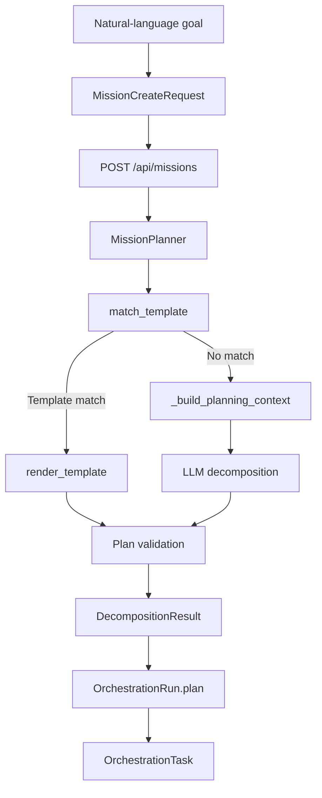
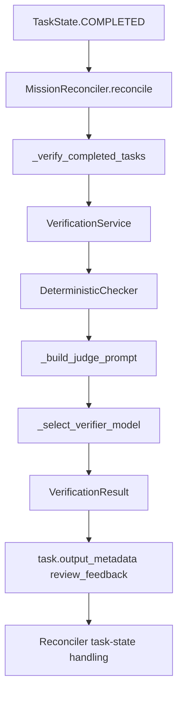
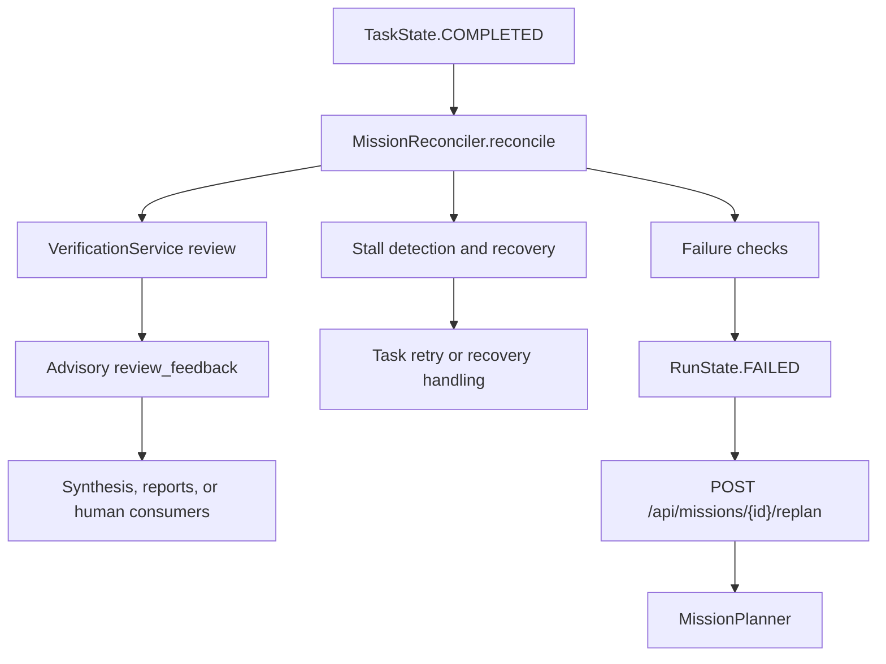

# Mission Planning & Verification

Relevant source files

The following files were used as context for generating this wiki page:

- [frontend/components/missions/__tests__/approve-body.test.ts](frontend/components/missions/__tests__/approve-body.test.ts)
- [frontend/components/missions/__tests__/mission-retry.test.tsx](frontend/components/missions/__tests__/mission-retry.test.tsx)
- [frontend/components/missions/__tests__/mission-stats.test.ts](frontend/components/missions/__tests__/mission-stats.test.ts)
- [frontend/components/missions/approve-body.ts](frontend/components/missions/approve-body.ts)
- [frontend/components/missions/create-mission-modal.tsx](frontend/components/missions/create-mission-modal.tsx)
- [frontend/components/missions/index.ts](frontend/components/missions/index.ts)
- [frontend/components/missions/mission-budget-bar.tsx](frontend/components/missions/mission-budget-bar.tsx)
- [frontend/components/missions/mission-card.tsx](frontend/components/missions/mission-card.tsx)
- [frontend/components/missions/mission-detail-page.tsx](frontend/components/missions/mission-detail-page.tsx)
- [frontend/components/missions/mission-field-inspector.tsx](frontend/components/missions/mission-field-inspector.tsx)
- [frontend/components/missions/mission-field-panel.tsx](frontend/components/missions/mission-field-panel.tsx)
- [frontend/components/missions/mission-field-viz.tsx](frontend/components/missions/mission-field-viz.tsx)
- [frontend/components/tools/tool-actions-modal.tsx](frontend/components/tools/tool-actions-modal.tsx)
- [frontend/components/tools/tool-details-modal.tsx](frontend/components/tools/tool-details-modal.tsx)
- [frontend/components/workflows/templates-tab.tsx](frontend/components/workflows/templates-tab.tsx)
- [frontend/hooks/use-missions-api.ts](frontend/hooks/use-missions-api.ts)
- [frontend/stores/mission-store.ts](frontend/stores/mission-store.ts)
- [frontend/types/missions.ts](frontend/types/missions.ts)
- [orchestrator/alembic/versions/prd123_checkpoint_count.py](orchestrator/alembic/versions/prd123_checkpoint_count.py)
- [orchestrator/api/mission_retry.py](orchestrator/api/mission_retry.py)
- [orchestrator/api/missions.py](orchestrator/api/missions.py)
- [orchestrator/core/models/orchestration.py](orchestrator/core/models/orchestration.py)
- [orchestrator/core/models/orchestration_enums.py](orchestrator/core/models/orchestration_enums.py)
- [orchestrator/modules/coordination/credit_pause.py](orchestrator/modules/coordination/credit_pause.py)
- [orchestrator/modules/coordination/dispatcher.py](orchestrator/modules/coordination/dispatcher.py)
- [orchestrator/modules/coordination/one_step_at_a_time.py](orchestrator/modules/coordination/one_step_at_a_time.py)
- [orchestrator/modules/coordination/planner.py](orchestrator/modules/coordination/planner.py)
- [orchestrator/modules/coordination/primitive_heartbeat.py](orchestrator/modules/coordination/primitive_heartbeat.py)
- [orchestrator/modules/coordination/reconciler.py](orchestrator/modules/coordination/reconciler.py)
- [orchestrator/modules/coordination/templates.py](orchestrator/modules/coordination/templates.py)
- [orchestrator/modules/coordination/verification.py](orchestrator/modules/coordination/verification.py)
- [orchestrator/modules/policy/pricing.py](orchestrator/modules/policy/pricing.py)
- [orchestrator/services/coordinator_service.py](orchestrator/services/coordinator_service.py)
- [orchestrator/tests/test_82c_wiring.py](orchestrator/tests/test_82c_wiring.py)
- [orchestrator/tests/test_agents_api_plugins.py](orchestrator/tests/test_agents_api_plugins.py)
- [orchestrator/tests/test_budget_gate.py](orchestrator/tests/test_budget_gate.py)
- [orchestrator/tests/test_coordinator_parallel.py](orchestrator/tests/test_coordinator_parallel.py)
- [orchestrator/tests/test_f142_a_task_is_given_the_missions_goal.py](orchestrator/tests/test_f142_a_task_is_given_the_missions_goal.py)
- [orchestrator/tests/test_f153_a_budget_pause_says_why.py](orchestrator/tests/test_f153_a_budget_pause_says_why.py)
- [orchestrator/tests/test_f247_a_mission_out_of_credit_pauses_and_resumes.py](orchestrator/tests/test_f247_a_mission_out_of_credit_pauses_and_resumes.py)
- [orchestrator/tests/test_f267_b_no_step_starts_while_another_is_redone.py](orchestrator/tests/test_f267_b_no_step_starts_while_another_is_redone.py)
- [orchestrator/tests/test_f285_a_only_a_budget_the_owner_set_pauses_a_mission.py](orchestrator/tests/test_f285_a_only_a_budget_the_owner_set_pauses_a_mission.py)
- [orchestrator/tests/test_mission_retry_feeds_critique.py](orchestrator/tests/test_mission_retry_feeds_critique.py)
- [orchestrator/tests/test_parallel_decomposition.py](orchestrator/tests/test_parallel_decomposition.py)
- [orchestrator/tests/test_plugin_assignment_api.py](orchestrator/tests/test_plugin_assignment_api.py)
- [orchestrator/tests/test_plugin_runtime_integration.py](orchestrator/tests/test_plugin_runtime_integration.py)
- [orchestrator/tests/test_prd128_notification_dispatcher.py](orchestrator/tests/test_prd128_notification_dispatcher.py)
- [orchestrator/tests/test_synthesis_executor.py](orchestrator/tests/test_synthesis_executor.py)
- [orchestrator/tests/test_w1s1_hotpath_telemetry.py](orchestrator/tests/test_w1s1_hotpath_telemetry.py)

## 1. Purpose & Scope

This page describes how mission goals are decomposed into task plans, how plans are validated and matched to agents, and how completed task outputs are reviewed. It also distinguishes advisory verification from retry and replan behavior: verification feedback is recorded for downstream use, while the verifier itself does not reject tasks or trigger retries. [orchestrator/modules/coordination/planner.py:1-15](), [orchestrator/modules/coordination/verification.py:1-16](), [orchestrator/modules/coordination/reconciler.py:5-16]()

Sources: [orchestrator/modules/coordination/planner.py:1-15](), [orchestrator/modules/coordination/verification.py:1-16](), [orchestrator/modules/coordination/reconciler.py:5-16]()

---

## 2. Mission Planner & Goal Decomposition

`MissionPlanner` turns a natural-language goal into a task plan. Its documented sequence is to try template matching first, fall back to LLM decomposition if no template matches, validate the resulting plan, retry LLM planning up to three times after validation failures, and return a `DecompositionResult`. [orchestrator/modules/coordination/planner.py:1-15]()

The planner also provides helpers for planning inputs:

- `_resolve_attachments_for_planning` resolves attachment IDs in the workspace. For documents, it extracts text; for images, it supplies a placeholder explaining that visual content will be available to executing agents. Missing or failed attachments become placeholder entries instead of aborting the planning request. [orchestrator/modules/coordination/planner.py:48-115]()
- `_build_planning_context` asks `ContextService.build_planning_context` for a goal-specific context pack with `include_roster=False`. If there is no database session, the pack is empty, or context building fails, planning continues without the pack. [orchestrator/modules/coordination/planner.py:123-155]()
- The planner defines `MIN_TASKS = 1`, `MAX_TASKS = 20`, and `MAX_PLAN_RETRIES = 3`. Its task-count guidance explicitly permits a single task when that is sufficient for the goal. [orchestrator/modules/coordination/planner.py:162-174]()

Mission creation enters through `POST /api/missions`. Its request accepts a natural-language `goal`, optional config, optional `template_id`, `plan_only`, and optional owner-specified `staffing`. [orchestrator/api/missions.py:8-18](), [orchestrator/api/missions.py:106-125]()

### Decomposition flow

**Diagram: Natural Language Space to Code Entity Space — Goal Decomposition**

Sources: [orchestrator/api/missions.py:8-18](), [orchestrator/api/missions.py:106-125](), [orchestrator/modules/coordination/planner.py:1-15](), [orchestrator/modules/coordination/planner.py:123-155](), [orchestrator/modules/coordination/planner.py:162-174](), [orchestrator/modules/coordination/templates.py:1-9](), [orchestrator/core/models/orchestration.py:39-69](), [orchestrator/core/models/orchestration.py:156-199]()

The persisted mission model is `OrchestrationRun` in the `orchestration_runs` table. It holds the goal, JSON plan, config, state, and replan count. Individual `OrchestrationTask` rows hold task definitions, sequence numbers, desired agent roles, and assignment state. [orchestrator/core/models/orchestration.py:39-69](), [orchestrator/core/models/orchestration.py:95-105](), [orchestrator/core/models/orchestration.py:156-218]()

Sources: [orchestrator/core/models/orchestration.py:39-69](), [orchestrator/core/models/orchestration.py:95-105](), [orchestrator/core/models/orchestration.py:156-218]()

---

## 3. Templates & Agent Matcher

Template matching is the planner’s first decomposition path. `planner.py` imports `match_template` and `render_template` from `modules.coordination.templates`; its documented pipeline uses template matching before LLM decomposition. [orchestrator/modules/coordination/planner.py:7-13](), [orchestrator/modules/coordination/planner.py:31-38]()

Agent selection is a separate concern from plan generation. `MissionDispatcher` uses `AgentMatcher` to select an agent for dispatch; its module documentation specifies that a task with no matching agent fails with `NO_AGENT_AVAILABLE`. [orchestrator/modules/coordination/dispatcher.py:5-13](), [orchestrator/modules/coordination/dispatcher.py:45-57]()

The task model stores a desired `agent_role` and an `assigned_agent_id`, allowing a plan to describe a role before dispatch resolves an actual agent. [orchestrator/core/models/orchestration.py:194-199](), [orchestrator/core/models/orchestration.py:214-218]()

`coordinator_service.py` imports `AgentMatcher`, `build_match_annotation`, and `resolve_named_agent`. It also defines `annotate_plan_with_matches`, which returns a new plan dictionary with match data mirrored onto plan tasks. It looks up a match by `temp_id` first and then by `sequence_number`, allowing approval-plan display to distinguish tasks that share a sequence number. [orchestrator/services/coordinator_service.py:54-56](), [orchestrator/services/coordinator_service.py:134-155]()

### Planning and staffing entities

| Planning or dispatch concept | Code entity | Role |
|---|---|---|
| Reusable task-plan match | `match_template` | Attempts to match a goal to a template before LLM decomposition. [orchestrator/modules/coordination/planner.py:7-13](), [orchestrator/modules/coordination/planner.py:31-38]() |
| Template expansion | `render_template` | Imported by the planner as the template rendering path. [orchestrator/modules/coordination/planner.py:31-38]() |
| Desired task expertise | `OrchestrationTask.agent_role` | Stores the role requested by a task before assignment. [orchestrator/core/models/orchestration.py:194-199]() |
| Agent selection | `AgentMatcher` | Used by the dispatcher to select an agent for a task. [orchestrator/modules/coordination/dispatcher.py:5-13](), [orchestrator/modules/coordination/dispatcher.py:45-57]() |
| Named-agent resolution | `resolve_named_agent` | Imported by the coordinator alongside agent matching. [orchestrator/services/coordinator_service.py:54-56]() |
| Plan match annotation | `annotate_plan_with_matches` | Copies match metadata into plan tasks, looking up by `temp_id` then sequence number. [orchestrator/services/coordinator_service.py:134-155]() |

Sources: [orchestrator/modules/coordination/planner.py:7-13](), [orchestrator/modules/coordination/planner.py:31-38](), [orchestrator/modules/coordination/dispatcher.py:5-13](), [orchestrator/modules/coordination/dispatcher.py:45-57](), [orchestrator/core/models/orchestration.py:194-218](), [orchestrator/services/coordinator_service.py:54-56](), [orchestrator/services/coordinator_service.py:134-155]()

---

## 4. Plan Validation & Approval-Time Editing

The planner documents structural validation of the generated plan, including checking that the task graph is acyclic, that referenced agents exist, and that task count is within bounds. Validation failures can cause the LLM decomposition path to retry, up to `MAX_PLAN_RETRIES`. [orchestrator/modules/coordination/planner.py:5-13](), [orchestrator/modules/coordination/planner.py:162-174]()

The planner imports `DependencyResolver`, `CyclicDependencyError`, and `InvalidDependencyError`, which are the dependency-resolution and dependency-error entities used by the planning path. [orchestrator/modules/coordination/planner.py:34-38]()

### Approval-time edits

Approval-time task edits are deliberately limited to the fields `agent_role`, `title`, and `description`; structural changes such as adding or removing tasks or rewiring dependencies are outside this field-edit path. [orchestrator/services/coordinator_service.py:110-113]()

The mission API defines plan editing as a separate operation from approval. `MissionApproveRequest` rejects unknown fields, and its validator rejects a `modifications` field with a message directing clients to edit the plan first. [orchestrator/api/missions.py:128-159]()

Sources: [orchestrator/modules/coordination/planner.py:5-13](), [orchestrator/modules/coordination/planner.py:34-38](), [orchestrator/modules/coordination/planner.py:162-174](), [orchestrator/services/coordinator_service.py:110-113](), [orchestrator/api/missions.py:128-159]()

---

## 5. Verification Service & Pipeline

`VerificationService` performs advisory review of task output. Its module contract specifies two stages: deterministic checks, followed by a cross-model LLM reviewer that returns scores and actionable suggestions. Verification feedback is stored in `task.output_metadata["review_feedback"]`; the verifier does not reject tasks or trigger retries based on verification. [orchestrator/modules/coordination/verification.py:1-16]()

The result type, `VerificationResult`, contains a verdict, dimension scores, reasoning, confidence, deterministic-check status and failures, suggestions, and token usage. The declared verdict constants are `pass`, `fail`, and `partial`; those labels describe the review result, not a task-state transition that rejects the task. [orchestrator/modules/coordination/verification.py:33-61]()

### Two-stage evaluation

1. **Deterministic checks.** `VerificationService` imports `DeterministicChecker` and `DeterministicResult` for the fast structural-check stage. [orchestrator/modules/coordination/verification.py:5-11](), [orchestrator/modules/coordination/verification.py:25-29]()
2. **Cross-model review.** The reviewer scores `relevance`, `completeness`, `accuracy`, and `format_compliance`. `_select_verifier_model` uses configured model mappings and a fallback model to select a reviewer distinct from the executor’s model family where possible. [orchestrator/modules/coordination/verification.py:41-42](), [orchestrator/modules/coordination/verification.py:89-140]()
3. **Task-specific criteria.** `_build_judge_prompt` accepts verification criteria and an optional `definition_of_done`, enabling the judge prompt to account for a task’s definition of done when present. [orchestrator/modules/coordination/verification.py:163-177]()

**Diagram: Natural Language Space to Code Entity Space — Task Review**

Sources: [orchestrator/core/models/orchestration_enums.py:48-59](), [orchestrator/modules/coordination/reconciler.py:129-156](), [orchestrator/modules/coordination/verification.py:1-16](), [orchestrator/modules/coordination/verification.py:33-61](), [orchestrator/modules/coordination/verification.py:89-140](), [orchestrator/modules/coordination/verification.py:163-177]()

The reconciler invokes its completed-task verification phase as part of `MissionReconciler.reconcile`. Its module documentation describes the state path as `COMPLETED → VERIFYING → VERIFIED/RETRYING/FAILED`; the verification service’s own contract clarifies that verifier scores do not themselves reject or retry a task. [orchestrator/modules/coordination/reconciler.py:5-16](), [orchestrator/modules/coordination/reconciler.py:129-156](), [orchestrator/modules/coordination/verification.py:9-12]()

Sources: [orchestrator/modules/coordination/reconciler.py:5-16](), [orchestrator/modules/coordination/reconciler.py:129-156](), [orchestrator/modules/coordination/verification.py:9-12]()

---

## 6. Reconciler, Retry Loop & Critique Integration

`MissionReconciler` is stateless and reconciles a mission using database state. Its pass verifies completed tasks, detects and recovers stalls, and checks whether the run should advance or fail. The documented stall thresholds are more than 60 seconds for `ASSIGNED` tasks and more than 300 seconds for `RUNNING` tasks. [orchestrator/modules/coordination/reconciler.py:5-16](), [orchestrator/modules/coordination/reconciler.py:120-144]()

`ReconcileResult` reports counts for detected and recovered stalls, failed and verified tasks, verification failures, and run advancement. [orchestrator/modules/coordination/reconciler.py:95-112]()

### Retry and critique boundaries

The retry behavior should be read as distinct from the verifier’s advisory review:

- The verification module explicitly says tasks are never rejected or retried based on verification. Its `review_feedback` is for downstream consumers, including synthesis tasks, reports, and humans. [orchestrator/modules/coordination/verification.py:9-12]()
- The reconciler’s documented task-state path includes `RETRYING`, and its responsibilities include stall recovery and failure checks. [orchestrator/modules/coordination/reconciler.py:5-16]()
- Retry and replan decisions are represented separately in the coordination layer. The coordinator imports `retries_a_failed_mission` and `replaces_what_the_failure_skipped`, while the mission API exposes a replan operation for failed missions. [orchestrator/services/coordinator_service.py:57-58](), [orchestrator/api/missions.py:8-22]()
- Permanent task failures and successful retry recoveries can be captured through `MissionMemoryService`. Both capture helpers are best-effort and log rather than propagate capture failures; the recovery helper skips first-attempt successes. [orchestrator/modules/coordination/reconciler.py:62-93]()

**Diagram: Mission review, retry, and replan control flow**

Sources: [orchestrator/modules/coordination/reconciler.py:5-16](), [orchestrator/modules/coordination/reconciler.py:120-160](), [orchestrator/modules/coordination/reconciler.py:62-93](), [orchestrator/modules/coordination/verification.py:9-12](), [orchestrator/services/coordinator_service.py:57-58](), [orchestrator/api/missions.py:8-22]()

### Replan entry point

The mission API documents `POST /api/missions/{id}/replan` as the operation for replanning a failed mission. The run model tracks `replan_count`, and the coordinator imports helper functions associated with failed-mission retry and replacing work skipped by a failure. [orchestrator/api/missions.py:15-22](), [orchestrator/core/models/orchestration.py:95-105](), [orchestrator/services/coordinator_service.py:57-58]()

Sources: [orchestrator/api/missions.py:15-22](), [orchestrator/core/models/orchestration.py:95-105](), [orchestrator/services/coordinator_service.py:57-58]()

---