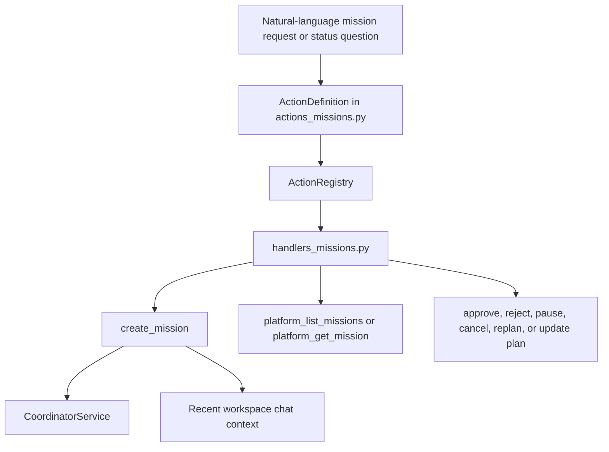
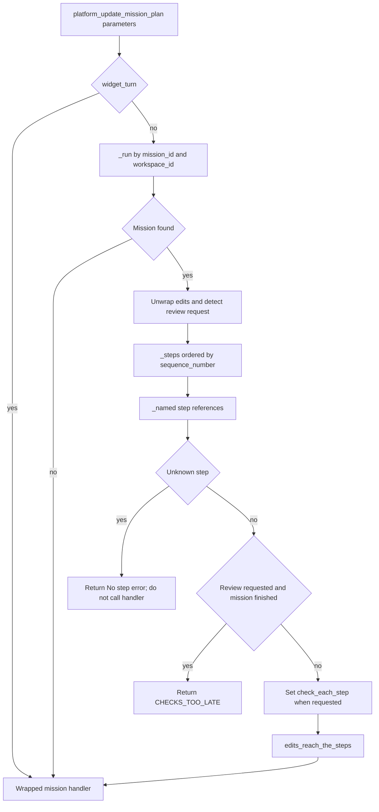
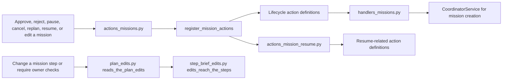
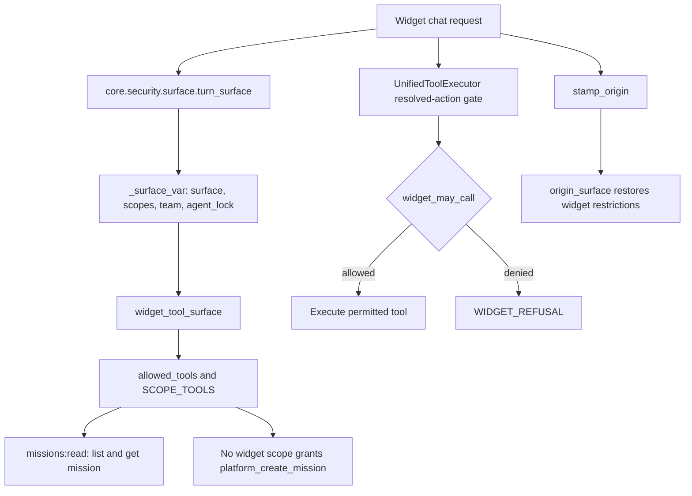

# Mission Platform Actions & Plan Edits

Relevant source files

The following files were used as context for generating this wiki page:

- [orchestrator/api/widgets/chat.py](orchestrator/api/widgets/chat.py)
- [orchestrator/core/security/surface.py](orchestrator/core/security/surface.py)
- [orchestrator/core/security/widget_scopes.py](orchestrator/core/security/widget_scopes.py)
- [orchestrator/modules/context/sections/composio.py](orchestrator/modules/context/sections/composio.py)
- [orchestrator/modules/context/sections/plugins.py](orchestrator/modules/context/sections/plugins.py)
- [orchestrator/modules/tools/discovery/actions_mission_resume.py](orchestrator/modules/tools/discovery/actions_mission_resume.py)
- [orchestrator/modules/tools/discovery/actions_missions.py](orchestrator/modules/tools/discovery/actions_missions.py)
- [orchestrator/modules/tools/discovery/handlers_missions.py](orchestrator/modules/tools/discovery/handlers_missions.py)
- [orchestrator/modules/tools/discovery/plan_edits.py](orchestrator/modules/tools/discovery/plan_edits.py)
- [orchestrator/modules/tools/discovery/step_brief_edits.py](orchestrator/modules/tools/discovery/step_brief_edits.py)
- [orchestrator/tests/test_f155_a_widget_turn_gets_no_skills_and_only_its_locked_agents_plugins.py](orchestrator/tests/test_f155_a_widget_turn_gets_no_skills_and_only_its_locked_agents_plugins.py)
- [orchestrator/tests/test_f155_the_public_widget_surface.py](orchestrator/tests/test_f155_the_public_widget_surface.py)
- [orchestrator/tests/test_f155_widget_born_work_carries_its_origin.py](orchestrator/tests/test_f155_widget_born_work_carries_its_origin.py)
- [orchestrator/tests/test_f155_widget_scopes.py](orchestrator/tests/test_f155_widget_scopes.py)
- [orchestrator/tests/test_f282_c_plan_edits_land_on_the_missions_steps.py](orchestrator/tests/test_f282_c_plan_edits_land_on_the_missions_steps.py)
- [orchestrator/tests/test_f308_c_a_brief_edit_reaches_the_steps_card.py](orchestrator/tests/test_f308_c_a_brief_edit_reaches_the_steps_card.py)
- [orchestrator/tests/test_f308_d_a_reply_never_says_steps_pause_when_they_dont.py](orchestrator/tests/test_f308_d_a_reply_never_says_steps_pause_when_they_dont.py)
- [orchestrator/tests/test_widget_proactive_prd007.py](orchestrator/tests/test_widget_proactive_prd007.py)

## Purpose & Scope

This page documents the mission platform-action catalog, the mission handler behavior visible in the supplied implementation, plan-edit normalization and validation, the mission resume-action module’s role, and widget-surface restrictions. The mission handlers are in `handlers_missions.py`; action schemas are registered in `actions_missions.py`; plan-edit preprocessing is implemented in `plan_edits.py` and delegates step-level handling to `step_brief_edits.py`. [orchestrator/modules/tools/discovery/handlers_missions.py:1-16]() [orchestrator/modules/tools/discovery/actions_missions.py:1-37]() [orchestrator/modules/tools/discovery/plan_edits.py:1-36]()

Sources: `orchestrator/modules/tools/discovery/handlers_missions.py:1-16`; `orchestrator/modules/tools/discovery/actions_missions.py:1-37`; `orchestrator/modules/tools/discovery/plan_edits.py:1-36`

---

## 1. Mission Platform Action Handlers & Registries

`actions_missions.py` defines mission action schemas and registers them with `ActionRegistry`. The module registers list, get, approve/reject, pause/cancel, replan, and plan-update actions in a fixed order; the resume-action definitions are separated into `actions_mission_resume.py`. [orchestrator/modules/tools/discovery/actions_missions.py:1-37]()

### Action Definitions and Registries

The visible action definitions establish the following API surface:

| Action | Purpose and schema characteristics |
|---|---|
| `platform_list_missions` | Read action with optional state and limit filters; its description directs callers to `platform_get_mission` for one mission’s details. [orchestrator/modules/tools/discovery/actions_missions.py:40-72]() |
| `platform_get_mission` | Read action requiring `mission_id`; accepts a mission ID, board card number, or an unambiguous title as the reference. [orchestrator/modules/tools/discovery/actions_missions.py:5-7]() [orchestrator/modules/tools/discovery/actions_missions.py:75-97]() |
| `platform_approve_mission` | Write action for approving a plan or, once execution has started, approving a step awaiting owner review; accepts a step reference and note. [orchestrator/modules/tools/discovery/actions_missions.py:17-24]() [orchestrator/modules/tools/discovery/actions_missions.py:100-129]() |
| `platform_reject_mission` | Write action for rejecting an awaiting-approval plan or sending a started mission step back with the owner’s requested changes. [orchestrator/modules/tools/discovery/actions_missions.py:25-27]() [orchestrator/modules/tools/discovery/actions_missions.py:131-148]() |
| `platform_update_mission_plan` | Registered by `_register_update_mission_plan`; plan edits are normalized by `reads_the_plan_edits`. [orchestrator/modules/tools/discovery/actions_missions.py:30-37]() [orchestrator/modules/tools/discovery/plan_edits.py:56-82]() |
| Resume actions | Resume-related definitions are delegated to `actions_mission_resume.py`; the supplied file listing identifies this module, but its implementation was not included in the provided contents. [orchestrator/modules/tools/discovery/actions_mission_resume.py:1-27]() |

Mission references are designed to accept a mission ID, a board card number such as `#0188`, or a unique title. A step’s card number, such as `#0188.3`, can identify its mission. [orchestrator/modules/tools/discovery/actions_missions.py:5-7]()

The action descriptions distinguish mission approval from board-card review: a card in Review is handled with `platform_update_task_status`, not `platform_approve_mission`. Approval and rejection tools also support step-level decisions after a mission starts. [orchestrator/modules/tools/discovery/actions_missions.py:14-27]() [orchestrator/modules/tools/discovery/actions_missions.py:100-148]()

### Handler Implementation

`handlers_missions.py` provides mission-specific helpers and a `create_mission` handler. Its visible imports show that mission behavior is composed with helpers for approval policy, mission-card references, step verdicts, plan edits, and caller narration. [orchestrator/modules/tools/discovery/handlers_missions.py:9-15]()

- `_actor(params)` chooses `_created_by`, then `_agent_id`, then `"agent"` as the actor identifier. [orchestrator/modules/tools/discovery/handlers_missions.py:23-28]()
- `_recent_chat_context(db, workspace_id, chat_id, limit)` retrieves up to five recent workspace messages by default, optionally filters to one chat, returns text-bearing messages oldest-first, and degrades to an empty list if the query fails. [orchestrator/modules/tools/discovery/handlers_missions.py:19-20]() [orchestrator/modules/tools/discovery/handlers_missions.py:30-58]()
- `_plan_task_summary(plan_tasks)` builds a summary for up to ten plan tasks, including title, agent role, sequence, and available task identifiers and agent-match details. [orchestrator/modules/tools/discovery/handlers_missions.py:61-87]()
- `_owner_approves_every_mission(db, workspace_id)` loads the workspace approval policy and treats policy-read failures as `ALWAYS_ASK`. [orchestrator/modules/tools/discovery/handlers_missions.py:90-100]()
- `_auto_approve_held(db, workspace_id, config)` explains why `auto_approve` is not applied when the turn is from a public widget or the workspace policy is always-ask. [orchestrator/modules/tools/discovery/handlers_missions.py:102-121]()
- `_create_reply_message(run, task_count)` reports `awaiting_approval` honestly, distinguishes a running auto-approved mission, and otherwise reports the run’s state. [orchestrator/modules/tools/discovery/handlers_missions.py:124-138]()
- `create_mission` is decorated to add approval-policy wording, owner-specified mission settings, and mission-card references. Its visible implementation requires a goal, resolves the actor, and documents recent chat as planner context. [orchestrator/modules/tools/discovery/handlers_missions.py:141-159]()

**Natural Language to Code: Mission Action Surface**

Sources:
- `orchestrator/modules/tools/discovery/actions_missions.py:1-37`
- `orchestrator/modules/tools/discovery/actions_missions.py:40-148`
- `orchestrator/modules/tools/discovery/handlers_missions.py:19-28`
- `orchestrator/modules/tools/discovery/handlers_missions.py:30-58`
- `orchestrator/modules/tools/discovery/handlers_missions.py:141-159`

Sources: `orchestrator/modules/tools/discovery/actions_missions.py:1-148`; `orchestrator/modules/tools/discovery/handlers_missions.py:19-159`

---

## 2. Plan Edits & Step Brief Updates

The `reads_the_plan_edits` decorator preprocesses `platform_update_mission_plan` parameters and delegates normalized edits to `edits_reach_the_steps` in `step_brief_edits.py`. The delegate’s full implementation was not included in the supplied contents, so its internal state checks and persistence behavior are not specified here. [orchestrator/modules/tools/discovery/plan_edits.py:34-36]() [orchestrator/modules/tools/discovery/plan_edits.py:56-82]()

### Plan Edit Preprocessing (`plan_edits.py`)

The wrapper performs these steps:

1. It normalizes absent parameters to an empty mapping and passes widget-turn calls directly to the wrapped handler without reading or rewriting the plan. [orchestrator/modules/tools/discovery/plan_edits.py:56-65]()
2. It loads the mission by parsing `mission_id` as a UUID and matching both the run ID and `workspace_id`. If the mission cannot be resolved, it delegates to the handler without performing step-name normalization. [orchestrator/modules/tools/discovery/plan_edits.py:85-94]() [orchestrator/modules/tools/discovery/plan_edits.py:56-66]()
3. It unwraps each dictionary edit, detects requests for owner review, drops edits that contain no supported editable fields, loads the mission’s ordered steps, and resolves the edits against those steps. [orchestrator/modules/tools/discovery/plan_edits.py:38-47]() [orchestrator/modules/tools/discovery/plan_edits.py:66-72]()
4. If an edit names an unknown step, it returns an error and does not call the wrapped handler. If a request enables checks after the mission is finished, it returns `CHECKS_TOO_LATE`. [orchestrator/modules/tools/discovery/plan_edits.py:49-53]() [orchestrator/modules/tools/discovery/plan_edits.py:69-74]()
5. When appropriate, `_check_each_step` enables the mission-level `check_each_step` setting. The wrapper either returns the resulting note directly or passes the normalized task edits to `edits_reach_the_steps`. [orchestrator/modules/tools/discovery/plan_edits.py:75-81]()

The edit normalizer accepts wrappers named `changes`, `updates`, `fields`, and `edits`. It maps agent-name aliases—including `assigned_agent_name`, `agent_name`, `agent`, and `assignee`—to `agent_role` when no explicit `agent_role` is present. The editable fields identified by the wrapper are `agent_id`, `agent_role`, `title`, and `description`. [orchestrator/modules/tools/discovery/plan_edits.py:38-47]() [orchestrator/modules/tools/discovery/plan_edits.py:96-106]()

Step references can use identifiers such as `task_id`, `temp_id`, `sequence_number`, `step`, `step_number`, `step_id`, `id`, or `ref`. The module’s documented contract supports card numbers, plan position, IDs, and title words; the resolver rewrites a recognized reference to the task ID. When no step matches, the error is intended to list available steps and an example reference. [orchestrator/modules/tools/discovery/plan_edits.py:38-50]() [orchestrator/modules/tools/discovery/plan_edits.py:119-129]()

Approval requests are normalized to the mission-level `check_each_step` behavior. The wrapper recognizes multiple approval/review aliases, including nested mappings, and rejects enabling checks after the mission has finished. [orchestrator/modules/tools/discovery/plan_edits.py:43-53]() [orchestrator/modules/tools/discovery/plan_edits.py:108-116]() [orchestrator/modules/tools/discovery/plan_edits.py:69-78]()

### Step Brief & Card Synchronization (`step_brief_edits.py`)

`plan_edits.py` delegates normalized edits to `edits_reach_the_steps`, whose module is `step_brief_edits.py`. The supplied file listing identifies that module, and the `plan_edits.py` call site confirms the delegation receives the database session, workspace, updated parameters, mission run, normalized edits, and resolved steps. The delegate’s detailed branching and persistence behavior cannot be established from the supplied excerpt. [orchestrator/modules/tools/discovery/plan_edits.py:34-36]() [orchestrator/modules/tools/discovery/plan_edits.py:79-81]()

**Plan Edit Translation & Step Routing**

Sources:
- `orchestrator/modules/tools/discovery/plan_edits.py:34-36`
- `orchestrator/modules/tools/discovery/plan_edits.py:56-82`
- `orchestrator/modules/tools/discovery/plan_edits.py:85-129`

Sources: `orchestrator/modules/tools/discovery/plan_edits.py:34-129`

---

## 3. Mission Resume & Lifecycle Actions

The mission action catalog describes lifecycle controls for approving or rejecting plans, pausing or cancelling runs, and replanning; it registers these alongside list, get, and plan-update actions. Resume-related actions are separated into `actions_mission_resume.py`. The supplied contents do not include that module’s implementation, so the exact resume handler, state transitions, and retry semantics cannot be detailed here. [orchestrator/modules/tools/discovery/actions_missions.py:8-10]() [orchestrator/modules/tools/discovery/actions_missions.py:30-37]() [orchestrator/modules/tools/discovery/actions_mission_resume.py:1-27]()

For creation, the handler’s status-message helper distinguishes `AWAITING_APPROVAL` from `RUNNING`; an awaiting-approval mission’s response tells the caller to review and approve the plan before execution. [orchestrator/modules/tools/discovery/handlers_missions.py:124-138]() The action definitions also distinguish approving an awaiting-approval plan from approving a step after the mission has started, and distinguish rejecting a plan from sending a started step back for rework. [orchestrator/modules/tools/discovery/actions_missions.py:17-27]() [orchestrator/modules/tools/discovery/actions_missions.py:100-148]()

**Mission Lifecycle Actions: Natural Language to Code Entities**

Sources:
- `orchestrator/modules/tools/discovery/actions_missions.py:1-37`
- `orchestrator/modules/tools/discovery/actions_missions.py:100-148`
- `orchestrator/modules/tools/discovery/actions_mission_resume.py:1-27`
- `orchestrator/modules/tools/discovery/handlers_missions.py:124-159`
- `orchestrator/modules/tools/discovery/plan_edits.py:34-36`
- `orchestrator/modules/tools/discovery/plan_edits.py:56-82`

Sources: `orchestrator/modules/tools/discovery/actions_missions.py:1-37`; `orchestrator/modules/tools/discovery/actions_mission_resume.py:1-27`; `orchestrator/modules/tools/discovery/handlers_missions.py:124-159`; `orchestrator/modules/tools/discovery/plan_edits.py:34-82`

---

## 4. Widget Scopes & Security Restrictions on Mission Surfaces

Widget calls are marked with a turn surface stored in a `ContextVar`. `turn_surface` carries the widget surface, granted scopes, normalized team lock, and optional agent lock; helper functions expose those values only when the current surface is a widget turn. [orchestrator/core/security/surface.py:27-67]() [orchestrator/core/security/surface.py:70-89]()

### Surface Enforcement

The widget tool allowlist is assembled from base tools plus tools associated with recognized scopes. `missions:read` grants `platform_list_missions` and `platform_get_mission`; the scope map shown does not grant mission creation, lifecycle changes, or plan updates. [orchestrator/core/security/widget_scopes.py:34-76]() The tests explicitly verify that a widget call cannot start a mission even when the key has `missions:read` and `missions:execute`, because mission tasks run later outside the widget turn. [orchestrator/tests/test_f155_widget_scopes.py:101-112]()

The same scope rules constrain both the tools offered to the model and the executor’s resolved action. `widget_tool_surface` filters ordinary tool schemas and narrows the `platform_execute` action enum to permitted actions; the tests verify that a chat-only key cannot execute owner writes or private reads and that unknown scopes add no permissions. [orchestrator/core/security/widget_scopes.py:87-108]() [orchestrator/core/security/widget_scopes.py:111-124]() [orchestrator/tests/test_f155_widget_scopes.py:43-99]()

Work created during a widget turn can carry server-stamped origin metadata: `origin_surface`, `origin_scopes`, `origin_team`, and, when present, `origin_agent_lock`. `origin_surface` can restore those restrictions when later work runs. [orchestrator/core/security/surface.py:27-32]() [orchestrator/core/security/surface.py:92-127]() The supplied tests verify that widget-origin mission creation does not accept a caller-supplied cost ceiling and that mission tasks can run under the stamped widget restrictions. [orchestrator/tests/test_f155_widget_born_work_carries_its_origin.py:42-63]() [orchestrator/tests/test_f155_widget_born_work_carries_its_origin.py:98-112]()

`reads_the_plan_edits` bypasses plan preprocessing on a widget turn and delegates directly to the wrapped handler; the supplied test confirms this path leaves the visitor’s edit unchanged when it reaches the handler. This does not itself establish the wrapped handler’s refusal behavior. [orchestrator/modules/tools/discovery/plan_edits.py:56-65]() [orchestrator/tests/test_f282_c_plan_edits_land_on_the_missions_steps.py:114-120]()

**Widget Mission Surface: Scope, Tool Filtering, and Origin**

Sources:
- `orchestrator/core/security/surface.py:27-127`
- `orchestrator/core/security/widget_scopes.py:1-25`
- `orchestrator/core/security/widget_scopes.py:34-124`
- `orchestrator/tests/test_f155_widget_scopes.py:101-112`
- `orchestrator/tests/test_f155_widget_born_work_carries_its_origin.py:42-63`
- `orchestrator/tests/test_f155_widget_born_work_carries_its_origin.py:98-112`

Sources: `orchestrator/core/security/surface.py:27-127`; `orchestrator/core/security/widget_scopes.py:1-124`; `orchestrator/tests/test_f155_widget_scopes.py:43-112`; `orchestrator/tests/test_f155_widget_born_work_carries_its_origin.py:42-112`

---