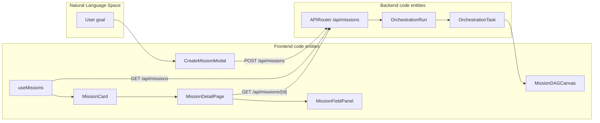
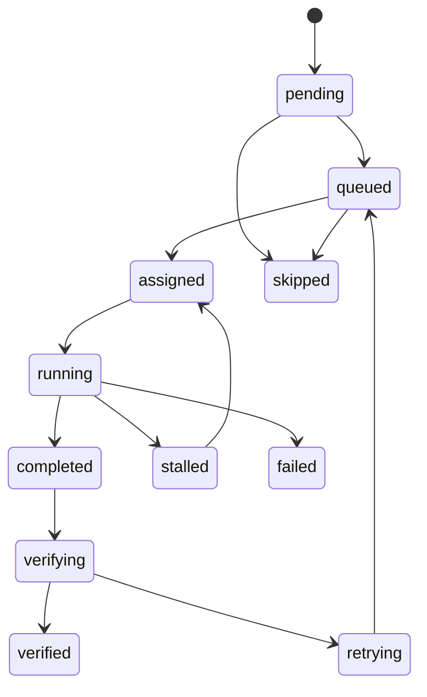
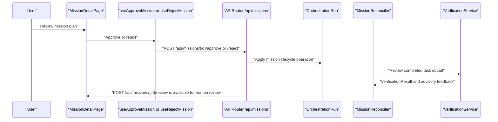
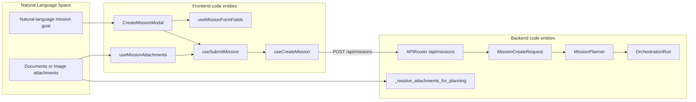
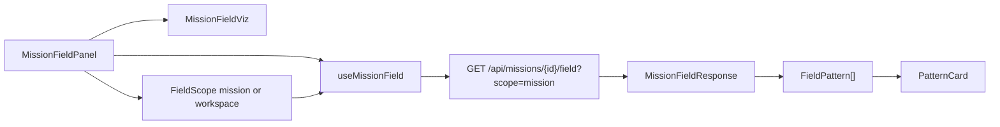

# Mission UI & Human Review

Relevant source files

The following files were used as context for generating this wiki page:

- [frontend/components/missions/__tests__/approve-body.test.ts](frontend/components/missions/__tests__/approve-body.test.ts)
- [frontend/components/missions/__tests__/mission-retry.test.tsx](frontend/components/missions/__tests__/mission-retry.test.tsx)
- [frontend/components/missions/__tests__/mission-stats.test.ts](frontend/components/missions/__tests__/mission-stats.test.ts)
- [frontend/components/missions/approve-body.ts](frontend/components/missions/approve-body.ts)
- [frontend/components/missions/create-mission-modal.tsx](frontend/components/missions/create-mission-modal.tsx)
- [frontend/components/missions/index.ts](frontend/components/missions/index.ts)
- [frontend/components/missions/mission-budget-bar.tsx](frontend/components/missions/mission-budget-bar.tsx)
- [frontend/components/missions/mission-card.tsx](frontend/components/missions/mission-card.tsx)
- [frontend/components/missions/mission-detail-page.tsx](frontend/components/missions/mission-detail-page.tsx)
- [frontend/components/missions/mission-field-inspector.tsx](frontend/components/missions/mission-field-inspector.tsx)
- [frontend/components/missions/mission-field-panel.tsx](frontend/components/missions/mission-field-panel.tsx)
- [frontend/components/missions/mission-field-viz.tsx](frontend/components/missions/mission-field-viz.tsx)
- [frontend/components/tools/tool-actions-modal.tsx](frontend/components/tools/tool-actions-modal.tsx)
- [frontend/components/tools/tool-details-modal.tsx](frontend/components/tools/tool-details-modal.tsx)
- [frontend/components/workflows/templates-tab.tsx](frontend/components/workflows/templates-tab.tsx)
- [frontend/hooks/use-missions-api.ts](frontend/hooks/use-missions-api.ts)
- [frontend/stores/mission-store.ts](frontend/stores/mission-store.ts)
- [frontend/types/missions.ts](frontend/types/missions.ts)
- [orchestrator/alembic/versions/prd123_checkpoint_count.py](orchestrator/alembic/versions/prd123_checkpoint_count.py)
- [orchestrator/api/mission_retry.py](orchestrator/api/mission_retry.py)
- [orchestrator/api/missions.py](orchestrator/api/missions.py)
- [orchestrator/core/models/orchestration.py](orchestrator/core/models/orchestration.py)
- [orchestrator/core/models/orchestration_enums.py](orchestrator/core/models/orchestration_enums.py)
- [orchestrator/modules/coordination/credit_pause.py](orchestrator/modules/coordination/credit_pause.py)
- [orchestrator/modules/coordination/dispatcher.py](orchestrator/modules/coordination/dispatcher.py)
- [orchestrator/modules/coordination/one_step_at_a_time.py](orchestrator/modules/coordination/one_step_at_a_time.py)
- [orchestrator/modules/coordination/planner.py](orchestrator/modules/coordination/planner.py)
- [orchestrator/modules/coordination/reconciler.py](orchestrator/modules/coordination/reconciler.py)
- [orchestrator/modules/coordination/verification.py](orchestrator/modules/coordination/verification.py)
- [orchestrator/services/coordinator_service.py](orchestrator/services/coordinator_service.py)
- [orchestrator/tests/test_f247_a_mission_out_of_credit_pauses_and_resumes.py](orchestrator/tests/test_f247_a_mission_out_of_credit_pauses_and_resumes.py)
- [orchestrator/tests/test_f267_b_no_step_starts_while_another_is_redone.py](orchestrator/tests/test_f267_b_no_step_starts_while_another_is_redone.py)
- [orchestrator/tests/test_w1s1_hotpath_telemetry.py](orchestrator/tests/test_w1s1_hotpath_telemetry.py)

## Purpose and scope

This page describes the mission-facing UI and its human-review seams: listing and creating missions, inspecting a mission’s task graph and shared field, and approving or rejecting plans and submitting reviews. The public API calls these resources “missions,” while the persisted top-level entity is `OrchestrationRun` in `orchestration_runs`. [orchestrator/api/missions.py:1-23](), [orchestrator/core/models/orchestration.py:39-49]()

Sources: [orchestrator/api/missions.py:1-23](), [orchestrator/core/models/orchestration.py:39-49]()

---

## 1. Mission UI and component architecture

The mission detail surface is organized around `MissionDetailPage`. It loads a mission by ID, derives summary statistics, and composes the budget bar, DAG canvas, activity feed, task inspector, results, field, and deliverables panels. The page also binds mission lifecycle actions—including pause, resume, cancel, approve, reject, replan, rerun, and save-as-routine—to mutation hooks. [frontend/components/missions/mission-detail-page.tsx:23-39](), [frontend/components/missions/mission-detail-page.tsx:69-105]()

The supplied code identifies `MissionCard` as an additional mission UI component, but does not include its implementation or the `MissionList` implementation. The frontend hooks do provide the list query contract: `useMissions` requests `/api/missions` with optional state, limit, and offset filters. [frontend/hooks/use-missions-api.ts:42-59](), [frontend/components/missions/mission-card.tsx:1-10]()

| UI surface | Role |
|---|---|
| `MissionList` / `useMissions` | List mission summaries; the hook supports state and pagination filters and refreshes periodically. [frontend/hooks/use-missions-api.ts:42-59]() |
| `MissionCard` | Mission card component; its implementation is not included in the supplied file contents. [frontend/components/missions/mission-card.tsx:1-10]() |
| `MissionDetailPage` | Loads one mission, derives stats, manages selected-task state, and arranges its inspection and results panels. [frontend/components/missions/mission-detail-page.tsx:69-105]() |
| `MissionDAGCanvas` | Imported into the detail page as the task-graph visualization. [frontend/components/missions/mission-detail-page.tsx:29-35]() |
| `MissionBudgetBar` | Imported into the detail page as the budget visualization. [frontend/components/missions/mission-detail-page.tsx:28-35]() |
| `MissionFieldPanel` | Fetches and displays shared-field patterns and field status. [frontend/components/missions/mission-field-panel.tsx:6-18](), [frontend/components/missions/mission-field-panel.tsx:115-181]() |

**Diagram: Mission UI names mapped to API and persistence entities**

Sources: [frontend/components/missions/create-mission-modal.tsx:70-108](), [frontend/components/missions/mission-detail-page.tsx:23-39](), [frontend/components/missions/mission-detail-page.tsx:69-105](), [frontend/hooks/use-missions-api.ts:42-71](), [frontend/components/missions/mission-card.tsx:1-10](), [orchestrator/api/missions.py:8-23](), [orchestrator/api/missions.py:80-80](), [orchestrator/core/models/orchestration.py:39-49](), [orchestrator/core/models/orchestration.py:156-182]()

### Detail-page state and interactions

`MissionDetailPage` gets mission data from `useMission(missionId)` and selected-task state from `useMissionStore`. It derives stats with `computeMissionStats`, finds the selected task from the fetched task collection, and updates or clears the selected task through callbacks. [frontend/components/missions/mission-detail-page.tsx:69-115]()

The page offers `activity`, `field`, and `deliverables` tabs on the right-side panel and displays a loading skeleton until mission data is available. Its header uses `missionDisplayTitle` to prefer a configured name, otherwise shorten the goal for display; the complete goal remains available in the mission view. [frontend/components/missions/mission-detail-page.tsx:54-67](), [frontend/components/missions/mission-detail-page.tsx:84-85](), [frontend/components/missions/mission-detail-page.tsx:124-159]()

Sources: [frontend/components/missions/mission-detail-page.tsx:54-67](), [frontend/components/missions/mission-detail-page.tsx:69-115](), [frontend/components/missions/mission-detail-page.tsx:124-159]()

---

## 2. Mission DAG and state integration

A mission’s task graph is backed by `OrchestrationTask` records and task-state enums. The task model associates a task with its parent run and stores task definition and ordering fields, including `title`, `description`, `task_type`, `sequence_number`, and `agent_role`. [orchestrator/core/models/orchestration.py:156-218]()

The canonical `TaskState` values include `pending`, `queued`, `assigned`, `running`, `completed`, `verifying`, `verified`, `failed`, `skipped`, `stalled`, and `retrying`. Importantly, the enum documentation states that `completed` is not terminal; `verified`, `failed`, and `skipped` are terminal task outcomes. [orchestrator/core/models/orchestration_enums.py:44-60]()

`MissionDetailPage` passes task selection through `handleTaskSelect` and `handleCloseInspector`, using the mission store’s `selectedTaskId` to resolve the task shown to the inspector. The page imports `MissionDAGCanvas` and `TaskInspector` as separate components; the supplied files do not show the canvas’s internal node layout or dependency-rendering implementation. [frontend/components/missions/mission-detail-page.tsx:29-35](), [frontend/components/missions/mission-detail-page.tsx:102-115]()

**Diagram: Mission task state vocabulary mapped to persisted task records**

Sources: [orchestrator/core/models/orchestration_enums.py:44-60](), [orchestrator/core/models/orchestration.py:156-218]()

Sources: [frontend/components/missions/mission-detail-page.tsx:29-35](), [frontend/components/missions/mission-detail-page.tsx:102-115](), [orchestrator/core/models/orchestration.py:156-218](), [orchestrator/core/models/orchestration_enums.py:44-60]()

---

## 3. Human review and plan approval

The mission API exposes distinct operations for approving a plan, rejecting a plan, and submitting a human review. It also provides a plan-edit route, separate from approval. [orchestrator/api/missions.py:8-23]()

`MissionApproveRequest` allows optional concurrency and token-budget overrides, a verification skip flag, and an owner note. Its schema forbids extra fields and explicitly rejects a `modifications` property with guidance to submit edits to the plan route first. Plan edits are represented by `MissionTaskEdit`; the coordinator’s editable per-task fields are `agent_role`, `title`, and `description`. [orchestrator/api/missions.py:128-165](), [orchestrator/services/coordinator_service.py:110-114]()

The detail page wires `useApproveMission` and `useRejectMission` mutations and tracks rejection feedback and approval budget inputs locally. Successful approve and reject mutations invalidate both mission-list queries and the corresponding mission-detail query, prompting refreshed data. [frontend/components/missions/mission-detail-page.tsx:74-91](), [frontend/hooks/use-missions-api.ts:185-219]()

### Plan approval versus task-output verification

Plan approval and task verification are separate gates. The run state enum includes `awaiting_approval` and `awaiting_human`; task events include `task_human_review_requested`, `task_human_approved`, and `task_human_rejected`. The API separately defines `/approve`, `/reject`, and `/review` endpoints. [orchestrator/core/models/orchestration_enums.py:29-41](), [orchestrator/core/models/orchestration_enums.py:99-119](), [orchestrator/api/missions.py:15-18]()

`VerificationService` performs deterministic checks and a cross-model LLM review. Its documented contract is advisory: review feedback is stored for downstream consumers, and verification scores do not themselves reject or retry tasks. The reconciler invokes verification for completed tasks as part of its verification phase. [orchestrator/modules/coordination/verification.py:1-16](), [orchestrator/modules/coordination/reconciler.py:128-160]()

**Diagram: Plan approval, task verification, and human-review API seam**

Sources: [frontend/components/missions/mission-detail-page.tsx:74-91](), [frontend/hooks/use-missions-api.ts:185-219](), [orchestrator/api/missions.py:8-23](), [orchestrator/core/models/orchestration.py:39-49](), [orchestrator/modules/coordination/reconciler.py:128-160](), [orchestrator/modules/coordination/verification.py:1-16]()

Sources: [orchestrator/api/missions.py:8-23](), [orchestrator/api/missions.py:128-165](), [orchestrator/core/models/orchestration_enums.py:29-41](), [orchestrator/core/models/orchestration_enums.py:99-119](), [orchestrator/modules/coordination/verification.py:1-16](), [orchestrator/modules/coordination/reconciler.py:128-160]()

---

## 4. Mission creation modal and data flow

`CreateMissionModal` combines form hooks, business-plan fields, attachment handling, orchestrator-model selection, and `useSubmitMission`. Its form includes template selection, mission text fields, power mode, attachments, a budget-pause toggle, a “Check each step with me” toggle, and tags. Submission is disabled while submitting, while uploads are in progress, or when the selected form does not satisfy its completion condition. [frontend/components/missions/create-mission-modal.tsx:13-25](), [frontend/components/missions/create-mission-modal.tsx:70-87](), [frontend/components/missions/create-mission-modal.tsx:103-134]()

The create API request accepts a natural-language `goal`, optional config, an optional template ID hint, `plan_only`, and optional staffing entries. The request schema describes `plan_only` as producing a plan that awaits approval instead of auto-executing. [orchestrator/api/missions.py:106-125]()

The frontend `useCreateMission` mutation posts to `/api/missions`; after success it invalidates the mission query family. The planner first attempts template matching and falls back to LLM decomposition when no template matches; it then validates the plan’s structure and retries LLM planning on validation failure. [frontend/hooks/use-missions-api.ts:168-183](), [orchestrator/modules/coordination/planner.py:1-13]()

Attachments are resolved by `_resolve_attachments_for_planning`: document attachments are opened and text-extracted, while images are represented to the planner by a placeholder indicating that visual content will be available to executing agents. [orchestrator/modules/coordination/planner.py:48-115]()

The create form exposes a “Check each step with me” control, but the supplied code does not show its payload mapping or backend behavior; the presence of the control alone does not establish the exact review-state transition semantics. [frontend/components/missions/create-mission-modal.tsx:117-124]()

**Diagram: Create-mission form to planner code entities**

Sources: [frontend/components/missions/create-mission-modal.tsx:13-25](), [frontend/components/missions/create-mission-modal.tsx:70-87](), [frontend/components/missions/create-mission-modal.tsx:103-134](), [frontend/hooks/use-missions-api.ts:168-183](), [orchestrator/api/missions.py:80-80](), [orchestrator/api/missions.py:106-125](), [orchestrator/modules/coordination/planner.py:1-13](), [orchestrator/modules/coordination/planner.py:48-115](), [orchestrator/core/models/orchestration.py:39-49]()

### Power modes and execution configuration

The coordinator defines fallback power-mode caps for `light`, `standard`, and `max`, including tool-iteration and timeout values; stored system settings can override these defaults. Its comments distinguish these power-mode limits from token-budget resolution. [orchestrator/services/coordinator_service.py:91-107]()

The create modal includes `PowerModePicker` and a budget-pause toggle. The supplied excerpts do not show the form-submission implementation or establish precisely how each UI selection is serialized into the request. [frontend/components/missions/create-mission-modal.tsx:15-25](), [frontend/components/missions/create-mission-modal.tsx:103-115]()

Sources: [orchestrator/services/coordinator_service.py:91-107](), [frontend/components/missions/create-mission-modal.tsx:15-25](), [frontend/components/missions/create-mission-modal.tsx:103-115]()

---

## 5. Shared mission field visualization

`MissionFieldPanel` fetches field data through `useMissionField(missionId, true, scope)`. Its scope defaults to `mission` and can also be `workspace`; the hook requests `/api/missions/{id}/field?scope=...` and refetches periodically. [frontend/components/missions/mission-field-panel.tsx:115-118](), [frontend/hooks/use-missions-api.ts:143-153]()

The field response includes a status, field ID, backend identifier, patterns, stability information, and optional metrics. Pattern records expose values such as key, value, agent ID, strength, decayed strength, access count, timestamps, archive status, and optional mission provenance. [frontend/hooks/use-missions-api.ts:75-89](), [frontend/hooks/use-missions-api.ts:127-141]()

The panel handles `not_created`, `missing`, and `unavailable` statuses with explanatory UI. It dynamically imports `MissionFieldViz` with server-side rendering disabled, and renders the 3D-field loading placeholder while that module loads. [frontend/components/missions/mission-field-panel.tsx:8-13](), [frontend/components/missions/mission-field-panel.tsx:138-181]()

The panel also renders field-pattern cards with the pattern key and value, access count, age, and decayed strength. It derives a visual agent index from the unique agent IDs in the returned patterns. [frontend/components/missions/mission-field-panel.tsx:41-63](), [frontend/components/missions/mission-field-panel.tsx:67-112](), [frontend/components/missions/mission-field-panel.tsx:119-128]()

**Diagram: Field visualization data flow**

Sources: [frontend/components/missions/mission-field-panel.tsx:8-13](), [frontend/components/missions/mission-field-panel.tsx:41-63](), [frontend/components/missions/mission-field-panel.tsx:67-112](), [frontend/components/missions/mission-field-panel.tsx:115-128](), [frontend/hooks/use-missions-api.ts:75-89](), [frontend/hooks/use-missions-api.ts:127-153]()

Sources: [frontend/components/missions/mission-field-panel.tsx:8-13](), [frontend/components/missions/mission-field-panel.tsx:115-181](), [frontend/hooks/use-missions-api.ts:75-89](), [frontend/hooks/use-missions-api.ts:127-153]()

---