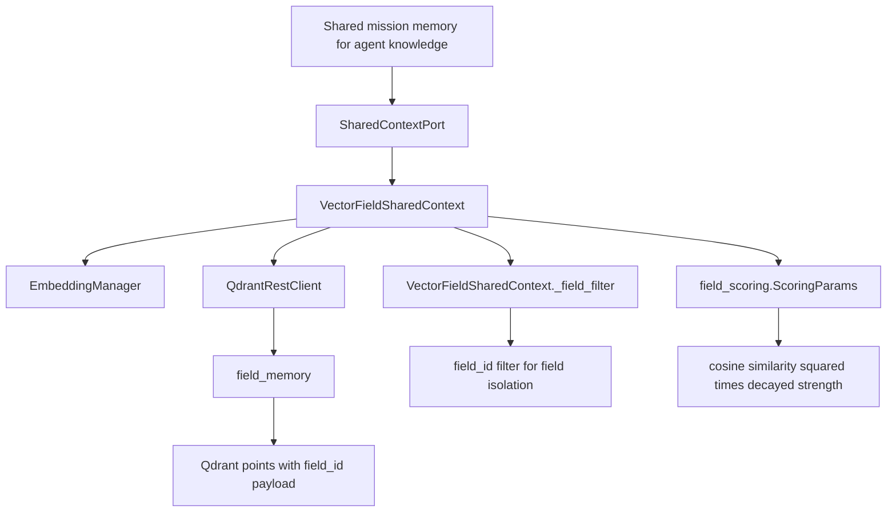
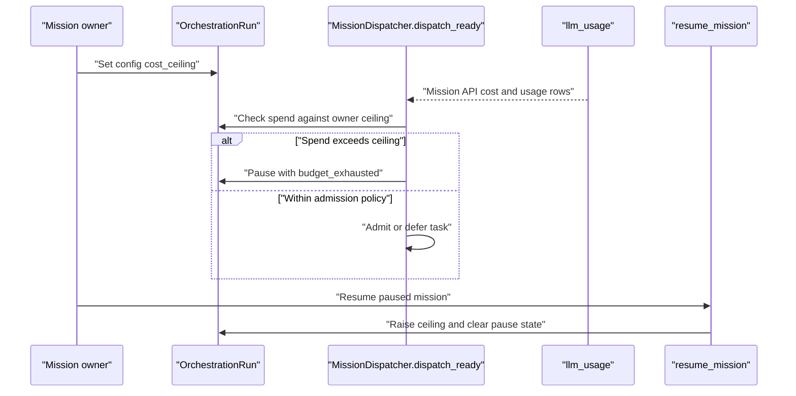
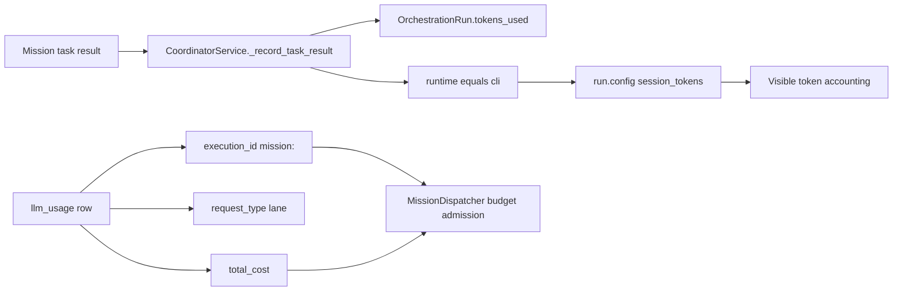
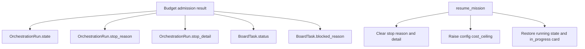

# Shared Context, Budget & Telemetry

Relevant source files

The following files were used as context for generating this wiki page:

- [frontend/components/missions/__tests__/field-viz-error-boundary.test.tsx](frontend/components/missions/__tests__/field-viz-error-boundary.test.tsx)
- [frontend/components/missions/__tests__/mission-field-viz-utils.test.ts](frontend/components/missions/__tests__/mission-field-viz-utils.test.ts)
- [frontend/components/missions/field-viz-error-boundary.tsx](frontend/components/missions/field-viz-error-boundary.tsx)
- [orchestrator/core/ports/context.py](orchestrator/core/ports/context.py)
- [orchestrator/core/qdrant_writes.py](orchestrator/core/qdrant_writes.py)
- [orchestrator/modules/context/adapters/redis_context.py](orchestrator/modules/context/adapters/redis_context.py)
- [orchestrator/modules/context/adapters/vector_field.py](orchestrator/modules/context/adapters/vector_field.py)
- [orchestrator/modules/context/instrumentation.py](orchestrator/modules/context/instrumentation.py)
- [orchestrator/modules/coordination/primitive_heartbeat.py](orchestrator/modules/coordination/primitive_heartbeat.py)
- [orchestrator/modules/coordination/templates.py](orchestrator/modules/coordination/templates.py)
- [orchestrator/modules/memory/durable_store.py](orchestrator/modules/memory/durable_store.py)
- [orchestrator/modules/policy/pricing.py](orchestrator/modules/policy/pricing.py)
- [orchestrator/modules/tools/discovery/handlers_field.py](orchestrator/modules/tools/discovery/handlers_field.py)
- [orchestrator/tests/test_82c_wiring.py](orchestrator/tests/test_82c_wiring.py)
- [orchestrator/tests/test_agents_api_plugins.py](orchestrator/tests/test_agents_api_plugins.py)
- [orchestrator/tests/test_budget_gate.py](orchestrator/tests/test_budget_gate.py)
- [orchestrator/tests/test_coordinator_parallel.py](orchestrator/tests/test_coordinator_parallel.py)
- [orchestrator/tests/test_f103_field_write_retried_once.py](orchestrator/tests/test_f103_field_write_retried_once.py)
- [orchestrator/tests/test_f103_memory_write_not_lost_silently.py](orchestrator/tests/test_f103_memory_write_not_lost_silently.py)
- [orchestrator/tests/test_f142_a_task_is_given_the_missions_goal.py](orchestrator/tests/test_f142_a_task_is_given_the_missions_goal.py)
- [orchestrator/tests/test_f153_a_budget_pause_says_why.py](orchestrator/tests/test_f153_a_budget_pause_says_why.py)
- [orchestrator/tests/test_f285_a_only_a_budget_the_owner_set_pauses_a_mission.py](orchestrator/tests/test_f285_a_only_a_budget_the_owner_set_pauses_a_mission.py)
- [orchestrator/tests/test_mission_retry_feeds_critique.py](orchestrator/tests/test_mission_retry_feeds_critique.py)
- [orchestrator/tests/test_parallel_decomposition.py](orchestrator/tests/test_parallel_decomposition.py)
- [orchestrator/tests/test_plugin_assignment_api.py](orchestrator/tests/test_plugin_assignment_api.py)
- [orchestrator/tests/test_plugin_runtime_integration.py](orchestrator/tests/test_plugin_runtime_integration.py)
- [orchestrator/tests/test_prd128_notification_dispatcher.py](orchestrator/tests/test_prd128_notification_dispatcher.py)
- [orchestrator/tests/test_prd154_s7_field.py](orchestrator/tests/test_prd154_s7_field.py)
- [orchestrator/tests/test_prd166_field_scoring.py](orchestrator/tests/test_prd166_field_scoring.py)
- [orchestrator/tests/test_prd178_field_trace_readonly.py](orchestrator/tests/test_prd178_field_trace_readonly.py)
- [orchestrator/tests/test_synthesis_executor.py](orchestrator/tests/test_synthesis_executor.py)
- [orchestrator/tests/test_vector_field.py](orchestrator/tests/test_vector_field.py)

## Purpose & Scope

This page covers mission-scoped semantic context in Qdrant, the mission budget admission gate, usage attribution evidence, and the boundaries of what can be documented about mission memory from the supplied source excerpts. `VectorFieldSharedContext` implements the shared-context port; mission dispatch uses an owner-set dollar ceiling to decide whether to admit work. [orchestrator/modules/context/adapters/vector_field.py:68-78](), [orchestrator/tests/test_budget_gate.py:11-14]()

Sources: `[orchestrator/modules/context/adapters/vector_field.py:68-78]()`, `[orchestrator/tests/test_budget_gate.py:11-14]()`

---

## 1. VectorFieldSharedContext & Field Memory

`VectorFieldSharedContext` is a Qdrant-backed implementation of `SharedContextPort`. It provides a shared semantic field: patterns injected by one agent can be queried by other agents in the same field. The adapter describes relevance as resonance—cosine similarity squared multiplied by decayed strength—rather than recency or insertion order. [orchestrator/modules/context/adapters/vector_field.py:15-16](), [orchestrator/modules/context/adapters/vector_field.py:68-78]()

### Architecture & Qdrant Integration

- **One collection for all fields:** The collection is named `field_memory`; mission-level separation is achieved with a `field_id` payload filter, not separate collections. [orchestrator/modules/context/adapters/vector_field.py:9-13](), [orchestrator/modules/context/adapters/vector_field.py:48-50]()
- **Vector configuration:** On bootstrap, the adapter creates the collection with a configured embedding dimension, cosine distance, on-disk vectors, on-disk payloads, and on-disk HNSW configuration. [orchestrator/modules/context/adapters/vector_field.py:114-138]()
- **Indexed payloads:** Bootstrap creates payload indexes for `field_id`, `workspace_id`, `subject_id`, `content_hash`, `agent_id`, and `created_at`. The source comments identify workspace-scoped recall and subject-level erasure as reasons for the respective fields. [orchestrator/modules/context/adapters/vector_field.py:140-160]()
- **Configuration and dependencies:** Construction requires `QDRANT_URL`; an empty value raises `RuntimeError`. The adapter initializes `QdrantRestClient` and `EmbeddingManager`, then reads field scoring, embedding-dimension, and boundary-permeability settings from configuration. [orchestrator/modules/context/adapters/vector_field.py:80-99]()
- **Idempotent bootstrap:** `ensure_shared_collection()` returns immediately after successful bootstrap in the current instance. It checks whether the collection exists, creates it when absent, attempts to create the payload indexes, and then marks bootstrap complete. [orchestrator/modules/context/adapters/vector_field.py:112-162]()
- **Scoring parameters:** `_scoring_params()` builds `field_scoring.ScoringParams` from the adapter’s configured decay, reinforcement, archival, and access half-life values. [orchestrator/modules/context/adapters/vector_field.py:101-110]()

### Diagram: Natural-Language Field Memory to Code Entities

Sources: `[orchestrator/modules/context/adapters/vector_field.py:5-16]()`, `[orchestrator/modules/context/adapters/vector_field.py:28-44]()`, `[orchestrator/modules/context/adapters/vector_field.py:48-50]()`, `[orchestrator/modules/context/adapters/vector_field.py:68-78]()`, `[orchestrator/modules/context/adapters/vector_field.py:101-110]()`

### Data-Flow Boundaries

The supplied adapter excerpt establishes its port, Qdrant client, embedder, collection bootstrap, payload indexes, configuration, and filter helper. It does not include the remainder of the adapter’s query, write, decay, archival, compaction, or deletion methods; those method-level details are therefore not specified here. [orchestrator/modules/context/adapters/vector_field.py:1-174]()

Sources: `[orchestrator/modules/context/adapters/vector_field.py:1-174]()`

---

## 2. Budget Ceiling & Admission Gate

The available budget tests document an admission gate in `MissionDispatcher`. The effective pause ceiling is an owner-configured dollar amount in `run.config["cost_ceiling"]`; the planner’s `token_budget_estimate` alone is explicitly not a budget ceiling. The supplied evidence describes a cost-based gate, not a token-bucket algorithm. [orchestrator/tests/test_budget_gate.py:11-14](), [orchestrator/tests/test_budget_gate.py:156-161]()

### Budget Status and Dispatch Behavior

The tests establish these budget-status boundaries: no ceiling is healthy; 50% is warning; 80% is critical; and spend above 100% is exceeded. [orchestrator/tests/test_budget_gate.py:131-161]()

At dispatch time, the tests cover allowing tasks when there is no ceiling or spend is healthy, and blocking or deferring work as the ceiling is reached. They also specify a critical-budget exception for synthesis work: synthesis can be admitted at the critical threshold while heavier work is deferred. [orchestrator/tests/test_budget_gate.py:164-180](), [orchestrator/tests/test_82c_wiring.py:16-20]()

When a budget pause occurs, the F153 test documents the expected run and board-card state: the run is paused with `stop_reason` set to `budget_exhausted`, and the board card is blocked with a detail string describing spend and ceiling. Resuming through `resume_mission` raises the configured ceiling to twice the recorded spend, clears the pause details, and returns the run and card to running states. [orchestrator/tests/test_f153_a_budget_pause_says_why.py:114-143]()

### Budget Accounting: Cost Versus Session Tokens

The budget tests distinguish tokens from spend:

- API calls are represented by `llm_usage` rows associated with `execution_id = "mission:<run id>"`; the test fixture books the row’s dollar cost and token count. [orchestrator/tests/test_f153_a_budget_pause_says_why.py:61-68]()
- A completed task’s returned `execution.tokens_used` is added to the run’s visible token count. For a task marked with `runtime="cli"`, those tokens are also recorded in `run.config["session_tokens"]`; the test verifies that this runtime task does not by itself cause a budget pause. [orchestrator/tests/test_f153_a_budget_pause_says_why.py:71-104]()
- The tests also verify that `llm_usage` rows with `request_type="session"` are not treated as spend for the admission decision. [orchestrator/tests/test_f153_a_budget_pause_says_why.py:125-129]()

### Diagram: Budget Ceiling Admission and Resume

Sources: `[orchestrator/tests/test_budget_gate.py:11-14]()`, `[orchestrator/tests/test_82c_wiring.py:16-20]()`, `[orchestrator/tests/test_f153_a_budget_pause_says-why.py:61-68]()`, `[orchestrator/tests/test_f153_a_budget_pause_says-why.py:114-143]()`

> **Implementation note:** The supplied files do not show the `MissionDispatcher` implementation or a token-bucket class. This section documents the behavior asserted by the tests; it does not infer an internal token-bucket mechanism. [orchestrator/tests/test_budget_gate.py:1-14]()

Sources: `[orchestrator/tests/test_budget_gate.py:1-14]()`

---

## 3. UsageTracker & Cost Attribution

The requested “UsageTracker” implementation is not present in the supplied excerpts. The available evidence instead shows how mission usage and cost are represented in tests: `llm_usage` rows carry workspace, execution, request type, token counts, and cost fields; the mission run separately maintains `tokens_used`. [orchestrator/tests/test_f153_a_budget_pause_says_why.py:61-68](), [orchestrator/tests/test_f153_a_budget_pause_says_why.py:71-83]()

The test helper books an API usage row with `execution_id` formatted as `mission:<run id>` and a request-type lane, then increments the run’s token count. This provides a concrete example of mission attribution, but does not establish the production implementation or a class named `UsageTracker`. [orchestrator/tests/test_f153_a_budget_pause_says_why.py:61-68]()

For CLI runtime tasks, the test records returned tokens for visibility and stores the total under `run.config["session_tokens"]`; those tokens are not treated as workspace spend by the budget check. [orchestrator/tests/test_f153_a_budget_pause_says_why.py:71-104](), [orchestrator/tests/test_f153_a_budget_pause_says_why.py:125-129]()

### Diagram: Natural-Language Usage Attribution to Code Entities

Sources: `[orchestrator/tests/test_f153_a_budget_pause_says_why.py:61-83]()`, `[orchestrator/tests/test_f153_a_budget_pause_says_why.py:98-129]()`

---

## 4. Mission Memory Service & Outcome Telemetry

The supplied materials identify `mission memory service` as a topic, but do not include the service implementation or its tests. Accordingly, this page cannot substantiate its API, storage tiers, write contract, failure handling, or call sites. The durable-memory excerpt describes a separate `DurableMemoryStore` and its relationship to `UnifiedMemoryService`; it does not establish how a mission memory service uses those components. [orchestrator/modules/memory/durable_store.py:5-19](), [orchestrator/modules/memory/durable_store.py:94-101]()

The available mission tests do provide a limited outcome-telemetry view: a budget pause has a machine-readable `stop_reason` and explanatory `stop_detail` on the run, with corresponding blocked status and reason on its board card. A resume clears those pause fields and restores the card to `in_progress`. [orchestrator/tests/test_f153_a_budget_pause_says_why.py:114-143]()

### Diagram: Verified Mission Outcome Fields

Sources: `[orchestrator/tests/test_f153_a_budget_pause_says_why.py:114-143]()`

### Durable Memory Context (Adjacent, Not Mission-Service Wiring)

`DurableMemoryStore` is documented as an L3 durable-memory store backed by Qdrant, using a `durable_memory` collection. Its points carry a namespace and top-level `workspace_id`; the source describes workspace-aware filtering and GDPR erasure capabilities. The excerpt states that its interface mirrors the retired fork client so `UnifiedMemoryService`’s L3 seam can be rewired, but it does not show a mission-specific memory integration. [orchestrator/modules/memory/durable_store.py:5-19](), [orchestrator/modules/memory/durable_store.py:94-101]()

Sources: `[orchestrator/modules/memory/durable_store.py:5-19]()`, `[orchestrator/modules/memory/durable_store.py:94-101]()`

---