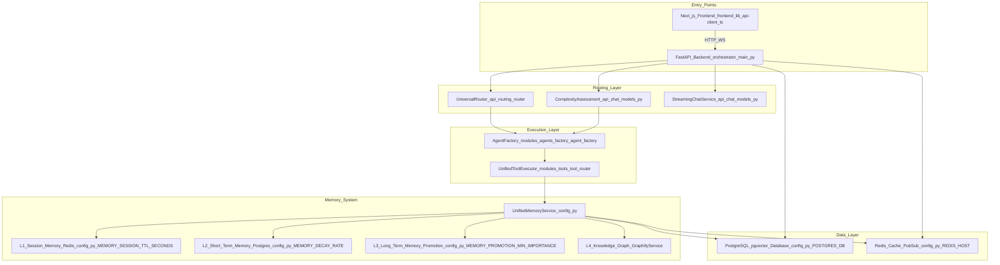
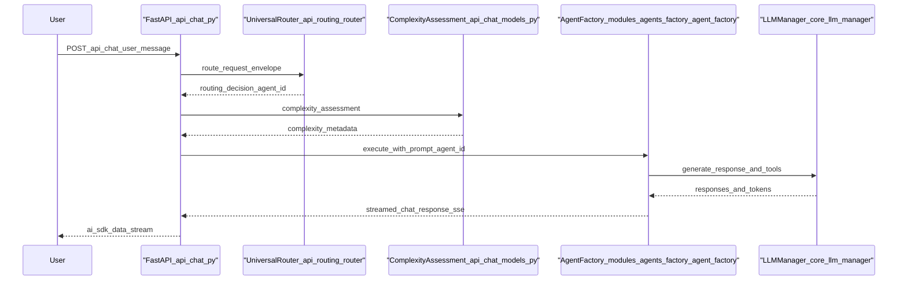

# Overview

Relevant source files

The following files were used as context for generating this wiki page:

- [README.md](README.md)
- [docs/PRDS/PRD-269-AUTOMATIC-LANGUAGE.md](docs/PRDS/PRD-269-AUTOMATIC-LANGUAGE.md)
- [docs/assets/showcase/go-play-chat-laptop.jpg](docs/assets/showcase/go-play-chat-laptop.jpg)
- [docs/assets/showcase/go-play-shelf-blog.jpg](docs/assets/showcase/go-play-shelf-blog.jpg)
- [docs/voice-auto-live/voice-ui-components.md](docs/voice-auto-live/voice-ui-components.md)
- [docs/voice/_index.md](docs/voice/_index.md)
- [frontend/lib/api-client.ts](frontend/lib/api-client.ts)
- [frontend/lib/chat/__tests__/turn-stream.test.ts](frontend/lib/chat/__tests__/turn-stream.test.ts)
- [frontend/lib/chat/turn-stream.ts](frontend/lib/chat/turn-stream.ts)
- [frontend/lib/voice/quick-ask/__tests__/audio-player.test.ts](frontend/lib/voice/quick-ask/__tests__/audio-player.test.ts)
- [frontend/lib/voice/quick-ask/__tests__/quick-ask-browser.test.ts](frontend/lib/voice/quick-ask/__tests__/quick-ask-browser.test.ts)
- [frontend/lib/voice/quick-ask/__tests__/quick-ask-engine.test.ts](frontend/lib/voice/quick-ask/__tests__/quick-ask-engine.test.ts)
- [frontend/lib/voice/quick-ask/__tests__/quick-ask-server-voice.test.ts](frontend/lib/voice/quick-ask/__tests__/quick-ask-server-voice.test.ts)
- [frontend/lib/voice/quick-ask/__tests__/server-speech-fakes.ts](frontend/lib/voice/quick-ask/__tests__/server-speech-fakes.ts)
- [frontend/lib/voice/quick-ask/__tests__/server-speech-fallback.test.ts](frontend/lib/voice/quick-ask/__tests__/server-speech-fallback.test.ts)
- [frontend/lib/voice/quick-ask/__tests__/server-speech.test.ts](frontend/lib/voice/quick-ask/__tests__/server-speech.test.ts)
- [frontend/lib/voice/quick-ask/config.ts](frontend/lib/voice/quick-ask/config.ts)
- [frontend/lib/voice/quick-ask/create-engine.ts](frontend/lib/voice/quick-ask/create-engine.ts)
- [frontend/lib/voice/quick-ask/deps.ts](frontend/lib/voice/quick-ask/deps.ts)
- [frontend/lib/voice/quick-ask/turn.ts](frontend/lib/voice/quick-ask/turn.ts)
- [orchestrator/api/socials.py](orchestrator/api/socials.py)
- [orchestrator/config.py](orchestrator/config.py)
- [orchestrator/main.py](orchestrator/main.py)
- [orchestrator/modules/socials/__init__.py](orchestrator/modules/socials/__init__.py)
- [orchestrator/modules/socials/render.py](orchestrator/modules/socials/render.py)
- [orchestrator/modules/socials/service.py](orchestrator/modules/socials/service.py)
- [orchestrator/reports/config-surface.json](orchestrator/reports/config-surface.json)
- [orchestrator/reports/route-manifest.json](orchestrator/reports/route-manifest.json)
- [orchestrator/tests/test_prd251_api.py](orchestrator/tests/test_prd251_api.py)
- [services/voice-tts/README.md](services/voice-tts/README.md)

## Purpose and Scope

This page provides a high-level introduction to **Automatos AI**, describing it as an operating system for AI agents designed to support autonomous capabilities, multi-agent orchestration, and intelligent routing [README.md:1-23](). It explains the platform's core purpose and major subsystems, clarifying how these components collaborate to deliver a scalable AI workforce infrastructure.

For detailed foundational concepts like agents, workflows/recipes, memory tiers, context assembly, routing, tools, and workspaces, see the child page [Key Concepts](#1.1). For a comprehensive view of system-level architecture, including backend/frontend components and integrations, see the child page [System Architecture](#1.2).

Sources: [orchestrator/main.py:1-35](), [README.md:1-23]()

---

## What is Automatos AI?

Automatos AI functions as an **operating system for AI agents**, enabling flexible creation, configuration, and orchestration of intelligent agents with autonomous behavior [README.md:22-23](). The platform coordinates multi-agent workflows, manages context and memory at scale, and routes requests intelligently to the proper agents or workflows [orchestrator/main.py:75-80]().

Key high-level capabilities include:

- **Multi-Agent Orchestration**: Manage multiple AI agents concurrently, each equipped with unique personas, skills, and tool integrations, orchestrated via scheduling and routing layers [README.md:29-37]().
- **Intelligent Routing**: A tiered routing service (`UniversalRouter`) directs incoming requests based on user overrides, cached rules, semantic similarity, and LLM classification [orchestrator/main.py:78]().
- **Layered Memory Architecture**: Memory is structured across five layers (`L0`-`L4`), ranging from immediate focus memory to durable organizational knowledge, all coordinated by `UnifiedMemoryService` [orchestrator/config.py:96-138]().
- **Context Assembly & Token Management**: Context sections are dynamically assembled based on execution mode and priority, enforcing strict token budgets to optimize LLM prompt construction. For details, see [Key Concepts](#1.1).
- **Workspace Sandboxing**: Each workspace provides isolated file systems, task queues, and execution sandboxes, enabling secure multi-tenant agent operations [README.md:40]().
- **Tool & Plugin Ecosystem**: Native platform actions and third-party tool integrations (such as Composio) extend agent capabilities through a unified execution pipeline [README.md:40-41]().

The backend is built with **FastAPI** (`orchestrator/main.py`) to provide asynchronous APIs and real-time streaming, while the frontend (`frontend/`) uses **Next.js** [README.md:47-48](). PostgreSQL with `pgvector` serves as the primary data store, alongside Redis for caching and pub/sub [orchestrator/config.py:49-93]().

Sources: [orchestrator/main.py:1-120](), [orchestrator/config.py:46-138](), [README.md:22-50]()

---

## Core Architecture

This diagram illustrates Automatos AI's high-level system components, bridging natural language concepts to exact code entities in the codebase.

### System Topology Bridging Natural Language to Code Entities

Sources: [orchestrator/main.py:30-120](), [orchestrator/config.py:46-138](), [README.md:22-42](), [frontend/lib/api-client.ts:1-7]()

---

## Major Subsystems at a Glance

| Subsystem | Description | Key Codebase Location | See Child Page |
|-----------|-------------|-----------------------|----------------|
| **Universal Router** | Intelligent request routing using rules, cache, semantic similarity, and LLM classification | `api.routing.router` | [Universal Router](#10) |
| **5-Layer Memory System** | Tiers from focus (L0) to durable organizational knowledge (L4), managed by `UnifiedMemoryService` | `orchestrator/config.py` | [Memory System](#3) |
| **LLM Manager** | Provider and model selection with credential resolution and tiered configurations | `core.llm.manager` | [Agents](#5) |
| **Agent Factory** | Agent lifecycle management, tool loading, prompt orchestration, and execution loops | `modules.agents.factory.agent_factory` | [Agents](#5) |
| **Workspace API & Sandboxing** | Workspace context, settings, and isolated execution environment for agent actions | `api.admin_workspaces` | [Workspace Execution](#21) |
| **Chat Service** | Streaming chat, message processing, and tool loop execution with token budgeting | `api.chat_models` | [Chat Interface](#9) |
| **Platform Actions** | Self-management tools enabling agents to control platform resources and workflows | `modules.tools.discovery` | [Platform Actions](#13) |
| **Workflow & Recipes** | Automation via multi-step playbooks and integration with agent tasks | `api.workflow_recipes` | [Workflows & Recipes](#6) |

Sources: [orchestrator/main.py:35-120](), [orchestrator/config.py:46-138](), [README.md:22-42](), [orchestrator/reports/route-manifest.json:1-283]()

---

## Request Flow Example: Chat Message Handling

This sequence diagram outlines the runtime lifecycle of a chat message from HTTP ingress through routing, complexity assessment, and agent execution.

### Request Flow Sequence Diagram

Sources: [orchestrator/main.py:100-115](), [orchestrator/reports/route-manifest.json:1-283](), [README.md:22-42]()

---

## Workspace Initialization & Onboarding

Each workspace operates as an isolated tenant with dedicated settings, integrations, and agents [README.md:33-48](). The platform provisions a default "Auto" agent per workspace to serve as the primary assistant and orchestrator.

Workspaces support:
- **Role-based access control**: Scoped user permissions and API keys supporting roles such as owner, member, or viewer [frontend/lib/api-client.ts:168-179]().
- **Credential Management**: Securely masked integration tokens and configuration keys [orchestrator/config.py:140]().
- **Onboarding Tracking**: Server-side trial and onboarding state persistence to guide new users through initial setup [frontend/lib/api-client.ts:143-147]().

Sources: [orchestrator/config.py:140](), [README.md:33-48](), [frontend/lib/api-client.ts:143-179]()

---

## Conclusion and Next Steps

Automatos AI serves as a comprehensive operating system for autonomous AI agents, unifying orchestration, memory management, tool integration, and multi-channel communication.

For deeper technical details, explore the child pages:
- [Key Concepts](#1.1) — Detailed definitions of agents, workflows, memory, routing, tools, and workspaces.
- [System Architecture](#1.2) — In-depth architectural designs of backend services, frontend apps, data layers, and infrastructure integrations.

---

# Child Pages

- **1.1 Key Concepts**: Fundamental building blocks and terminology.
- **1.2 System Architecture**: High-level component design and deployment.

---