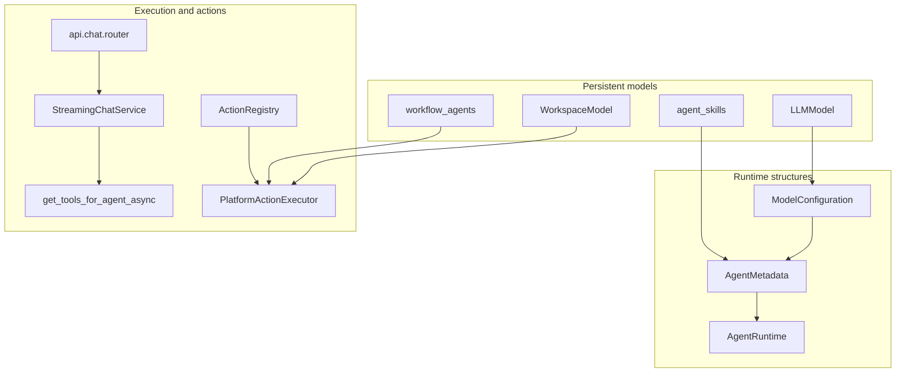
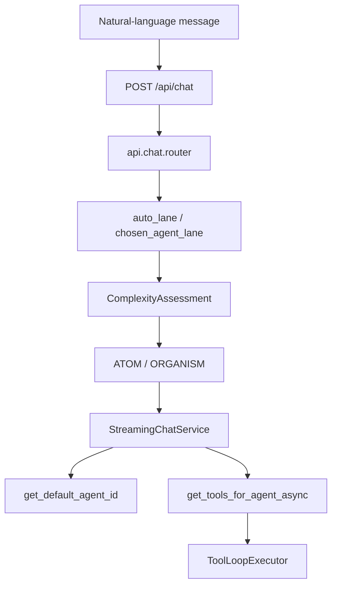
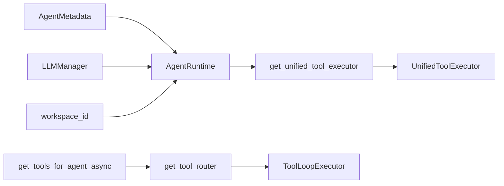

# Key Concepts

Relevant source files

The following files were used as context for generating this wiki page:

- [README.md](README.md)
- [docs/PRDS/PRD-269-AUTOMATIC-LANGUAGE.md](docs/PRDS/PRD-269-AUTOMATIC-LANGUAGE.md)
- [docs/assets/showcase/go-play-chat-laptop.jpg](docs/assets/showcase/go-play-chat-laptop.jpg)
- [docs/assets/showcase/go-play-shelf-blog.jpg](docs/assets/showcase/go-play-shelf-blog.jpg)
- [docs/voice-auto-live/voice-ui-components.md](docs/voice-auto-live/voice-ui-components.md)
- [docs/voice/_index.md](docs/voice/_index.md)
- [frontend/lib/chat/__tests__/turn-stream.test.ts](frontend/lib/chat/__tests__/turn-stream.test.ts)
- [frontend/lib/chat/turn-stream.ts](frontend/lib/chat/turn-stream.ts)
- [frontend/lib/voice/quick-ask/__tests__/audio-player.test.ts](frontend/lib/voice/quick-ask/__tests__/audio-player.test.ts)
- [frontend/lib/voice/quick-ask/__tests__/quick-ask-browser.test.ts](frontend/lib/voice/quick-ask/__tests__/quick-ask-browser.test.ts)
- [frontend/lib/voice/quick-ask/__tests__/quick-ask-engine.test.ts](frontend/lib/voice/quick-ask/__tests__/quick-ask-engine.test.ts)
- [frontend/lib/voice/quick-ask/__tests__/quick-ask-server-voice.test.ts](frontend/lib/voice/quick-ask/__tests__/quick-ask-server-voice.test.ts)
- [frontend/lib/voice/quick-ask/__tests__/server-speech-fakes.ts](frontend/lib/voice/quick-ask/__tests__/server-speech-fakes.ts)
- [frontend/lib/voice/quick-ask/__tests__/server-speech-fallback.test.ts](frontend/lib/voice/quick-ask/__tests__/server-speech-fallback.test.ts)
- [frontend/lib/voice/quick-ask/__tests__/server-speech.test.ts](frontend/lib/voice/quick-ask/__tests__/server-speech.test.ts)
- [frontend/lib/voice/quick-ask/config.ts](frontend/lib/voice/quick-ask/config.ts)
- [frontend/lib/voice/quick-ask/create-engine.ts](frontend/lib/voice/quick-ask/create-engine.ts)
- [frontend/lib/voice/quick-ask/deps.ts](frontend/lib/voice/quick-ask/deps.ts)
- [frontend/lib/voice/quick-ask/turn.ts](frontend/lib/voice/quick-ask/turn.ts)
- [orchestrator/alembic/versions/prd263_harness_ledger_grants.py](orchestrator/alembic/versions/prd263_harness_ledger_grants.py)
- [orchestrator/alembic/versions/prd266_merge_heads.py](orchestrator/alembic/versions/prd266_merge_heads.py)
- [orchestrator/alembic/versions/prd266_mobile_devices.py](orchestrator/alembic/versions/prd266_mobile_devices.py)
- [orchestrator/core/auth/device.py](orchestrator/core/auth/device.py)
- [orchestrator/core/models/__init__.py](orchestrator/core/models/__init__.py)
- [orchestrator/core/models/core.py](orchestrator/core/models/core.py)
- [orchestrator/core/models/harness.py](orchestrator/core/models/harness.py)
- [orchestrator/core/services/auto_cadence.py](orchestrator/core/services/auto_cadence.py)
- [orchestrator/router_manifest.py](orchestrator/router_manifest.py)
- [orchestrator/scripts/harness_backfill_runs.py](orchestrator/scripts/harness_backfill_runs.py)
- [orchestrator/services/themes/data/core-pages.json](orchestrator/services/themes/data/core-pages.json)
- [orchestrator/tests/test_prd209_alembic_single_head.py](orchestrator/tests/test_prd209_alembic_single_head.py)
- [orchestrator/tests/test_prd236_w1_routes.py](orchestrator/tests/test_prd236_w1_routes.py)
- [orchestrator/tests/test_prd263_harness_backfill_runs.py](orchestrator/tests/test_prd263_harness_backfill_runs.py)
- [orchestrator/tests/test_prd263_harness_history_runs.py](orchestrator/tests/test_prd263_harness_history_runs.py)
- [orchestrator/tests/test_prd263_harness_ledger_migration.py](orchestrator/tests/test_prd263_harness_ledger_migration.py)
- [orchestrator/tests/test_prd263_harness_review_cadence.py](orchestrator/tests/test_prd263_harness_review_cadence.py)
- [orchestrator/tests/test_prd266_device_lane.py](orchestrator/tests/test_prd266_device_lane.py)
- [orchestrator/tests/test_prd266_mobile_devices_model.py](orchestrator/tests/test_prd266_mobile_devices_model.py)
- [orchestrator/tests/test_prd266_mobile_devices_routes.py](orchestrator/tests/test_prd266_mobile_devices_routes.py)
- [services/voice-tts/README.md](services/voice-tts/README.md)

## Purpose and Scope

This page defines the core concepts used to understand Automatos AI: agents, workflows and recipes, memory, context assembly, routing, tools, and workspaces. It focuses on the implementation that can be established from the codebase; detailed subsystem behavior belongs in the linked topic pages. The agent factory describes agents as user-defined execution units, while the chat and platform-action layers connect those units to requests, tools, and workspace-scoped operations. `[orchestrator/modules/agents/factory/agent_factory.py:1-10]()`

Sources: `[orchestrator/modules/agents/factory/agent_factory.py:1-10]()`, `[orchestrator/consumers/chatbot/service.py:5-12]`, `[orchestrator/modules/tools/discovery/platform_executor.py:5-8]()`

---

## Core Entity Architecture

The core concepts are represented across database models, runtime structures, request handlers, and tool registries. The model layer defines association tables like `agent_skills` and `workflow_agents`, alongside registry models such as `LLMModel` and `WorkspaceModel`. `[orchestrator/core/models/core.py:36-49]`, `[orchestrator/core/models/core.py:55-65]`, `[orchestrator/core/models/core.py:127-136]()`

Title: Core entity and code mapping

Sources: `[orchestrator/core/models/core.py:36-49]()`, `[orchestrator/core/models/core.py:55-65]()`, `[orchestrator/core/models/core.py:127-136]()`, `[orchestrator/modules/agents/factory/agent_factory.py:67-103]()`, `[orchestrator/modules/agents/factory/agent_factory.py:111-173]()`

---

## Agents & Agent Architecture

An **agent** is an execution unit configured with metadata and a model route. The factory’s `AgentMetadata` carries identity, agent type, persona, skill names, model configuration, and custom metadata. `[orchestrator/modules/agents/factory/agent_factory.py:111-153]()`

`AgentRuntime` holds the active execution-time state: an agent ID, metadata, `LLMManager`, lifecycle state (`AgentLifecycle`), execution counters, metrics, memory, and tool bindings. `[orchestrator/modules/agents/factory/agent_factory.py:58-65]`, `[orchestrator/modules/agents/factory/agent_factory.py:156-173]()`

| Concept | Code representation | Role |
|---|---|---|
| Agent metadata | `AgentMetadata` | Carries agent identity, persona, skills, model configuration, and custom metadata. `[orchestrator/modules/agents/factory/agent_factory.py:111-125]()` |
| Model route | `ModelConfiguration` | Holds provider, model ID, generation settings, and optional fallback model. `[orchestrator/modules/agents/factory/agent_factory.py:67-103]()` |
| Runtime state | `AgentRuntime` | Holds execution-time agent state, manager, counters, tools, and workspace association. `[orchestrator/modules/agents/factory/agent_factory.py:156-173]()` |
| Lifecycle | `AgentLifecycle` | Defines runtime lifecycle states (`INITIALIZING`, `ACTIVE`, `BUSY`, etc.). `[orchestrator/modules/agents/factory/agent_factory.py:58-65]()` |
| Model catalog | `LLMModel` | Stores provider, model identity, capabilities, context limits, and marketplace routing metadata. `[orchestrator/core/models/core.py:55-95]()` |

Sources: `[orchestrator/modules/agents/factory/agent_factory.py:1-173]()`, `[orchestrator/core/models/core.py:55-95]()`

---

## Workflows & Recipes

A **workflow** is backed by the `workflows` database table, with `workflow_agents` providing the many-to-many relationship linking workflow IDs to agent IDs. `[orchestrator/core/models/core.py:46-49]()`

Playbooks and recipes are exposed via the platform action registry (`register_playbooks_actions`), supporting CRUD, scheduling, and execution lookup handlers. `[orchestrator/modules/tools/discovery/platform_actions.py:14-16]`, `[orchestrator/modules/tools/discovery/platform_executor.py:30-41]()`

| Concept | Evidence in Code |
|---|---|
| Workflow-Agent association | `workflow_agents` stores `workflow_id` and `agent_id` foreign keys. `[orchestrator/core/models/core.py:46-49]()` |
| Playbook Actions | Action registry maps playbook run handlers and step lifecycle actions. `[orchestrator/modules/tools/discovery/platform_actions.py:14-16]()` |

Sources: `[orchestrator/core/models/core.py:46-49]`, `[orchestrator/modules/tools/discovery/platform_actions.py:14-16]`, `[orchestrator/modules/tools/discovery/platform_executor.py:30-41]()`

---

## Memory Tiers

Memory management spans multiple storage tiers and is integrated directly into the chat consumer and agent runtime. Platform action handlers support operations like `get_memory_stats`, `store_memory`, `checkpoint_thread`, and `search_memory`. `[orchestrator/consumers/chatbot/service.py:5-12]`, `[orchestrator/modules/tools/discovery/platform_executor.py:74-84]()`

| Tier Name | Conceptual Role | Codebase Integration |
|---|---|---|
| L0 — Focus | Immediate prompt context | Injected into active generation context via memory blocks. `[orchestrator/consumers/chatbot/service.py:5-12]()` |
| L1 — Working | Active working memory | Redis-backed ephemeral state during active execution sessions. |
| L2 — Short-term | Persisted short-term memory | PostgreSQL storage for recent chat exchanges and checkpoints. `[orchestrator/modules/tools/discovery/platform_executor.py:74-84]()` |
| L3 — Long-term | Consolidated durable store | Vector embeddings and consolidated summaries across execution horizons. |
| L4 — Organizational | Shared knowledge retrieval | RAG integration pipeline bridging knowledge bases and agent prompts. |

Sources: `[orchestrator/consumers/chatbot/service.py:5-12]`, `[orchestrator/modules/tools/discovery/platform_executor.py:74-84]()`

---

## Context Assembly & Routing

### Context Assembly
Prompt construction is managed dynamically via context services and specialized chat helpers (`atom_system_prompt`, `atom_memory_block`, `resolve_atom_attachments`). `[orchestrator/consumers/chatbot/service.py:44-49]()`

### Routing
Requests are categorized using a progressive complexity assessment (`ATOM`, `ORGANISM`) and routed via specific lanes (`auto_lane`, `chosen_agent_lane`). The Universal Router handles classification rules, overrides, and caching. `[orchestrator/api/chat.py:25-45]`, `[orchestrator/consumers/chatbot/auto.py:5-21]()`

Sources: `[orchestrator/api/chat.py:25-45]`, `[orchestrator/consumers/chatbot/auto.py:5-21]`, `[orchestrator/consumers/chatbot/service.py:44-49]()`

---

## Tools & Integrations

Tools provide capabilities to agents via the `UnifiedToolExecutor` and `ToolLoopExecutor`. Tool definitions are resolved dynamically using `get_tools_for_agent_async`, while platform management actions are executed through `PlatformActionExecutor`. `[orchestrator/consumers/chatbot/service.py:27-36]`, `[orchestrator/modules/tools/discovery/platform_executor.py:1-8]()`

Sources: `[orchestrator/consumers/chatbot/service.py:27-36]`, `[orchestrator/modules/tools/discovery/platform_executor.py:1-8]()`

---

## Workspaces & Multi-Tenancy

Workspaces isolate resources, models, and memory spaces. `WorkspaceModel` ties installed models to a specific `workspace_id`, and agent resolution functions (`_explicitly_chosen_agent`, `get_default_agent_id`) enforce strict workspace boundaries. `[orchestrator/core/models/core.py:127-136]`, `[orchestrator/api/chat.py:106-155]()`

Sources: `[orchestrator/core/models/core.py:127-136]`, `[orchestrator/api/chat.py:106-155]()`

---

## System Interaction Diagrams

### Natural Language Space to Code Entity Space

Title: Natural-language chat routing to code symbols

Sources: `[orchestrator/api/chat.py:20-45]`, `[orchestrator/api/chat.py:106-155]`, `[orchestrator/consumers/chatbot/auto.py:5-21]`, `[orchestrator/consumers/chatbot/service.py:27-60]()`

### Agent Execution and Tool Flow Space

Title: Agent runtime and tool execution symbols

Sources: `[orchestrator/modules/agents/factory/agent_factory.py:49-173]`, `[orchestrator/consumers/chatbot/service.py:27-60]()`

---

## Summary

- **Agents:** Configured via `AgentMetadata`, `ModelConfiguration`, and executed within `AgentRuntime` under lifecycle rules. `[orchestrator/modules/agents/factory/agent_factory.py:58-173]()`
- **Workflows & Recipes:** Backed by `workflow_agents` and managed via platform action executors. `[orchestrator/core/models/core.py:46-49]`, `[orchestrator/modules/tools/discovery/platform_executor.py:30-41]()`
- **Memory Tiers:** Ranging from ephemeral L1 to long-term L4 vector and PostgreSQL storage. `[orchestrator/consumers/chatbot/service.py:5-12]`, `[orchestrator/modules/tools/discovery/platform_executor.py:74-84]()`
- **Context & Routing:** Progressive complexity scoring and automated lane dispatch. `[orchestrator/api/chat.py:25-45]`, `[orchestrator/consumers/chatbot/auto.py:5-21]()`
- **Tools:** Dynamic tool loading, execution loops, and platform action dispatchers. `[orchestrator/consumers/chatbot/service.py:27-36]`, `[orchestrator/modules/tools/discovery/platform_executor.py:1-8]()`
- **Workspaces:** Tenant isolation enforced across models, agents, and storage boundaries. `[orchestrator/core/models/core.py:127-136]`, `[orchestrator/api/chat.py:106-155]()`

Sources: `[orchestrator/modules/agents/factory/agent_factory.py:58-173]`, `[orchestrator/core/models/core.py:46-136]`, `[orchestrator/api/chat.py:25-155]`, `[orchestrator/consumers/chatbot/service.py:5-60]`, `[orchestrator/modules/tools/discovery/platform_executor.py:1-84]()`

---