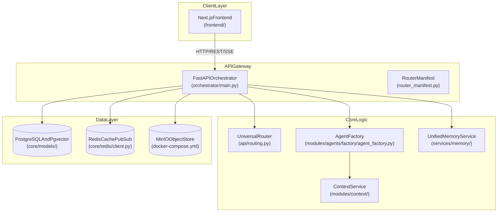
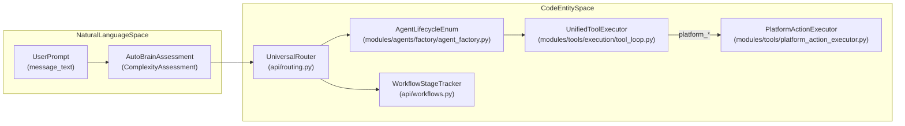
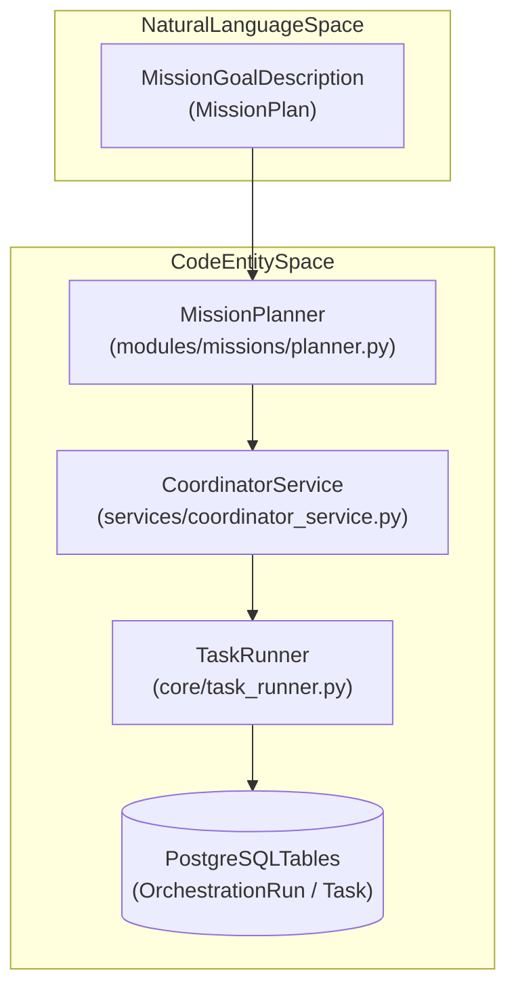

# System Architecture

Relevant source files

The following files were used as context for generating this wiki page:

- [frontend/lib/api-client.ts](frontend/lib/api-client.ts)
- [orchestrator/alembic/versions/prd263_harness_ledger_grants.py](orchestrator/alembic/versions/prd263_harness_ledger_grants.py)
- [orchestrator/alembic/versions/prd266_merge_heads.py](orchestrator/alembic/versions/prd266_merge_heads.py)
- [orchestrator/alembic/versions/prd266_mobile_devices.py](orchestrator/alembic/versions/prd266_mobile_devices.py)
- [orchestrator/api/socials.py](orchestrator/api/socials.py)
- [orchestrator/config.py](orchestrator/config.py)
- [orchestrator/core/auth/device.py](orchestrator/core/auth/device.py)
- [orchestrator/core/models/__init__.py](orchestrator/core/models/__init__.py)
- [orchestrator/core/models/core.py](orchestrator/core/models/core.py)
- [orchestrator/core/models/harness.py](orchestrator/core/models/harness.py)
- [orchestrator/core/services/auto_cadence.py](orchestrator/core/services/auto_cadence.py)
- [orchestrator/main.py](orchestrator/main.py)
- [orchestrator/modules/socials/__init__.py](orchestrator/modules/socials/__init__.py)
- [orchestrator/modules/socials/render.py](orchestrator/modules/socials/render.py)
- [orchestrator/modules/socials/service.py](orchestrator/modules/socials/service.py)
- [orchestrator/reports/config-surface.json](orchestrator/reports/config-surface.json)
- [orchestrator/reports/route-manifest.json](orchestrator/reports/route-manifest.json)
- [orchestrator/router_manifest.py](orchestrator/router_manifest.py)
- [orchestrator/scripts/harness_backfill_runs.py](orchestrator/scripts/harness_backfill_runs.py)
- [orchestrator/services/themes/data/core-pages.json](orchestrator/services/themes/data/core-pages.json)
- [orchestrator/tests/test_prd209_alembic_single_head.py](orchestrator/tests/test_prd209_alembic_single_head.py)
- [orchestrator/tests/test_prd236_w1_routes.py](orchestrator/tests/test_prd236_w1_routes.py)
- [orchestrator/tests/test_prd251_api.py](orchestrator/tests/test_prd251_api.py)
- [orchestrator/tests/test_prd263_harness_backfill_runs.py](orchestrator/tests/test_prd263_harness_backfill_runs.py)
- [orchestrator/tests/test_prd263_harness_history_runs.py](orchestrator/tests/test_prd263_harness_history_runs.py)
- [orchestrator/tests/test_prd263_harness_ledger_migration.py](orchestrator/tests/test_prd263_harness_ledger_migration.py)
- [orchestrator/tests/test_prd263_harness_review_cadence.py](orchestrator/tests/test_prd263_harness_review_cadence.py)
- [orchestrator/tests/test_prd266_device_lane.py](orchestrator/tests/test_prd266_device_lane.py)
- [orchestrator/tests/test_prd266_mobile_devices_model.py](orchestrator/tests/test_prd266_mobile_devices_model.py)
- [orchestrator/tests/test_prd266_mobile_devices_routes.py](orchestrator/tests/test_prd266_mobile_devices_routes.py)

## Purpose and Scope

This document provides a comprehensive technical overview of the Automatos AI platform architecture. It details the service topology, FastAPI backend orchestrator (`orchestrator/main.py`), Next.js frontend integration, centralized configuration management (`orchestrator/config.py`), persistent data layers (`core/models/`), and the execution bridges translating natural language intents into executable code entities as configured in `docker-compose.yml`.

Sources: `[orchestrator/main.py:1-25](), [docker-compose.yml:1-81]()`

---

## System Topology & Service Architecture

The Automatos AI platform uses a multi-tier architecture composed of a FastAPI backend (`orchestrator/main.py`), a Next.js frontend, durable data stores (PostgreSQL with `pgvector`, Redis cache/pub-sub, and S3-compatible MinIO object storage), and asynchronous worker nodes.

Title: Platform Service Topology

Sources: `[orchestrator/main.py:1-120](), [docker-compose.yml:41-129]()`

Key platform components include:
- **Frontend:** Next.js application handling server-side rendering (SSR) and single-page application (SPA) states with React Query data synchronization.
- **Backend Orchestrator:** FastAPI instance managing business logic, agent execution loops, workflows, and WebSocket/SSE streams `[orchestrator/main.py:1-120]()`.
- **Core Services:** Includes the `UniversalRouter` for semantic request distribution, `AgentFactory` for agent lifecycle handling `[orchestrator/modules/agents/factory/agent_factory.py:57-64]()`, `ContextService` for prompt assembly, and `UnifiedMemoryService` for multi-tier memory.
- **Data Layer:** PostgreSQL stores relational models and vector embeddings; Redis handles caching, session state, and pub/sub events; MinIO provides durable object storage `[docker-compose.yml:41-129]()`.
- **External Integrations:** Managed via pluggable tool architectures (Composio wrapper), webhooks, and multi-provider LLM gateways.

Sources: `[orchestrator/main.py:1-120](), [docker-compose.yml:41-129]()`

---

## Backend Application & Router Architecture

The backend application is orchestrated in `orchestrator/main.py` utilizing FastAPI with lifespan management and modular router mounting.

### Application Setup and Boot Phases
- Environment variables are loaded prior to application initialization `[orchestrator/main.py:31-33]()`.
- Database initialization and session factory (`SessionLocal`) are established via `init_database` `[orchestrator/main.py:40-40]()`.
- Middleware layers enforce CORS policies and request limits `[orchestrator/main.py:17-18]()`.
- Modular routers (Agents, Workflows, Marketplace, Socials, Notifications, etc.) are registered using fail-loud router manifests via `mount_manifest_routers` `[orchestrator/main.py:37-37]()`.

### Router Manifest and Route Governance
- The route catalog is tracked and verified via `orchestrator/reports/route-manifest.json`, which registers over 1,016 endpoints `[orchestrator/reports/route-manifest.json:2-3]()`.
- Request context resolution is handled by `get_request_context_hybrid`, supporting both Clerk JWT validation and static API key authentication across dependencies `[orchestrator/main.py:20-20]()`.

Sources: `[orchestrator/main.py:35-115](), [orchestrator/reports/route-manifest.json:1-15]()`

---

## Natural Language Space to Code Entity Space Bridges

Automatos AI maps user intents expressed in natural language into concrete backend functions and database entities via multi-stage execution pipelines.

### Bridge 1: User Prompt to Agent Execution
Title: Chat Request to Agent Execution Flow

Sources: `[orchestrator/api/chat.py:20-35](), [orchestrator/modules/agents/factory/agent_factory.py:30-175]()`

- User prompts pass through `AutoBrain` complexity assessment to generate tool hints.
- The `UniversalRouter` classifies and routes messages to appropriate execution targets.
- `AgentLifecycle` manages agent states (`INITIALIZING`, `ACTIVE`, `BUSY`, `LEARNING`, `HIBERNATING`, `RETIRED`) `[orchestrator/modules/agents/factory/agent_factory.py:57-64]()`.
- `UnifiedToolExecutor` executes authorized tool loops, invoking platform actions when self-management tools are requested.

Sources: `[orchestrator/api/chat.py:20-35](), [orchestrator/modules/agents/factory/agent_factory.py:30-175]()`

### Bridge 2: Mission Intent to Task Execution Pipeline
Title: Mission Decomposition to Task Runner Pipeline

Sources: `[orchestrator/api/recipe_executor.py:30-46](), [orchestrator/main.py:33-36]()`

- High-level natural language goals are parsed by `MissionPlanner` into directed acyclic graphs (DAGs) of tasks.
- The `CoordinatorService` drives the scheduling loop, managing optimistic locking and task dependencies.
- `TaskRunner` executes discrete units of work against persistent SQLAlchemy orchestration tables.

Sources: `[orchestrator/api/recipe_executor.py:30-46](), [orchestrator/main.py:33-36]()`

---

## Data Layer & Configuration Management

Configuration and data persistence are centralized to guarantee multi-tenant tenant isolation and cross-service consistency.

### Centralized Configuration (`Config` class)
- Configuration is centralized exclusively in `orchestrator/config.py` using a type-safe `Config` class that wraps environment variables `[orchestrator/config.py:1-46]()`.
- Exposes connection strings (`DATABASE_URL`, `POSTGRES_*`), Redis parameters (`REDIS_URL`, `REDIS_HOST`), memory tuning variables, and LLM thresholds `[orchestrator/config.py:48-138]()`.
- Enforces strict production rules, such as forcing `sslmode=require` for external PostgreSQL connections `[orchestrator/config.py:59-72]()`.
- System settings coverage is tracked via `orchestrator/reports/config-surface.json` containing over 688 defined settings keys `[orchestrator/reports/config-surface.json:1-197]()`.

### Persistent Data Stores
- **PostgreSQL + pgvector:** Stores core domain models (such as `LLMModel` and `WorkspaceModel`) alongside vector embedding columns for semantic search `[orchestrator/core/models/core.py:54-143]()`.
- **Redis:** Manages caching, session expiration TTLs, and pub/sub messaging channels `[docker-compose.yml:66-91]()`.
- **MinIO / S3:** Provides local object storage for rendered social assets, documents, and execution artifacts `[docker-compose.yml:101-129]()`.

Sources: `[orchestrator/config.py:1-46](), [orchestrator/core/models/core.py:54-143](), [docker-compose.yml:41-129]()`

---

## Frontend & API Client Architecture

The Next.js frontend interfaces with the backend via a unified API client pattern located in `frontend/lib/api-client.ts`.

### API Transport and Scoping
- Manages authentication header injection (Clerk session tokens) and workspace propagation headers `[frontend/lib/api-client.ts:1-7]()`.
- Provides admin override utilities via `setAdminWorkspaceOverride` and `getAdminWorkspaceOverride` for cross-tenant administration `[frontend/lib/api-client.ts:172-180]()`.
- Implements strict typing for configurations (`RAGConfig`) and platform metrics (`ActivationMetric`, `ApprovalGrant`, `SubstrateHealthMetric`, etc.) `[frontend/lib/api-client.ts:53-240]()`.

Sources: `[frontend/lib/api-client.ts:1-180]()`

---

# Summary

Automatos AI's system architecture provides a robust, scalable foundation:
- A **FastAPI backend orchestrator** manages the API surface and multi-agent workflows `[orchestrator/main.py:1-120]()`.
- A **Next.js frontend** communicates via a standardized API transport layer `[frontend/lib/api-client.ts:1-45]()`.
- Core services (`AgentFactory`, `UniversalRouter`, `CoordinatorService`) handle intent parsing, execution routing, and autonomous task loops `[orchestrator/modules/agents/factory/agent_factory.py:57-64]()`.
- The **data layer** ensures multi-tenant isolation, relational consistency, and vector indexing using PostgreSQL (`pgvector`), Redis, and S3 object storage `[docker-compose.yml:41-129]()`.
- Centralized configuration modules prevent environment drift and enforce strict operational boundaries `[orchestrator/config.py:1-46]()`.

---