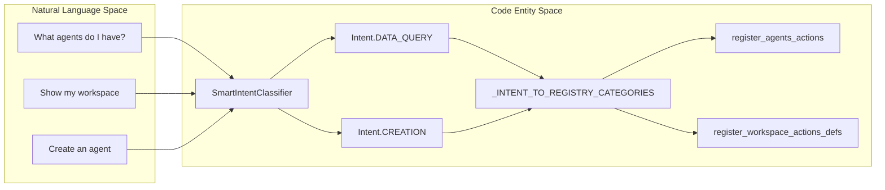
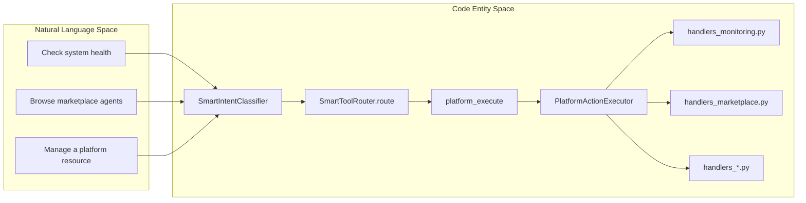

# Platform Actions

Relevant source files

The following files were used as context for generating this wiki page:

- [orchestrator/consumers/chatbot/auto.py](orchestrator/consumers/chatbot/auto.py)
- [orchestrator/consumers/chatbot/intent_classifier.py](orchestrator/consumers/chatbot/intent_classifier.py)
- [orchestrator/consumers/chatbot/smart_tool_router.py](orchestrator/consumers/chatbot/smart_tool_router.py)
- [orchestrator/core/security/driving_user.py](orchestrator/core/security/driving_user.py)
- [orchestrator/core/services/auto_autonomy.py](orchestrator/core/services/auto_autonomy.py)
- [orchestrator/modules/tools/discovery/actions_autonomy.py](orchestrator/modules/tools/discovery/actions_autonomy.py)
- [orchestrator/modules/tools/discovery/handlers_autonomy.py](orchestrator/modules/tools/discovery/handlers_autonomy.py)
- [orchestrator/modules/tools/discovery/platform_actions.py](orchestrator/modules/tools/discovery/platform_actions.py)
- [orchestrator/modules/tools/discovery/platform_executor.py](orchestrator/modules/tools/discovery/platform_executor.py)
- [orchestrator/tests/security/test_nl2sql_tenancy.py](orchestrator/tests/security/test_nl2sql_tenancy.py)
- [orchestrator/tests/security/test_w3_full_autonomy_gate.py](orchestrator/tests/security/test_w3_full_autonomy_gate.py)
- [orchestrator/tests/test_prd232_us001_dispatcher_survives_route.py](orchestrator/tests/test_prd232_us001_dispatcher_survives_route.py)
- [orchestrator/tests/test_prd232_us002_flag_split.py](orchestrator/tests/test_prd232_us002_flag_split.py)
- [orchestrator/tests/test_us014_graph_router_delegation.py](orchestrator/tests/test_us014_graph_router_delegation.py)
- [orchestrator/tests/test_us015_registry_intent_filter.py](orchestrator/tests/test_us015_registry_intent_filter.py)
- [orchestrator/tests/test_w3_auto_autonomy_service.py](orchestrator/tests/test_w3_auto_autonomy_service.py)

## Purpose and scope

Platform Actions let agents inspect and manage Automatos AI through curated operations on platform entities. Definitions are registered centrally, while a dispatcher routes calls to domain-specific handlers; the executor’s stated design keeps queries workspace-scoped [orchestrator/modules/tools/discovery/platform_actions.py:1-9]() [orchestrator/modules/tools/discovery/platform_executor.py:1-9](). This parent page outlines how those pieces fit together and links to the child pages for implementation details.

- [Platform Action System](#13.1)
- [Action Categories](#13.2)
- [Confirmation, Approval & Rate Limiting](#13.3)
- [Platform Actions Discovery](#13.4)

Sources: [orchestrator/modules/tools/discovery/platform_actions.py:1-9]() [orchestrator/modules/tools/discovery/platform_executor.py:1-9]()

---

## Overview

`register_all_actions()` is the registration entry point. It assembles action definitions from domain-specific modules, including agents, playbooks, documents, monitoring, marketplace, missions, scheduling, graph, autonomy, web, and socials [orchestrator/modules/tools/discovery/platform_actions.py:12-74] [orchestrator/modules/tools/discovery/platform_actions.py:117-128](). At execution time, `PlatformActionExecutor` dispatches to specialized handlers rather than implementing every domain operation itself [orchestrator/modules/tools/discovery/platform_executor.py:1-9]().

In chat, intent classification and tool routing connect user requests to available actions. `SmartIntentClassifier` recognizes platform-related phrases and action-name references; `SmartToolRouter` filters tools using registry categories and preserves the `platform_execute` dispatcher among its always-included tools [orchestrator/consumers/chatbot/intent_classifier.py:77-106]() [orchestrator/consumers/chatbot/smart_tool_router.py:31-52]() [orchestrator/consumers/chatbot/smart_tool_router.py:111-135]().

| Platform concern | Code entity | High-level role |
|---|---|---|
| Action catalog assembly | `register_all_actions()` | Registers definitions from domain-specific action modules. |
| Execution dispatch | `PlatformActionExecutor` | Routes platform action calls to domain handlers. |
| Intent classification | `SmartIntentClassifier` | Classifies requests, including platform-related queries and operations. |
| Tool selection | `SmartToolRouter` | Selects relevant tools using intent, registry categories, and routing pins. |
| Direct dispatcher | `platform_execute` | Provides a dispatcher path for platform actions and is retained by the router’s always-include mechanism. |

Sources: [orchestrator/modules/tools/discovery/platform_actions.py:12-74]() [orchestrator/modules/tools/discovery/platform_actions.py:117-128]() [orchestrator/modules/tools/discovery/platform_executor.py:1-9]() [orchestrator/consumers/chatbot/intent_classifier.py:77-106]() [orchestrator/consumers/chatbot/smart_tool_router.py:111-152]()

### Natural language and code entities: platform requests

Platform-related user language can be classified as data queries, searches, external actions, creations, or multi-step tasks. The classifier includes patterns for platform entities and direct `platform_*` references; the router maps tool-requiring intents to registry categories [orchestrator/consumers/chatbot/intent_classifier.py:77-106]() [orchestrator/consumers/chatbot/smart_tool_router.py:31-52]().

**Diagram: "Platform request language mapped to routing code"**

Sources: [orchestrator/consumers/chatbot/intent_classifier.py:77-106]() [orchestrator/consumers/chatbot/smart_tool_router.py:31-52]() [orchestrator/modules/tools/discovery/platform_actions.py:14-25]()

### Natural language and code entities: dispatch

The chat router retains `platform_execute` as a dispatcher pin, and the executor describes itself as a thin dispatcher to standalone handler functions. This links the user-facing tool-routing layer to the platform’s handler modules [orchestrator/consumers/chatbot/smart_tool_router.py:123-135]() [orchestrator/modules/tools/discovery/platform_executor.py:1-9]().

**Diagram: "Platform action request mapped to dispatcher and handlers"**

Sources: [orchestrator/consumers/chatbot/intent_classifier.py:77-106]() [orchestrator/consumers/chatbot/smart_tool_router.py:123-135]() [orchestrator/modules/tools/discovery/platform_executor.py:1-9]() [orchestrator/modules/tools/discovery/platform_executor.py:88-95]() [orchestrator/modules/tools/discovery/platform_executor.py:108-119]()

---

## Platform Action System

The system separates action registration from execution: `register_all_actions()` assembles domain definitions, and `PlatformActionExecutor` dispatches calls to handler modules [orchestrator/modules/tools/discovery/platform_actions.py:117-128]() [orchestrator/modules/tools/discovery/platform_executor.py:1-9](). The executor imports handlers across platform domains, including agents, documents, workspace, monitoring, marketplace, scheduling, and reports [orchestrator/modules/tools/discovery/platform_executor.py:19-29]() [orchestrator/modules/tools/discovery/platform_executor.py:52-63]() [orchestrator/modules/tools/discovery/platform_executor.py:74-95]() [orchestrator/modules/tools/discovery/platform_executor.py:108-123]() [orchestrator/modules/tools/discovery/platform_executor.py:152-164]().

For details on `ActionRegistry`, `ActionDefinition`, executor behavior, and permission levels, see [Platform Action System](#13.1).

Sources: [orchestrator/modules/tools/discovery/platform_actions.py:117-128]() [orchestrator/modules/tools/discovery/platform_executor.py:1-9]() [orchestrator/modules/tools/discovery/platform_executor.py:19-29]() [orchestrator/modules/tools/discovery/platform_executor.py:52-63]() [orchestrator/modules/tools/discovery/platform_executor.py:74-95]() [orchestrator/modules/tools/discovery/platform_executor.py:108-123]() [orchestrator/modules/tools/discovery/platform_executor.py:152-164]()

---

## Action Categories

Action definitions are grouped by domain-specific registration modules. The registration entry point includes families for agents, playbooks, analytics, documents, workspace, monitoring, marketplace, skills, board tasks, scheduling, reports, missions, graph, autonomy, web, and socials [orchestrator/modules/tools/discovery/platform_actions.py:14-74](). The executor’s handler imports show how registered capabilities correspond to domain handler modules [orchestrator/modules/tools/discovery/platform_executor.py:19-29]() [orchestrator/modules/tools/discovery/platform_executor.py:52-63]() [orchestrator/modules/tools/discovery/platform_executor.py:152-175]().

For the catalog of `platform_*` action families, see [Action Categories](#13.2).

Sources: [orchestrator/modules/tools/discovery/platform_actions.py:14-74]() [orchestrator/modules/tools/discovery/platform_executor.py:19-29]() [orchestrator/modules/tools/discovery/platform_executor.py:52-63]() [orchestrator/modules/tools/discovery/platform_executor.py:152-175]()

---

## Confirmation, Approval & Rate Limiting

Action execution has safety controls around confirmation, authorization, and rate limiting. For example, the autonomy service documents `standard` as the supervised default and `full` as a setting that skips the confirmation and admin gates; it also states that rate limits and agent-hierarchy checks remain in place [orchestrator/core/services/auto_autonomy.py:11-27](). The autonomy handlers read or persist the workspace setting and record a change in the log [orchestrator/modules/tools/discovery/handlers_autonomy.py:31-45]() [orchestrator/modules/tools/discovery/handlers_autonomy.py:48-89]().

For details on confirmation behavior, approval grants, board approvals, the human-directed gate, and rate limiting, see [Confirmation, Approval & Rate Limiting](#13.3).

Sources: [orchestrator/core/services/auto_autonomy.py:11-27]() [orchestrator/modules/tools/discovery/handlers_autonomy.py:31-45]() [orchestrator/modules/tools/discovery/handlers_autonomy.py:48-89]()

---

## Platform Actions Discovery

The chat flow classifies platform-related language and routes tool-requiring intents to registry categories. The intent classifier contains patterns for platform entities, configuration and installation requests, and literal `platform_*` references; `SmartToolRouter` maps intents to registry categories and keeps selected platform tools, including `platform_execute`, available through its always-include mechanism [orchestrator/consumers/chatbot/intent_classifier.py:77-106]() [orchestrator/consumers/chatbot/smart_tool_router.py:31-52]() [orchestrator/consumers/chatbot/smart_tool_router.py:111-152]().

For details on keyword detection, `tool_hints`, the `PlatformActions` context section, and semantic action indexing, see [Platform Actions Discovery](#13.4).

Sources: [orchestrator/consumers/chatbot/intent_classifier.py:77-106]() [orchestrator/consumers/chatbot/smart_tool_router.py:31-52]() [orchestrator/consumers/chatbot/smart_tool_router.py:111-152]()

---