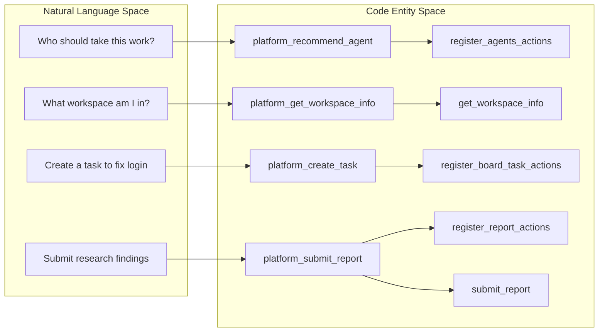
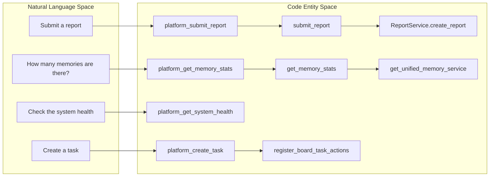
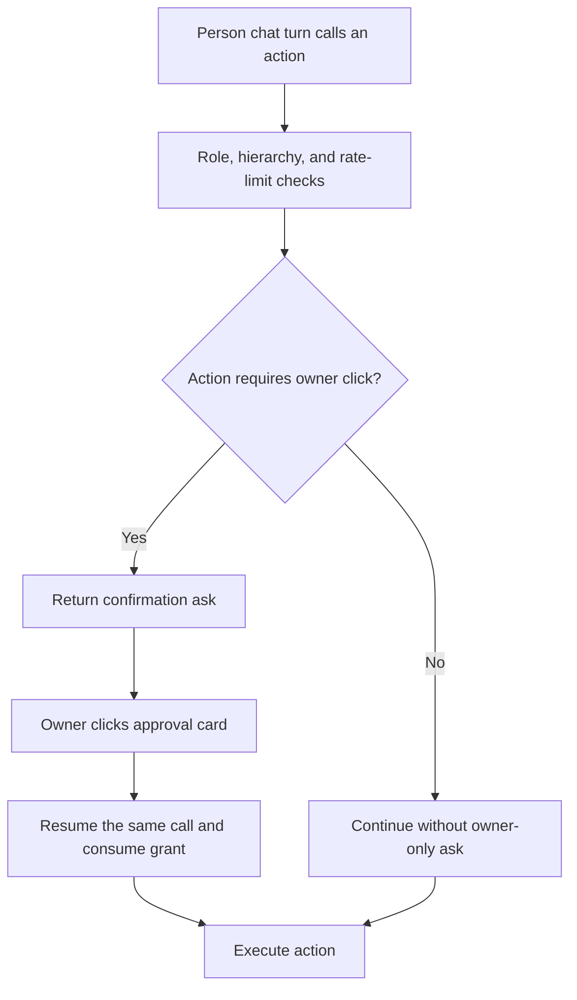

# Action Categories

Relevant source files

The following files were used as context for generating this wiki page:

- [orchestrator/api/board_task_rebrief.py](orchestrator/api/board_task_rebrief.py)
- [orchestrator/api/widget_memory.py](orchestrator/api/widget_memory.py)
- [orchestrator/consumers/chatbot/claim_removed.py](orchestrator/consumers/chatbot/claim_removed.py)
- [orchestrator/core/services/mission_memory_service.py](orchestrator/core/services/mission_memory_service.py)
- [orchestrator/core/services/playbook_memory_service.py](orchestrator/core/services/playbook_memory_service.py)
- [orchestrator/modules/memory/injection_filter.py](orchestrator/modules/memory/injection_filter.py)
- [orchestrator/modules/tools/discovery/actions_agents.py](orchestrator/modules/tools/discovery/actions_agents.py)
- [orchestrator/modules/tools/discovery/actions_assignments.py](orchestrator/modules/tools/discovery/actions_assignments.py)
- [orchestrator/modules/tools/discovery/actions_board_tasks.py](orchestrator/modules/tools/discovery/actions_board_tasks.py)
- [orchestrator/modules/tools/discovery/actions_marketplace.py](orchestrator/modules/tools/discovery/actions_marketplace.py)
- [orchestrator/modules/tools/discovery/actions_monitoring.py](orchestrator/modules/tools/discovery/actions_monitoring.py)
- [orchestrator/modules/tools/discovery/actions_reports.py](orchestrator/modules/tools/discovery/actions_reports.py)
- [orchestrator/modules/tools/discovery/actions_search.py](orchestrator/modules/tools/discovery/actions_search.py)
- [orchestrator/modules/tools/discovery/actions_workspace.py](orchestrator/modules/tools/discovery/actions_workspace.py)
- [orchestrator/modules/tools/discovery/handlers_agents.py](orchestrator/modules/tools/discovery/handlers_agents.py)
- [orchestrator/modules/tools/discovery/handlers_monitoring.py](orchestrator/modules/tools/discovery/handlers_monitoring.py)
- [orchestrator/modules/tools/discovery/handlers_reports.py](orchestrator/modules/tools/discovery/handlers_reports.py)
- [orchestrator/modules/tools/discovery/handlers_search.py](orchestrator/modules/tools/discovery/handlers_search.py)
- [orchestrator/modules/tools/discovery/handlers_workspace.py](orchestrator/modules/tools/discovery/handlers_workspace.py)
- [orchestrator/modules/tools/discovery/owner_only.py](orchestrator/modules/tools/discovery/owner_only.py)
- [orchestrator/modules/tools/discovery/send_back_checks.py](orchestrator/modules/tools/discovery/send_back_checks.py)
- [orchestrator/modules/tools/discovery/send_backs.py](orchestrator/modules/tools/discovery/send_backs.py)
- [orchestrator/modules/tools/discovery/ticket_changes.py](orchestrator/modules/tools/discovery/ticket_changes.py)
- [orchestrator/modules/tools/discovery/ticket_edit_moves.py](orchestrator/modules/tools/discovery/ticket_edit_moves.py)
- [orchestrator/modules/tools/discovery/ticket_edits.py](orchestrator/modules/tools/discovery/ticket_edits.py)
- [orchestrator/modules/tools/discovery/ticket_moves.py](orchestrator/modules/tools/discovery/ticket_moves.py)
- [orchestrator/modules/tools/execution/call_effects.py](orchestrator/modules/tools/execution/call_effects.py)
- [orchestrator/modules/tools/execution/owner_reasons.py](orchestrator/modules/tools/execution/owner_reasons.py)
- [orchestrator/modules/tools/services/action_capability_filter.py](orchestrator/modules/tools/services/action_capability_filter.py)
- [orchestrator/services/board_task_view.py](orchestrator/services/board_task_view.py)
- [orchestrator/services/done_needs_an_artifact.py](orchestrator/services/done_needs_an_artifact.py)
- [orchestrator/tests/test_f134_edits_say_they_apply_to_the_next_run.py](orchestrator/tests/test_f134_edits_say_they_apply_to_the_next_run.py)
- [orchestrator/tests/test_f141_an_agents_model_is_checked_on_every_write.py](orchestrator/tests/test_f141_an_agents_model_is_checked_on_every_write.py)
- [orchestrator/tests/test_f144_every_namesake_is_named.py](orchestrator/tests/test_f144_every_namesake_is_named.py)
- [orchestrator/tests/test_f159_a_playbook_run_recalls_its_past_runs.py](orchestrator/tests/test_f159_a_playbook_run_recalls_its_past_runs.py)
- [orchestrator/tests/test_f189_a_memory_is_never_filed_as_another_agent.py](orchestrator/tests/test_f189_a_memory_is_never_filed_as_another_agent.py)
- [orchestrator/tests/test_f241_e_a_new_card_never_copies_one_and_notes_are_the_owners.py](orchestrator/tests/test_f241_e_a_new_card_never_copies_one_and_notes_are_the_owners.py)
- [orchestrator/tests/test_f279_a_send_back_is_the_boards_reject.py](orchestrator/tests/test_f279_a_send_back_is_the_boards_reject.py)
- [orchestrator/tests/test_f309_c_an_approval_through_the_edit_tool_keeps_its_note.py](orchestrator/tests/test_f309_c_an_approval_through_the_edit_tool_keeps_its_note.py)
- [orchestrator/tests/test_f351_a_a_document_claim_needs_a_document.py](orchestrator/tests/test_f351_a_a_document_claim_needs_a_document.py)
- [orchestrator/tests/test_f449_a_a_refused_call_reads_in_the_owners_words.py](orchestrator/tests/test_f449_a_a_refused_call_reads_in_the_owners_words.py)
- [orchestrator/tests/test_p2w1_playbook_write_dedup.py](orchestrator/tests/test_p2w1_playbook_write_dedup.py)
- [orchestrator/tests/test_prd222_unknown_model_error_names_the_way_out.py](orchestrator/tests/test_prd222_unknown_model_error_names_the_way_out.py)
- [orchestrator/tests/test_prd256_fix_honesty_per_claim.py](orchestrator/tests/test_prd256_fix_honesty_per_claim.py)
- [orchestrator/tests/test_prd256_fix_send_back_waits_for_the_click.py](orchestrator/tests/test_prd256_fix_send_back_waits_for_the_click.py)

## Purpose and scope

This page catalogs the `platform_*` action families visible in the supplied code excerpts. It focuses on how action definitions expose names, schemas, categories, and permission levels, and how selected handlers operate. The excerpts show implementation details for agents, workspace and memory, board tasks, reports, monitoring, and marketplace; for several other families, they show only action names in the owner-only policy list. [orchestrator/modules/tools/discovery/actions_agents.py:91-143](), [orchestrator/modules/tools/discovery/actions_workspace.py:6-58](), [orchestrator/modules/tools/discovery/actions_board_tasks.py:24-37](), [orchestrator/modules/tools/discovery/actions_reports.py:6-15](), [orchestrator/modules/tools/discovery/owner_only.py:42-72]()

Sources: [orchestrator/modules/tools/discovery/actions_agents.py:91-143](), [orchestrator/modules/tools/discovery/actions_workspace.py:6-58](), [orchestrator/modules/tools/discovery/actions_board_tasks.py:24-37](), [orchestrator/modules/tools/discovery/actions_reports.py:6-15](), [orchestrator/modules/tools/discovery/owner_only.py:42-72]()

---

## 1. Action family taxonomy and registration

Action-definition modules construct `ActionDefinition` objects and pass them to `ActionRegistry.register`. The visible definitions include a tool name, description, category, parameter schema, permission level, and optional metadata such as `tags`, `promoted`, and `requires_confirmation`. [orchestrator/modules/tools/discovery/actions_board_tasks.py:24-37](), [orchestrator/modules/tools/discovery/actions_reports.py:17-38](), [orchestrator/modules/tools/discovery/actions_workspace.py:15-34]()

Agent registration wraps the registry so that `platform_create_agent` and `platform_update_agent` receive `runtime`, `provider`, and `model` schema properties as they are registered. The wrapper rebuilds the definition rather than mutating it in place. [orchestrator/modules/tools/discovery/actions_agents.py:41-46](), [orchestrator/modules/tools/discovery/actions_agents.py:49-68](), [orchestrator/modules/tools/discovery/actions_agents.py:71-88]()

The owner-only policy names actions that, when called from a person’s chat turn, require the owner’s click. The policy also distinguishes conditional cases: for example, a `platform_update_playbook` call is owner-only when it sets the playbook timer, and a `platform_create_agent` call is owner-only when it creates a CLI agent. [orchestrator/modules/tools/discovery/owner_only.py:42-72]()

### Natural-language requests mapped to code entities

This diagram connects example requests to action names and the shown registration or handler symbols. The edges identify the corresponding tool and implementation symbols shown in the excerpts. [orchestrator/modules/tools/discovery/actions_agents.py:91-139](), [orchestrator/modules/tools/discovery/actions_workspace.py:15-34](), [orchestrator/modules/tools/discovery/handlers_workspace.py:40-63](), [orchestrator/modules/tools/discovery/actions_board_tasks.py:24-81](), [orchestrator/modules/tools/discovery/actions_reports.py:17-38](), [orchestrator/modules/tools/discovery/handlers_reports.py:16-26]()

**Diagram: Natural-language request to action definition and handler**

Sources: [orchestrator/modules/tools/discovery/actions_agents.py:91-139](), [orchestrator/modules/tools/discovery/actions_workspace.py:15-34](), [orchestrator/modules/tools/discovery/handlers_workspace.py:40-63](), [orchestrator/modules/tools/discovery/actions_board_tasks.py:24-81](), [orchestrator/modules/tools/discovery/actions_reports.py:6-38](), [orchestrator/modules/tools/discovery/handlers_reports.py:16-26]()

### Definition and implementation correspondence

| Family | Definition or action symbols | Shown implementation symbols |
|---|---|---|
| Agents | `register_agents_actions`, `platform_recommend_agent`, `platform_list_agents` | `list_agents`, `get_agent` [orchestrator/modules/tools/discovery/actions_agents.py:91-143](), [orchestrator/modules/tools/discovery/handlers_agents.py:31-109]() |
| Workspace and memory | `register_workspace_actions_defs`, `platform_get_workspace_info`, `platform_get_memory_stats`, `platform_resume_context` | `get_workspace_info`, `get_memory_stats`, `list_connected_apps` [orchestrator/modules/tools/discovery/actions_workspace.py:6-84](), [orchestrator/modules/tools/discovery/handlers_workspace.py:40-168]() |
| Board tasks | `register_board_task_actions`, `platform_create_task` | Board task implementation is not included in the shown handler excerpt; its action registration and schema are shown [orchestrator/modules/tools/discovery/actions_board_tasks.py:24-81]() |
| Reports | `register_report_actions`, `platform_submit_report`, `platform_browse_reports`, `platform_acknowledge_report` | `submit_report`, `acknowledge_report`, `link_report_to_task` [orchestrator/modules/tools/discovery/actions_reports.py:6-125](), [orchestrator/modules/tools/discovery/handlers_reports.py:16-174]() |
| Monitoring | Monitoring action definitions are in a separate definition module | `prometheus_available`, `loki_available`, `railway_api_available`, `get_logs`, `list_services`, `query_loki_logs` [orchestrator/modules/tools/discovery/handlers_monitoring.py:14-112]() |
| Marketplace | `register_marketplace_actions`, `platform_browse_marketplace_plugins`, `platform_browse_marketplace_agents`, `platform_browse_marketplace_skills` | Definition excerpt shown; corresponding handlers are not included [orchestrator/modules/tools/discovery/actions_marketplace.py:6-123]() |

Sources: [orchestrator/modules/tools/discovery/actions_agents.py:91-143](), [orchestrator/modules/tools/discovery/handlers_agents.py:31-109](), [orchestrator/modules/tools/discovery/actions_workspace.py:6-84](), [orchestrator/modules/tools/discovery/handlers_workspace.py:40-168](), [orchestrator/modules/tools/discovery/actions_board_tasks.py:24-81](), [orchestrator/modules/tools/discovery/actions_reports.py:6-125](), [orchestrator/modules/tools/discovery/handlers_reports.py:16-174](), [orchestrator/modules/tools/discovery/handlers_monitoring.py:14-112](), [orchestrator/modules/tools/discovery/actions_marketplace.py:6-123]()

---

## 2. Catalog of platform action families

### 2.1 Agents

Agent actions cover roster discovery and recommendation, and include agent creation and update. `platform_recommend_agent` is a read action that accepts an objective, an optional runtime preference (`any`, `cli`, or `api`), and an optional result limit. The registration wrapper adds runtime-related schema fields to create and update actions. [orchestrator/modules/tools/discovery/actions_agents.py:41-68](), [orchestrator/modules/tools/discovery/actions_agents.py:91-139]()

`list_agents` filters `Agent` rows by `workspace_id`, optionally filters by status, and returns agent summaries. On widget turns it returns the restricted `_visitor_view`; otherwise it includes details such as runtime, model-related information, tool and skill counts, heartbeat state, and tags. `get_agent` resolves an agent by ID or name and also returns the restricted view on widget turns. [orchestrator/modules/tools/discovery/handlers_agents.py:20-44](), [orchestrator/modules/tools/discovery/handlers_agents.py:46-79](), [orchestrator/modules/tools/discovery/handlers_agents.py:82-109]()

Sources: [orchestrator/modules/tools/discovery/actions_agents.py:41-68](), [orchestrator/modules/tools/discovery/actions_agents.py:91-139](), [orchestrator/modules/tools/discovery/handlers_agents.py:20-109]()

### 2.2 Workspace

`register_workspace_actions_defs` registers workspace information, memory, integrations, and system-health actions. The visible tools include `platform_get_workspace_info`, `platform_get_memory_stats`, `platform_resume_context`, `platform_checkpoint_thread`, `platform_list_connected_apps`, and `platform_get_system_health`. The health action is marked `super_admin_only` and promoted. [orchestrator/modules/tools/discovery/actions_workspace.py:6-34](), [orchestrator/modules/tools/discovery/actions_workspace.py:36-117](), [orchestrator/modules/tools/discovery/actions_workspace.py:119-168]()

`get_workspace_info` loads the workspace by ID and returns workspace metadata plus agent and document counts. `get_memory_stats` obtains the unified memory service, checks durable configuration, retrieves workspace-level memories, and scans up to ten workspace agents for agent-specific memories. `list_connected_apps` aggregates active `AgentAppAssignment` rows by app name and type for agents in the workspace. [orchestrator/modules/tools/discovery/handlers_workspace.py:40-63](), [orchestrator/modules/tools/discovery/handlers_workspace.py:66-137](), [orchestrator/modules/tools/discovery/handlers_workspace.py:140-168]()

Sources: [orchestrator/modules/tools/discovery/actions_workspace.py:6-168](), [orchestrator/modules/tools/discovery/handlers_workspace.py:40-168]()

### 2.3 Documents

The owner-only policy excerpt names `platform_read_document` in a test-provided task brief, but the supplied files do not include its action definition or handler implementation. This page therefore does not infer its schema or execution behavior. [orchestrator/tests/test_f241_e_a_new_card_never_copies_one_and_notes_are_the_owners.py:22-28]()

Sources: [orchestrator/tests/test_f241_e_a_new_card_never_copies_one_and_notes_are_the_owners.py:22-28]()

### 2.4 Missions

The owner-only policy identifies `platform_create_mission`, `platform_approve_mission`, `platform_cancel_mission`, and `platform_update_mission_plan` as mission-related actions. The excerpt marks mission plan edits as owner-only; it does not provide the action definitions or handler implementations for these tools. [orchestrator/modules/tools/discovery/owner_only.py:43-73]()

Sources: [orchestrator/modules/tools/discovery/owner_only.py:43-73]()

### 2.5 Playbooks

The owner-only policy names `platform_create_playbook`, `platform_schedule_playbook`, `platform_delete_playbook`, `platform_update_playbook`, and `platform_execute_playbook`. It specifies that a playbook update is owner-only when it sets the timer, and that creating, scheduling, deleting, or running a playbook is included in the owner-only action set. [orchestrator/modules/tools/discovery/owner_only.py:50-62]()

Sources: [orchestrator/modules/tools/discovery/owner_only.py:50-62]()

### 2.6 Reports

`register_report_actions` registers report submission, browsing, acknowledgement, report-to-task linkage, and latest-report retrieval. The definitions distinguish read actions such as `platform_browse_reports` and `platform_get_latest_report` from write actions such as `platform_submit_report` and `platform_acknowledge_report`. [orchestrator/modules/tools/discovery/actions_reports.py:6-15](), [orchestrator/modules/tools/discovery/actions_reports.py:17-165]()

`submit_report` validates required title and content, rejects template placeholders, validates report type and status, optionally checks required sections, resolves the calling agent, and delegates persistence to `ReportService.create_report`. `acknowledge_report` updates acknowledgement fields within the workspace and, after committing, calls `file_owner_approved`. `link_report_to_task` validates the task reference and updates the report’s linked task IDs. [orchestrator/modules/tools/discovery/handlers_reports.py:16-106](), [orchestrator/modules/tools/discovery/handlers_reports.py:109-148](), [orchestrator/modules/tools/discovery/handlers_reports.py:151-174]()

Sources: [orchestrator/modules/tools/discovery/actions_reports.py:6-165](), [orchestrator/modules/tools/discovery/handlers_reports.py:16-174]()

### 2.7 Monitoring

Monitoring handler utilities check whether Prometheus, Loki, or the Railway API are configured. `get_logs` requires a configured `RailwayClient` and a service name, delegates to `fetch_service_logs`, and formats and truncates the returned text for model consumption. `list_services` delegates to `RailwayClient.list_services`. [orchestrator/modules/tools/discovery/handlers_monitoring.py:14-37](), [orchestrator/modules/tools/discovery/handlers_monitoring.py:39-109]()

`query_loki_logs` checks Loki availability, bounds its time range and result limit, builds a LogQL selector, and tries the Grafana datasource proxy before the direct Loki fallback. The supplied excerpt shows the Grafana-proxy request and the start of the fallback path. [orchestrator/modules/tools/discovery/handlers_monitoring.py:112-185]()

Sources: [orchestrator/modules/tools/discovery/handlers_monitoring.py:14-109](), [orchestrator/modules/tools/discovery/handlers_monitoring.py:112-185]()

### 2.8 Marketplace

`register_marketplace_actions` registers marketplace discovery actions for plugins, agents, and skills. These are read actions with optional search, category, and limit parameters. The excerpt also shows workspace-inventory actions for enabled plugins and skills; browsing for new items is distinguished from listing items already enabled in the workspace. [orchestrator/modules/tools/discovery/actions_marketplace.py:6-46](), [orchestrator/modules/tools/discovery/actions_marketplace.py:48-123](), [orchestrator/modules/tools/discovery/actions_marketplace.py:125-173]()

Sources: [orchestrator/modules/tools/discovery/actions_marketplace.py:6-173]()

### 2.9 Scheduling

The owner-only policy names `platform_schedule_playbook` and `platform_schedule_task`; scheduling-related actions in that set require owner approval when called from a person’s chat turn. The supplied excerpts do not show their action definitions or scheduling handlers. [orchestrator/modules/tools/discovery/owner_only.py:50-59]()

Sources: [orchestrator/modules/tools/discovery/owner_only.py:50-59]()

### 2.10 Graph

The supplied excerpts do not show graph action definitions or handlers. No graph implementation details are inferred here.

Sources: [orchestrator/modules/tools/discovery/owner_only.py:42-72]()

### 2.11 Autonomy

The supplied excerpts do not show autonomy action definitions or handlers. The owner-only module does state that a person’s owner-only action cannot bypass the click requirement based on role or the full-autonomy setting. [orchestrator/modules/tools/discovery/owner_only.py:1-19]()

Sources: [orchestrator/modules/tools/discovery/owner_only.py:1-19]()

### 2.12 Web

The supplied excerpts do not show web action definitions or handlers. No web-access behavior is inferred here.

Sources: [orchestrator/modules/tools/discovery/owner_only.py:42-72]()

### 2.13 Socials

The owner-only policy names `platform_submit_social_post` and states that it sends a social post for approval; its accompanying verb explicitly says that nothing posts yet. The excerpt does not include the action definition or publishing handler. [orchestrator/modules/tools/discovery/owner_only.py:43-64](), [orchestrator/modules/tools/discovery/owner_only.py:99-112]()

Sources: [orchestrator/modules/tools/discovery/owner_only.py:43-64](), [orchestrator/modules/tools/discovery/owner_only.py:99-112]()

### 2.14 Brand

The supplied excerpts do not show brand action definitions or handlers. No brand behavior is inferred here.

Sources: [orchestrator/modules/tools/discovery/owner_only.py:42-72]()

### 2.15 Tasks and board

`register_board_task_actions` registers task creation, listing, snapshots, summaries, retrieval, waiting, assignment, and update operations. `platform_create_task` is a promoted `write` action with `requires_confirmation=False`; its schema includes title and description requirements and optional fields for assignment, priority, parent ticket, review mode, deadline, approval action, initial status, and auto-approval. [orchestrator/modules/tools/discovery/actions_board_tasks.py:24-37](), [orchestrator/modules/tools/discovery/actions_board_tasks.py:58-81](), [orchestrator/modules/tools/discovery/actions_board_tasks.py:103-148]()

The board status schema is sourced from `api.board_tasks.VALID_STATUSES` when importable and uses a stable fallback list otherwise. The supplied tests show a refusal path that prevents creating a duplicate card when the proposed title is effectively another ticket’s number, and a chat directive that assigns the existing card rather than creating a copy. [orchestrator/modules/tools/discovery/actions_board_tasks.py:10-21](), [orchestrator/tests/test_f241_e_a_new_card_never_copies_one_and_notes_are_the_owners.py:46-80]()

Sources: [orchestrator/modules/tools/discovery/actions_board_tasks.py:10-21](), [orchestrator/modules/tools/discovery/actions_board_tasks.py:24-37](), [orchestrator/modules/tools/discovery/actions_board_tasks.py:58-81](), [orchestrator/modules/tools/discovery/actions_board_tasks.py:103-148](), [orchestrator/tests/test_f241_e_a_new_card_never_copies_one_and_notes_are_the_owners.py:46-80]()

---

## 3. Data flow and owner-only gating

For report submission, the handler validates input and caller-agent context before constructing `ReportService` and calling `create_report`. For report acknowledgement, it updates the workspace-scoped row, commits, and then invokes `file_owner_approved`. [orchestrator/modules/tools/discovery/handlers_reports.py:16-106](), [orchestrator/modules/tools/discovery/handlers_reports.py:109-148]()

For workspace memory statistics, the handler obtains the unified memory service, reads workspace memories, loads workspace agents, and concurrently retrieves memories for up to ten agents. [orchestrator/modules/tools/discovery/handlers_workspace.py:66-105]()

**Diagram: Natural-language requests through visible definitions and data paths**

Sources: [orchestrator/modules/tools/discovery/actions_reports.py:17-38](), [orchestrator/modules/tools/discovery/handlers_reports.py:16-106](), [orchestrator/modules/tools/discovery/actions_workspace.py:38-58](), [orchestrator/modules/tools/discovery/handlers_workspace.py:66-105](), [orchestrator/modules/tools/discovery/actions_workspace.py:145-168](), [orchestrator/modules/tools/discovery/actions_board_tasks.py:24-81]()

### Owner-only checks and confirmation grants

`OWNER_ONLY_ACTIONS` lists the action names treated as owner-only, including agent, mission, playbook, scheduling, social-post, and board-update operations. The policy module states that for a person’s chat turn the action waits for the owner’s click and resumes through the approval-grant path; agent runs, playbook steps, and heartbeats do not carry a driving user and are unchanged. The excerpt also states that the owner-only ask follows role, hierarchy, and rate-limit checks. [orchestrator/modules/tools/discovery/owner_only.py:1-19](), [orchestrator/modules/tools/discovery/owner_only.py:42-72]()

**Diagram: Owner-only confirmation flow described by the policy module**

Sources: [orchestrator/modules/tools/discovery/owner_only.py:1-19](), [orchestrator/modules/tools/discovery/owner_only.py:42-72]()

---

## 4. Source files in the supplied excerpts

| Area | File | Role established by the excerpt |
|---|---|---|
| Board task definitions | `orchestrator/modules/tools/discovery/actions_board_tasks.py` | Registers board task action definitions and schemas [orchestrator/modules/tools/discovery/actions_board_tasks.py:24-37]() |
| Agent definitions | `orchestrator/modules/tools/discovery/actions_agents.py` | Registers agent actions and injects runtime-related schema properties [orchestrator/modules/tools/discovery/actions_agents.py:41-92]() |
| Agent handlers | `orchestrator/modules/tools/discovery/handlers_agents.py` | Implements agent listing, retrieval, and view shaping [orchestrator/modules/tools/discovery/handlers_agents.py:20-148]() |
| Workspace definitions | `orchestrator/modules/tools/discovery/actions_workspace.py` | Registers workspace, memory, integration, and health actions [orchestrator/modules/tools/discovery/actions_workspace.py:6-168]() |
| Workspace handlers | `orchestrator/modules/tools/discovery/handlers_workspace.py` | Implements workspace info, memory stats, and connected-app listing [orchestrator/modules/tools/discovery/handlers_workspace.py:40-168]() |
| Report definitions | `orchestrator/modules/tools/discovery/actions_reports.py` | Registers report actions [orchestrator/modules/tools/discovery/actions_reports.py:6-165]() |
| Report handlers | `orchestrator/modules/tools/discovery/handlers_reports.py` | Validates and processes report submission, acknowledgement, and task linkage [orchestrator/modules/tools/discovery/handlers_reports.py:16-174]() |
| Monitoring handlers | `orchestrator/modules/tools/discovery/handlers_monitoring.py` | Checks monitoring integrations and queries deployment or Loki logs [orchestrator/modules/tools/discovery/handlers_monitoring.py:14-185]() |
| Marketplace definitions | `orchestrator/modules/tools/discovery/actions_marketplace.py` | Registers marketplace browse and workspace-inventory actions [orchestrator/modules/tools/discovery/actions_marketplace.py:6-173]() |
| Owner-only policy | `orchestrator/modules/tools/discovery/owner_only.py` | Lists owner-only action names and describes the click/grant behavior [orchestrator/modules/tools/discovery/owner_only.py:1-19](), [orchestrator/modules/tools/discovery/owner_only.py:42-72]() |
| Board task regression tests | `orchestrator/tests/test_f241_e_a_new_card_never_copies_one_and_notes_are_the_owners.py` | Tests duplicate-card refusal and assignment of an existing ticket [orchestrator/tests/test_f241_e_a_new_card_never_copies_one_and_notes_are_the_owners.py:46-80]() |

Sources: [orchestrator/modules/tools/discovery/actions_board_tasks.py:24-37](), [orchestrator/modules/tools/discovery/actions_agents.py:41-92](), [orchestrator/modules/tools/discovery/handlers_agents.py:20-148](), [orchestrator/modules/tools/discovery/actions_workspace.py:6-168](), [orchestrator/modules/tools/discovery/handlers_workspace.py:40-168](), [orchestrator/modules/tools/discovery/actions_reports.py:6-165](), [orchestrator/modules/tools/discovery/handlers_reports.py:16-174](), [orchestrator/modules/tools/discovery/handlers_monitoring.py:14-185](), [orchestrator/modules/tools/discovery/actions_marketplace.py:6-173](), [orchestrator/modules/tools/discovery/owner_only.py:1-19](), [orchestrator/modules/tools/discovery/owner_only.py:42-72](), [orchestrator/tests/test_f241_e_a_new_card_never_copies_one_and_notes_are_the_owners.py:46-80]()

---