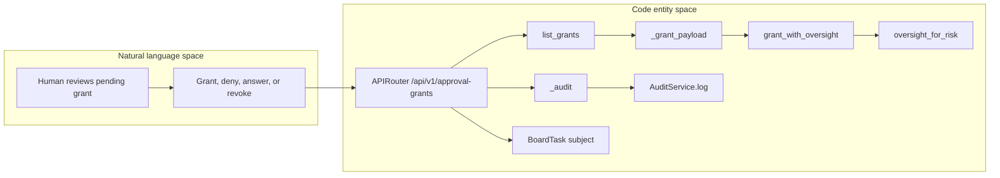
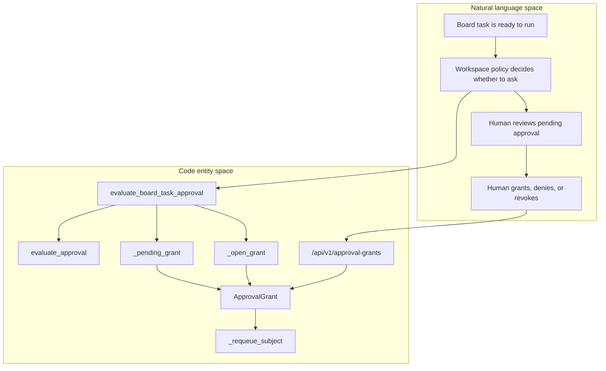

# Confirmation, Approval & Rate Limiting

Relevant source files

The following files were used as context for generating this wiki page:

- [docs/PRDS/136-LLM-CONTEXT-BUDGET-SETTINGS.md](docs/PRDS/136-LLM-CONTEXT-BUDGET-SETTINGS.md)
- [frontend/components/settings/ApiKeyManager.tsx](frontend/components/settings/ApiKeyManager.tsx)
- [frontend/components/settings/LLMModelsSettingsTab.tsx](frontend/components/settings/LLMModelsSettingsTab.tsx)
- [frontend/components/settings/LLMTierCard.tsx](frontend/components/settings/LLMTierCard.tsx)
- [frontend/components/widgets/CodeWidget/index.tsx](frontend/components/widgets/CodeWidget/index.tsx)
- [frontend/components/widgets/DataWidget/index.tsx](frontend/components/widgets/DataWidget/index.tsx)
- [frontend/components/widgets/ImageWidget/index.tsx](frontend/components/widgets/ImageWidget/index.tsx)
- [frontend/components/widgets/WidgetBase.tsx](frontend/components/widgets/WidgetBase.tsx)
- [frontend/components/widgets/WidgetWrapper.tsx](frontend/components/widgets/WidgetWrapper.tsx)
- [frontend/components/widgets/__tests__/registration-manifest.test.ts](frontend/components/widgets/__tests__/registration-manifest.test.ts)
- [frontend/components/widgets/registry.ts](frontend/components/widgets/registry.ts)
- [frontend/stores/index.ts](frontend/stores/index.ts)
- [frontend/stores/workspace-store.ts](frontend/stores/workspace-store.ts)
- [orchestrator/alembic/versions/prd136_collapse_llm_tiers.py](orchestrator/alembic/versions/prd136_collapse_llm_tiers.py)
- [orchestrator/alembic/versions/prd181_s2_approval_grants.py](orchestrator/alembic/versions/prd181_s2_approval_grants.py)
- [orchestrator/api/approval_grants.py](orchestrator/api/approval_grants.py)
- [orchestrator/core/models/approval_grants.py](orchestrator/core/models/approval_grants.py)
- [orchestrator/core/models/workspaces.py](orchestrator/core/models/workspaces.py)
- [orchestrator/core/services/approval_grants.py](orchestrator/core/services/approval_grants.py)
- [orchestrator/services/board_approval.py](orchestrator/services/board_approval.py)
- [orchestrator/services/budget_ceiling.py](orchestrator/services/budget_ceiling.py)
- [orchestrator/tests/test_f193_two_approvals_at_once_resume_once.py](orchestrator/tests/test_f193_two_approvals_at_once_resume_once.py)
- [orchestrator/tests/test_grant_approve_commit_ordering.py](orchestrator/tests/test_grant_approve_commit_ordering.py)
- [orchestrator/tests/test_human_directed_gate.py](orchestrator/tests/test_human_directed_gate.py)
- [orchestrator/tests/test_p2w2_grant_mutation_admin_gate.py](orchestrator/tests/test_p2w2_grant_mutation_admin_gate.py)
- [orchestrator/tests/test_p2w2_grant_resume.py](orchestrator/tests/test_p2w2_grant_resume.py)

## Purpose and scope

This page documents confirmation and approval paths for write or destructive actions: durable approval grants, board-task approval, human-directed confirmation-gate behavior, and the rate-limiting boundary. The supplied source excerpts establish the grant model and lifecycle, approval API, board approval decision glue, and tests of the human-directed gate and approval commit ordering. They do not expose implementation details for a rate limiter. [orchestrator/core/models/approval_grants.py:1-22](), [orchestrator/core/services/approval_grants.py:1-12](), [orchestrator/api/approval_grants.py:1-14](), [orchestrator/services/board_approval.py:1-19](), [orchestrator/tests/test_human_directed_gate.py:1-19]()

Sources: [orchestrator/core/models/approval_grants.py:1-22](), [orchestrator/core/services/approval_grants.py:1-12](), [orchestrator/api/approval_grants.py:1-14](), [orchestrator/services/board_approval.py:1-19](), [orchestrator/tests/test_human_directed_gate.py:1-19]()

## Overview: separate gates, shared human decision surface

`ApprovalGrant` is a durable authorization record scoped to a workspace and subject. The model supports `board_task`, `playbook_run`, and `tool_call` subjects; a grant can include a tool name, risk tier, acting agent, reason, estimated cost, expiry, and revocation metadata. [orchestrator/core/models/approval_grants.py:15-21](), [orchestrator/core/models/approval_grants.py:52-81](), [orchestrator/core/models/approval_grants.py:84-113]()

A pending grant holds its subject blocked. A grant authorizes only when its status is `GRANTED` and its `expires_at` has not passed; revoked, expired, denied, and pending grants do not authorize. Expiry is checked at read time, so authorization does not depend on a background expiry sweep running on time. [orchestrator/core/models/approval_grants.py:35-49](), [orchestrator/core/services/approval_grants.py:7-11]()

The approval API allows workspace owners, admins, and editors to list grants and answer approval requests; viewers are refused. Revocation is more restrictive: only an owner or admin may retract an authorization that has already been granted. State changes are audited as governance actions. [orchestrator/api/approval_grants.py:8-14]()

Sources: [orchestrator/core/models/approval_grants.py:15-21](), [orchestrator/core/models/approval_grants.py:35-49](), [orchestrator/core/services/approval_grants.py:7-11](), [orchestrator/api/approval_grants.py:8-14]()

## Approval grants

### API surface and workspace scope

The FastAPI router prefix is `/api/v1/approval-grants`. `list_grants` scopes its query to `ctx.workspace_id`, optionally filters by `status` and `kind`, sorts by `requested_at` descending, and returns at most 200 rows. It enriches each result with its owner; question-kind grants also include a blocked-task cascade in their payload. [orchestrator/api/approval_grants.py:42-42](), [orchestrator/api/approval_grants.py:108-131](), [orchestrator/api/approval_grants.py:59-73]()

Approval rows and question rows have distinct API verbs. `question_not_approval` constructs a 422 explanation directing callers from `/grant` to `/answer`; `approval_not_question` directs callers from `/answer` to `/grant` or `/deny`. The answer body guidance includes either an allowed option or free-text `answer_text`, depending on the question. [orchestrator/api/approval_grants.py:141-157]()

| Operation | Required role | API behavior |
|---|---|---|
| List grants | Owner, admin, or editor via `require_workspace_answerer` | Lists grants in the caller’s workspace, with optional `status` and `kind` filters. [orchestrator/api/approval_grants.py:108-126]() |
| Grant, deny, or answer | Owner, admin, or editor via `require_workspace_answerer` | The API module’s documented access policy permits workspace answerers to decide; approval and question rows use separate verbs. [orchestrator/api/approval_grants.py:8-10](), [orchestrator/api/approval_grants.py:141-157]() |
| Revoke | Owner or admin via `require_workspace_admin` | Retracts an authorization after it has been given. [orchestrator/api/approval_grants.py:8-11]() |

Sources: [orchestrator/api/approval_grants.py:8-14](), [orchestrator/api/approval_grants.py:42-42](), [orchestrator/api/approval_grants.py:59-73](), [orchestrator/api/approval_grants.py:108-157]()

### Grant data model and lifecycle

`ApprovalGrant` is stored in the `approval_grants` table, with a workspace foreign key that cascades on workspace deletion. Its subject lookup index covers `workspace_id`, `subject_type`, `subject_id`, and `status`. `GrantStatus` defines `pending`, `granted`, `revoked`, `expired`, and `denied`. [orchestrator/core/models/approval_grants.py:35-49](), [orchestrator/core/models/approval_grants.py:64-75](), [orchestrator/core/models/approval_grants.py:115-119]()

`create_grant` stages a pending grant and flushes it without committing; transaction ownership remains with the caller. It assigns an expiry using the supplied TTL, with a minimum of one second. The configured default TTL comes from `APPROVAL_GRANT_TTL_SECONDS`, falling back to 24 hours if configuration is unavailable. [orchestrator/core/services/approval_grants.py:24-36](), [orchestrator/core/services/approval_grants.py:43-99]()

`find_active_grant` searches for granted rows matching the workspace and subject, newest grant first, and returns the first one that passes `is_authorising`. `find_pending_grant` is documented as an idempotency lookup for an existing pending grant; callers can narrow by kind so an open question is not mistaken for approval. [orchestrator/core/services/approval_grants.py:134-165](), [orchestrator/core/services/approval_grants.py:168-179]()

| Lifecycle state | Meaning for authorization |
|---|---|
| `PENDING` | Waiting for a human decision; the subject is blocked. [orchestrator/core/models/approval_grants.py:35-42]() |
| `GRANTED` | Authorizes the subject only while not past `expires_at`. [orchestrator/core/models/approval_grants.py:38-41](), [orchestrator/core/services/approval_grants.py:7-11]() |
| `REVOKED` | Authorization has been retracted. [orchestrator/core/models/approval_grants.py:40-42]() |
| `EXPIRED` | No longer authorizes after expiry. [orchestrator/core/models/approval_grants.py:40-42]() |
| `DENIED` | Explicit refusal; the subject fails rather than retries. [orchestrator/core/models/approval_grants.py:40-42]() |

Sources: [orchestrator/core/models/approval_grants.py:35-49](), [orchestrator/core/models/approval_grants.py:64-75](), [orchestrator/core/models/approval_grants.py:84-119](), [orchestrator/core/services/approval_grants.py:24-36](), [orchestrator/core/services/approval_grants.py:43-99](), [orchestrator/core/services/approval_grants.py:134-179]()

### Oversight metadata and audit

`grant_with_oversight` converts a grant to a dictionary and adds an `oversight` object produced by `oversight_for_risk(grant.risk_tier)`. The API documentation describes this as an EU AI Act Article 14 oversight tier and rationale, with a conservative human-in-the-loop fallback when risk is unknown or absent. [orchestrator/api/approval_grants.py:45-56]()

`_audit` uses `AuditService.log` to record a grant state change with workspace, actor, action, resource, and subject details. The actor reference is derived through `actor_ref(ctx)`. Audit failures are caught and logged rather than propagated from `_audit`. [orchestrator/api/approval_grants.py:76-105]()

Board-policy grant creation also has a system-actor governance audit path: `_audit_governance` writes an `approval_grant` resource record and logs failures without raising. [orchestrator/services/board_approval.py:50-70]()

Sources: [orchestrator/api/approval_grants.py:45-56](), [orchestrator/api/approval_grants.py:76-105](), [orchestrator/services/board_approval.py:50-70]()

### Approval-grant flow: natural language to code entities

This diagram maps a human reviewing a request to the API’s workspace-scoped listing, payload enrichment, oversight mapping, and audit entities. The listed operations and helper names are defined in the API module. [orchestrator/api/approval_grants.py:42-73](), [orchestrator/api/approval_grants.py:76-131]()

**Diagram: Approval grant decision and API entities**

Sources: [orchestrator/api/approval_grants.py:42-73](), [orchestrator/api/approval_grants.py:76-131]()

## Board approvals and human-directed decisions

### Board-task grant behavior

`evaluate_board_task_approval` evaluates a board task against workspace approval policy. If the policy permits the task, it returns an outcome requiring no approval and creates no grant. If the policy holds the task, it derives a human-readable reason, checks for an existing pending grant, and reuses that grant when present; otherwise it opens a new one. [orchestrator/services/board_approval.py:73-109]()

The module’s documented integration boundary is that `api.board_tasks` and `services.board_dispatcher` handle moving a held task to `blocked` and re-queuing it after a grant. The board approval module provides the decision glue and states that pending grants are announced to workspace admins through an `approval_pending` notification. [orchestrator/services/board_approval.py:12-19]()

A regression test pins approval commit ordering: `grant_approval` must perform `_cas_grant`, commit the granted state, and only then call `_requeue_subject`. This ordering ensures a resumed execution can observe the approval in the database before it re-enters the gate. The test also requires a later commit after resume for persisted execution results. [orchestrator/tests/test_grant_approve_commit_ordering.py:1-17](), [orchestrator/tests/test_grant_approve_commit_ordering.py:28-75]()

Sources: [orchestrator/services/board_approval.py:73-109](), [orchestrator/services/board_approval.py:12-19](), [orchestrator/tests/test_grant_approve_commit_ordering.py:1-17](), [orchestrator/tests/test_grant_approve_commit_ordering.py:28-75]()

### Human-directed confirmation gate

The human-directed exception is intentionally narrower than a general admin bypass. The test specification requires both an interactive chat context carrying a server-threaded `conversation_id` and a driving user who resolves to an owner or admin in workspace membership. Agent lanes such as heartbeat, cadence, board, and mission do not carry that interactive conversation context; those calls retain the confirmation ask. [orchestrator/tests/test_human_directed_gate.py:1-19](), [orchestrator/tests/test_human_directed_gate.py:69-95]()

The tests pin role behavior: owner and admin pass, while editor, member, viewer, missing membership, missing/non-string principal, and role-resolver failure do not. A resolver failure therefore fails closed to the ask. [orchestrator/tests/test_human_directed_gate.py:49-95]()

Audit attribution distinguishes three cases: `autonomous`, `approved_via_grant_id`, and `human_directed`. The test asserts that these markers can coexist and that an empty decision has no marker payload. It also source-pins that the confirmation gate’s consume/ask branch is guarded for human-directed calls and that execution results receive the `human_directed` marker. [orchestrator/tests/test_human_directed_gate.py:97-114](), [orchestrator/tests/test_human_directed_gate.py:117-145]()

Sources: [orchestrator/tests/test_human_directed_gate.py:1-19](), [orchestrator/tests/test_human_directed_gate.py:49-95](), [orchestrator/tests/test_human_directed_gate.py:97-114](), [orchestrator/tests/test_human_directed_gate.py:117-145]()

### Board approval and confirmation flow: natural language to code entities

This diagram connects a workspace policy decision and human review to the board approval and grant entities visible in the supplied code. The dispatch and notification steps are described by `board_approval.py`; the API module supplies the human grant surface. [orchestrator/services/board_approval.py:1-19](), [orchestrator/services/board_approval.py:73-109](), [orchestrator/api/approval_grants.py:42-56]()

**Diagram: Board task hold and human decision**

Sources: [orchestrator/services/board_approval.py:73-109](), [orchestrator/api/approval_grants.py:42-56](), [orchestrator/tests/test_grant_approve_commit_ordering.py:28-67]()

## Confirmation and action-gating boundaries

The supplied human-directed gate tests describe the intended boundary: confirmation-gated actions may skip the ask only for a human-directed interactive chat turn from an owner or admin; other contexts retain the ask. The tests also pin that the execution is marked `human_directed`, distinct from autonomous execution or grant-based approval. [orchestrator/tests/test_human_directed_gate.py:1-19](), [orchestrator/tests/test_human_directed_gate.py:117-145]()

The supplied excerpts do not include the platform action permission definitions or the confirmation-gate implementation itself. Accordingly, this page does not infer a complete action permission matrix or describe implementation details beyond the tested behavior above. [orchestrator/tests/test_human_directed_gate.py:117-145]()

Sources: [orchestrator/tests/test_human_directed_gate.py:1-19](), [orchestrator/tests/test_human_directed_gate.py:117-145]()

## Rate limiting

The supplied source excerpts do not include a rate-limiting implementation, configuration, or route-level limiter. They therefore do not establish rate-limit keys, thresholds, windows, response behavior, or how limits interact with confirmation and approval. No such behavior is specified here.

Sources: [orchestrator/api/approval_grants.py:1-14](), [orchestrator/core/services/approval_grants.py:1-12](), [orchestrator/services/board_approval.py:1-19]()

## Technical reference

| Concern | Code entity | Role |
|---|---|---|
| Approval API | `router` in `orchestrator/api/approval_grants.py` | Defines the `/api/v1/approval-grants` router prefix. [orchestrator/api/approval_grants.py:42-42]() |
| Workspace grant listing | `list_grants` | Filters grants by workspace, optional status and kind, and a 200-row limit. [orchestrator/api/approval_grants.py:108-131]() |
| Oversight enrichment | `grant_with_oversight` | Adds the `oversight_for_risk` result to the serialized grant. [orchestrator/api/approval_grants.py:45-56]() |
| Grant data | `ApprovalGrant`, `GrantStatus` | Defines grant subjects, lifecycle states, timestamps, and audit-related fields. [orchestrator/core/models/approval_grants.py:35-49](), [orchestrator/core/models/approval_grants.py:64-113]() |
| Grant creation and lookup | `create_grant`, `find_active_grant`, `find_pending_grant` | Stages pending grants and looks up active or pending grants. [orchestrator/core/services/approval_grants.py:43-99](), [orchestrator/core/services/approval_grants.py:134-179]() |
| Board policy evaluation | `evaluate_board_task_approval` | Decides whether a board task needs approval and reuses or opens a pending grant. [orchestrator/services/board_approval.py:73-109]() |
| Approval commit ordering | `_cas_grant`, `commit`, `_requeue_subject` | The regression test requires grant mutation and commit before requeue/resume. [orchestrator/tests/test_grant_approve_commit_ordering.py:28-67]() |
| Human-directed gate contract | `_human_directed_admin`, `human_directed` | Tests role/context conditions, fail-closed behavior, and distinct audit markers. [orchestrator/tests/test_human_directed_gate.py:49-114]() |

Sources: [orchestrator/api/approval_grants.py:42-131](), [orchestrator/core/models/approval_grants.py:35-113](), [orchestrator/core/services/approval_grants.py:43-179](), [orchestrator/services/board_approval.py:73-109](), [orchestrator/tests/test_grant_approve_commit_ordering.py:28-67](), [orchestrator/tests/test_human_directed_gate.py:49-114]()

---