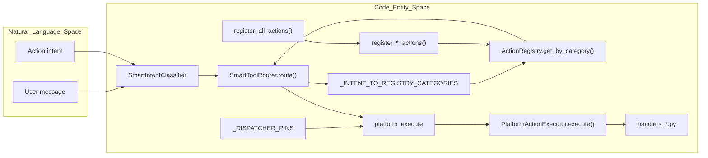
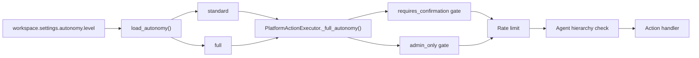

# Platform Action System

Relevant source files

The following files were used as context for generating this wiki page:

- [orchestrator/consumers/chatbot/auto.py](orchestrator/consumers/chatbot/auto.py)
- [orchestrator/consumers/chatbot/intent_classifier.py](orchestrator/consumers/chatbot/intent_classifier.py)
- [orchestrator/consumers/chatbot/smart_tool_router.py](orchestrator/consumers/chatbot/smart_tool_router.py)
- [orchestrator/core/security/driving_user.py](orchestrator/core/security/driving_user.py)
- [orchestrator/core/services/auto_autonomy.py](orchestrator/core/services/auto_autonomy.py)
- [orchestrator/modules/tools/discovery/actions_autonomy.py](orchestrator/modules/tools/discovery/actions_autonomy.py)
- [orchestrator/modules/tools/discovery/handlers_autonomy.py](orchestrator/modules/tools/discovery/handlers_autonomy.py)
- [orchestrator/modules/tools/discovery/platform_actions.py](orchestrator/modules/tools/discovery/platform_actions.py)
- [orchestrator/modules/tools/discovery/platform_executor.py](orchestrator/modules/tools/discovery/platform_executor.py)
- [orchestrator/tests/security/test_nl2sql_tenancy.py](orchestrator/tests/security/test_nl2sql_tenancy.py)
- [orchestrator/tests/security/test_w3_full_autonomy_gate.py](orchestrator/tests/security/test_w3_full_autonomy_gate.py)
- [orchestrator/tests/test_prd232_us001_dispatcher_survives_route.py](orchestrator/tests/test_prd232_us001_dispatcher_survives_route.py)
- [orchestrator/tests/test_prd232_us002_flag_split.py](orchestrator/tests/test_prd232_us002_flag_split.py)
- [orchestrator/tests/test_us014_graph_router_delegation.py](orchestrator/tests/test_us014_graph_router_delegation.py)
- [orchestrator/tests/test_us015_registry_intent_filter.py](orchestrator/tests/test_us015_registry_intent_filter.py)
- [orchestrator/tests/test_w3_auto_autonomy_service.py](orchestrator/tests/test_w3_auto_autonomy_service.py)

## Purpose and Scope

The Platform Action System exposes curated actions that agents can use to inspect and manage Automatos itself. This page covers action definitions and registration, the execution dispatcher and domain handlers, and the `read`, `write`, and `destructive` permission levels. It also describes how chat routing can keep platform actions available and how workspace autonomy affects execution gates. [orchestrator/modules/tools/discovery/platform_actions.py:1-10](), [orchestrator/modules/tools/discovery/platform_executor.py:1-9](), [orchestrator/tests/security/test_w3_full_autonomy_gate.py:1-17]()

Sources: [orchestrator/modules/tools/discovery/platform_actions.py:1-10](), [orchestrator/modules/tools/discovery/platform_executor.py:1-9](), [orchestrator/tests/security/test_w3_full_autonomy_gate.py:1-17]()

---

## Architecture Overview

`ActionDefinition` describes an action, and `ActionRegistry` stores definitions for lookup and filtering. `register_all_actions()` composes registrations from domain-specific modules. During chat tool routing, intent categories can select registry actions dynamically; the `platform_execute` dispatcher is also explicitly pinned so intent filtering does not remove that execution path. [orchestrator/modules/tools/discovery/platform_actions.py:1-10](), [orchestrator/consumers/chatbot/smart_tool_router.py:31-52](), [orchestrator/consumers/chatbot/smart_tool_router.py:111-135]()

### Diagram: Registry and Execution Path — Natural Language to Code Entities

The chat router maps tool-requiring intents to registry categories and pulls matching action names from the registry. Its always-include set includes `platform_execute`; the dispatcher then routes actions to standalone async handler functions. [orchestrator/consumers/chatbot/intent_classifier.py:23-45](), [orchestrator/consumers/chatbot/smart_tool_router.py:31-52](), [orchestrator/consumers/chatbot/smart_tool_router.py:111-135](), [orchestrator/modules/tools/discovery/platform_executor.py:1-9]()

Sources: [orchestrator/consumers/chatbot/intent_classifier.py:23-45](), [orchestrator/consumers/chatbot/smart_tool_router.py:31-52](), [orchestrator/consumers/chatbot/smart_tool_router.py:111-135](), [orchestrator/modules/tools/discovery/platform_executor.py:1-9]()

### Diagram: Intent-to-Action Bridge — Natural Language to Code Entities

`DATA_QUERY` maps to categories including `analytics`, `database`, `graph`, `field`, and `reports`; other intents map to their own category lists. The dispatcher pin is separate from category mapping and keeps `platform_execute` in the router’s always-include set. `list_agents` is imported by the executor as a domain handler. [orchestrator/consumers/chatbot/smart_tool_router.py:31-52](), [orchestrator/consumers/chatbot/smart_tool_router.py:123-135](), [orchestrator/modules/tools/discovery/platform_executor.py:19-29]()

Sources: [orchestrator/consumers/chatbot/smart_tool_router.py:31-52](), [orchestrator/consumers/chatbot/smart_tool_router.py:123-135](), [orchestrator/modules/tools/discovery/platform_executor.py:19-29]()

---

## Core Components

### `ActionDefinition`

`ActionDefinition` represents an individual platform action. Its metadata includes the action name, description, category, parameter schema, permission level, and flags used for confirmation and access control. It also provides an OpenAI function schema conversion method. [orchestrator/modules/tools/discovery/action_registry.py:56-128]()

| Field | Meaning |
|---|---|
| `name` | Action identifier, such as `platform_list_agents`. [orchestrator/modules/tools/discovery/action_registry.py:56-64]() |
| `description` | Action description used as metadata for discovery and tool presentation. [orchestrator/modules/tools/discovery/action_registry.py:56-63]() |
| `category` | Grouping used to organize and retrieve actions. [orchestrator/modules/tools/discovery/action_registry.py:56-63]() |
| `parameters` | Parameter schema for the action. [orchestrator/modules/tools/discovery/action_registry.py:56-64]() |
| `permission_level` | Declared permission tier: `read`, `write`, or `destructive`. [orchestrator/modules/tools/discovery/action_registry.py:56-107]() |
| `requires_confirmation` | Indicates whether the action requires confirmation under the standard autonomy setting. [orchestrator/modules/tools/discovery/action_registry.py:64-66](), [orchestrator/tests/security/test_w3_full_autonomy_gate.py:80-107]() |
| `workspace_scoped` | Indicates workspace scoping for an action. The executor documentation states that queries are workspace-scoped for tenant isolation. [orchestrator/modules/tools/discovery/action_registry.py:64-67](), [orchestrator/modules/tools/discovery/platform_executor.py:5-9]() |
| `admin_only` | Access-control metadata for actions requiring administrative access. [orchestrator/modules/tools/discovery/action_registry.py:65-71](), [orchestrator/tests/security/test_w3_full_autonomy_gate.py:127-153]() |
| `super_admin_only` | Additional administrative restriction metadata. [orchestrator/modules/tools/discovery/action_registry.py:68-72]() |
| `available` | Optional callable used to check whether an action is available. [orchestrator/modules/tools/discovery/action_registry.py:75-98]() |

`to_openai_schema()` converts an action definition into a function-calling schema. [orchestrator/modules/tools/discovery/action_registry.py:119-128]()

Sources: [orchestrator/modules/tools/discovery/action_registry.py:56-128]()

### `ActionRegistry`

`ActionRegistry` stores action definitions by name and supports lookup and filtering, including category-based retrieval used by chat routing. Initialization registers actions through the platform action registration entry point. [orchestrator/modules/tools/discovery/action_registry.py:131-165](), [orchestrator/consumers/chatbot/smart_tool_router.py:31-52]()

The registry-based category mapping makes newly registered actions discoverable to an intent when their category is already mapped, without adding a per-action name to the router. [orchestrator/consumers/chatbot/smart_tool_router.py:31-38](), [orchestrator/tests/test_us015_registry_intent_filter.py:133-160]()

Sources: [orchestrator/modules/tools/discovery/action_registry.py:131-165](), [orchestrator/consumers/chatbot/smart_tool_router.py:31-52](), [orchestrator/tests/test_us015_registry_intent_filter.py:133-160]()

### Registration and Categories

`platform_actions.py` re-exports `register_all_actions()` as the central registration entry point and imports domain-specific registration functions. The visible registrations cover agents, playbooks, analytics, documents, workspace and memory actions, monitoring, search, tools and LLMs, marketplace, skills, assignments, board tasks, scheduling, reports, missions, governance, graph, code graph, channels, autonomy, onboarding, web, socials, and other domains. [orchestrator/modules/tools/discovery/platform_actions.py:1-74]()

`register_all_actions()` calls registrars directly and through helper groupings such as `_register_documents_actions()`, `_register_memory_actions()`, and `_register_observability_actions()`. [orchestrator/modules/tools/discovery/platform_actions.py:76-127]()

Sources: [orchestrator/modules/tools/discovery/platform_actions.py:1-74](), [orchestrator/modules/tools/discovery/platform_actions.py:76-127]()

### Permission Levels (`read`, `write`, `destructive`)

Action definitions declare a `permission_level` of `read`, `write`, or `destructive`. The permission tier is distinct from other gates such as `requires_confirmation` and `admin_only`; the executor tests demonstrate confirmation and admin checks as separate behaviors. [orchestrator/modules/tools/discovery/action_registry.py:56-107](), [orchestrator/tests/security/test_w3_full_autonomy_gate.py:80-153]()

| Level | Intended use |
|---|---|
| `read` | Inspection or retrieval actions that do not modify platform state. [orchestrator/modules/tools/discovery/action_registry.py:56-107]() |
| `write` | State-changing actions that create or update platform resources. A tested example is `platform_update_auto_reporting_prefs`. [orchestrator/tests/security/test_w3_full_autonomy_gate.py:34-37]() |
| `destructive` | Deletion or other high-impact actions. A tested example is `platform_delete_memory`. [orchestrator/tests/security/test_w3_full_autonomy_gate.py:34-37]() |

Under the standard autonomy setting, a `requires_confirmation` action returns a confirmation-required result without invoking its handler. The test suite covers both a write action and a destructive delete configured this way. [orchestrator/tests/security/test_w3_full_autonomy_gate.py:80-93](), [orchestrator/tests/security/test_w3_full_autonomy_gate.py:109-124]()

Sources: [orchestrator/modules/tools/discovery/action_registry.py:56-107](), [orchestrator/tests/security/test_w3_full_autonomy_gate.py:34-37](), [orchestrator/tests/security/test_w3_full_autonomy_gate.py:80-124]()

---

## Execution and Data Flow

### `PlatformActionExecutor` and Handlers

`PlatformActionExecutor` is documented as a thin dispatcher that routes platform actions to standalone async functions in domain-specific `handlers_*.py` modules. The executor imports handler functions across domains, including agent, playbook, analytics, document, workspace, monitoring, marketplace, scheduling, report, and mission operations. [orchestrator/modules/tools/discovery/platform_executor.py:1-9](), [orchestrator/modules/tools/discovery/platform_executor.py:19-42](), [orchestrator/modules/tools/discovery/platform_executor.py:52-95](), [orchestrator/modules/tools/discovery/platform_executor.py:108-175]()

The executor’s documented tenancy contract is that queries are workspace-scoped. This is the isolation boundary stated in the module documentation; the supplied excerpt does not show individual handler query implementations. [orchestrator/modules/tools/discovery/platform_executor.py:5-9]()

Sources: [orchestrator/modules/tools/discovery/platform_executor.py:1-9](), [orchestrator/modules/tools/discovery/platform_executor.py:19-42](), [orchestrator/modules/tools/discovery/platform_executor.py:52-95](), [orchestrator/modules/tools/discovery/platform_executor.py:108-175]()

### Diagram: Action Execution and Workspace Scope

```mermaid
flowchart LR
    ToolCall["platform_execute action call"]
    Registry["ActionRegistry.get()"]
    Definition["ActionDefinition"]
    PermissionGate["Permission and confirmation gates"]
    RateLimit["check_rate_limit"]
    Executor["PlatformActionExecutor.execute()"]
    Handler["Domain handler async function"]
    WorkspaceData["Workspace-scoped data"]

    ToolCall --> Executor
    Executor --> Registry
    Registry --> Definition
    Definition --> PermissionGate
    PermissionGate --> RateLimit
    RateLimit --> Handler
    Handler --> WorkspaceData
```

The executor’s role as dispatcher and the workspace-scoped query contract are documented in its module header. The security tests verify that confirmation and admin gates can prevent handler invocation, and that rate limiting is exercised in the full-autonomy confirmation test path. [orchestrator/modules/tools/discovery/platform_executor.py:1-9](), [orchestrator/tests/security/test_w3_full_autonomy_gate.py:80-107](), [orchestrator/tests/security/test_w3_full_autonomy_gate.py:127-153]()

Sources: [orchestrator/modules/tools/discovery/platform_executor.py:1-9](), [orchestrator/tests/security/test_w3_full_autonomy_gate.py:80-107](), [orchestrator/tests/security/test_w3_full_autonomy_gate.py:127-153]()

---

## Discovery and Prompt Context

### Registry-Backed Intent Filtering

`SmartToolRouter` maps tool-requiring intents to `ActionRegistry` category names. The router retrieves matching action names from the registry at call time, while keeping `CORE_TOOLS`, suggested tools, and its always-include names in the filtered tool set. [orchestrator/consumers/chatbot/smart_tool_router.py:31-52](), [orchestrator/consumers/chatbot/smart_tool_router.py:111-152]()

The `platform_execute` dispatcher is included in `_DISPATCHER_PINS`, which contributes to the router’s always-include set. This prevents intent filtering from stripping the dispatcher when the agent carries it. [orchestrator/consumers/chatbot/smart_tool_router.py:123-135](), [orchestrator/consumers/chatbot/smart_tool_router.py:140-152]()

Sources: [orchestrator/consumers/chatbot/smart_tool_router.py:31-52](), [orchestrator/consumers/chatbot/smart_tool_router.py:111-152]()

### Autonomy and Execution Gates

The workspace autonomy setting is stored as `workspace.settings.autonomy.level`. The supported values are `standard` and `full`; missing, corrupt, or unreadable settings fail safe to `standard`. Public widget turns do not receive full autonomy. [orchestrator/core/services/auto_autonomy.py:1-28](), [orchestrator/core/services/auto_autonomy.py:40-79]()

Under `standard`, confirmation and admin gates remain in effect. Under `full`, the executor skips the confirmation gate and treats Auto as admin for `admin_only` actions. The supplied security test documentation says that rate limits, hierarchy checks, and the destructive backstop are not bypassed; the autonomy setting does not change an action’s `requires_confirmation` flag. [orchestrator/tests/security/test_w3_full_autonomy_gate.py:1-17]()

The autonomy handlers read and write the workspace setting through the canonical `auto_autonomy` service. Setting the level commits the change and logs an audit line containing the workspace, actor agent, previous level, and new level. [orchestrator/modules/tools/discovery/handlers_autonomy.py:1-5](), [orchestrator/modules/tools/discovery/handlers_autonomy.py:31-45](), [orchestrator/modules/tools/discovery/handlers_autonomy.py:48-95]()

Sources: [orchestrator/core/services/auto_autonomy.py:1-28](), [orchestrator/core/services/auto_autonomy.py:40-79](), [orchestrator/tests/security/test_w3_full_autonomy_gate.py:1-17](), [orchestrator/modules/tools/discovery/handlers_autonomy.py:1-5](), [orchestrator/modules/tools/discovery/handlers_autonomy.py:31-95]()

### Diagram: Autonomy Setting to Executor Gates

The autonomy service defines the workspace setting and its fail-safe behavior. The executor security tests specify that full autonomy skips confirmation and bypasses the admin gate, while leaving rate limits and hierarchy checks in place. [orchestrator/core/services/auto_autonomy.py:40-79](), [orchestrator/tests/security/test_w3_full_autonomy_gate.py:1-17]()

Sources: [orchestrator/core/services/auto_autonomy.py:40-79](), [orchestrator/tests/security/test_w3_full_autonomy_gate.py:1-17]()

---