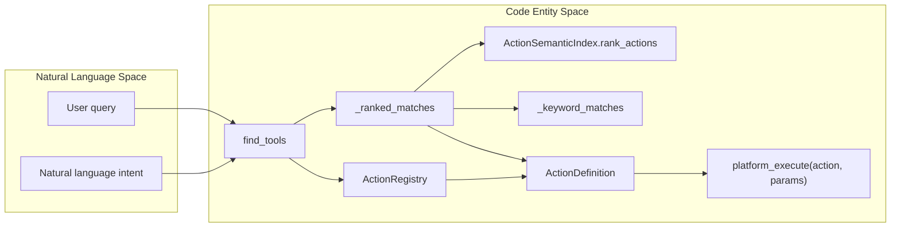
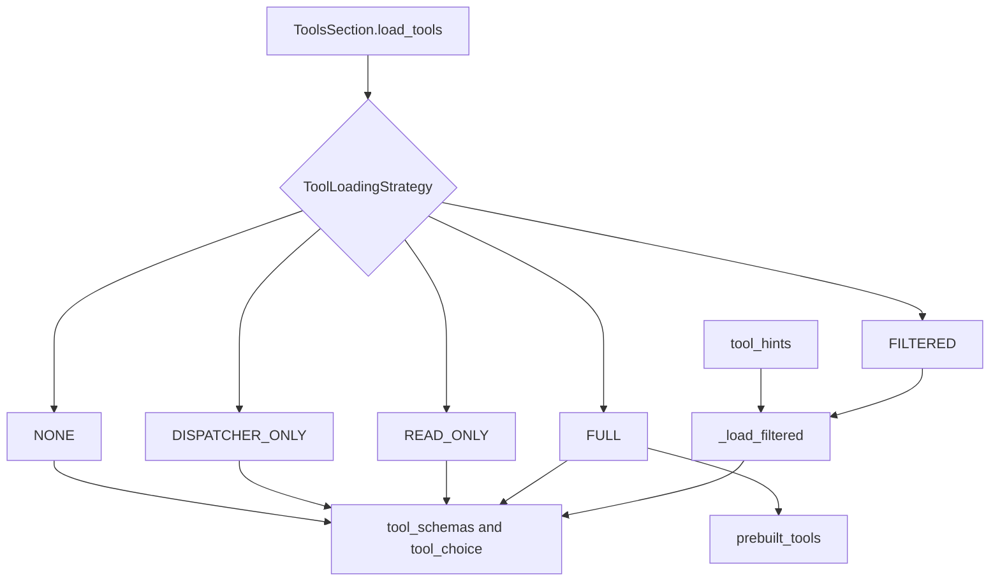
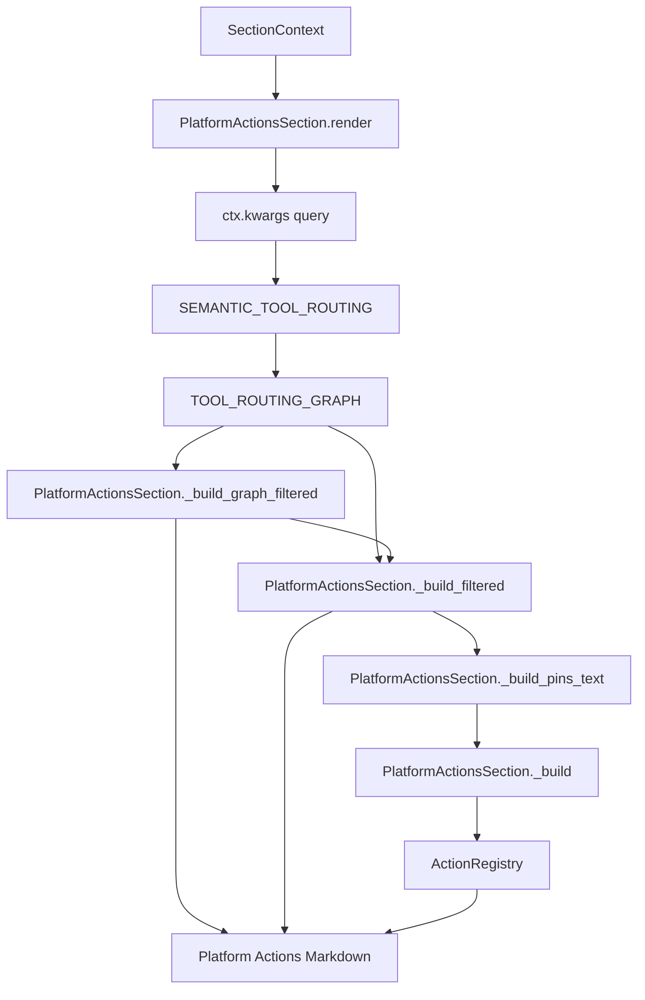

# Platform Actions Discovery

Relevant source files

The following files were used as context for generating this wiki page:

- [orchestrator/modules/context/sections/platform_actions.py](orchestrator/modules/context/sections/platform_actions.py)
- [orchestrator/modules/context/sections/tools.py](orchestrator/modules/context/sections/tools.py)
- [orchestrator/modules/tools/discovery/action_registry.py](orchestrator/modules/tools/discovery/action_registry.py)
- [orchestrator/modules/tools/discovery/action_semantic_index.py](orchestrator/modules/tools/discovery/action_semantic_index.py)
- [orchestrator/modules/tools/discovery/handlers_capabilities.py](orchestrator/modules/tools/discovery/handlers_capabilities.py)
- [orchestrator/modules/tools/tool_router.py](orchestrator/modules/tools/tool_router.py)
- [orchestrator/tests/test_action_registry_filtered.py](orchestrator/tests/test_action_registry_filtered.py)
- [orchestrator/tests/test_action_semantic_index.py](orchestrator/tests/test_action_semantic_index.py)
- [orchestrator/tests/test_identity_section.py](orchestrator/tests/test_identity_section.py)
- [orchestrator/tests/test_platform_actions_section.py](orchestrator/tests/test_platform_actions_section.py)
- [orchestrator/tests/test_platform_actions_section_graph.py](orchestrator/tests/test_platform_actions_section_graph.py)
- [orchestrator/tests/test_prd232_us014_promotion_prior.py](orchestrator/tests/test_prd232_us014_promotion_prior.py)
- [orchestrator/tests/test_skills_section.py](orchestrator/tests/test_skills_section.py)
- [orchestrator/tests/test_tool_router_semantic.py](orchestrator/tests/test_tool_router_semantic.py)
- [orchestrator/tests/test_tool_surface_prb.py](orchestrator/tests/test_tool_surface_prb.py)

## Purpose & Scope

This page describes how platform actions are surfaced for natural-language requests through `find_tools`, how `tool_hints` are passed into tool loading, how `PlatformActionsSection` builds prompt context, and how `ActionSemanticIndex` supports semantic ranking. The supplied code shows the discovery and context-assembly paths, but not where AutoBrain detects platform keywords or produces `tool_hints`; this page therefore documents the observable interfaces without attributing keyword detection to a specific implementation [orchestrator/modules/tools/discovery/handlers_capabilities.py:133-159](), [orchestrator/modules/context/sections/tools.py:64-85](), [orchestrator/modules/context/sections/platform_actions.py:60-87](), [orchestrator/modules/tools/discovery/action_semantic_index.py:113-130]().

Sources: [orchestrator/modules/tools/discovery/handlers_capabilities.py:133-159](), [orchestrator/modules/context/sections/tools.py:64-85](), [orchestrator/modules/context/sections/platform_actions.py:60-87](), [orchestrator/modules/tools/discovery/action_semantic_index.py:113-130]()

---

## 1. Overview

Platform-action discovery connects natural-language queries to registered `ActionDefinition` records. The supplied implementation provides two discovery surfaces: `find_tools`, which returns matching actions and a suggested call form, and `PlatformActionsSection`, which renders an action catalog into prompt context [orchestrator/modules/tools/discovery/handlers_capabilities.py:133-159](), [orchestrator/modules/context/sections/platform_actions.py:60-87]().

An `ActionDefinition` describes an operation using its name, description, category, parameter schema, permission level, and other metadata. `ActionRegistry` stores definitions and lazily registers platform and workspace actions on first access [orchestrator/modules/tools/discovery/action_registry.py:56-79](), [orchestrator/modules/tools/discovery/action_registry.py:138-158]().

### Natural-language request to code entities

**Diagram: Query discovery and catalog entities**

`find_tools` validates the query, obtains eligible actions from the registry, attempts semantic ranking, and falls back to token overlap when semantic ranking cannot provide matches. Its results include a `platform_execute` call form [orchestrator/modules/tools/discovery/handlers_capabilities.py:40-54](), [orchestrator/modules/tools/discovery/handlers_capabilities.py:93-117](), [orchestrator/modules/tools/discovery/handlers_capabilities.py:133-159]().

Sources: [orchestrator/modules/tools/discovery/action_registry.py:56-79](), [orchestrator/modules/tools/discovery/action_registry.py:138-158](), [orchestrator/modules/tools/discovery/handlers_capabilities.py:40-54](), [orchestrator/modules/tools/discovery/handlers_capabilities.py:93-117](), [orchestrator/modules/tools/discovery/handlers_capabilities.py:133-159]()

---

## 2. Query Discovery, Keyword Matching, and Tool Hints

### `find_tools` discovery path

`find_tools(db, workspace_id, params)` requires a non-empty `query`. It bounds the requested result limit to `1..25`, defaults to 8, and includes compact parameter details unless `include_params` is explicitly false [orchestrator/modules/tools/discovery/handlers_capabilities.py:20-22](), [orchestrator/modules/tools/discovery/handlers_capabilities.py:72-79](), [orchestrator/modules/tools/discovery/handlers_capabilities.py:133-140]().

Before matching, the handler loads workspace-hidden categories and filters the registry to actions that are not admin-only or super-admin-only and are available on the current server. For widget turns, it further restricts eligible actions to those granted by the widget’s scopes [orchestrator/modules/tools/discovery/handlers_capabilities.py:57-69](), [orchestrator/modules/tools/discovery/handlers_capabilities.py:81-90](), [orchestrator/modules/tools/discovery/handlers_capabilities.py:141-147]().

`_ranked_matches` asks `ActionSemanticIndex.rank_actions` for up to the requested limit and maps returned names back to eligible registry entries. If ranking raises or produces no eligible matches, it uses `_keyword_matches`, which scores actions by overlap between query tokens longer than two characters and the lowercased action name, description, and tags [orchestrator/modules/tools/discovery/handlers_capabilities.py:40-54](), [orchestrator/modules/tools/discovery/handlers_capabilities.py:93-117]().

| Stage | Implementation | Result |
|---|---|---|
| Query validation and limit | `find_tools`, `_find_limit` | Rejects an empty query and bounds the result count [orchestrator/modules/tools/discovery/handlers_capabilities.py:72-79](), [orchestrator/modules/tools/discovery/handlers_capabilities.py:133-140](). |
| Eligibility filtering | `_discoverable`, `_for_this_turn` | Excludes privileged, unavailable, hidden, or widget-ungranted actions as applicable [orchestrator/modules/tools/discovery/handlers_capabilities.py:57-69](), [orchestrator/modules/tools/discovery/handlers_capabilities.py:81-90](). |
| Semantic matching | `_ranked_matches` | Uses `ActionSemanticIndex.rank_actions` and maps names to eligible definitions [orchestrator/modules/tools/discovery/handlers_capabilities.py:93-117](). |
| Keyword fallback | `_keyword_matches` | Counts query-token matches in action name, description, and tags [orchestrator/modules/tools/discovery/handlers_capabilities.py:40-54](). |
| Result formatting | `_match_row`, `find_tools` | Returns action metadata, permission level, call form, and optionally compact parameters [orchestrator/modules/tools/discovery/handlers_capabilities.py:24-37](), [orchestrator/modules/tools/discovery/handlers_capabilities.py:119-159](). |

Sources: [orchestrator/modules/tools/discovery/handlers_capabilities.py:20-22](), [orchestrator/modules/tools/discovery/handlers_capabilities.py:24-37](), [orchestrator/modules/tools/discovery/handlers_capabilities.py:40-54](), [orchestrator/modules/tools/discovery/handlers_capabilities.py:57-90](), [orchestrator/modules/tools/discovery/handlers_capabilities.py:93-159]()

### `tool_hints` and tool loading

`ToolsSection.load_tools` accepts `tool_hints` alongside `intent_result`, `query`, and other context inputs. For the `FILTERED` strategy, it forwards `tool_hints` to `_load_filtered` [orchestrator/modules/context/sections/tools.py:64-75](), [orchestrator/modules/context/sections/tools.py:109-119]().

The section defines five strategies: `FULL`, `FILTERED`, `DISPATCHER_ONLY`, `READ_ONLY`, and `NONE`. `NONE` returns no tools with `tool_choice="none"`; `DISPATCHER_ONLY` loads the dispatcher schema; `READ_ONLY` uses its read-only loader; and `FULL` and `FILTERED` use their respective helper paths. Errors are caught and return an empty tool list with `tool_choice="auto"` [orchestrator/modules/context/sections/tools.py:32-41](), [orchestrator/modules/context/sections/tools.py:87-134]().

The supplied code establishes `tool_hints` as an input to tool loading, not how AutoBrain detects platform keywords or constructs the hints. The caller and hint-generation path are not present in the supplied excerpts [orchestrator/modules/context/sections/tools.py:64-75](), [orchestrator/modules/context/sections/tools.py:109-119]().

**Diagram: Context tool-loading strategies**

In the filtered branch, `tool_hints` are passed to `_load_filtered`. In the full branch, non-empty `prebuilt_tools` are authoritative; otherwise the section can rebuild tools [orchestrator/modules/context/sections/tools.py:75-85](), [orchestrator/modules/context/sections/tools.py:94-118]().

Sources: [orchestrator/modules/context/sections/tools.py:32-41](), [orchestrator/modules/context/sections/tools.py:64-85](), [orchestrator/modules/context/sections/tools.py:87-134]()

---

## 3. `PlatformActionsSection` Context Section

`PlatformActionsSection` is a priority-5 context section that renders a Markdown catalog of available `platform_execute` actions. It delegates catalog formatting to `ActionRegistry` and may use semantic or graph routing to narrow the catalog when a query is supplied [orchestrator/modules/context/sections/platform_actions.py:1-18](), [orchestrator/modules/context/sections/platform_actions.py:60-76]().

### Rendering flow and decision tree

`render(ctx)` derives context-mode tool exclusions and workspace-hidden categories. Widget turns take a separate `_build_widget` path. For other turns, it reads a string query from `ctx.kwargs["query"]` [orchestrator/modules/context/sections/platform_actions.py:78-112]().

When a query exists and semantic routing is enabled, `_routed` tries graph routing when enabled, then falls back to embedding-based filtering. If routing does not return a catalog, the renderer may try the closed-pins fallback; otherwise, it builds the regular catalog. An exception in the render path is logged and degrades to an empty string [orchestrator/modules/context/sections/platform_actions.py:113-132](), [orchestrator/modules/context/sections/platform_actions.py:138-153]().

| Condition | Behavior |
|---|---|
| Widget turn | Render through `_build_widget` [orchestrator/modules/context/sections/platform_actions.py:102-105](). |
| Query and semantic routing enabled | Try `_routed`; use its result when available [orchestrator/modules/context/sections/platform_actions.py:107-116](). |
| Graph routing enabled | Try `_build_graph_filtered`; on failure, continue to embedding routing [orchestrator/modules/context/sections/platform_actions.py:138-153](). |
| No routed result, closed-pins fallback enabled | Try `_build_pins_text` [orchestrator/modules/context/sections/platform_actions.py:118-125](). |
| No narrowed result | Build the regular catalog with applicable exclusions [orchestrator/modules/context/sections/platform_actions.py:127](). |
| Render raises | Log the failure and return an empty string [orchestrator/modules/context/sections/platform_actions.py:128-132](). |

The catalog preamble instructs the model to use `platform_execute(action, params)` for listed actions and distinguishes them from tools that have their own function schemas [orchestrator/modules/context/sections/platform_actions.py:155-159]().

### Natural-language query to prompt catalog

**Diagram: `PlatformActionsSection.render` routing**

Sources: [orchestrator/modules/context/sections/platform_actions.py:1-18](), [orchestrator/modules/context/sections/platform_actions.py:60-76](), [orchestrator/modules/context/sections/platform_actions.py:78-159]()

---

## 4. `ActionSemanticIndex` and Semantic Ranking

`ActionSemanticIndex` is a per-process semantic index over platform `ActionDefinition` records. Its constructor creates an embedding manager, obtains a cache service and action registry, and initializes per-process embedding state [orchestrator/modules/tools/discovery/action_semantic_index.py:113-136]().

The index is designed to reuse provider-agnostic embeddings and a per-text cache rather than introducing custom blob storage or a hardcoded model [orchestrator/modules/tools/discovery/action_semantic_index.py:1-7](), [orchestrator/modules/tools/discovery/action_semantic_index.py:113-136]().

### Ranking inputs and request scope

`_collect_enum_values` flattens enum values from object properties and array-item schemas, deduplicating them while preserving order [orchestrator/modules/tools/discovery/action_semantic_index.py:143-161]().

`rank_actions_scope()` installs a fresh per-request `ContextVar` dictionary and restores the previous value when the scope ends. The code documents that the scope lets ranking calls within a turn share computed results, while the fresh dictionary limits that memoization to the request [orchestrator/modules/tools/discovery/action_semantic_index.py:26-55]().

The index reads optional relevance-floor and promotion-boost configuration lazily. `_apply_relevance_floor` preserves candidate order while dropping scores below the configured absolute floor or, where applicable, the best-score ratio floor [orchestrator/modules/tools/discovery/action_semantic_index.py:57-82](), [orchestrator/modules/tools/discovery/action_semantic_index.py:85-110]().

| Concern | Symbol | Role |
|---|---|---|
| Action source | `ActionRegistry` | Supplies registered `ActionDefinition` records [orchestrator/modules/tools/discovery/action_semantic_index.py:21-22](), [orchestrator/modules/tools/discovery/action_semantic_index.py:113-123](). |
| Parameter vocabulary | `_collect_enum_values` | Collects property and array-item enum values [orchestrator/modules/tools/discovery/action_semantic_index.py:143-161](). |
| Per-turn memo scope | `rank_actions_scope` | Installs and resets per-request ranking state [orchestrator/modules/tools/discovery/action_semantic_index.py:26-55](). |
| Relevance threshold | `_apply_relevance_floor` | Applies configured score cutoffs to sorted candidates [orchestrator/modules/tools/discovery/action_semantic_index.py:85-110](). |
| Embedding dependencies | `create_embedding_manager`, `get_cache_service` | Provide embedding and cached-vector services to the index [orchestrator/modules/tools/discovery/action_semantic_index.py:113-123](). |

Sources: [orchestrator/modules/tools/discovery/action_semantic_index.py:1-7](), [orchestrator/modules/tools/discovery/action_semantic_index.py:21-22](), [orchestrator/modules/tools/discovery/action_semantic_index.py:26-110](), [orchestrator/modules/tools/discovery/action_semantic_index.py:113-161]()

---

## 5. Registry, Dispatcher Narrowing, and Discovery Boundaries

### `ActionRegistry` and `ActionDefinition`

`ActionDefinition` represents a platform operation and includes its name, description, category, parameter schema, permission level, confirmation requirements, workspace scope, administrative flags, tags, examples, and optional availability check. `to_openai_schema()` serializes the definition as a function schema [orchestrator/modules/tools/discovery/action_registry.py:56-79](), [orchestrator/modules/tools/discovery/action_registry.py:119-128]().

`ActionRegistry` is a thread-safe registry whose actions are registered at startup or lazily loaded on first access. Its initializer imports the platform action registrar and registers platform and workspace actions [orchestrator/modules/tools/discovery/action_registry.py:51-54](), [orchestrator/modules/tools/discovery/action_registry.py:138-158]().

### Dispatcher loading

`ToolsSection`’s `DISPATCHER_ONLY` branch calls `_load_dispatcher_only`, which is documented as returning only the `platform_execute` dispatcher schema. When a query is supplied and semantic routing is on, the loader narrows the dispatcher’s action enum and falls back to the full enum on error [orchestrator/modules/context/sections/tools.py:94-98](), [orchestrator/modules/context/sections/tools.py:140-152]().

The loader obtains the action registry and workspace-hidden categories, then imports `_narrow_dispatcher_actions_async` and the shared dispatcher-inclusion helper [orchestrator/modules/context/sections/tools.py:153-167]().

### Discovery safeguards

Action discovery does not itself authorize execution. The capability handler excludes admin-only and super-admin-only actions from its advertised discovery set and filters unavailable or workspace-hidden actions. Widget discovery is additionally constrained by granted tool scopes [orchestrator/modules/tools/discovery/handlers_capabilities.py:57-90]().

`ActionDefinition.is_available()` returns true when no availability callback is configured; if a callback raises, it logs a warning and returns false. The capability handler uses `action_is_available` while building its discoverable set [orchestrator/modules/tools/discovery/action_registry.py:110-135](), [orchestrator/modules/tools/discovery/handlers_capabilities.py:57-69]().

Sources: [orchestrator/modules/tools/discovery/action_registry.py:51-54](), [orchestrator/modules/tools/discovery/action_registry.py:56-79](), [orchestrator/modules/tools/discovery/action_registry.py:110-158](), [orchestrator/modules/context/sections/tools.py:94-98](), [orchestrator/modules/context/sections/tools.py:140-167](), [orchestrator/modules/tools/discovery/handlers_capabilities.py:57-90]()

---