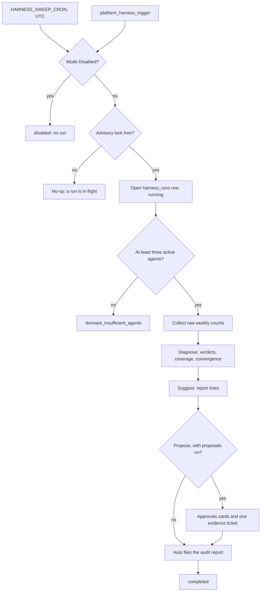

# Self-Management Harness

Relevant source files

- [orchestrator/services/harness_service.py](orchestrator/services/harness_service.py)
- [orchestrator/services/harness_mode.py](orchestrator/services/harness_mode.py)
- [orchestrator/services/harness_runs.py](orchestrator/services/harness_runs.py)
- [orchestrator/services/harness_metrics.py](orchestrator/services/harness_metrics.py)
- [orchestrator/services/harness_diagnose.py](orchestrator/services/harness_diagnose.py)
- [orchestrator/services/harness_grants.py](orchestrator/services/harness_grants.py)
- [orchestrator/services/harness_cards.py](orchestrator/services/harness_cards.py)
- [orchestrator/core/stats/harness_verdicts.py](orchestrator/core/stats/harness_verdicts.py)
- [orchestrator/core/models/harness.py](orchestrator/core/models/harness.py)
- [orchestrator/api/harness.py](orchestrator/api/harness.py)
- [orchestrator/modules/tools/discovery/actions_harness.py](orchestrator/modules/tools/discovery/actions_harness.py)
- [orchestrator/modules/tools/discovery/handlers_harness.py](orchestrator/modules/tools/discovery/handlers_harness.py)
- [orchestrator/core/services/auto_cadence.py](orchestrator/core/services/auto_cadence.py)
- [orchestrator/scripts/harness_backfill_runs.py](orchestrator/scripts/harness_backfill_runs.py)
- [frontend/components/settings/harness-settings-section.tsx](frontend/components/settings/harness-settings-section.tsx)
- [frontend/components/activity/widgets/self-learning-health-widget.tsx](frontend/components/activity/widgets/self-learning-health-widget.tsx)

HARNESS is the weekly review of a workspace's agents. Once a week it reads what each agent actually did, judges each agent against its own recent weeks, and files an audit report from Auto. By default it is **report only**: it changes no agent setting, creates no Task and raises no approval. Its suggestions are lines of the report, and acting on them is the owner's call (PRD-263). A workspace set to **Propose** gets its suggested changes as Approvals cards instead, and a change applies only on the owner's click (see [Propose: Approvals cards](#propose-approvals-cards)).

Sources:
- [orchestrator/services/harness_service.py]()
- [orchestrator/services/harness_mode.py]()

## The mode setting

The only per-workspace HARNESS control is its mode, under **Settings > Orchestrator** (`orchestrator.harness.mode` in the workspace settings):

| Mode | What HARNESS does |
|---|---|
| **Report only** (the default) | Runs every week, files the audit report, changes nothing. |
| **Disabled** | Does not run for this workspace. A manual trigger answers that HARNESS is disabled. |
| **Propose** | Raises each change HARNESS suggests as an Approvals card, and changes nothing until the owner approves it. Cards appear only while the installation setting `HARNESS_SELF_MANAGEMENT_ENABLED` is on; with it off, a Propose workspace runs exactly like Report only. |

There is no on/off switch and no schedule select. A value stored before PRD-263 is read, never rewritten: `full_auto` and `manual` read as Report only, and the retired `disabled: true` or `enabled: false` reads as Disabled ([orchestrator/services/harness_mode.py]()). The Settings API accepts only `report_only`, `propose` and `disabled`.

## When it runs

One scheduler job sweeps every active workspace whose mode is not Disabled, on the cron in the installation setting `HARNESS_SWEEP_CRON`, read in UTC. The default, `0 10 * * 1`, is Monday 10:00 UTC: a weekday daytime hour, outside the night window. The day and hour are an installation setting, not a workspace one.

A run judges the **last complete ISO week** (its `cur_window`, for example `2026-W42`). Each run takes its workspace's Postgres advisory lock first, so whatever the worker or replica count, one workspace has one run at a time; a run that finds the lock held does nothing. The sweep also skips a workspace whose judged week already has a completed or dormant run, so a week is judged once. Auto's `platform_harness_trigger` starts a run at once; it is exempt from the once-a-week skip, and a rerun of a week already judged keeps that week's verdicts.

Sources:
- [orchestrator/services/harness_runs.py]()

## What a run does

1. **Dormancy.** A workspace with fewer than three active agents is `dormant_insufficient_agents`, and the run stops there.
2. **Collect.** One workspace-bound read of the tables that record each agent's work (Tasks done and failed, model usage, heartbeat outcomes, Mission steps, production tool calls) returns raw weekly counts for the judged week and the weeks before it. An agent with no rows has n = 0, never 0% ([orchestrator/services/harness_metrics.py]()).
3. **Diagnose.** Each agent and metric is judged against a clean reference: the `HARNESS_REF_DAYS` before the judged week, less weeks already flagged and weeks after a change. Every threshold is a `HARNESS_*` setting in `config.py`, with Benjamini-Hochberg across the run.
4. **Suggest.** One registry defines every kind of change HARNESS may suggest ([orchestrator/services/harness_changes.py]()). Each agent's tool failures in the judged week are judged on production tool logs; when sign-in or connection errors carry the flag, the report says "reconnect &lt;app&gt;". An enabled heartbeat that rarely met its objective in the judged week (at least `HARNESS_HEARTBEAT_MIN_RUNS` runs with an outcome, and even allowing for chance fewer than `HARNESS_HEARTBEAT_MAX_MET` of them met it; runs that reported nothing to judge are not counted) gets a suggestion to double its interval, up to 1,440 minutes. A suggestion that is invalid, or that names the workspace's Auto, is dropped and its reason kept on the run's row. Suggestions are report lines; in a Propose workspace a change HARNESS may apply also becomes an Approvals card (below).
5. **Report.** Auto files the audit report ("HARNESS Weekly Org Review — Run #n") in Reports, with the coverage, each agent's verdicts and the suggested changes under "Suggested changes (reported only; nothing was changed)".

### The four verdicts

| Verdict | Meaning |
|---|---|
| `INSUFFICIENT_DATA` | Fewer than `HARNESS_MIN_SAMPLES` in the judged week or its reference: too little work to judge. Never called stable. |
| `STABLE` | Judged, and no metric worsened beyond the thresholds. |
| `WATCH` | A first flag: the metric worsened this week. |
| `REGRESSION` | Flagged in two consecutive ISO weeks, or once with p below `HARNESS_STRONG_P`. |

### Coverage and convergence

**Coverage** is the agents judged over the active agents (Auto is not counted). Below `HARNESS_MIN_COVERAGE` the run's convergence reads `insufficient_data`; otherwise it reads `regression` if any agent is in REGRESSION, `watching` if any is in WATCH, and `steady` if not. On fake or light traffic, expect a high INSUFFICIENT_DATA share.

Sources:
- [orchestrator/services/harness_diagnose.py]()
- [orchestrator/core/stats/harness_verdicts.py]()

## Status and the run record

Every run is one `harness_runs` row: its judged week, start and finish, status, iteration (completed runs so far), coverage, the verdict counts, its suggestions, the audit report and whether the report was filed. Nothing is written to the workspace volume. `get_status` reads the latest row and returns one of:

- `running`: a run holds the workspace's lock;
- `disabled`: the workspace's mode is Disabled;
- `failed`: the latest run failed, or was left unfinished (`interrupted`), with its `error`;
- `dormant_insufficient_agents`: too few active agents;
- `scheduled_not_run_yet`: no run yet, with `next_scheduled_run`;
- `completed`: with `iteration_count`, `cur_window`, coverage, convergence, the INSUFFICIENT_DATA, WATCH and REGRESSION counts, `last_run_at` and `artifacts.audit_report`.

History from before PRD-263, kept as JSON files under `<WORKSPACE_VOLUME_PATH>/<ws>/harness`, is imported once by `scripts/harness_backfill_runs.py`, which Gerard runs. It inserts one row per workspace and week that has none, defaults to a dry run (`--apply` writes), never writes a file, and `--summary-only` prints totals that name no workspace. Imported rows carry no coverage or verdicts: the old loop's judgement is not something DIAGNOSE reads. Once the history is in, `--remove-files` (with `--apply`) deletes each workspace's `harness/` JSON files, and only when that workspace's import count verifies: every ISO week its files hold has a `harness_runs` row, read back after the import. A workspace that does not verify keeps its files and is counted; that count must be 0. Symbolic links are never followed or removed.

### Status diagram

## How Auto and the owner see it

- **`platform_harness_status`** returns the state above. Auto never calls an unjudged agent stable.
- **`platform_harness_history`** lists past runs, newest first, from `harness_runs`: the week judged, status, iteration, coverage, convergence, the verdict counts, how many changes each report suggested and how many the run applied itself (0 for every report-only run; a run imported from before PRD-263 shows what the old loop applied).
- **`platform_harness_trigger`** starts a run now, or says the workspace is disabled.
- **`platform_harness_apply`** makes one HARNESS change its owner approved on the change's Approvals card, and it is the only HARNESS code that changes an agent setting. It acts only while that approval is granted and unexpired, and only if the setting still reads the value it had when HARNESS proposed the change; otherwise the change's ledger row ends `expired` or `drifted` and nothing changes. A call with no granted approval, from chat or a heartbeat, changes nothing. The change runs as the workspace's Auto, so the hierarchy check, the rate limit and the destructive backstop run on it. Each proposal's row ends in one recorded state: the start of every run and a daily sweep (`HARNESS_GRANT_SWEEP_CRON`, UTC) close declined, withdrawn, lapsed and drifted approvals, and fail a clicked one that recorded no outcome within `HARNESS_RECONCILE_GRACE_MINUTES`.
- **The Weekly HARNESS Review** cadence (opt-in, on Auto's heartbeat) tells Auto to read the status, wait when this week's run has not happened yet (`scheduled_not_run_yet`, or a `cur_window` other than the week it names), pull the audit report and send the owner a short summary: coverage and the INSUFFICIENT_DATA, WATCH and REGRESSION counts. It names no day or time.
- **The Command Center Self-Learning tile** reads `GET /api/harness/self-learning`: the latest run's status, iteration, coverage and verdict counts, the workspace's mode, this workspace's production tool calls over the last 7 days, and how many of HARNESS's Approvals cards are pending, applied, declined and expired (a waiting card whose approval has lapsed counts as expired before the sweep closes it). Any member of the workspace may read it; it returns counts only, never grant text, and writes nothing. A figure the backend does not have shows "—".

Sources:
- [orchestrator/modules/tools/discovery/actions_harness.py]()
- [orchestrator/modules/tools/discovery/handlers_harness.py]()
- [orchestrator/core/services/auto_cadence.py]()
- [orchestrator/api/harness.py]()

## Propose: Approvals cards

In a workspace set to **Propose**, while the installation setting `HARNESS_SELF_MANAGEMENT_ENABLED` is on (it is off by default), each valid change of a kind HARNESS may apply becomes an **Approvals card**: a heartbeat interval doubled, a tool taken from an agent, or the undoing of an earlier HARNESS change. Every other suggestion stays a line of the report. HARNESS never proposes a change to the workspace's Auto, and raises no second card for an agent and kind while one is still waiting.

- **Where it appears.** The card is in Command Center > Governance > Approvals and inside the run's **evidence ticket**, and an `approval_pending` notification announces it. The evidence ticket is one board card per run, filed in Review with no agent: it lists each proposal with its numbers and its card. No agent picks it up; approving or cancelling it on the board only closes it.
- **What it says.** Five parts, in order: the change (agent, setting, before → after); why (the counts behind it and how many agents HARNESS judged); what approving does; how a change that goes wrong is undone; and when the card expires.
- **What approving does.** The owner's click runs `platform_harness_apply`, which makes the change as the workspace's Auto, and only if the approval is still live and the setting still reads its value from when HARNESS proposed it. Otherwise nothing changes and the card says why. A second click changes nothing.
- **24 hour expiry.** A card expires 24 hours (`APPROVAL_GRANT_TTL_SECONDS`) after it is raised. After that, approving does nothing, and the daily sweep closes the card within a day. If the evidence still holds, the next run raises a fresh card.
- **Rollback cards.** HARNESS compares a changed agent's next weeks with the weeks before the change, and sends a separate card to undo the change if its Tasks or tool errors get worse. A rollback is never itself rolled back.
- **A Blocked evidence ticket.** Dragging the evidence ticket to Blocked stops its cards: approving one changes nothing, and its proposal is recorded as failed ("evidence card was blocked; nothing changed").
- **No memory.** Approving or declining a HARNESS card writes no decision memory: the HARNESS ledger and the audit rows are the record.

Every proposal's ledger row ends in one recorded state: `applied`, `failed`, `denied`, `expired`, `drifted`, `withdrawn`, `raise_failed` or `rolled_back`.

Sources:
- [orchestrator/services/harness_grants.py]()
- [orchestrator/services/harness_cards.py]()
- [orchestrator/services/click_memory.py]()

## Idle-in-Transaction Prevention

A run commits its session before each phase (`end_open_transaction(db)`), so the connection never sits idle in a transaction across a phase's long awaits. The `test_w1s9_idle_in_tx.py` suite checks that the commit happens between the database reads and the awaits that follow them.

Sources:
- [orchestrator/tests/test_w1s9_idle_in_tx.py]()

## Knowledge Graph Single Store and Heartbeat

While the HARNESS service itself is distinct from the Knowledge Graph, it interacts with the platform's self-learning and monitoring mechanisms. The `primitive_heartbeat.py` module provides a stateless helper, `_emit_graph_primitive`, to report the health status of the Knowledge Graph build process to the `HeartbeatService` [orchestrator/modules/knowledge/primitive_heartbeat.py:1-23]().

This helper emits a "green" status on successful graph builds/imports and a "down" status with error details on failures [orchestrator/modules/knowledge/primitive_heartbeat.py:34-38,52-54](). This ensures that the health of the Knowledge Graph, a critical component for agent intelligence, is continuously monitored and reported, contributing to the overall self-management and observability of the platform.

Sources:
- [orchestrator/modules/knowledge/primitive_heartbeat.py:1-65]()
- [orchestrator/tests/test_graph_single_store.py:1-75]()

---
