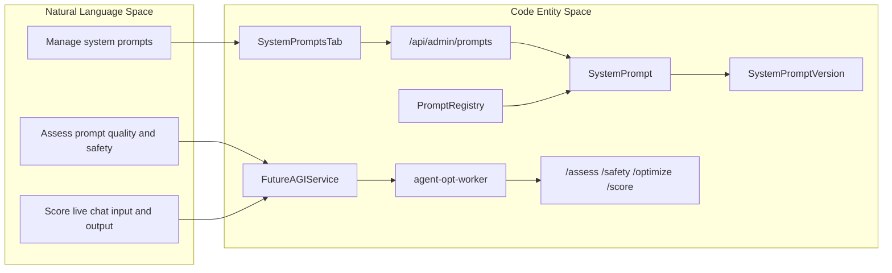
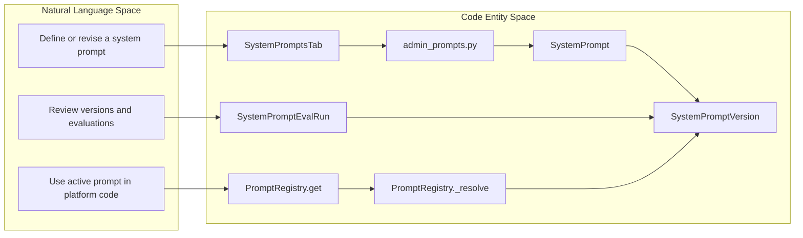

# Prompt Optimization & System Prompts

Relevant source files

The following files were used as context for generating this wiki page:

- [frontend/components/settings/SystemPromptsTab.tsx](frontend/components/settings/SystemPromptsTab.tsx)
- [orchestrator/api/admin_prompts.py](orchestrator/api/admin_prompts.py)
- [orchestrator/core/models/system_prompts.py](orchestrator/core/models/system_prompts.py)
- [orchestrator/core/seeds/seed_system_prompts.py](orchestrator/core/seeds/seed_system_prompts.py)
- [orchestrator/core/services/futureagi_service.py](orchestrator/core/services/futureagi_service.py)
- [orchestrator/core/services/prompt_registry.py](orchestrator/core/services/prompt_registry.py)
- [orchestrator/tests/test_httpx_request_urls_are_never_logged.py](orchestrator/tests/test_httpx_request_urls_are_never_logged.py)
- [services/agent-opt-worker/automatos_logging.py](services/agent-opt-worker/automatos_logging.py)
- [services/agent-opt-worker/automatos_metrics.py](services/agent-opt-worker/automatos_metrics.py)
- [services/agent-opt-worker/main.py](services/agent-opt-worker/main.py)
- [services/media-render/.dockerignore](services/media-render/.dockerignore)
- [services/media-render/automatos_logging.py](services/media-render/automatos_logging.py)
- [services/media-render/kokoro/SHA256SUMS](services/media-render/kokoro/SHA256SUMS)
- [services/shared/automatos_logging.py](services/shared/automatos_logging.py)
- [services/shared/automatos_metrics.py](services/shared/automatos_metrics.py)
- [services/workspace-worker/automatos_logging.py](services/workspace-worker/automatos_logging.py)
- [services/workspace-worker/automatos_metrics.py](services/workspace-worker/automatos_metrics.py)

## Purpose & Scope

This parent page introduces the system prompt registry and FutureAGI-powered prompt assessment, safety checks, optimization, and scoring. The orchestrator manages prompt data and communicates with an isolated worker that handles FutureAGI operations. [orchestrator/core/services/futureagi_service.py:1-14](), [services/agent-opt-worker/main.py:1-20]()

For implementation details, see:
- [System Prompt Management](#15.1) — `SystemPromptsTab`, prompt models and registry, seeds, versioning, and admin API.
- [Prompt Evaluation & Live Scoring](#15.2) — Assessment runs, quality metrics, concurrent scoring, and live-traffic scoring.
- [Agent-Opt Worker Service](#15.3) — Worker isolation, FutureAGI SDK integration, endpoints, logging, and metrics.

Sources: [orchestrator/core/services/futureagi_service.py:1-14](), [services/agent-opt-worker/main.py:1-20]()

## Architecture & System Overview

Prompts have stable slugs and versioned content. `PromptRegistry` resolves prompt content for platform use, while `SystemPromptsTab` provides an admin interface for prompt and assessment data. The orchestrator’s `FutureAGIService` routes FutureAGI operations to the worker, keeping the SDK outside the orchestrator. [orchestrator/core/models/system_prompts.py:32-38](), [orchestrator/core/services/prompt_registry.py:35-42](), [frontend/components/settings/SystemPromptsTab.tsx:101-115](), [orchestrator/core/services/futureagi_service.py:1-14]()

**Diagram: Prompt Registry and Worker at a Glance**

Sources: [frontend/components/settings/SystemPromptsTab.tsx:101-115](), [orchestrator/api/admin_prompts.py:42-62](), [orchestrator/core/models/system_prompts.py:32-38](), [orchestrator/core/models/system_prompts.py:71-98](), [orchestrator/core/services/prompt_registry.py:35-42](), [orchestrator/core/services/futureagi_service.py:1-14](), [services/agent-opt-worker/main.py:9-15]()

### How the Components Relate

`SystemPrompt` identifies a prompt by slug and relates it to version and evaluation records. `PromptRegistry` resolves prompt content for platform use, and `SystemPromptsTab` provides administrative prompt, version, and assessment views. The orchestrator’s `FutureAGIService` is an HTTP client to the worker. [orchestrator/core/models/system_prompts.py:32-68](), [orchestrator/core/services/prompt_registry.py:35-42](), [frontend/components/settings/SystemPromptsTab.tsx:101-115](), [orchestrator/core/services/futureagi_service.py:1-14]()

**Diagram: Prompt Lifecycle from Admin Intent to Runtime Lookup**

Sources: [frontend/components/settings/SystemPromptsTab.tsx:101-115](), [orchestrator/api/admin_prompts.py:5-11](), [orchestrator/core/models/system_prompts.py:32-68](), [orchestrator/core/models/system_prompts.py:71-138](), [orchestrator/core/services/prompt_registry.py:59-80](), [orchestrator/core/services/prompt_registry.py:93-140]()

## 15.1 System Prompt Management

The prompt registry stores named prompts and versioned snapshots. `PromptRegistry` resolves content from its in-memory cache, the database, or hardcoded defaults, and supports variable interpolation. The admin interface is `SystemPromptsTab`; the admin API is mounted under `/api/admin/prompts`. [orchestrator/core/models/system_prompts.py:32-38](), [orchestrator/core/models/system_prompts.py:71-105](), [orchestrator/core/services/prompt_registry.py:59-76](), [orchestrator/core/services/prompt_registry.py:93-115](), [orchestrator/api/admin_prompts.py:42-62](), [frontend/components/settings/SystemPromptsTab.tsx:101-115]()

For details on the model, registry, seeds, version lifecycle, and admin endpoints, see [System Prompt Management](#15.1).

Sources: [orchestrator/core/models/system_prompts.py:32-105](), [orchestrator/core/services/prompt_registry.py:59-115](), [orchestrator/api/admin_prompts.py:42-62](), [frontend/components/settings/SystemPromptsTab.tsx:101-115]()

## 15.2 Prompt Evaluation & Live Scoring

Evaluation records associate runs with prompts and versions, and retain run type, status, scores, and timing. The worker declares endpoints for assessment, safety checks, optimization, and scoring live chat input/output; its template configuration includes quality and safety-oriented metrics. [orchestrator/core/models/system_prompts.py:108-138](), [services/agent-opt-worker/main.py:9-15](), [services/agent-opt-worker/main.py:139-152]()

The orchestrator service describes its role as handling database reads and writes, fire-and-forget dispatch, and dataset collection while routing FutureAGI operations to the worker. For the assessment lifecycle and live-scoring behavior, see [Prompt Evaluation & Live Scoring](#15.2). [orchestrator/core/services/futureagi_service.py:5-14]()

Sources: [orchestrator/core/models/system_prompts.py:108-138](), [services/agent-opt-worker/main.py:9-15](), [services/agent-opt-worker/main.py:139-152](), [orchestrator/core/services/futureagi_service.py:5-14]()

## 15.3 Agent-Opt Worker Service

`services/agent-opt-worker/main.py` defines the isolated FastAPI worker and its FutureAGI operation endpoints. Routes other than health and metrics require an internal token; the worker initializes shared logging and FastAPI metrics. The orchestrator client sends the worker token when configured. [services/agent-opt-worker/main.py:18-51](), [orchestrator/core/services/futureagi_service.py:32-45]()

For worker request and response behavior, SDK integration, deployment, and observability details, see [Agent-Opt Worker Service](#15.3).

Sources: [services/agent-opt-worker/main.py:18-51](), [orchestrator/core/services/futureagi_service.py:32-45]()

---