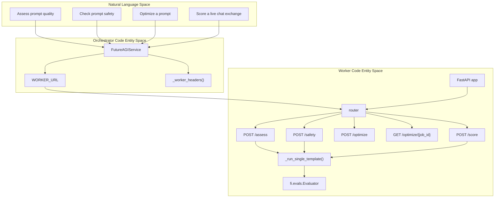
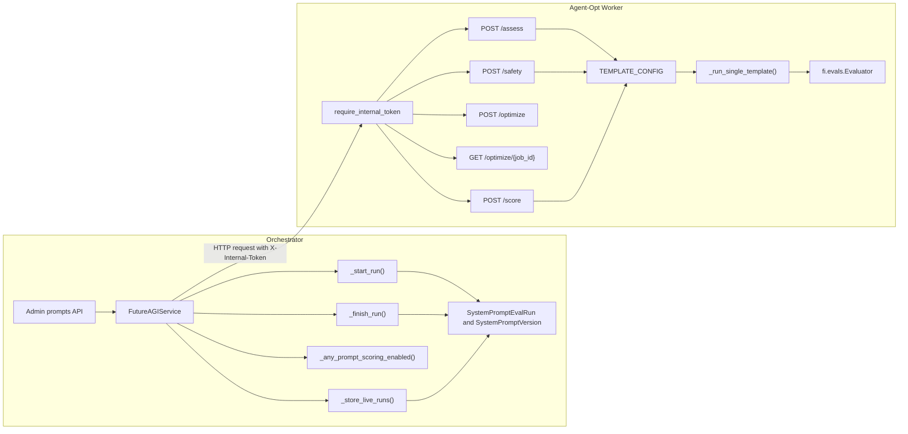
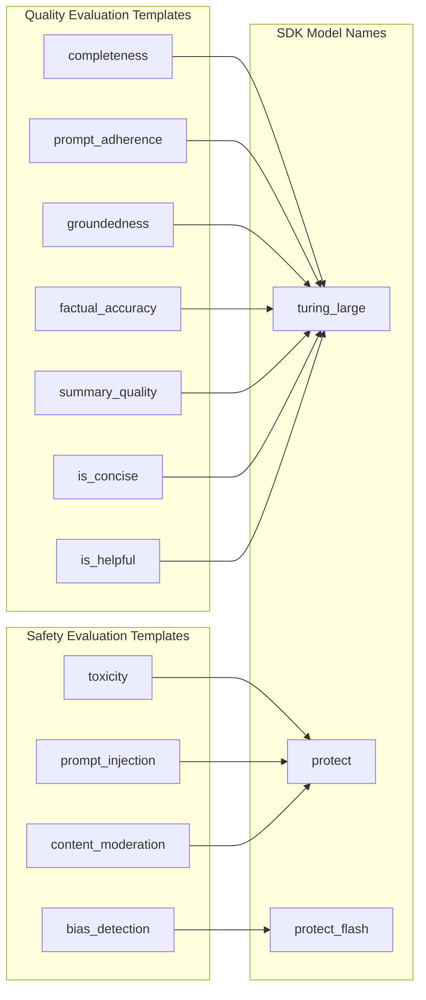

# Agent-Opt Worker Service

Relevant source files

The following files were used as context for generating this wiki page:

- [frontend/components/settings/SystemPromptsTab.tsx](frontend/components/settings/SystemPromptsTab.tsx)
- [orchestrator/api/admin_prompts.py](orchestrator/api/admin_prompts.py)
- [orchestrator/core/models/system_prompts.py](orchestrator/core/models/system_prompts.py)
- [orchestrator/core/seeds/seed_system_prompts.py](orchestrator/core/seeds/seed_system_prompts.py)
- [orchestrator/core/services/futureagi_service.py](orchestrator/core/services/futureagi_service.py)
- [orchestrator/core/services/prompt_registry.py](orchestrator/core/services/prompt_registry.py)
- [orchestrator/tests/test_httpx_request_urls_are_never_logged.py](orchestrator/tests/test_httpx_request_urls_are_never_logged.py)
- [services/agent-opt-worker/automatos_logging.py](services/agent-opt-worker/automatos_logging.py)
- [services/agent-opt-worker/automatos_metrics.py](services/agent-opt-worker/automatos_metrics.py)
- [services/agent-opt-worker/main.py](services/agent-opt-worker/main.py)
- [services/media-render/.dockerignore](services/media-render/.dockerignore)
- [services/media-render/automatos_logging.py](services/media-render/automatos_logging.py)
- [services/media-render/kokoro/SHA256SUMS](services/media-render/kokoro/SHA256SUMS)
- [services/shared/automatos_logging.py](services/shared/automatos_logging.py)
- [services/shared/automatos_metrics.py](services/shared/automatos_metrics.py)
- [services/workspace-worker/automatos_logging.py](services/workspace-worker/automatos_logging.py)
- [services/workspace-worker/automatos_metrics.py](services/workspace-worker/automatos_metrics.py)

## Purpose and Scope

The Agent-Opt Worker Service isolates FutureAGI SDK operations in a dedicated service. The worker is the gateway for prompt assessment, safety checks, asynchronous optimization, and live chat scoring; the orchestrator uses an HTTP client and retains database and dispatch responsibilities [services/agent-opt-worker/main.py:1-20](), [orchestrator/core/services/futureagi_service.py:1-14]().

This page covers the service boundary, SDK integration, advertised HTTP endpoints, orchestrator data flow, and shared observability setup. It does not describe deployment details not present in the provided source excerpts.

Sources: [services/agent-opt-worker/main.py:1-20](), [orchestrator/core/services/futureagi_service.py:1-14]()

---

## Architecture Overview

The worker is a FastAPI application with a protected router for FutureAGI operations. The worker owns SDK calls; the orchestrator’s `FutureAGIService` acts as a thin HTTP client and handles database reads and writes [services/agent-opt-worker/main.py:34-51](), [orchestrator/core/services/futureagi_service.py:5-14]().

### Diagram: Natural Language Space to Code Entity Space — Operation Routing

The worker module documents the operation paths and initializes the app, protected router, and SDK evaluation helper. The orchestrator defines the worker URL and token-header helper [services/agent-opt-worker/main.py:9-20](), [services/agent-opt-worker/main.py:34-51](), [services/agent-opt-worker/main.py:70-85](), [orchestrator/core/services/futureagi_service.py:32-46]().

Sources: [services/agent-opt-worker/main.py:9-20](), [services/agent-opt-worker/main.py:34-51](), [services/agent-opt-worker/main.py:70-85](), [orchestrator/core/services/futureagi_service.py:32-46]()

### Diagram: Service Boundary and Persistence Flow

`_start_run()` reads run and version inputs before a worker call; `_finish_run()` writes the worker result in a new session. Live scoring uses a cached enablement check and stores runs for enabled prompts with active versions [orchestrator/core/services/futureagi_service.py:11-14](), [orchestrator/core/services/futureagi_service.py:84-124](), [orchestrator/core/services/futureagi_service.py:133-181](). The worker declares its protected router and template/evaluation helpers [services/agent-opt-worker/main.py:44-51](), [services/agent-opt-worker/main.py:70-85](), [services/agent-opt-worker/main.py:139-152]().

Sources: [orchestrator/core/services/futureagi_service.py:11-14](), [orchestrator/core/services/futureagi_service.py:84-124](), [orchestrator/core/services/futureagi_service.py:133-181](), [services/agent-opt-worker/main.py:44-51](), [services/agent-opt-worker/main.py:70-85](), [services/agent-opt-worker/main.py:139-152]()

---

## Service Configuration

### Runtime and credentials

`_get_keys()` reads the API key from `FUTUREAGI_API_KEY` or `FI_API_KEY` and the secret from `FUTUREAGI_SECRET_KEY` or `FI_SECRET_KEY`. If either is missing, it raises `ValueError`; otherwise, it sets `FI_API_KEY` and `FI_SECRET_KEY` in the environment so the SDK can detect both credentials [services/agent-opt-worker/main.py:57-67]().

The orchestrator takes its worker URL from `config.AGENT_OPT_WORKER_URL`. `_worker_headers()` returns an `X-Internal-Token` header when `config.AGENT_OPT_WORKER_TOKEN` is configured [orchestrator/core/services/futureagi_service.py:28-46](). The worker applies `require_internal_token` as a dependency on its router; the module documents that startup stops if the internal token is unset or blank [services/agent-opt-worker/main.py:18-20](), [services/agent-opt-worker/main.py:44-48]().

Sources: [services/agent-opt-worker/main.py:18-20](), [services/agent-opt-worker/main.py:44-67](), [orchestrator/core/services/futureagi_service.py:28-46]()

### Evaluation template configuration

`TEMPLATE_CONFIG` associates supported evaluation templates with required input keys and an SDK model name. The worker module notes that requests name known templates, limit entries, and use only the teacher model sent by the platform [services/agent-opt-worker/main.py:139-157]().

| Template | Required input keys | Model |
|---|---|---|
| `completeness` | `input`, `output` | `turing_large` |
| `prompt_adherence` | `input`, `output` | `turing_large` |
| `groundedness` | `input`, `output`, `context` | `turing_large` |
| `factual_accuracy` | `input`, `output` | `turing_large` |
| `summary_quality` | `input`, `output` | `turing_large` |
| `is_concise` | `output` | `turing_large` |
| `is_helpful` | `input`, `output` | `turing_large` |
| `toxicity` | `output` | `protect` |
| `bias_detection` | `output` | `protect_flash` |
| `prompt_injection` | `input` | `protect` |
| `content_moderation` | `output` | `protect` |

Sources: [services/agent-opt-worker/main.py:139-157]()

### Diagram: Template Names Mapped to SDK Models

Template-to-model assignments and required input keys come from `TEMPLATE_CONFIG` [services/agent-opt-worker/main.py:139-152]().

Sources: [services/agent-opt-worker/main.py:139-152]()

---

## HTTP API Endpoints

The worker module documents `/assess`, `/safety`, `/optimize`, `/optimize/{job_id}`, `/score`, `/health`, and `/metrics`. It disables the FastAPI documentation endpoints and attaches `require_internal_token` to the application’s protected router; `/health` and `/metrics` are documented as exceptions to the token requirement [services/agent-opt-worker/main.py:9-20](), [services/agent-opt-worker/main.py:44-51]().

| Method and path | Documented purpose | Authentication |
|---|---|---|
| `POST /assess` | Score a prompt using quality metric templates | Internal token |
| `POST /safety` | Run safety checks on a prompt | Internal token |
| `POST /optimize` | Start asynchronous prompt optimization and return a `job_id` | Internal token |
| `GET /optimize/{job_id}` | Poll optimization status or result | Internal token |
| `POST /score` | Score a live chat input/output pair | Internal token |
| `GET /health` | Health check | Exempt |
| `GET /metrics` | Prometheus metrics | Exempt |

Sources: [services/agent-opt-worker/main.py:9-20](), [services/agent-opt-worker/main.py:44-51]()

### `POST /assess`

The worker describes `/assess` as scoring a prompt with quality metric templates [services/agent-opt-worker/main.py:9-11](). `_run_single_template()` creates an `fi.evals.Evaluator` and calls `evaluate()` with the template, inputs, model name, and a 55-second timeout. It returns an error object when the SDK call raises an exception [services/agent-opt-worker/main.py:70-88]().

The helper checks for absent or empty `eval_results` and parses the first result. Numeric output becomes a float, with `score >= 0.5` treated as passing. String values `Passed` and `Failed` map to `1.0` and `0.0`; other strings are parsed as numbers where possible. Unparseable or unexpected output types default to a failed zero score [services/agent-opt-worker/main.py:90-136]().

Sources: [services/agent-opt-worker/main.py:9-11](), [services/agent-opt-worker/main.py:70-136]()

### `POST /safety`

The worker describes `/safety` as running safety checks on a prompt [services/agent-opt-worker/main.py:10-12](). The template configuration includes `toxicity`, `bias_detection`, `prompt_injection`, and `content_moderation` [services/agent-opt-worker/main.py:139-152]().

Sources: [services/agent-opt-worker/main.py:10-12](), [services/agent-opt-worker/main.py:139-152]()

### `POST /optimize` and `GET /optimize/{job_id}`

The worker documents `POST /optimize` as starting asynchronous prompt optimization and returning a `job_id`; `GET /optimize/{job_id}` is documented for polling optimization status or results [services/agent-opt-worker/main.py:11-13]().

Sources: [services/agent-opt-worker/main.py:11-13]()

### `POST /score`

The worker documents `/score` as scoring a live chat input/output pair [services/agent-opt-worker/main.py:14-15](). The template configuration defines the available templates and their input keys for evaluation [services/agent-opt-worker/main.py:139-152]().

Sources: [services/agent-opt-worker/main.py:14-15](), [services/agent-opt-worker/main.py:139-152]()

### Health and metrics

The worker documents `/health` and `/metrics` as its health-check and Prometheus-metrics endpoints. At startup, it calls `add_fastapi_metrics(app, service="agent-opt-worker")` [services/agent-opt-worker/main.py:15-16](), [services/agent-opt-worker/main.py:50-51]().

Sources: [services/agent-opt-worker/main.py:15-16](), [services/agent-opt-worker/main.py:50-51]()

---

## Orchestrator Integration and Data Flow

`FutureAGIService` defines the worker URL, request timeouts, token-header name, and time-to-live for the cached live-scoring flag. The configured timeouts are 120 seconds for assessment/safety and 300 seconds for optimization [orchestrator/core/services/futureagi_service.py:32-39]().

The orchestrator uses short `get_db_session()` sessions for database operations. `_start_run()` marks an evaluation run as running and reads the prompt-version content and run metadata before the worker call. `_finish_run()` opens a new session to save the result or mark the run failed [orchestrator/core/services/futureagi_service.py:133-155](), [orchestrator/core/services/futureagi_service.py:166-181]().

For live scoring, `_any_prompt_scoring_enabled()` checks whether any `SystemPrompt` has `futureagi_eval_enabled` set. `_store_live_runs()` then creates completed live `SystemPromptEvalRun` records for enabled prompts that have an active version [orchestrator/core/services/futureagi_service.py:84-124]().

Sources: [orchestrator/core/services/futureagi_service.py:32-39](), [orchestrator/core/services/futureagi_service.py:84-124](), [orchestrator/core/services/futureagi_service.py:133-181]()

---

## Shared Logging and Metrics

The worker initializes shared logging with `setup_logging(service="agent-opt-worker")` and obtains a service-specific logger named `agent-opt-worker`. It also attaches FastAPI metrics using `add_fastapi_metrics(app, service="agent-opt-worker")` [services/agent-opt-worker/main.py:37-51]().

The worker’s `automatos_logging.py` copy describes an environment-configured log relay and an asynchronous `LogRelayHandler`. The handler queues structured log entries for background flushing; the queue is bounded, and `emit()` drops an entry rather than blocking when the queue is full [services/agent-opt-worker/automatos_logging.py:1-25](), [services/agent-opt-worker/automatos_logging.py:132-166](). Its structured context includes standard location fields and recognized extras such as `request_id`, `workspace_id`, `trace_id`, `duration_ms`, and `job_id` [services/agent-opt-worker/automatos_logging.py:115-125](), [services/agent-opt-worker/automatos_logging.py:168-190]().

Sources: [services/agent-opt-worker/main.py:37-51](), [services/agent-opt-worker/automatos_logging.py:1-25](), [services/agent-opt-worker/automatos_logging.py:115-125](), [services/agent-opt-worker/automatos_logging.py:132-166](), [services/agent-opt-worker/automatos_logging.py:168-190]()

---