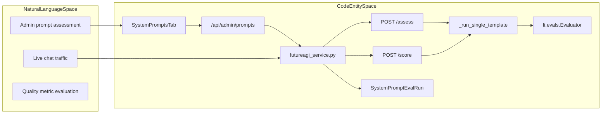
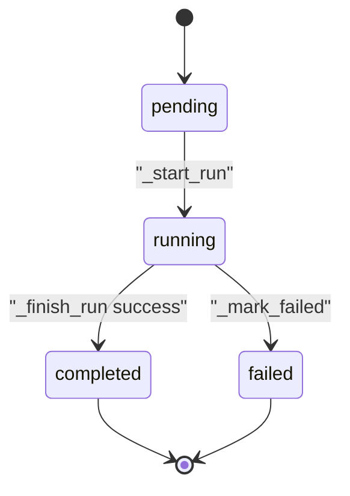
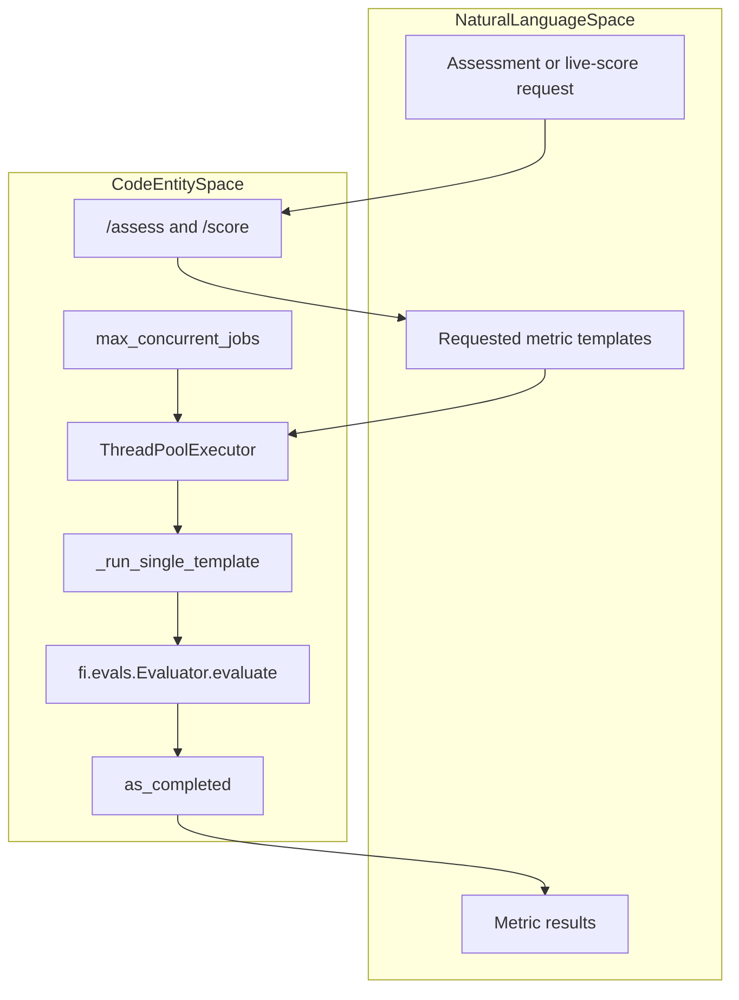
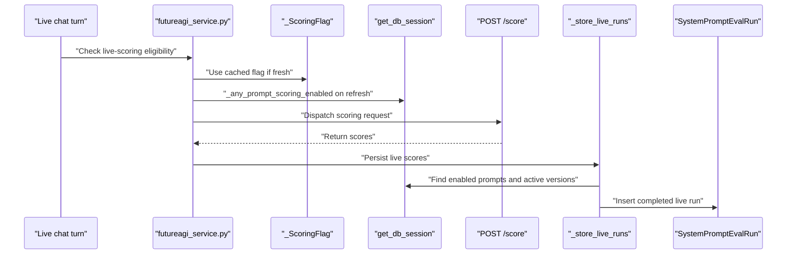
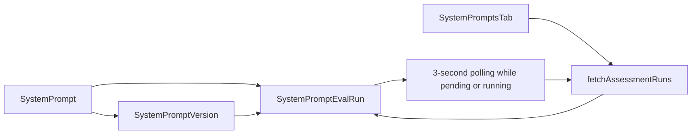

# Prompt Evaluation & Live Scoring

Relevant source files

The following files were used as context for generating this wiki page:

- [frontend/components/settings/SystemPromptsTab.tsx](frontend/components/settings/SystemPromptsTab.tsx)
- [orchestrator/api/admin_prompts.py](orchestrator/api/admin_prompts.py)
- [orchestrator/core/models/system_prompts.py](orchestrator/core/models/system_prompts.py)
- [orchestrator/core/seeds/seed_system_prompts.py](orchestrator/core/seeds/seed_system_prompts.py)
- [orchestrator/core/services/futureagi_service.py](orchestrator/core/services/futureagi_service.py)
- [orchestrator/core/services/prompt_registry.py](orchestrator/core/services/prompt_registry.py)
- [orchestrator/tests/test_httpx_request_urls_are_never_logged.py](orchestrator/tests/test_httpx_request_urls_are_never_logged.py)
- [services/agent-opt-worker/automatos_logging.py](services/agent-opt-worker/automatos_logging.py)
- [services/agent-opt-worker/automatos_metrics.py](services/agent-opt-worker/automatos_metrics.py)
- [services/agent-opt-worker/main.py](services/agent-opt-worker/main.py)
- [services/media-render/.dockerignore](services/media-render/.dockerignore)
- [services/media-render/automatos_logging.py](services/media-render/automatos_logging.py)
- [services/media-render/kokoro/SHA256SUMS](services/media-render/kokoro/SHA256SUMS)
- [services/shared/automatos_logging.py](services/shared/automatos_logging.py)
- [services/shared/automatos_metrics.py](services/shared/automatos_metrics.py)
- [services/workspace-worker/automatos_logging.py](services/workspace-worker/automatos_logging.py)
- [services/workspace-worker/automatos_metrics.py](services/workspace-worker/automatos_metrics.py)

## Purpose and Scope

This page documents the prompt assessment and live-scoring components visible in the provided code: the admin prompt surface, the orchestrator-to-worker boundary, quality metric templates, evaluation records, and live-scoring flag and persistence helpers. The orchestrator owns database work and dispatch responsibilities; the isolated `agent-opt-worker` owns FutureAGI SDK operations [orchestrator/core/services/futureagi_service.py:1-14](), [services/agent-opt-worker/main.py:1-20]().

Sources: [orchestrator/core/services/futureagi_service.py:1-14](), [services/agent-opt-worker/main.py:1-20]()

---

## 1. Evaluation Architecture & Component Mapping

The FutureAGI integration is split across an orchestrator-side service and an isolated worker. The orchestrator service describes itself as a thin HTTP client and assigns database reads and writes, fire-and-forget dispatch, and dataset collection to that side of the boundary. The worker handles assessment, safety, optimization, and live scoring [orchestrator/core/services/futureagi_service.py:1-14]().

The worker exposes `/assess`, `/safety`, `/optimize`, `GET /optimize/{job_id}`, `/score`, `/health`, and `/metrics`. Its FastAPI app disables docs and OpenAPI endpoints. The protected router requires the internal-token dependency; `/health` and `/metrics` are not declared on that router [services/agent-opt-worker/main.py:9-20, 44-51]().

The admin prompt interface is `SystemPromptsTab`, which requests prompt data from `/api/admin/prompts` and assessment-run data from a prompt-specific assessment-runs path. The backend router is mounted at `/api/admin/prompts` [frontend/components/settings/SystemPromptsTab.tsx:101-115, 121-161](), [orchestrator/api/admin_prompts.py:40-43]().

**Diagram: Prompt evaluation boundary from user workflows to code entities**

Sources: [frontend/components/settings/SystemPromptsTab.tsx:101-115, 121-161](), [orchestrator/api/admin_prompts.py:40-43](), [orchestrator/core/services/futureagi_service.py:1-14](), [services/agent-opt-worker/main.py:9-16, 70-88](), [orchestrator/core/models/system_prompts.py:108-138]()

The orchestrator sends the worker token in the `X-Internal-Token` header when `AGENT_OPT_WORKER_TOKEN` is configured. The worker route dependency is constructed using `internal_token()` [orchestrator/core/services/futureagi_service.py:32-45](), [services/agent-opt-worker/main.py:39-48]().

Sources: [orchestrator/core/services/futureagi_service.py:32-45](), [services/agent-opt-worker/main.py:39-48]()

---

## 2. Assessment Flow & Data Pipeline

`SystemPromptEvalRun` is the persisted record for an evaluation run. It links to a prompt and optionally a version, stores the run type and status, and has JSON fields for scores and metadata plus error and timing fields. The model comments document run types `evaluate`, `optimize`, and `safety`, and statuses `pending`, `running`, `completed`, and `failed` [orchestrator/core/models/system_prompts.py:108-138]().

The orchestrator service defines `_RunInputs` to carry the run type, prompt content, version ID, and settings needed by the worker. `_start_run` loads the run and version inside a short database session, marks the run running, and returns those inputs. If the run is missing it logs an error; if the version is missing it marks the run failed [orchestrator/core/services/futureagi_service.py:74-82, 127-155]().

The service’s module documentation states that the database session is not held while the worker is awaited. `_finish_run` writes the worker result in a new session: a failed result or an error without scores marks the run failed; otherwise the run is marked completed and the result is stored [orchestrator/core/services/futureagi_service.py:11-14, 166-181]().

**Diagram: Assessment run lifecycle**

Sources: [orchestrator/core/models/system_prompts.py:108-138](), [orchestrator/core/services/futureagi_service.py:127-181]()

**Data flow:** `_start_run` reads inputs and updates run state before the worker call; `_finish_run` persists the worker result after that call. These helpers use separate short database sessions rather than keeping one open across the worker wait [orchestrator/core/services/futureagi_service.py:11-14, 133-155, 166-181]().

Sources: [orchestrator/core/services/futureagi_service.py:11-14, 133-155, 166-181]()

---

## 3. Quality Metric Templates & Normalization

The worker’s `TEMPLATE_CONFIG` maps supported template names to required input keys and a configured model [services/agent-opt-worker/main.py:139-152]().

| Template | Required inputs | Configured model |
|---|---|---|
| `completeness` | `input`, `output` | `turing_large` |
| `prompt_adherence` | `input`, `output` | `turing_large` |
| `groundedness` | `input`, `output`, `context` | `turing_large` |
| `factual_accuracy` | `input`, `output` | `turing_large` |
| `summary_quality` | `input`, `output` | `turing_large` |
| `is_concise` | `output` | `turing_large` |
| `is_helpful` | `input`, `output` | `turing_large` |
| `toxicity` | `output` | `protect` |
| `bias_detection` | `output` | `protect_flash` |
| `prompt_injection` | `input` | `protect` |
| `content_moderation` | `output` | `protect` |

Sources: [services/agent-opt-worker/main.py:139-152]()

`_run_single_template` resolves FutureAGI credentials, constructs `fi.evals.Evaluator`, and calls `evaluate` with the template, inputs, model, and a 55-second timeout. SDK exceptions are caught and returned as an error result [services/agent-opt-worker/main.py:70-88]().

The result parser normalizes numeric output to a float and treats scores of at least `0.5` as passing. String outputs `"Passed"` and `"Failed"` become `1.0` and `0.0`; other strings are parsed as numbers where possible. Unparseable or unexpected output types default to a failing score, and missing or malformed result structures produce an error result [services/agent-opt-worker/main.py:90-136]().

Sources: [services/agent-opt-worker/main.py:70-136]()

---

## 4. Concurrent Scoring Execution

The worker imports `ThreadPoolExecutor` and `as_completed`. Its visible contract states that `/assess` and `/score` start one thread per template entry, and that requests name known templates with at most one entry per template. The worker also imports `max_concurrent_jobs` from its configuration [services/agent-opt-worker/main.py:31-40, 155-157]().

These lines establish the intended template-level concurrency boundary and the presence of a concurrency configuration value. They do not, by themselves, show the complete executor setup, result aggregation, or enforcement behavior; those details are not covered here.

**Diagram: Concurrency boundary named by the worker contract**

Sources: [services/agent-opt-worker/main.py:31-40, 70-88, 155-157]()

---

## 5. Live-Traffic Fire-and-Forget Scoring Runs

The orchestrator service’s module documentation identifies fire-and-forget dispatch as one of its responsibilities. To avoid a database lookup on every chat turn, it defines a cached scoring-enabled flag with a 60-second TTL. `_ScoringFlag.fresh` checks whether the cached value is still within that TTL, and `_any_prompt_scoring_enabled` queries whether any `SystemPrompt` has `futureagi_eval_enabled=True` [orchestrator/core/services/futureagi_service.py:8-14, 36-40, 63-92]().

When scores are available, `_store_live_runs` queries prompts with live scoring enabled and finds each prompt’s active version. For each prompt with an active version, it inserts a completed `SystemPromptEvalRun` with `run_type="live"`. Its JSON score payload includes the scores, metric count, and `source="live_traffic"` [orchestrator/core/services/futureagi_service.py:94-124]().

The worker endpoint inventory identifies `POST /score` as the route for scoring a live chat input/output pair [services/agent-opt-worker/main.py:9-16]().

**Diagram: Live scoring flag, worker route, and persistence path**

Sources: [orchestrator/core/services/futureagi_service.py:36-40, 63-72, 84-124](), [services/agent-opt-worker/main.py:9-16]()

---

## 6. Database Integration & UI Polling

`SystemPrompt` stores prompt identity and the `futureagi_eval_enabled` switch. `SystemPromptVersion` stores versioned prompt content and an `eval_scores` JSON field. `SystemPromptEvalRun` stores individual run type, status, scores, metadata, errors, and timestamps [orchestrator/core/models/system_prompts.py:32-68, 71-105, 108-138]().

The admin interface defines client-side types for prompts, versions, and assessment runs. `SystemPromptsTab` fetches the prompt list, categories, versions, and assessment runs through `apiClient`. When a prompt is selected, it fetches that prompt’s versions and assessment runs. If any loaded run is `pending` or `running`, an effect polls for updates every three seconds [frontend/components/settings/SystemPromptsTab.tsx:34-73, 101-115, 121-161, 166-188]().

The backend admin router is mounted at `/api/admin/prompts`. Its visible list endpoint requires admin authorization and returns prompts using `_prompt_to_response`; that response includes the active version content and active evaluation scores [orchestrator/api/admin_prompts.py:42-43, 49-62, 65-86, 106-128]().

**Diagram: Evaluation records and admin refresh loop**

Sources: [orchestrator/core/models/system_prompts.py:32-68, 71-105, 108-138](), [frontend/components/settings/SystemPromptsTab.tsx:145-174, 180-188]()

---