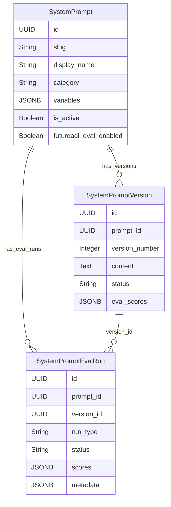
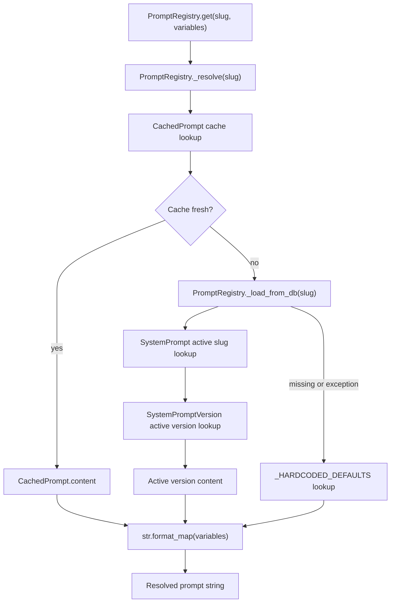
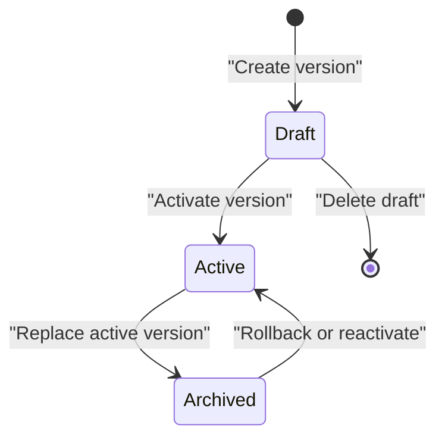
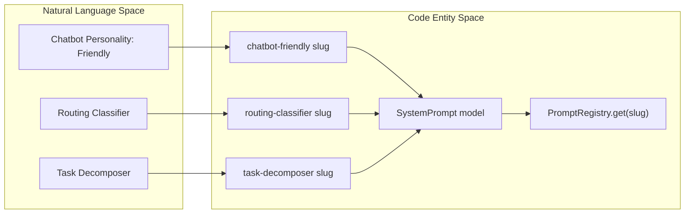
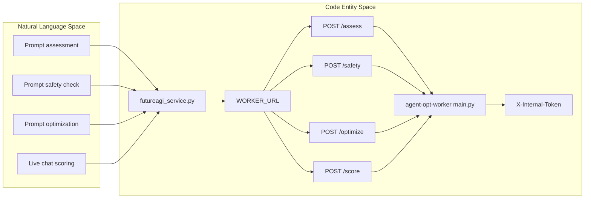

# System Prompt Management

Relevant source files

The following files were used as context for generating this wiki page:

- [frontend/components/settings/SystemPromptsTab.tsx](frontend/components/settings/SystemPromptsTab.tsx)
- [orchestrator/api/admin_prompts.py](orchestrator/api/admin_prompts.py)
- [orchestrator/core/models/system_prompts.py](orchestrator/core/models/system_prompts.py)
- [orchestrator/core/seeds/seed_system_prompts.py](orchestrator/core/seeds/seed_system_prompts.py)
- [orchestrator/core/services/futureagi_service.py](orchestrator/core/services/futureagi_service.py)
- [orchestrator/core/services/prompt_registry.py](orchestrator/core/services/prompt_registry.py)
- [orchestrator/tests/test_httpx_request_urls_are_never_logged.py](orchestrator/tests/test_httpx_request_urls_are_never_logged.py)
- [services/agent-opt-worker/automatos_logging.py](services/agent-opt-worker/automatos_logging.py)
- [services/agent-opt-worker/automatos_metrics.py](services/agent-opt-worker/automatos_metrics.py)
- [services/agent-opt-worker/main.py](services/agent-opt-worker/main.py)
- [services/media-render/.dockerignore](services/media-render/.dockerignore)
- [services/media-render/automatos_logging.py](services/media-render/automatos_logging.py)
- [services/media-render/kokoro/SHA256SUMS](services/media-render/kokoro/SHA256SUMS)
- [services/shared/automatos_logging.py](services/shared/automatos_logging.py)
- [services/shared/automatos_metrics.py](services/shared/automatos_metrics.py)
- [services/workspace-worker/automatos_logging.py](services/workspace-worker/automatos_logging.py)
- [services/workspace-worker/automatos_metrics.py](services/workspace-worker/automatos_metrics.py)

## Purpose and Scope

System Prompt Management provides database-backed prompt definitions and versions, runtime lookup through a registry, seed data for initial prompts, and an admin interface for browsing and editing prompts. It also includes the data models and service boundary used for FutureAGI evaluation and scoring. [orchestrator/core/models/system_prompts.py:32-138](), [orchestrator/core/services/prompt_registry.py:1-10](), [orchestrator/core/seeds/seed_system_prompts.py:1-7](), [frontend/components/settings/SystemPromptsTab.tsx:101-115](), [orchestrator/core/services/futureagi_service.py:1-14]()

Sources: [orchestrator/core/models/system_prompts.py:32-138](), [orchestrator/core/services/prompt_registry.py:1-10](), [orchestrator/core/seeds/seed_system_prompts.py:1-7](), [frontend/components/settings/SystemPromptsTab.tsx:101-115](), [orchestrator/core/services/futureagi_service.py:1-14]()

---

## Database Schema & Data Models

Three SQLAlchemy models represent prompt definitions, prompt versions, and evaluation runs: `SystemPrompt`, `SystemPromptVersion`, and `SystemPromptEvalRun`. The prompt’s `slug` is its stable code-facing identifier. Each version belongs to a prompt; the model declares a unique constraint on `(prompt_id, version_number)`. Version statuses are represented as strings, with `draft`, `active`, and `archived` documented by the model. [orchestrator/core/models/system_prompts.py:32-38](), [orchestrator/core/models/system_prompts.py:56-68](), [orchestrator/core/models/system_prompts.py:71-105]()

- `SystemPrompt` stores prompt metadata such as `display_name`, `category`, `description`, `variables`, `is_active`, and `futureagi_eval_enabled`. [orchestrator/core/models/system_prompts.py:32-54]()
- `SystemPromptVersion` stores versioned text in `content`, along with `change_note`, `status`, `created_by`, `created_at`, and optional `eval_scores`. [orchestrator/core/models/system_prompts.py:71-105]()
- `SystemPromptEvalRun` associates an evaluation run with a prompt and, optionally, a version. It stores `run_type`, `status`, `scores`, metadata, errors, and timestamps. [orchestrator/core/models/system_prompts.py:108-138]()

### Data Model Entity Space

The diagram connects the prompt-management concepts to their SQLAlchemy model names and relationships. [orchestrator/core/models/system_prompts.py:32-138]()

Sources: [orchestrator/core/models/system_prompts.py:32-138]()

---

## Prompt Registry & Resolution

`PromptRegistry` is a singleton service with an in-memory cache and database-backed lookup. `get_instance()` creates the singleton on first use and returns it on subsequent calls. [orchestrator/core/services/prompt_registry.py:35-53]()

- `get(slug, **variables)` resolves content and, when variables are supplied, interpolates them with `str.format_map()`. If interpolation encounters a missing key, the method logs a warning and returns the raw prompt string. [orchestrator/core/services/prompt_registry.py:59-76]()
- `get_raw(slug)` returns the resolved content without interpolation. [orchestrator/core/services/prompt_registry.py:78-81]()
- `clear_cache(slug)` removes one slug from the cache; without a slug it clears the cache. [orchestrator/core/services/prompt_registry.py:82-87]()

Resolution checks the cache first, then the database, then hardcoded defaults. Cached entries use a 60-second TTL. The database lookup selects an active `SystemPrompt` by slug, then selects its active version with the highest version number. If no database content is available, `_resolve()` checks `_HARDCODED_DEFAULTS`; if no fallback exists, it returns `None`. [orchestrator/core/services/prompt_registry.py:24-33](), [orchestrator/core/services/prompt_registry.py:93-115](), [orchestrator/core/services/prompt_registry.py:117-143]()

### Prompt Resolution Data Flow

This flow shows the registry lookup path and how resolved text reaches `get()` for optional interpolation. [orchestrator/core/services/prompt_registry.py:59-76](), [orchestrator/core/services/prompt_registry.py:93-143]()

Sources: [orchestrator/core/services/prompt_registry.py:59-76](), [orchestrator/core/services/prompt_registry.py:93-143]()

---

## Prompt Lifecycle & Versioning API

The admin prompts router is mounted at `/api/admin/prompts`. Its `_assert_admin(ctx)` helper allows API-key authentication for service-to-service calls; otherwise, it checks the authenticated user through `caller_is_admin` and returns HTTP 403 when the check fails. [orchestrator/api/admin_prompts.py:42-62]()

`create_version()` accepts a `PromptVersionCreate` body and an `activate` query parameter that defaults to `False`. The function checks that the prompt exists and begins determining the next version number from the maximum existing `version_number`. [orchestrator/api/admin_prompts.py:178-199]()

### Version State Machine

The model documents the `draft`, `active`, and `archived` statuses and states that only one version per prompt can be active at a time. The diagram summarizes those statuses; it does not imply additional transition behavior beyond the model and API code cited here. [orchestrator/core/models/system_prompts.py:71-105]()

Sources: [orchestrator/core/models/system_prompts.py:71-105]()

---

## Seed Data & System Prompt Manifest

`seed_system_prompts.py` defines an idempotent seed for LLM-facing system prompts. Its `PROMPT_MANIFEST` includes chatbot personality prompts such as `chatbot-friendly`, `chatbot-professional`, and `chatbot-technical`, as well as orchestrator prompts including `routing-classifier` and `task-decomposer`. The visible manifest entries define each prompt’s slug, display name, category, description, variables, and content. [orchestrator/core/seeds/seed_system_prompts.py:1-7](), [orchestrator/core/seeds/seed_system_prompts.py:19-123]()

### Natural Language Space to Code Entity Space

This diagram associates human-readable prompt names with manifest slugs, the `SystemPrompt` model, and the runtime `PromptRegistry.get()` lookup. [orchestrator/core/seeds/seed_system_prompts.py:23-123](), [orchestrator/core/models/system_prompts.py:32-42](), [orchestrator/core/services/prompt_registry.py:35-76]()

Sources: [orchestrator/core/seeds/seed_system_prompts.py:23-123](), [orchestrator/core/models/system_prompts.py:32-42](), [orchestrator/core/services/prompt_registry.py:35-76]()

---

## Admin Prompts API Reference

The admin router defines list, category, prompt-detail, version-list, and version-creation endpoints in the inspected portion of `admin_prompts.py`. These endpoints use `_assert_admin(ctx)` for authorization. [orchestrator/api/admin_prompts.py:42-62](), [orchestrator/api/admin_prompts.py:106-199]()

| Method | Route | Behavior |
|---|---|---|
| `GET` | `/api/admin/prompts` | Lists prompts, optionally filtered by `category` and `search`. Search matches display name, slug, or description. [orchestrator/api/admin_prompts.py:106-128]() |
| `GET` | `/api/admin/prompts/categories` | Returns distinct categories with prompt counts. [orchestrator/api/admin_prompts.py:131-144]() |
| `GET` | `/api/admin/prompts/{prompt_id}` | Retrieves a prompt and returns 404 when it is not found. [orchestrator/api/admin_prompts.py:147-158]() |
| `GET` | `/api/admin/prompts/{prompt_id}/versions` | Lists a prompt’s versions in descending `version_number` order. [orchestrator/api/admin_prompts.py:161-175]() |
| `POST` | `/api/admin/prompts/{prompt_id}/versions` | Starts creating a new version; the `activate` query parameter defaults to `False`. [orchestrator/api/admin_prompts.py:178-199]() |

Sources: [orchestrator/api/admin_prompts.py:42-62](), [orchestrator/api/admin_prompts.py:106-199]()

---

## Frontend Management (`SystemPromptsTab`)

`SystemPromptsTab` is a client-side React component that tracks the prompt list, categories, selected prompt, versions, assessment runs, editor state, and active tab. It fetches prompts and categories from the admin API and requests versions and assessment runs when a prompt is selected. [frontend/components/settings/SystemPromptsTab.tsx:101-115](), [frontend/components/settings/SystemPromptsTab.tsx:121-161](), [frontend/components/settings/SystemPromptsTab.tsx:180-188]()

When assessment runs include `pending` or `running` statuses and a prompt is selected, the component refreshes the assessment-run list every three seconds; the interval is cleared when the effect is cleaned up. [frontend/components/settings/SystemPromptsTab.tsx:166-174]()

Sources: [frontend/components/settings/SystemPromptsTab.tsx:101-115](), [frontend/components/settings/SystemPromptsTab.tsx:121-188]()

---

## FutureAGI Integration & Worker Service

The orchestrator-side `futureagi_service.py` describes itself as a thin HTTP client that routes FutureAGI operations to the isolated worker. Its stated responsibilities include database reads and writes, fire-and-forget dispatch, and dataset collection; the worker handles assessment, safety, optimization, and live scoring. The client defines `X-Internal-Token` as the worker token header and uses `AGENT_OPT_WORKER_TOKEN` when configured. [orchestrator/core/services/futureagi_service.py:1-14](), [orchestrator/core/services/futureagi_service.py:32-45]()

The worker’s FastAPI application declares an authenticated router for internal operations. The application documentation lists `/assess`, `/safety`, `/optimize`, `/optimize/{job_id}`, and `/score`, with `/health` and `/metrics` also documented. The worker configures a dependency requiring the internal token on routes registered on that router, and disables API documentation endpoints. [services/agent-opt-worker/main.py:9-20](), [services/agent-opt-worker/main.py:44-51]()

### Natural Language Space to Worker Entity Space

This diagram maps evaluation and safety concepts to the worker’s documented HTTP routes and the orchestrator client boundary. [orchestrator/core/services/futureagi_service.py:1-45](), [services/agent-opt-worker/main.py:9-20](), [services/agent-opt-worker/main.py:44-51]()

Sources: [orchestrator/core/services/futureagi_service.py:1-45](), [services/agent-opt-worker/main.py:9-20](), [services/agent-opt-worker/main.py:44-51]()

---