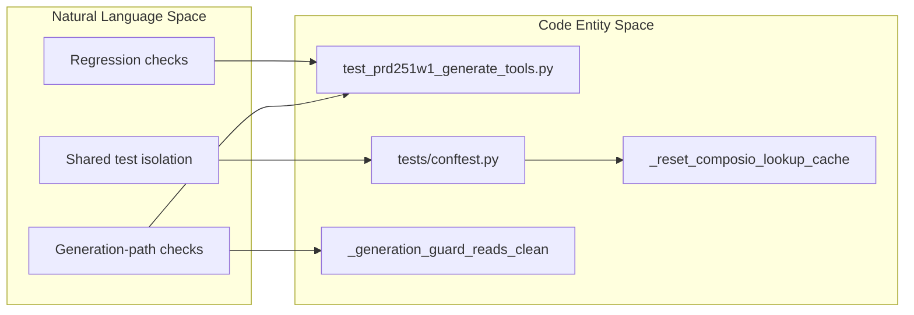

# Testing & Quality Engineering

<details>
<summary>Relevant source files</summary>

The following files were used as context for generating this wiki page:

- [docs/PRDS/PRD-264-EU-AI-ACT-ARTICLE-50.md](docs/PRDS/PRD-264-EU-AI-ACT-ARTICLE-50.md)
- [frontend/lib/ai/models.ts](frontend/lib/ai/models.ts)
- [frontend/lib/llm-defaults.ts](frontend/lib/llm-defaults.ts)
- [orchestrator/alembic/versions/prd264_blog_review.py](orchestrator/alembic/versions/prd264_blog_review.py)
- [orchestrator/api/blog.py](orchestrator/api/blog.py)
- [orchestrator/api/widgets/blog.py](orchestrator/api/widgets/blog.py)
- [orchestrator/core/generation_guard.py](orchestrator/core/generation_guard.py)
- [orchestrator/core/llm/defaults.py](orchestrator/core/llm/defaults.py)
- [orchestrator/core/services/blog_post_view.py](orchestrator/core/services/blog_post_view.py)
- [orchestrator/core/services/blog_review.py](orchestrator/core/services/blog_review.py)
- [orchestrator/core/services/blog_service.py](orchestrator/core/services/blog_service.py)
- [orchestrator/modules/documents/brand_style.py](orchestrator/modules/documents/brand_style.py)
- [orchestrator/modules/socials/recipes/footage.py](orchestrator/modules/socials/recipes/footage.py)
- [orchestrator/modules/socials/recipes/footage_toolkits.py](orchestrator/modules/socials/recipes/footage_toolkits.py)
- [orchestrator/modules/socials/recipes/voice.py](orchestrator/modules/socials/recipes/voice.py)
- [orchestrator/modules/tools/discovery/actions_blog.py](orchestrator/modules/tools/discovery/actions_blog.py)
- [orchestrator/modules/tools/discovery/handlers_blog.py](orchestrator/modules/tools/discovery/handlers_blog.py)
- [orchestrator/scripts/seed_blog_playbook.py](orchestrator/scripts/seed_blog_playbook.py)
- [orchestrator/tests/conftest.py](orchestrator/tests/conftest.py)
- [orchestrator/tests/test_prd251bw3_ai_options.py](orchestrator/tests/test_prd251bw3_ai_options.py)
- [orchestrator/tests/test_prd251w1_generate_tools.py](orchestrator/tests/test_prd251w1_generate_tools.py)
- [orchestrator/tests/test_prd264_art5_footage.py](orchestrator/tests/test_prd264_art5_footage.py)
- [orchestrator/tests/test_prd264_art5_generation_guard.py](orchestrator/tests/test_prd264_art5_generation_guard.py)
- [orchestrator/tests/test_prd264_euai08b_blog_review.py](orchestrator/tests/test_prd264_euai08b_blog_review.py)
- [orchestrator/tests/test_prd264_euai09_wiring.py](orchestrator/tests/test_prd264_euai09_wiring.py)

</details>


## Purpose and scope

Automatos AI’s test estate spans orchestrator-level pytest suites, live API and end-to-end checks, simulation, and evaluation benchmarks. These layers cover different quality questions: whether individual components and contracts behave as expected, whether integrated journeys work, and whether system-level quality can be measured. This parent page maps those areas; use the child pages for implementation details.

Sources: [orchestrator/tests/conftest.py:73-150](), [orchestrator/tests/test_prd251w1_generate_tools.py:1-30]()

## 29.1 Orchestrator Test Suites

The orchestrator suite includes regression tests for concrete product behavior. For example, `test_prd251w1_generate_tools.py` describes checks of document generation, playbook step references, and cover-image behavior. Shared pytest fixtures in `tests/conftest.py` reset selected process-wide caches and isolate generation-guard behavior, helping tests avoid inheriting state from other tests. [orchestrator/tests/test_prd251w1_generate_tools.py:1-30](), [orchestrator/tests/conftest.py:73-150]()

For suite configuration, database setup, security tests, regression conventions, and import contracts, see [Orchestrator Test Suites](#29.1).

**Diagram: Orchestrator tests mapped to code entities**



Sources: [orchestrator/tests/test_prd251w1_generate_tools.py:1-30](), [orchestrator/tests/conftest.py:91-150]()

## 29.2 Live API & E2E Testing

The broader test estate includes live API journeys, contract and regression checks, browser-based end-to-end tests, and a customer simulation harness. Together, these target integrated behavior beyond the orchestrator’s unit and regression suites. The available test fixture file also shows that process-level state, such as Composio lookup caches, is explicitly reset around tests. [orchestrator/tests/conftest.py:91-119]()

For the nightly runner, API journeys, browser fixtures, and simulation harness details, see [Live API & E2E Testing](#29.2).

**Diagram: Test layers and their code-facing entry points**

```mermaid
flowchart LR
    subgraph NaturalLanguageSpace["Natural Language Space"]
        Nightly[""Nightly live-API validation""]
        Journeys[""API journeys and contracts""]
        Browser[""Browser end-to-end checks""]
        Simulation[""Customer simulation""]
    end
    subgraph CodeEntitySpace["Code Entity Space"]
        Runner[""tests/run_nightly.py""]
        ApiTests[""tests/api/"""]
        BrowserTests[""tests/e2e/browser/"""]
        SimTests[""tests/sim/"""]
    end
    Nightly --> Runner
    Runner --> ApiTests
    Journeys --> ApiTests
    Browser --> BrowserTests
    Simulation --> SimTests
```

Sources: [orchestrator/tests/conftest.py:91-119]()

## 29.3 Evaluations & Benchmarks

Evaluation and benchmark work complements pass/fail tests by measuring system quality. The evaluation area covers retrieval recall, operating-graph uplift, tool routing, field-memory comparisons, and decision-shadow scoring. These benchmarks are distinct from the orchestrator and integration suites: they focus on comparative or scored outcomes rather than only checking that a specific behavior holds.

For evaluation scripts, telemetry inputs, and benchmark methodology, see [Evaluations & Benchmarks](#29.3).

**Diagram: Evaluation goals mapped to code entities**

```mermaid
flowchart LR
    subgraph NaturalLanguageSpace["Natural Language Space"]
        Recall[""Retrieval recall""]
        GraphUplift[""Operating-graph uplift""]
        Routing[""Tool-routing evaluation""]
        FieldMemory[""Field-memory comparison""]
        DecisionShadow[""Decision-shadow scoring""]
    end
    subgraph CodeEntitySpace["Code Entity Space"]
        Evals[""orchestrator/evals/"""]
        RoutingScripts[""tool-routing evaluation scripts"""]
        MemoryBenchmarks[""tools/benchmark_*"""]
        ShadowScoring[""decision-shadow scoring""]
    end
    Recall --> Evals
    GraphUplift --> Evals
    Routing --> RoutingScripts
    FieldMemory --> MemoryBenchmarks
    DecisionShadow --> ShadowScoring
```

Sources: [orchestrator/tests/test_prd251w1_generate_tools.py:1-30]()

---