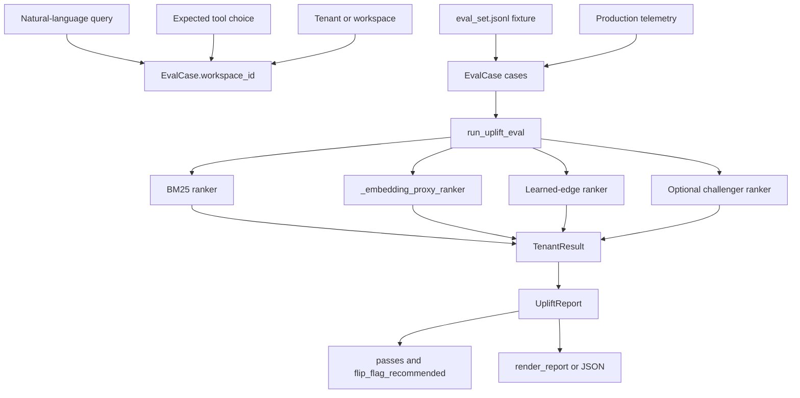
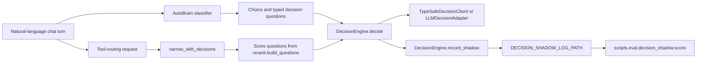
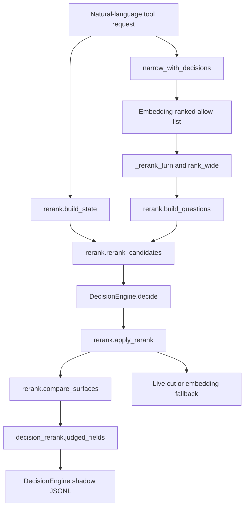

# Evaluations & Benchmarks

Relevant source files

The following files were used as context for generating this wiki page:

- [docs/PRDS/PRD-248-DECISION-ENGINE-SEAM.md](docs/PRDS/PRD-248-DECISION-ENGINE-SEAM.md)
- [orchestrator/core/llm/decisions/__init__.py](orchestrator/core/llm/decisions/__init__.py)
- [orchestrator/core/llm/decisions/engine.py](orchestrator/core/llm/decisions/engine.py)
- [orchestrator/core/llm/decisions/llm_adapter.py](orchestrator/core/llm/decisions/llm_adapter.py)
- [orchestrator/core/llm/decisions/questions.py](orchestrator/core/llm/decisions/questions.py)
- [orchestrator/core/llm/decisions/rerank.py](orchestrator/core/llm/decisions/rerank.py)
- [orchestrator/core/llm/decisions/typesafe_client.py](orchestrator/core/llm/decisions/typesafe_client.py)
- [orchestrator/evals/__init__.py](orchestrator/evals/__init__.py)
- [orchestrator/evals/operating_graph_uplift.py](orchestrator/evals/operating_graph_uplift.py)
- [orchestrator/modules/tools/discovery/decision_rerank.py](orchestrator/modules/tools/discovery/decision_rerank.py)
- [orchestrator/scripts/eval/decision_shadow/score.py](orchestrator/scripts/eval/decision_shadow/score.py)
- [orchestrator/tests/test_prd177_uplift_eval.py](orchestrator/tests/test_prd177_uplift_eval.py)
- [orchestrator/tests/test_prd248_decision_seam.py](orchestrator/tests/test_prd248_decision_seam.py)
- [orchestrator/tests/test_prd248_s4_tool_rerank.py](orchestrator/tests/test_prd248_s4_tool_rerank.py)
- [orchestrator/tests/test_prd248_seam_tuning_a_version_stamp.py](orchestrator/tests/test_prd248_seam_tuning_a_version_stamp.py)
- [orchestrator/tests/test_prd248_seam_tuning_e_tool_rerank_scores.py](orchestrator/tests/test_prd248_seam_tuning_e_tool_rerank_scores.py)
- [scripts/ralph/customer-night/nights/auto-brain-jev.SUPERVISOR.md](scripts/ralph/customer-night/nights/auto-brain-jev.SUPERVISOR.md)
- [scripts/ralph/customer-night/nights/auto-brain-jev.md](scripts/ralph/customer-night/nights/auto-brain-jev.md)
- [scripts/ralph/customer-night/nights/auto-brain.md](scripts/ralph/customer-night/nights/auto-brain.md)

## Purpose and scope

This page describes evaluation and benchmark mechanisms represented in the available source excerpts: retrieval-recall evaluation, operating-graph uplift, typed decision-engine shadow scoring, tool-routing rerank evaluation, and field-memory comparisons. The supplied excerpts provide implementation detail for operating-graph uplift and decision-seam scoring; they do not include the retrieval-recall or field-memory benchmark implementations, so those areas are identified without inferring their internals. [orchestrator/evals/operating_graph_uplift.py:1-35]()

Sources: `[orchestrator/evals/operating_graph_uplift.py:1-35]()`, `[docs/PRDS/PRD-248-DECISION-ENGINE-SEAM.md:39-43]()`

---

## 1. Retrieval-Recall Evaluation

The requested retrieval-recall evaluation is part of this page’s scope, but the supplied source excerpts do not include its implementation or tests. The available material therefore does not substantiate details such as its dataset schema, retrieval variants, metrics, or command-line interface.

Sources: `[orchestrator/evals/operating_graph_uplift.py:1-35]()`

---

## 2. Operating Graph Uplift Evaluation Gate

`orchestrator/evals/operating_graph_uplift.py` evaluates whether a learned per-tenant operating-graph signal improves tool selection over retrieval baselines. It computes top-1 accuracy on held-out queries for BM25, an embedding proxy, and a learned-edge ranker, then reports learned-ranker uplift over the best baseline. The harness uses a train/test split; its bundled fixture is not the production gate. A production-oriented run loads telemetry instead. [orchestrator/evals/operating_graph_uplift.py:1-35]()

### Cases, rankers, and reporting

`EvalCase` holds a query, its expected action, category, and workspace identifier. `TenantResult` records each tenant’s test count and ranker accuracies; `best_baseline` selects the higher of BM25 and embedding accuracy, and `uplift_points` expresses the learned ranker’s difference from that baseline in percentage points. [orchestrator/evals/operating_graph_uplift.py:64-96]()

The BM25 ranker uses lexical ranking over action text. The embedding ranker uses a deterministic bag-of-words proxy for the production semantic index, allowing offline evaluation without an embedding provider. The learned-edge ranker uses a tenant’s training split and falls back to the embedding proxy when the tenant or cluster has no learned signal. [orchestrator/evals/operating_graph_uplift.py:8-22]()

`UpliftReport` aggregates per-tenant results. Its pass condition compares mean uplift with `UPLIFT_THRESHOLD_POINTS`, set to 5.0. The report includes the input source and exposes `flip_flag_recommended` from the same pass condition; the harness reports sub-threshold results rather than massaging them. [orchestrator/evals/operating_graph_uplift.py:50-58](), [orchestrator/evals/operating_graph_uplift.py:98-154]()

| Ranker or report field | Meaning |
|---|---|
| `bm25_acc` | Tenant top-1 accuracy for lexical BM25 ranking. |
| `embedding_acc` | Tenant top-1 accuracy for the deterministic embedding proxy, unless a real ranker is injected. |
| `learned_acc` | Tenant top-1 accuracy for the learned-edge ranker. |
| `best_baseline` | The higher of `bm25_acc` and `embedding_acc`. |
| `uplift_points` | `(learned_acc - best_baseline) * 100`. |
| `challenger_acc` | Optional challenger accuracy; it is scored alongside the gate rankers and does not change the gate. |

[orchestrator/evals/operating_graph_uplift.py:73-96]()

### Data flow and code-entity mapping

This diagram connects natural-language queries and expected tool choices to the concrete evaluation entities. The bundled fixture and telemetry are distinct input sources; the report records which source was used. [orchestrator/evals/operating_graph_uplift.py:30-35](), [orchestrator/evals/operating_graph_uplift.py:64-70](), [orchestrator/evals/operating_graph_uplift.py:98-115]()

**Diagram: Operating-graph evaluation from query to gate report**

Sources: `[orchestrator/evals/operating_graph_uplift.py:30-35]()`, `[orchestrator/evals/operating_graph_uplift.py:64-70]()`, `[orchestrator/evals/operating_graph_uplift.py:73-154]()`

### Running and interpreting the uplift evaluation

The module documents three principal invocations: the bundled fixture, JSON output, and telemetry-backed JSON output. The telemetry-backed run is identified as the real gate; fixture output is explicitly labelled `fixture` so it cannot be mistaken for production telemetry. [orchestrator/evals/operating_graph_uplift.py:30-35](), [orchestrator/evals/operating_graph_uplift.py:98-115]()

The gate is averaged across tenants. A tenant’s uplift is relative to its own best baseline, not an aggregate baseline across all tenants. `UpliftReport.passes` is true only when `mean_uplift_points` meets the 5.0-point threshold. The optional challenger is reported separately and does not contribute to that pass condition. [orchestrator/evals/operating_graph_uplift.py:50-52](), [orchestrator/evals/operating_graph_uplift.py:83-125]()

Sources: `[orchestrator/evals/operating_graph_uplift.py:30-35]()`, `[orchestrator/evals/operating_graph_uplift.py:50-52]()`, `[orchestrator/evals/operating_graph_uplift.py:83-125]()`

---

## 3. Tool-Routing Evaluation, Decision Seam, and Shadow Scoring

The tool-routing evaluation harness is described as comparing `jev_rerank` with other routing modes on the tool-routing query set. The operating-graph harness can also score a `jev` challenger beside its three gate rankers. The decision-seam design specifies that these challengers are measured offline and do not replace the operating-graph gate. [docs/PRDS/PRD-248-DECISION-ENGINE-SEAM.md:37-43](), [orchestrator/evals/operating_graph_uplift.py:73-96]()

### Decision seam

`core.llm.decisions` exposes typed decision questions (`Choice`, `Score`, and `Noul`), results, providers, and `DecisionEngine` through a common `decide()` interface. The engine’s modes are `off`, `shadow`, and `live`; the documented defaults are off. Its dials are read from the `decision_engine` settings category, with a 30-second cache and fail-soft behavior for settings reads. [orchestrator/core/llm/decisions/__init__.py:1-38](), [orchestrator/core/llm/decisions/engine.py:40-56](), [orchestrator/core/llm/decisions/engine.py:61-95](), [orchestrator/core/llm/decisions/engine.py:168-193]()

The engine supports TypeSafe, OpenRouter, and system-LLM decision backends. In shadow mode it writes JSON-lines records to `DECISION_SHADOW_LOG_PATH`; those records are consumed by `scripts.eval.decision_shadow.score`. The seam version is stamped on rows so scoring can distinguish data produced under different question or state definitions. [orchestrator/core/llm/decisions/engine.py:1-14](), [orchestrator/core/llm/decisions/engine.py:47-54](), [orchestrator/tests/test_prd248_seam_tuning_a_version_stamp.py:20-32]()

**Diagram: Natural-language turn to decision-seam entities**

Sources: `[orchestrator/core/llm/decisions/__init__.py:1-38]()`, `[orchestrator/core/llm/decisions/engine.py:1-14]()`, `[orchestrator/core/llm/decisions/engine.py:27-54]()`, `[orchestrator/modules/tools/discovery/decision_rerank.py:1-39]()`, `[orchestrator/scripts/eval/decision_shadow/score.py:1-23]()`

### Decision shadow scoring

The scorer reads JSON-lines rows from an explicit path or the configured `DECISION_SHADOW_LOG_PATH`, defaulting to `logs/decision_shadow.jsonl` if app configuration is unavailable. `load_rows` skips blank lines and malformed JSON. The scorer supports traffic filtering: `execution_id` values beginning with `sim:` identify simulated rows; `--only sim` and `--only real` select the respective traffic class. It can also filter by seam version and time window. [orchestrator/scripts/eval/decision_shadow/score.py:10-23](), [orchestrator/scripts/eval/decision_shadow/score.py:34-63](), [orchestrator/scripts/eval/decision_shadow/score.py:84-100](), [orchestrator/scripts/eval/decision_shadow/score.py:138-159]()

For `tool_rerank` rows, `summarize_rerank` excludes errored or non-comparable rows from the scored set, counts errors, and reports latency percentiles and surface comparison statistics where available. The surface comparison includes embedding and reranked sizes, overlap, whether the top action stayed the same, and actions dropped or added. [orchestrator/scripts/eval/decision_shadow/score.py:103-135](), [orchestrator/core/llm/decisions/rerank.py:134-145]()

The scorer’s documented outputs include coverage, agreement by field and tier, agreement by confidence band, latency percentiles, and the number of turns the engine would have decided on at its configured confidence floor. [orchestrator/scripts/eval/decision_shadow/score.py:1-8]()

Sources: `[orchestrator/scripts/eval/decision_shadow/score.py:1-23]()`, `[orchestrator/scripts/eval/decision_shadow/score.py:34-63]()`, `[orchestrator/scripts/eval/decision_shadow/score.py:84-100]()`, `[orchestrator/scripts/eval/decision_shadow/score.py:103-159]()`, `[orchestrator/core/llm/decisions/rerank.py:134-145]()`

### Tool-routing rerank

`modules.tools.discovery.decision_rerank.narrow_with_decisions` applies the `tool_rerank_mode` to an embedding-ranked allow-list. The pure ranking logic is in `core.llm.decisions.rerank`; the production wrapper injects the ranking function, descriptions, decision function, and shadow writer so the wrapper can be tested without loading the router’s full module graph. [orchestrator/modules/tools/discovery/decision_rerank.py:1-19](), [orchestrator/modules/tools/discovery/decision_rerank.py:28-39]()

`rerank_candidates` builds a bounded request state and one `Score` question per named candidate. Each question includes the action name and a truncated description. `apply_rerank` scales answers to probabilities, requires answers for at least half the candidate names, orders candidates by probability while retaining original order for ties, keeps candidates above the configured floor, tops up to `min_keep`, and caps the result at `top_k`. A partial answer is a miss (`None`), not permission to narrow the surface. [orchestrator/core/llm/decisions/rerank.py:24-65](), [orchestrator/core/llm/decisions/rerank.py:68-131]()

| Mode | Effect on the current candidate list |
|---|---|
| `off` | Leaves the allow-list unchanged. |
| `shadow` | Schedules a fire-and-forget comparison and returns the original allow-list. |
| `live` | Uses the reranked cut when available; on a miss, retains the embedding cut. |
| `union` | An experiment selected by `TOOL_SHORTLIST_JEV_UNION`, not a `tool_rerank_mode` dial value. |

[orchestrator/modules/tools/discovery/decision_rerank.py:1-19]()

In shadow mode, `_shadow_turn` records the original embedding cut, wider candidate list, candidate source, decision metadata, cut, and surface comparison when available. The scheduled task is retained in `_SHADOW_TASKS` until completion, and shadow-write failures do not surface to the caller. [orchestrator/modules/tools/discovery/decision_rerank.py:93-140](), [orchestrator/modules/tools/discovery/decision_rerank.py:143-189]()

**Diagram: Natural-language request through tool rerank to scored comparison**

Sources: `[orchestrator/modules/tools/discovery/decision_rerank.py:59-90]()`, `[orchestrator/modules/tools/discovery/decision_rerank.py:93-132]()`, `[orchestrator/modules/tools/discovery/decision_rerank.py:143-189]()`, `[orchestrator/core/llm/decisions/rerank.py:37-65]()`, `[orchestrator/core/llm/decisions/rerank.py:96-181]()`

### Tool-routing eval and seed telemetry

The PRD describes `scripts.eval.tool_routing.run_eval --mode jev_rerank` as an offline evaluation of the rerank rule on a 77-query set, reported alongside `filtered_schema`. It also describes `evals.operating_graph_uplift --ranker jev [--from-telemetry]` as a challenger evaluation beside the three operating-graph rankers. [docs/PRDS/PRD-248-DECISION-ENGINE-SEAM.md:37-43]()

The supplied excerpts do not include the tool-routing eval runner, its seed-telemetry script, or the telemetry graph implementation. Consequently, this page does not document their specific functions, data schemas, or persistence behavior. The available operating-graph harness does specify that telemetry-backed evaluation filters and counts its input rows, and that the output records whether the source was telemetry or the fixture. [orchestrator/evals/operating_graph_uplift.py:98-115]()

Sources: `[docs/PRDS/PRD-248-DECISION-ENGINE-SEAM.md:37-43]()`, `[orchestrator/evals/operating_graph_uplift.py:98-115]()`

---

## 4. Field Memory Benchmarks and A/B Comparisons

The requested `tools/benchmark_*` field-memory comparisons are within scope, but the supplied excerpts do not include those benchmark files. Their execution modes, seed data, result schema, and comparison functions cannot be verified from the available material and are therefore not described here.

Sources: `[orchestrator/evals/operating_graph_uplift.py:1-35]()`

---