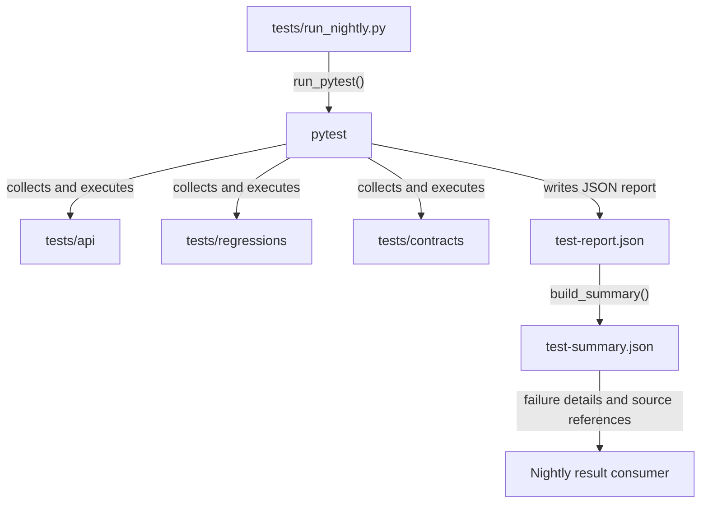
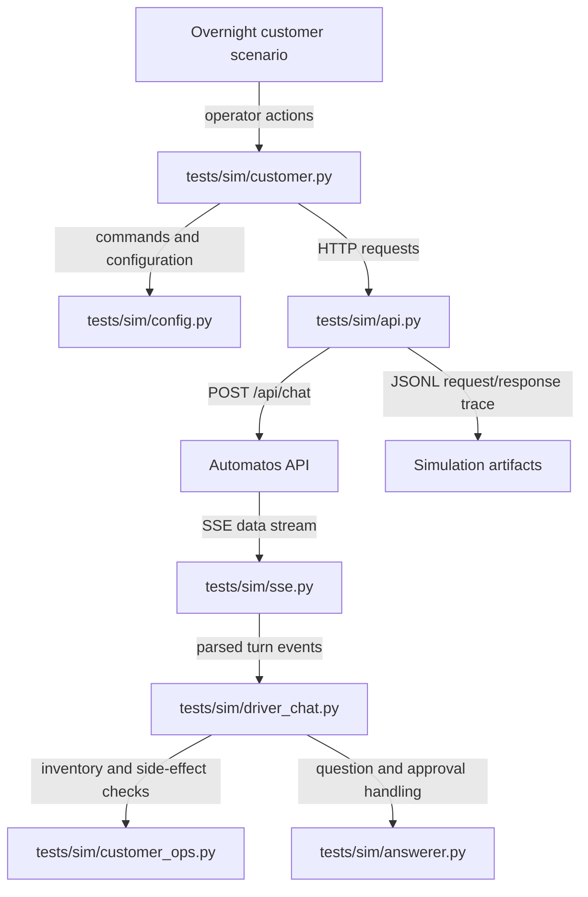
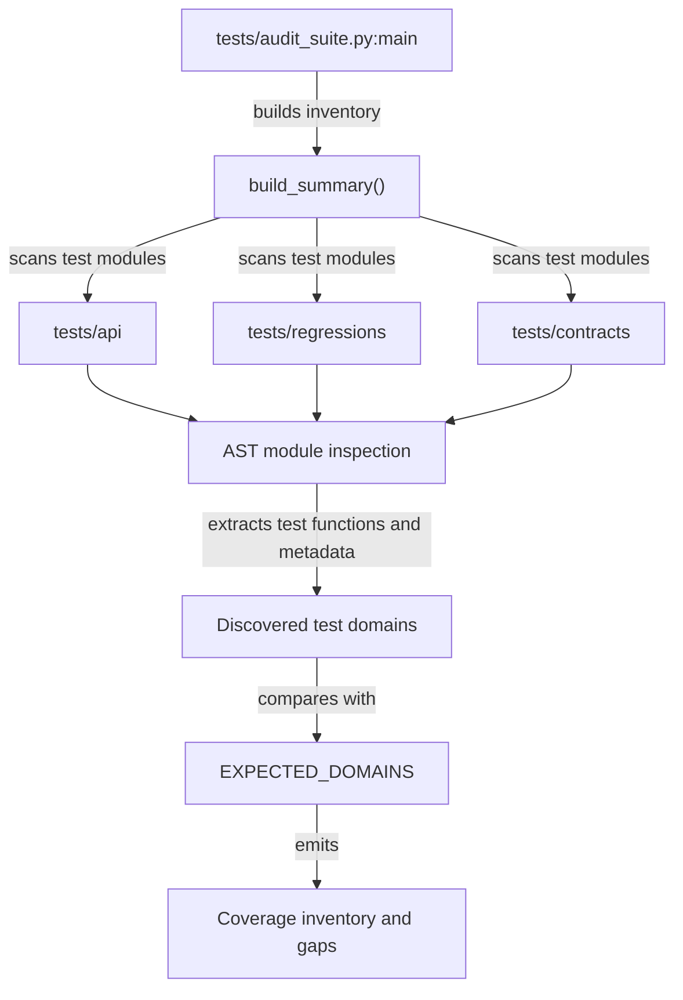
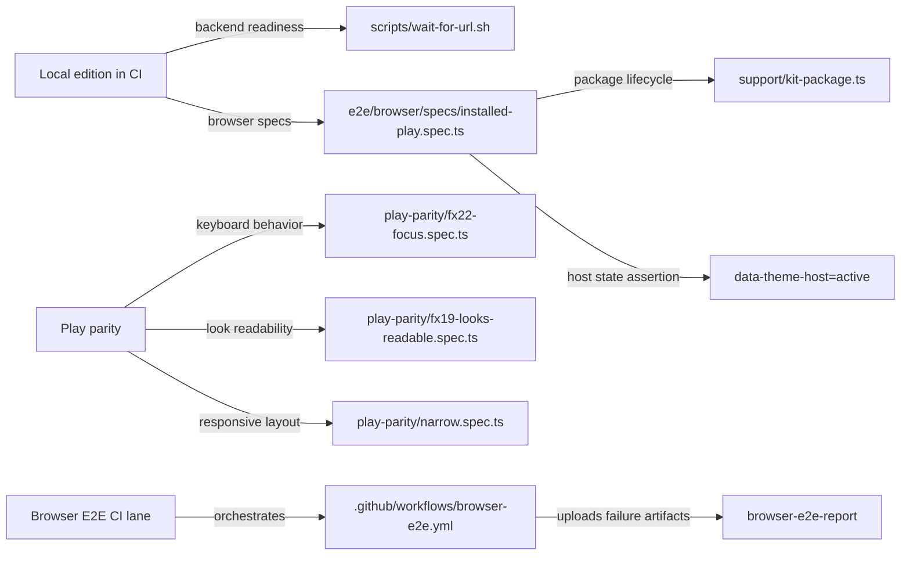

# Live API & E2E Testing

Relevant source files

The following files were used as context for generating this wiki page:

- [.github/workflows/browser-e2e.yml](.github/workflows/browser-e2e.yml)
- [e2e/browser/README.md](e2e/browser/README.md)
- [e2e/browser/parity-checklist.md](e2e/browser/parity-checklist.md)
- [e2e/browser/specs/installed-play-ai-label.spec.ts](e2e/browser/specs/installed-play-ai-label.spec.ts)
- [e2e/browser/specs/installed-play.spec.ts](e2e/browser/specs/installed-play.spec.ts)
- [e2e/browser/specs/play-parity/fx19-looks-readable.spec.ts](e2e/browser/specs/play-parity/fx19-looks-readable.spec.ts)
- [e2e/browser/specs/play-parity/fx22-focus.spec.ts](e2e/browser/specs/play-parity/fx22-focus.spec.ts)
- [e2e/browser/specs/play-parity/narrow.spec.ts](e2e/browser/specs/play-parity/narrow.spec.ts)
- [e2e/browser/specs/play-parity/play-routes.spec.ts](e2e/browser/specs/play-parity/play-routes.spec.ts)
- [e2e/browser/specs/play-previews.spec.ts](e2e/browser/specs/play-previews.spec.ts)
- [e2e/browser/support/play-chat.ts](e2e/browser/support/play-chat.ts)
- [orchestrator/services/themes/data/signing-keys.json](orchestrator/services/themes/data/signing-keys.json)
- [orchestrator/services/themes/signature_verify.py](orchestrator/services/themes/signature_verify.py)
- [orchestrator/tests/test_prd261_signature_verify.py](orchestrator/tests/test_prd261_signature_verify.py)

## Purpose and Scope
This page describes the live API and end-to-end testing lanes: the nightly pytest runner and its API journeys, regression and contract coverage, the browser-only Playwright lane, and the customer simulation harness. It focuses on how these tests exercise the application and turn test outcomes into reports and checks. [tests/run_nightly.py:1-187]()

Sources: [tests/run_nightly.py:1-187]()

---

## 1. Nightly Runner Architecture (`tests/run_nightly.py`)

The nightly runner invokes pytest for API journeys, regressions, contracts, and selected regression modules, then produces a compact summary from the JSON test report. This separates test execution from downstream consumption of the results. [tests/run_nightly.py:35-42, 71-99, 140-187]()

### Results Directory Resolution

`_resolve_results_dir()` selects where artifacts are written. It prefers `AUTOMATOS_RESULTS_DIR`, then uses a workspace-specific artifacts directory when running in a workspace, and otherwise falls back to `tests/api/reports/`. [tests/run_nightly.py:45-61]()

| Resolution order | Condition | Result |
|---|---|---|
| 1 | `AUTOMATOS_RESULTS_DIR` is set | Use the explicit path |
| 2 | Runner is inside a workspace | Use `/workspaces/{id}/artifacts/results/` |
| 3 | Neither applies | Use `tests/api/reports/` |

Sources: [tests/run_nightly.py:45-61]()

### Execution and Summary Generation

`run_pytest()` selects test targets from `tests/api`, `tests/regressions`, and `tests/contracts`, plus additional regression modules. The runner enables JSON reporting; after pytest completes, `build_summary()` reads `test-report.json` and writes `test-summary.json`. [tests/run_nightly.py:35-42, 71-99, 140-187]()

Failure summaries include a pytest `nodeid`, a traceback truncated to 3,000 characters, an extracted assertion message, and parsed source-file references. `_extract_assertion_message()` and `_extract_source_files()` provide the latter fields. [tests/run_nightly.py:111-138, 161-176]()

| Summary field | Purpose |
|---|---|
| `nodeid` | Identifies the failing pytest case |
| `error` | Provides a bounded traceback excerpt |
| `assertion_message` | Surfaces the assertion’s concise diagnostic |
| `source_files` | Points to source file and line references |

Sources: [tests/run_nightly.py:111-138, 140-187]()

### Nightly Runner Execution Flow

The runner translates test execution into report artifacts that can be inspected by maintainers or downstream automation.

Sources: [tests/run_nightly.py:35-42, 71-99, 140-187]()

---

## 2. API Journeys & Smoke Tests (`tests/api/`)

API tests exercise backend behavior through HTTP journeys. The existing test playbook groups coverage into smoke, error-path, CRUD, deep, user-journey, and performance categories. These suites complement narrower unit tests by checking observable API behavior and multi-step state changes. [tests/TEST-PLAYBOOK.md:40-152]()

### Health and System Smoke Tests

`test_health.py` checks `GET /health`, including accepted health status values, and exercises system health and state-summary endpoints. These checks provide basic availability and system-state coverage. [tests/api/test_health.py:9-34]()

### LLM Configuration Validation

`test_llm_config.py` checks that required service categories—including `orchestrator_llm`, `chatbot`, and `complexity_assessor`—are present in system settings and have valid provider and model values. This guards against missing or malformed configuration. [tests/api/test_llm_config.py:1-13, 9-97]()

### Channel Lifecycle and Analytics

`test_channels.py` covers webhook-channel CRUD and analytics. Its analytics assertions include verifying that `today_by_source` is a dictionary, guarding the response shape used by consumers. [tests/api/test_channels.py:1-72]()

### Workflow Recipes

`test_recipes.py` exercises recipe listing, categorization, search, and detail views. It also covers recipe creation with an explicit `created_by: null` payload and asserts the expected default-author behavior. [tests/api/test_recipes.py:1-82]()

### Stateful User Journeys

`test_user_journeys.py` links multiple API operations into flows. The journeys cover agent model-config inspection and update, agent execution, chat-title persistence, workflow execution and status lookup, and heartbeat response shape. [tests/api/test_user_journeys.py:18-159]()

| Journey | API-level behavior exercised |
|---|---|
| Model config round-trip | Create an agent, read its model configuration, update parameters, and verify persistence |
| Agent execution | Execute an active agent and inspect execution metadata |
| Chat title round-trip | Post a message, obtain the chat ID from the stream, rename the chat, and verify persistence |
| Workflow execution | Start a workflow and retrieve execution status |
| Heartbeat response | Run an agent heartbeat and validate the response schema |

Sources: [tests/api/test_health.py:1-34](), [tests/api/test_llm_config.py:1-135](), [tests/api/test_channels.py:1-82](), [tests/api/test_recipes.py:1-82](), [tests/api/test_user_journeys.py:1-159](), [tests/TEST-PLAYBOOK.md:40-152]()

---

## 3. Customer Simulation Harness (`tests/sim/`)

The simulation harness is intended to run customer-like scenarios against a local Automatos instance using REST endpoints and SSE streams. A headless agent session can act as the scenario operator; the goal is to assess whether a customer achieved the requested outcome and what the run cost. [docs/testing/CUSTOMER-NIGHTS-PLAN.md:1-5, 37-38](), [scripts/ralph/customer-night/PROMPT_customer.md:13-50]()

### Harness Architecture and Modules

- **CLI (`tests/sim/customer.py`)** exposes operations including `preflight`, `chat`, `questions`, `inventory`, `cost`, `judge`, and `purge`. Preflight checks service and workspace prerequisites and can reject a run when its balance is too low. [tests/sim/customer.py:9-16, 137-154]()
- **HTTP client (`tests/sim/api.py`)** sends requests with workspace and API-key headers and records request/response traces as JSONL. It retries selected transient HTTP statuses and connection errors. [tests/sim/api.py:1-72, 129-154]()
- **Chat driver (`tests/sim/driver_chat.py`)** chains chat turns, tracks chat IDs, records effects, and extracts tool, error, and usage information from streamed responses. [tests/sim/driver_chat.py:1-104, 47-55]()
- **SSE parser (`tests/sim/sse.py`)** decodes AI SDK data streams and Automatos-specific frames. It handles backend-assigned chat IDs and platform errors carried in `e:` frames. [tests/sim/sse.py:1-168](), [tests/sim/tests/test_chat_continuity.py:25-33]()
- **Customer operations and answer handling** provide workspace inventory comparisons, local-time conversion, cost summaries, and pending-question resolution. The answerer can answer question grants from a persona script and grant other approvals in a simulation workspace. [tests/sim/customer_ops.py:89-106](), [tests/sim/answerer.py:1-17, 90-121]()
- **Configuration (`tests/sim/config.py`)** controls simulation endpoint, credentials, containers, model IDs, and budget. It restricts non-loopback targets unless `SIM_ALLOW_REMOTE=1` is set and guards against accidentally targeting the operator’s default workspace. [tests/sim/config.py:1-22]()

### Customer Simulation Data Flow

The simulation starts from a customer scenario, makes API calls, parses streamed responses, and records observable workspace effects for later review.

Sources: [docs/testing/CUSTOMER-NIGHTS-PLAN.md:1-56](), [scripts/ralph/customer-night/PROMPT_customer.md:13-50](), [tests/sim/customer.py:1-40, 137-154](), [tests/sim/config.py:1-22](), [tests/sim/api.py:1-75, 129-154](), [tests/sim/sse.py:1-48, 101-104, 145-151](), [tests/sim/driver_chat.py:1-60](), [tests/sim/customer_ops.py:89-106](), [tests/sim/answerer.py:1-17, 90-121]()

---

## 4. Test Suite Inventory and Coverage Audit (`tests/audit_suite.py`)

`tests/audit_suite.py` tracks test coverage by scanning test modules and comparing discovered test domains with `EXPECTED_DOMAINS`. The audit parses Python source with `ast`, extracts test functions, and builds inventory information. [tests/audit_suite.py:1-88]()

### Audit Coverage Pipeline

The audit connects test source files to a machine-readable coverage-gap result.

Sources: [tests/audit_suite.py:1-136]()

---

## 5. Test Helpers and SSE Stream Parsers (`tests/api/helpers.py`, `tests/sim/sse.py`)

API journeys and customer simulations use helpers to generate identifiers and interpret streaming responses. The API helper parser is oriented toward test responses; the simulation parser additionally tracks richer turn events and chat continuity. [tests/api/helpers.py:1-179](), [tests/sim/sse.py:1-168]()

### Key Utilities

- `RUN_ID` provides a session identifier for test runs. [tests/api/helpers.py:10]()
- `uid(prefix)` produces randomized entity names. [tests/api/helpers.py:13-16]()
- `pick(items)` selects from test data pools. [tests/api/helpers.py:19-21]()

### SSE Response Parsers

`tests/api/helpers.parse_sse_response` handles text deltas and JSON data frames, including `2:`, `d:`, and `e:` prefixes. `tests/sim/sse.parse_data_stream` handles the simulation stream’s event types, including chat-ID continuity and platform turn errors. [tests/api/helpers.py:111-179](), [tests/sim/sse.py:1-168](), [tests/sim/tests/test_chat_continuity.py:25-33]()

Sources: [tests/api/helpers.py:1-179](), [tests/sim/sse.py:1-168](), [tests/sim/tests/test_chat_continuity.py:25-33]()

---

## 6. Regression and Contract Suites (`tests/regressions/`, `tests/contracts/`, `orchestrator/tests/`)

Regression suites preserve behavior across changes, while contract tests assert structural and boundary expectations. The nightly runner includes the API, regression, and contract directories as pytest targets. [tests/run_nightly.py:35-42, 71-99]()

An example of a codebase contract test is `test_prd261_signature_verify.py`, which checks theme-signature behavior against shared test vectors. It covers RFC 8032 Ed25519 cases, canonical signing payloads, key identifiers, verification verdicts, malformed key files, and constraints on private-key material in the tested locations. [orchestrator/tests/test_prd261_signature_verify.py:1-19, 105-153]()

### Signature Verification Contract

The verifier builds a payload from the theme ID, version, digest, and file hashes; canonicalizes it to bytes; and checks the signature against configured public keys. The tests point the verifier at temporary key files through the `keys_at` fixture, allowing cases to be exercised without changing the shipped key file. [orchestrator/services/themes/signature_verify.py:104-118, 132-148](), [orchestrator/tests/test_prd261_signature_verify.py:80-103]()

The verifier represents outcomes with `Verdict`: `verified`, `invalid`, or `unsigned`. Its `view()` method exposes the state and key ID. Key parsing rejects invalid shapes, statuses, dates, public-key encodings, mismatched key IDs, and duplicate IDs. [orchestrator/services/themes/signature_verify.py:72-99, 132-148]()

| Contract area | Test intent |
|---|---|
| Shared vector | Pin the RFC-derived cases and the canonical signing payload |
| Key identity | Verify `keyId` derivation from the public-key encoding |
| Signature verdicts | Distinguish verified, invalid, and unsigned inputs |
| Invalid configuration | Reject malformed or duplicate key entries |
| Test isolation | Redirect key loading to temporary files |

Sources: [orchestrator/services/themes/signature_verify.py:72-148](), [orchestrator/tests/test_prd261_signature_verify.py:1-19, 80-153](), [orchestrator/services/themes/data/signing-keys.json:1]()

### Browser E2E Tests (`e2e/browser/`)

The browser lane runs Playwright against the local edition using real Chromium and WebKit. It targets browser behavior that jsdom-based tests cannot establish, including module loading, import maps, and real page rendering. It is a CI lane separate from the Python scenario runner in `e2e/`, and the README states that it does not run on a maintainer’s machine. [e2e/browser/README.md:1-10]()

The GitHub Actions workflow watches selected frontend, theme-host, backend theme, boot-substrate, browser-test, and workflow paths. It supports `workflow_dispatch` inputs for a Design Kit commit and theme; pull-request and push runs use the configured default kit reference and theme. [/.github/workflows/browser-e2e.yml:19-45, 53-66, 130-148]()

The lane boots PostgreSQL, Redis, MinIO, and the backend through Docker Compose, waits for readiness, builds and serves the frontend standalone output, installs Playwright and its browsers, type-checks the specs, and runs them. Failure artifacts include reports, traces, screenshots, videos, and backend/frontend logs. [e2e/browser/README.md:12-28]()

#### Installed Theme and Play Package Tests

The Design Kit package job packs a theme package; the browser lane installs that package through the theme import, opt-in, and choice flow. The installed-theme spec checks that the theme host becomes `active`, the Play class appears on `<html>`, the Play sidebar is visible, the Studio shell is absent, and no page errors were recorded. [e2e/browser/README.md:30-55](), [e2e/browser/specs/installed-play.spec.ts:27-53]()

The installed-theme spec is isolated because the member’s theme choice is stored on the lane backend. The README describes running this step one test at a time and restoring the selection and install state afterward. [e2e/browser/README.md:49-55, 61-82]()

#### Play Parity and Browser-Specific Assertions

The parity specs validate installed-package behavior using browser-visible results. Examples include keyboard-focus behavior after failed turns and backend availability changes, readable look selection controls using computed styles, and responsive layouts across narrow and phone-sized viewports. [e2e/browser/specs/play-parity/fx22-focus.spec.ts:13-27, 77-95](), [e2e/browser/specs/play-parity/fx19-looks-readable.spec.ts:5-16, 121-132](), [e2e/browser/specs/play-parity/narrow.spec.ts:4-19, 21-56]()

The installed Play AI-label test checks that the host-provided “Auto is an AI” label remains visible when styles attempt to hide it, and that the chat composer’s controls remain enabled. It exercises DOM layout and paint behavior that jsdom does not provide. [e2e/browser/specs/installed-play-ai-label.spec.ts:9-35, 59-76]()

#### Preview Capture and Manual Verification

`play-previews.spec.ts` captures deterministic listing screenshots for Play presets and selected pages. It specifies a 1440×900 viewport, CSS-pixel scaling, reduced animation, and stability checks, and it uses controlled API responses for conversations and deliverables. [e2e/browser/specs/play-previews.spec.ts:11-35, 37-69, 105-113]()

The parity checklist records manual checks that automation cannot fully cover, including visual comparison, physical devices and real browsers, screen-reader behavior, and SaaS-only session and step-up flows. It directs reviewers to record the core and kit commits, environment, browser/device, tester, and date. [e2e/browser/parity-checklist.md:1-31, 33-83]()

### Browser Lane: Natural-Language Intent to Code Entities

This diagram maps the browser-testing concepts—local app, installed theme, and parity checks—to the workflow and spec entities that implement them.

Sources: [e2e/browser/README.md:12-28](), [e2e/browser/specs/installed-play.spec.ts:27-53](), [e2e/browser/specs/play-parity/fx22-focus.spec.ts:77-95](), [e2e/browser/specs/play-parity/fx19-looks-readable.spec.ts:121-132](), [e2e/browser/specs/play-parity/narrow.spec.ts:4-19](), [/.github/workflows/browser-e2e.yml:1-45]()

### Continuous Integration Test Enforcements

The browser lane is one part of the repository’s testing workflow. The existing page describes additional CI workflows for orchestrator pytest, fresh-clone smoke testing, image builds, malware scanning, media rendering, Shopify isolation, import linting, and checkout line endings. [/.github/workflows/test.yml:1-150](), [/.github/workflows/smoke-fresh-clone.yml:1-100](), [/.github/workflows/images.yml:1-52]()

Sources: [/.github/workflows/test.yml:1-150](), [/.github/workflows/smoke-fresh-clone.yml:1-100](), [/.github/workflows/images.yml:1-52](), [/.github/workflows/browser-e2e.yml:1-148](), [e2e/browser/README.md:1-28]()

---