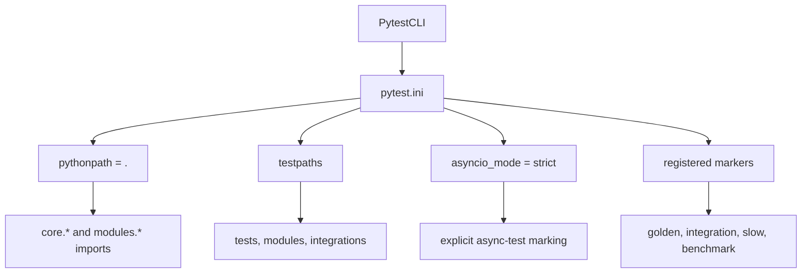
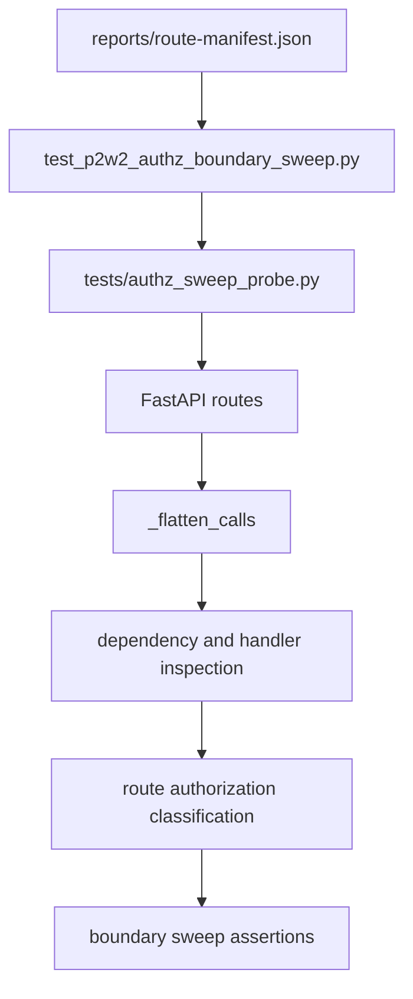
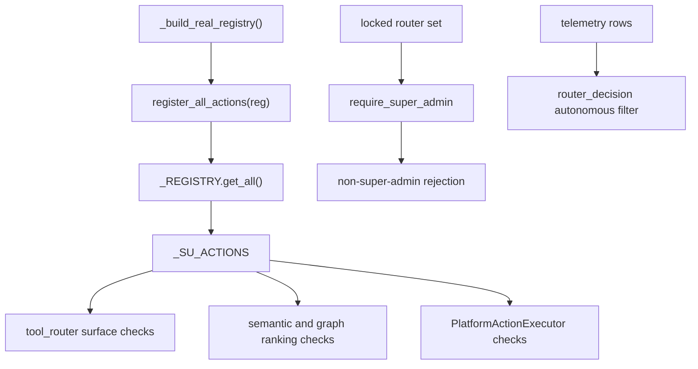
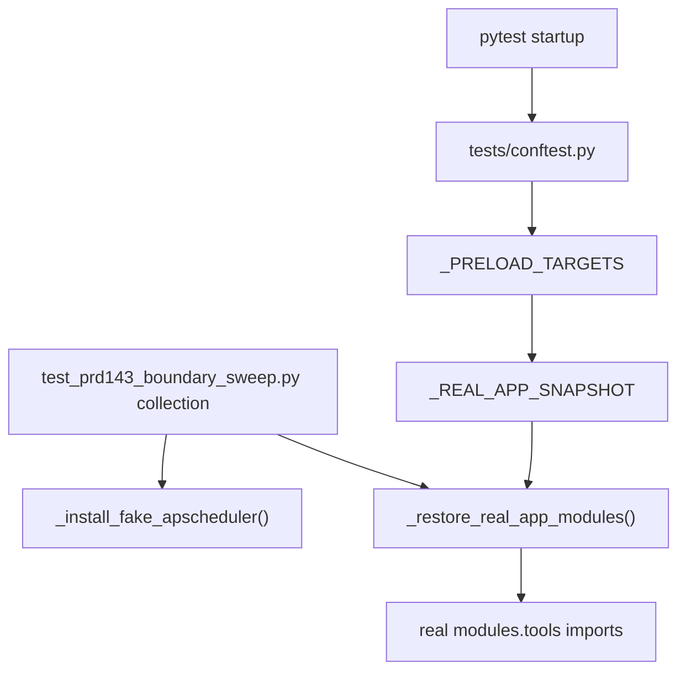

# Orchestrator Test Suites

<details>
<summary>Relevant source files</summary>

The following files were used as context for generating this wiki page:

- [docs/PRDS/PRD-143-AUTO-FULL-PLATFORM-OPERATOR.md](docs/PRDS/PRD-143-AUTO-FULL-PLATFORM-OPERATOR.md)
- [docs/PRDS/PRD-264-EU-AI-ACT-ARTICLE-50.md](docs/PRDS/PRD-264-EU-AI-ACT-ARTICLE-50.md)
- [docs/universal-router/tier-2-rule-based-routing.md](docs/universal-router/tier-2-rule-based-routing.md)
- [frontend/lib/ai/models.ts](frontend/lib/ai/models.ts)
- [frontend/lib/llm-defaults.ts](frontend/lib/llm-defaults.ts)
- [orchestrator/alembic/versions/prd264_blog_review.py](orchestrator/alembic/versions/prd264_blog_review.py)
- [orchestrator/api/blog.py](orchestrator/api/blog.py)
- [orchestrator/api/widgets/blog.py](orchestrator/api/widgets/blog.py)
- [orchestrator/core/generation_guard.py](orchestrator/core/generation_guard.py)
- [orchestrator/core/llm/defaults.py](orchestrator/core/llm/defaults.py)
- [orchestrator/core/services/blog_post_view.py](orchestrator/core/services/blog_post_view.py)
- [orchestrator/core/services/blog_review.py](orchestrator/core/services/blog_review.py)
- [orchestrator/core/services/blog_service.py](orchestrator/core/services/blog_service.py)
- [orchestrator/modules/documents/brand_style.py](orchestrator/modules/documents/brand_style.py)
- [orchestrator/modules/socials/recipes/footage.py](orchestrator/modules/socials/recipes/footage.py)
- [orchestrator/modules/socials/recipes/footage_toolkits.py](orchestrator/modules/socials/recipes/footage_toolkits.py)
- [orchestrator/modules/socials/recipes/voice.py](orchestrator/modules/socials/recipes/voice.py)
- [orchestrator/modules/tools/discovery/actions_blog.py](orchestrator/modules/tools/discovery/actions_blog.py)
- [orchestrator/modules/tools/discovery/handlers_blog.py](orchestrator/modules/tools/discovery/handlers_blog.py)
- [orchestrator/modules/tools/discovery/metadata_graph_seed.py](orchestrator/modules/tools/discovery/metadata_graph_seed.py)
- [orchestrator/scripts/seed_blog_playbook.py](orchestrator/scripts/seed_blog_playbook.py)
- [orchestrator/scripts/seed_tool_routing_graph.py](orchestrator/scripts/seed_tool_routing_graph.py)
- [orchestrator/tests/conftest.py](orchestrator/tests/conftest.py)
- [orchestrator/tests/test_config.py](orchestrator/tests/test_config.py)
- [orchestrator/tests/test_prd143_boundary_sweep.py](orchestrator/tests/test_prd143_boundary_sweep.py)
- [orchestrator/tests/test_prd143_graph_seed.py](orchestrator/tests/test_prd143_graph_seed.py)
- [orchestrator/tests/test_prd143_selection_at_scale.py](orchestrator/tests/test_prd143_selection_at_scale.py)
- [orchestrator/tests/test_prd143_su_executor_gate.py](orchestrator/tests/test_prd143_su_executor_gate.py)
- [orchestrator/tests/test_prd143_su_surface.py](orchestrator/tests/test_prd143_su_surface.py)
- [orchestrator/tests/test_prd164_agent_match.py](orchestrator/tests/test_prd164_agent_match.py)
- [orchestrator/tests/test_prd164_dispatch_digest.py](orchestrator/tests/test_prd164_dispatch_digest.py)
- [orchestrator/tests/test_prd164_match_reasons_surface.py](orchestrator/tests/test_prd164_match_reasons_surface.py)
- [orchestrator/tests/test_prd164_progress_ledger.py](orchestrator/tests/test_prd164_progress_ledger.py)
- [orchestrator/tests/test_prd232_us006_corpus_embeddings.py](orchestrator/tests/test_prd232_us006_corpus_embeddings.py)
- [orchestrator/tests/test_prd251bw3_ai_options.py](orchestrator/tests/test_prd251bw3_ai_options.py)
- [orchestrator/tests/test_prd251w1_generate_tools.py](orchestrator/tests/test_prd251w1_generate_tools.py)
- [orchestrator/tests/test_prd264_art5_footage.py](orchestrator/tests/test_prd264_art5_footage.py)
- [orchestrator/tests/test_prd264_art5_generation_guard.py](orchestrator/tests/test_prd264_art5_generation_guard.py)
- [orchestrator/tests/test_prd264_euai08b_blog_review.py](orchestrator/tests/test_prd264_euai08b_blog_review.py)
- [orchestrator/tests/test_prd264_euai09_wiring.py](orchestrator/tests/test_prd264_euai09_wiring.py)

</details>


## Purpose and Scope

This page documents the orchestrator’s pytest configuration, test isolation and database setup, security-boundary checks, and representative PRD- and feature-tagged regression suites. It also describes the import-protection patterns used by tests that load real application modules alongside lightweight stubs. [orchestrator/pytest.ini:1-35](), [orchestrator/tests/conftest.py:12-24](), [orchestrator/tests/test_prd143_boundary_sweep.py:1-27]()

Sources: `orchestrator/pytest.ini`, `orchestrator/tests/conftest.py`, `orchestrator/tests/test_prd143_boundary_sweep.py`

---

## 1. Test Estate Configuration & Pytest Initialization

`orchestrator/pytest.ini` provides the pytest defaults for import paths, test discovery, asynchronous tests, and registered markers. The settings make the orchestrator directory the import root, discover tests across the configured trees, and require explicit marking of async tests under strict asyncio mode. [orchestrator/pytest.ini:1-35]()

- **`pythonpath = .`**: Makes the orchestrator root available for imports such as `core.*` and `modules.*`. [orchestrator/pytest.ini:6-7]()
- **`testpaths`**: Configures discovery in the `tests`, `modules`, and `integrations` trees. [orchestrator/pytest.ini:21-24]()
- **`asyncio_mode = strict`**: Uses strict `pytest-asyncio` behavior, requiring async tests to opt in explicitly. [orchestrator/pytest.ini:26-28]()
- **Custom markers**: Registers `golden`, `integration`, `slow`, and `benchmark` for categorizing test runs. [orchestrator/pytest.ini:31-35]()

**Diagram: pytest configuration mapped to test discovery and imports**



Sources: `orchestrator/pytest.ini`

---

## 2. Conftest Fixtures and Package Protection

The suite uses conftest-level setup to isolate process-global state and repair import state that can be contaminated by tests installing package stubs. The supplied test conftest also puts the orchestrator root on `sys.path`, so tests can import the application package. [orchestrator/tests/conftest.py:1-10](), [orchestrator/tests/conftest.py:67-70]()

### Root Conftest (`orchestrator/conftest.py`)

The root conftest provides database-oriented fixtures for tests that need a SQLAlchemy engine, a transactional session, or a workspace row. Its session fixture pattern rolls back the transaction during teardown, while the workspace fixture supplies a minimal row for foreign-key-dependent tests. [orchestrator/conftest.py:30-94]()

- `test_db_url()` resolves a database URL through `get_database_url()`. [orchestrator/conftest.py:30-38]()
- `test_engine` creates a session-scoped SQLAlchemy engine from that URL. [orchestrator/conftest.py:40-48]()
- `db_session()` yields a session bound to a transaction and rolls the transaction back during teardown. [orchestrator/conftest.py:50-67]()
- `seed_workspace()` inserts a minimal workspace record for tests that require one. [orchestrator/conftest.py:69-94]()

Sources: `orchestrator/conftest.py`

### Module Conftest & Stub Repair (`orchestrator/tests/conftest.py`)

The test-level conftest addresses process-wide Python import state. Some unit tests insert `ModuleType` stubs into `sys.modules` to avoid importing package initializers that pull in optional dependencies. Such stubs can break later imports or `monkeypatch` attribute traversal if a child module is not bound on its parent package. [orchestrator/tests/conftest.py:150-165]()

`_module_is_real()` distinguishes a genuinely loaded module from a stub by checking whether `__file__` exists on disk or whether the module has namespace-package search locations. This deliberately treats path-bearing stubs with no real file as stubs, avoiding the false-positive behavior of checks based only on `__path__` or `__spec__`. [orchestrator/tests/conftest.py:12-32]()

The conftest declares `_PRELOAD_TARGETS` for the real application import chain and maintains `_REAL_APP_SNAPSHOT`. `_restore_real_app_modules()` replaces a missing or stubbed entry with its preloaded real module, but leaves a currently real module untouched. [orchestrator/tests/conftest.py:35-65]()

Autouse fixtures reset process-level caches around tests:

- `_reset_composio_deny_list_cache` calls `reset_cache()` on already-imported `core.composio.deny_list` and `core.composio.post_gate` modules. It avoids importing either module merely to reset it, since doing so could interfere with tests that install stubs. [orchestrator/tests/conftest.py:73-89]()
- `_reset_composio_lookup_cache` calls `forget_all()` on an already-imported `core.composio.lookup_cache`. [orchestrator/tests/conftest.py:91-104]()
- `_reset_theme_boot_files` calls `forget_boot_files()` on an already-imported `services.themes.serve`. [orchestrator/tests/conftest.py:106-120]()
- `_generation_guard_reads_clean` allows tests marked `real_generation_guard` to exercise the real guard. For other tests, it replaces `read_answers` with a clean result and enables the guard read, while leaving tests that cannot import the guard alone. [orchestrator/tests/conftest.py:122-147]()

**Diagram: import restoration and autouse isolation mapped to code entities**

```mermaid
graph TD
    A["pytest collection"] --> B["_PRELOAD_TARGETS"]
    B --> C["_REAL_APP_SNAPSHOT"]
    D["pytest_collectstart"] --> E["_restore_real_app_modules"]
    C --> E
    E --> F["_module_is_real"]
    F -->| "missing or stub" | G["restore real module in sys.modules"]
    F -->| "real module" | H["leave current module"]
    I["test setup"] --> J["_reset_composio_deny_list_cache"]
    I --> K["_reset_composio_lookup_cache"]
    I --> L["_reset_theme_boot_files"]
    I --> M["_generation_guard_reads_clean"]
    I --> N["_repair_stubbed_package_bindings"]
```

Sources: `orchestrator/tests/conftest.py`

---

## 3. Database Initialization & Schema Provisioning

`orchestrator/scripts/init_test_db.py` provides a test-database initialization path that creates SQLAlchemy metadata and adds raw-DDL tables used by integration tests. It imports `modules.memory.models` so those models are registered before metadata creation. [orchestrator/scripts/init_test_db.py:17-21]()

`init_db()` creates registered models with `Base.metadata.create_all(bind=engine)` and executes additional DDL for tables that do not rely solely on SQLAlchemy model metadata, including document chunks and code-graph tables. `_pgvector_available()` checks whether the database supports the vector extension so initialization can choose an appropriate schema path. [orchestrator/scripts/init_test_db.py:23-41](), [orchestrator/scripts/init_test_db.py:48-151]()

**Diagram: test database initialization mapped to functions and schema entities**

```mermaid
graph TD
    A["init_db()"] --> B["import modules.memory.models"]
    A --> C["Base.metadata.create_all"]
    C --> D["registered SQLAlchemy models"]
    A --> E["_pgvector_available()"]
    E -->| "vector available" | F["vector-enabled schema"]
    E -->| "vector unavailable" | G["fallback schema"]
    A --> H["raw DDL"]
    H --> I["document_chunks"]
    H --> J["codegraph tables"]
```

Sources: `orchestrator/scripts/init_test_db.py`

---

## 4. PRD-Tagged Regression and Feature Test Suites

PRD-oriented test files encode behavior as testable contracts, often with test names and module docstrings identifying the requirement or implementation wave under test. The examples below cover authorization boundaries, session-mode behavior, tool selection, media generation, and content-safety wiring. [orchestrator/tests/test_prd143_boundary_sweep.py:1-27](), [orchestrator/tests/test_prd251w1_generate_tools.py:1-31]()

### AuthZ Boundary Sweeps & Probes (`test_p2w2_authz_boundary_sweep.py`, `authz_sweep_probe.py`)

The boundary sweep compares routes from the live application with an expected route-manifest contract and probes the app in a separate process. Its route classification accounts for workspace permissions, super-admin-only routers, workspace-admin checks, non-hybrid authentication paths, intentionally public routes, and handler-level authorization checks. [orchestrator/tests/test_p2w2_authz_boundary_sweep.py:1-30](), [orchestrator/tests/authz_sweep_probe.py:1-23]()

The probe inspects FastAPI routes and their dependencies, then checks the resulting structural classifications. This separates route enumeration from the sweep’s assertions and allows the app probe to run without relying on the test process’s imported application state. [orchestrator/tests/authz_sweep_probe.py:1-105](), [orchestrator/tests/test_p2w2_authz_boundary_sweep.py:1-30]()

**Diagram: route contract and probe mapped to test entities**



Sources: `orchestrator/tests/test_p2w2_authz_boundary_sweep.py`, `orchestrator/tests/authz_sweep_probe.py`

### Family Permission Gates (`test_p2w2_family_gates.py`)

The family-gate suite checks representative workspace permission behavior across routes and subsystem families. It verifies permission-decorator wiring and exercises the expected denial and success behavior for role categories such as viewers, editors, and administrators. [orchestrator/tests/test_p2w2_family_gates.py:1-16](), [orchestrator/tests/test_p2w2_family_gates.py:49-130]()

Sources: `orchestrator/tests/test_p2w2_family_gates.py`

### PRD-245 Session Token Real-DB Suite (`test_prd245_session_token_realdb.py`)

The session-token suite is marked for integration testing and exercises session token behavior against a real database. Its documented contract includes storing a token hash rather than a plaintext session token and resolving credentials in relation to the state of the associated board task. [orchestrator/tests/test_prd245_session_token_realdb.py:1-36](), [orchestrator/tests/test_prd245_session_token_realdb.py:130-160]()

Sources: `orchestrator/tests/test_prd245_session_token_realdb.py`

### Review Semantics & Denial Classification (`test_prd245_review_semantics.py`)

The review-semantics tests cover when a session-mode request should or should not require human review. The suite distinguishes read attempts and unknown or automated requests from cases such as expired holds or operator-denied tool requests that should move a ticket into review. [orchestrator/tests/test_prd245_review_semantics.py:1-13](), [orchestrator/tests/test_prd245_review_semantics.py:120-167]()

Sources: `orchestrator/tests/test_prd245_review_semantics.py`

### Session Mode Settings (`test_prd239_session_mode_settings.py`)

The session-mode settings tests cover workspace configuration, including default folders and project-directory mounts, as well as fallback behavior when settings are absent. [orchestrator/tests/test_prd239_session_mode_settings.py:1-119]()

Sources: `orchestrator/tests/test_prd239_session_mode_settings.py`

### Security Boundary Sweeps (`test_prd143_boundary_sweep.py`)

The PRD-143 boundary sweep is a cross-cutting, negative security test. It derives the super-admin-only action set from the live action registry rather than hardcoding it, and tests that operator paths do not expose or execute those actions. The suite’s stated coverage includes tool schemas and dispatcher enums, semantic and graph ranking, executor denial, router-wide super-admin dependencies, autonomy-surface checks, and telemetry filtering. [orchestrator/tests/test_prd143_boundary_sweep.py:1-27]()

The test builds a real `ActionRegistry` directly, calls `register_all_actions(reg)`, and derives `_SU_ACTIONS` from definitions with `super_admin_only`. That source-of-truth approach makes new super-admin-only actions part of the sweep automatically. [orchestrator/tests/test_prd143_boundary_sweep.py:128-148]()

For import safety, the suite sets inert test Postgres environment defaults and conditionally stubs APScheduler only if the dependency is truly missing. It restores the preloaded real application modules before importing the real tool router, action registry, executor, and telemetry modules. [orchestrator/tests/test_prd143_boundary_sweep.py:47-55](), [orchestrator/tests/test_prd143_boundary_sweep.py:59-93](), [orchestrator/tests/test_prd143_boundary_sweep.py:100-122]()

**Diagram: security requirements mapped to registry, tool surfaces, and execution entities**



Sources: `orchestrator/tests/test_prd143_boundary_sweep.py`

### In-Repo Topology & Import Contracts (`test_prd143_boundary_sweep.py`)

Several regression tests depend on importing real application packages after other tests have installed stubs into `sys.modules`. The `tests/conftest.py` preload-and-restore pattern is the primary protection: it snapshots selected real modules while imports are clean, then restores missing or stubbed entries. The boundary-sweep module calls `_restore_real_app_modules()` before importing the real tool and authentication dependencies as a standalone or reordered-run safeguard. [orchestrator/tests/conftest.py:35-65](), [orchestrator/tests/test_prd143_boundary_sweep.py:100-122]()

The test also uses `_install_fake_apscheduler()` only when APScheduler is absent, avoiding shadowing a real installation that later test modules may need. [orchestrator/tests/test_prd143_boundary_sweep.py:59-93]()

**Diagram: import contract between pytest startup and PRD-143 collection**



Sources: `orchestrator/tests/conftest.py`, `orchestrator/tests/test_prd143_boundary_sweep.py`

### Socials Templates and Media Rendering Tests

The Socials-related tests cover social document formats, playbook execution, generation tooling, template contracts, and media-specific behavior. The `test_prd251w1_generate_tools.py` module describes tests that exercise `generate_document`, fixed-step playbook rendering with scratchpad values, and `platform_generate_cover_image`. [orchestrator/tests/test_prd251w1_generate_tools.py:1-31]()

#### Seeded Social Templates (`test_prd251w1_seeded_templates.py`)

This suite verifies seeded social video templates and their associated template data, including footage slots, voice lines, and brand palettes. [orchestrator/tests/test_prd251w1_seeded_templates.py:1-36]()

Sources: `orchestrator/tests/test_prd251w1_seeded_templates.py`

#### Social Templates Data Contract (`test_prd251w1_social_templates.py`)

This suite checks the social template data contract, including format availability, block-schema validation, brand-rule behavior, and document-generation dispatch. [orchestrator/tests/test_prd251w1_social_templates.py:1-27]()

Sources: `orchestrator/tests/test_prd251w1_social_templates.py`

#### Brand Board (`test_prd255w2_brand_board.py`)

The brand-board tests cover rendering a brand kit into a page and social card, including the rendering and document-reading dependencies named by the test module. [orchestrator/tests/test_prd255w2_brand_board.py:1-13]()

Sources: `orchestrator/tests/test_prd255w2_brand_board.py`

#### PRD-251 Wave 1 Generate Tools (`test_prd251w1_generate_tools.py`)

The suite exercises `generate_document` with social formats and a seeded template, fixed-step playbook rendering where a prior step supplies structured data through `scratchpad_write`, and `platform_generate_cover_image` with and without a blog post association. The module documents its use of a real media-render client with `httpx.MockTransport`, plus the associated deliverable and content-provenance expectations. [orchestrator/tests/test_prd251w1_generate_tools.py:1-31]()

Sources: `orchestrator/tests/test_prd251w1_generate_tools.py`

### PRD-264 EU AI Act Article 5 Tests

The PRD-264 test cluster covers generation guard behavior and its integration with generated-media flows. The Socials footage implementation identifies `core.generation_guard` as a dependency and labels the footage guard path `socials.footage`; test conftest configures a clean guard response for tests that are not explicitly marked `real_generation_guard`. [orchestrator/modules/socials/recipes/footage.py:65-75](), [orchestrator/modules/socials/recipes/footage.py:106-110](), [orchestrator/tests/conftest.py:122-147]()

#### Generation Guard (`test_prd264_art5_generation_guard.py`)

This suite tests the generation guard’s refusal and safety behavior, including blocked terms, model-based reads, failure handling, provider refusals, and reference-image analysis. [orchestrator/tests/test_prd264_art5_generation_guard.py:1-13]()

Sources: `orchestrator/tests/test_prd264_art5_generation_guard.py`

#### Footage Generation (`test_prd264_art5_footage.py`)

The footage tests cover the generation-guard interaction with the Socials footage-generation path, including prompt checks before external toolkit submission. [orchestrator/tests/test_prd264_art5_footage.py:1-10](), [orchestrator/modules/socials/recipes/footage.py:1-31]()

Sources: `orchestrator/tests/test_prd264_art5_footage.py`, `orchestrator/modules/socials/recipes/footage.py`

#### AI-Generated Content Marking Wiring (`test_prd264_euai09_wiring.py`)

This suite checks the wiring of AI-generated metadata and review timestamps across the blog API, service, and persistence layers. [orchestrator/tests/test_prd264_euai09_wiring.py:1-10]()

Sources: `orchestrator/tests/test_prd264_euai09_wiring.py`

#### Blog Review Semantics (`test_prd264_euai08b_blog_review.py`)

The blog-review tests cover review behavior and invalidation when content changes. The blog API imports the shared post-view helpers used to expose the current text and review-related metadata. [orchestrator/tests/test_prd264_euai08b_blog_review.py:1-16](), [orchestrator/api/blog.py:25-26]()

Sources: `orchestrator/tests/test_prd264_euai08b_blog_review.py`, `orchestrator/api/blog.py`

**Diagram: compliance test areas mapped to test modules and implementation entities**

```mermaid
graph TD
    A["PRD-264 Article 5 tests"] --> B["test_prd264_art5_generation_guard.py"]
    A --> C["test_prd264_art5_footage.py"]
    A --> D["test_prd264_euai09_wiring.py"]
    A --> E["test_prd264_euai08b_blog_review.py"]
    B --> F["core.generation_guard"]
    C --> G["modules.socials.recipes.footage"]
    G --> F
    D --> H["api.blog and blog service wiring"]
    E --> I["blog review behavior"]
    J["_generation_guard_reads_clean"] --> F
    J -->| "real_generation_guard marker" | K["exercise real guard behavior"]
```

Sources: `orchestrator/tests/conftest.py`, `orchestrator/tests/test_prd264_art5_generation_guard.py`, `orchestrator/tests/test_prd264_art5_footage.py`, `orchestrator/tests/test_prd264_euai09_wiring.py`, `orchestrator/tests/test_prd264_euai08b_blog_review.py`, `orchestrator/modules/socials/recipes/footage.py`

---