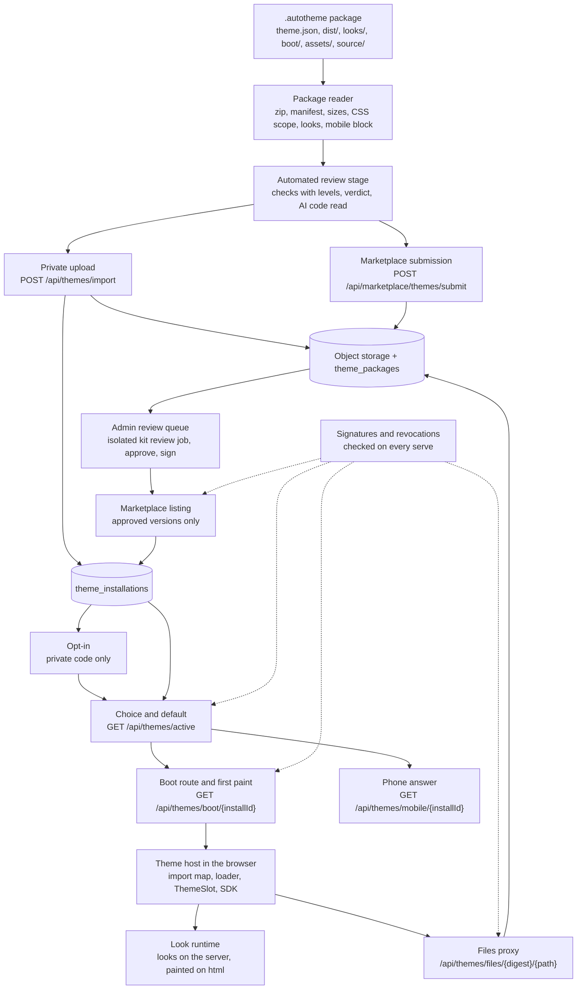

# Theme host

Relevant source files

The following files were used as context for generating this page:

- [orchestrator/services/themes/package.py](../../orchestrator/services/themes/package.py)
- [orchestrator/services/themes/manifest.py](../../orchestrator/services/themes/manifest.py)
- [orchestrator/services/themes/contract.py](../../orchestrator/services/themes/contract.py)
- [orchestrator/services/themes/digest.py](../../orchestrator/services/themes/digest.py)
- [orchestrator/services/themes/look_schema.py](../../orchestrator/services/themes/look_schema.py)
- [orchestrator/services/themes/review_stage.py](../../orchestrator/services/themes/review_stage.py)
- [orchestrator/services/themes/llm_stage.py](../../orchestrator/services/themes/llm_stage.py)
- [orchestrator/services/themes/review_limits.py](../../orchestrator/services/themes/review_limits.py)
- [orchestrator/services/themes/storage.py](../../orchestrator/services/themes/storage.py)
- [orchestrator/services/themes/records.py](../../orchestrator/services/themes/records.py)
- [orchestrator/services/themes/submissions.py](../../orchestrator/services/themes/submissions.py)
- [orchestrator/services/themes/listings.py](../../orchestrator/services/themes/listings.py)
- [orchestrator/services/themes/choices.py](../../orchestrator/services/themes/choices.py)
- [orchestrator/services/themes/optin.py](../../orchestrator/services/themes/optin.py)
- [orchestrator/services/themes/defaults.py](../../orchestrator/services/themes/defaults.py)
- [orchestrator/services/themes/serve.py](../../orchestrator/services/themes/serve.py)
- [orchestrator/services/themes/membership.py](../../orchestrator/services/themes/membership.py)
- [orchestrator/services/themes/mobile.py](../../orchestrator/services/themes/mobile.py)
- [orchestrator/services/themes/signature_state.py](../../orchestrator/services/themes/signature_state.py)
- [orchestrator/services/themes/revocations.py](../../orchestrator/services/themes/revocations.py)
- [orchestrator/services/themes/revocation_feed.py](../../orchestrator/services/themes/revocation_feed.py)
- [orchestrator/services/themes/revocation_pull.py](../../orchestrator/services/themes/revocation_pull.py)
- [orchestrator/services/themes/review.py](../../orchestrator/services/themes/review.py)
- [orchestrator/services/themes/signature_verify.py](../../orchestrator/services/themes/signature_verify.py)
- [orchestrator/services/themes/data/signing-keys.json](../../orchestrator/services/themes/data/signing-keys.json)
- [orchestrator/core/models/themes.py](../../orchestrator/core/models/themes.py)
- [orchestrator/api/themes_import.py](../../orchestrator/api/themes_import.py)
- [orchestrator/api/themes_files.py](../../orchestrator/api/themes_files.py)
- [orchestrator/api/marketplace_themes_submit.py](../../orchestrator/api/marketplace_themes_submit.py)
- [frontend/app/layout.tsx](../../frontend/app/layout.tsx)
- [frontend/app/api/themes/files/[...path]/route.ts](../../frontend/app/api/themes/files/[...path]/route.ts)
- [frontend/lib/theme-host/boot.ts](../../frontend/lib/theme-host/boot.ts)
- [frontend/lib/theme-host/boot-server.ts](../../frontend/lib/theme-host/boot-server.ts)
- [frontend/lib/theme-host/boot-client.ts](../../frontend/lib/theme-host/boot-client.ts)
- [frontend/lib/theme-host/boot-sanitize.ts](../../frontend/lib/theme-host/boot-sanitize.ts)
- [frontend/lib/theme-host/import-map.ts](../../frontend/lib/theme-host/import-map.ts)
- [frontend/lib/theme-host/shared-modules.json](../../frontend/lib/theme-host/shared-modules.json)
- [frontend/lib/theme-host/sources.ts](../../frontend/lib/theme-host/sources.ts)
- [frontend/lib/theme-host/loader.ts](../../frontend/lib/theme-host/loader.ts)
- [frontend/lib/theme-host/manifest.ts](../../frontend/lib/theme-host/manifest.ts)
- [frontend/lib/theme-host/looks/motion.ts](../../frontend/lib/theme-host/looks/motion.ts)
- [frontend/lib/theme-host/look.ts](../../frontend/lib/theme-host/look.ts)
- [frontend/lib/theme-host/constants.ts](../../frontend/lib/theme-host/constants.ts)
- [frontend/lib/theme-host/installed-entry.ts](../../frontend/lib/theme-host/installed-entry.ts)
- [frontend/lib/theme-host/choice-sync.ts](../../frontend/lib/theme-host/choice-sync.ts)
- [frontend/lib/theme-host/looks/provider.tsx](../../frontend/lib/theme-host/looks/provider.tsx)
- [frontend/lib/theme-host/looks/server.ts](../../frontend/lib/theme-host/looks/server.ts)
- [frontend/components/theme-host/theme-host-provider.tsx](../../frontend/components/theme-host/theme-host-provider.tsx)
- [frontend/components/theme-host/theme-import-map.tsx](../../frontend/components/theme-host/theme-import-map.tsx)
- [frontend/components/theme-host/theme-slot.tsx](../../frontend/components/theme-host/theme-slot.tsx)
- [frontend/components/theme-host/theme-frame-slot.tsx](../../frontend/components/theme-host/theme-frame-slot.tsx)
- [frontend/components/theme-host/theme-slot-route.tsx](../../frontend/components/theme-host/theme-slot-route.tsx)
- [frontend/components/theme-host/theme-look-runtime.tsx](../../frontend/components/theme-host/theme-look-runtime.tsx)
- [frontend/lib/theme-sdk/index.ts](../../frontend/lib/theme-sdk/index.ts)
- [frontend/lib/theme-sdk/surface](../../frontend/lib/theme-sdk/surface)
- [frontend/components/settings/themes/appearance-tab.tsx](../../frontend/components/settings/themes/appearance-tab.tsx)
- [frontend/components/marketplace/themes/tab.tsx](../../frontend/components/marketplace/themes/tab.tsx)
- [frontend/app/admin/themes/page.tsx](../../frontend/app/admin/themes/page.tsx)
- [frontend/app/looks/page.tsx](../../frontend/app/looks/page.tsx)
- [orchestrator/reports/route-manifest.json](../../orchestrator/reports/route-manifest.json)

The theme host is the part of Automatos that takes a theme package, checks it, stores it, lets a workspace install
it, and then draws it for each member who chooses it. This topic is for people who work on the platform or run a
server. For what members and workspace admins see, read [Themes](../themes/_index.md). To build a theme, use the
[Automatos Design Kit](https://github.com/AutomatosAI/automatos-design-kit) and its
[guides](https://github.com/AutomatosAI/automatos-design-kit/tree/main/guides).

## Pages in this topic

| Page | What it covers |
|---|---|
| [API reference](api-reference.md) | Every `/api/themes*` route and every admin theme route: who may call it, what it takes and answers, its errors |
| [Security model](security-model.md) | Why private code needs an opt-in, the CSS scope, the SDK boundary, the files proxy, step-up, signatures, revocations, safe mode |
| [Operations](operations.md) | Runbooks: the signing key, an official listing, revoking, the revocation feed, the upload switches, reading a scan report |
| [CSS layer model](css-layer-model.md) | Why theme CSS is unlayered, the scope check, how the approval cards and the AI label hold |
| [Placement slots](placement-reach.md) | The three placement slots and which core pages reach them |
| [SDK surface map](sdk-surface-map.md) | Every name of `@automatos/theme-sdk`, mapped to the core module it replaces |
| [The phone's theme](mobile.md) | The `mobile` block in `theme.json`, `GET /api/themes/mobile/{installId}` and the routes a phone may call |
| [Changing the theme host](changing-the-host.md) | For contributors: what else to update, and which guard fails, when you change a core page, the SDK, the contract, a route or the CI lane |

## From package to screen

Each step below names the code that does it. The routes are listed in full in the [API reference](api-reference.md).

## 1. The package

A theme is one `.autotheme` file: a plain zip. The reader (`services/themes/package.py`, `read_theme_package`)
accepts only these paths (`FILE_KINDS`):

| Path | Type served | Cap |
|---|---|---|
| `theme.json` | `application/json` | 64 KB |
| `dist/entry.js` | `text/javascript` | `THEME_MAX_ENTRY_KB` (300 KB) |
| `dist/chunks/<name>.js` | `text/javascript` | JS plus CSS together under `THEME_MAX_CODE_KB` (3072 KB) |
| `dist/theme.css` | `text/css` | counted in the same JS plus CSS cap |
| `boot/prepaint.json` | `application/json` | 256 KB |
| `looks/schema.json` | `application/json` | 64 KB |
| `looks/presets/<id>.look.json` | `application/json` | 64 KB |
| `assets/fonts/<name>.woff2` | `font/woff2` | 400 KB |
| `assets/fonts/mobile/<name>.ttf` or `.otf` | `font/ttf`, `font/otf` | 400 KB, one sfnt face |
| `assets/fonts/<name>.txt` or `.md` | plain text | 256 KB |
| `assets/mascot/<name>.webm` or `.mp4` | `video/webm`, `video/mp4` | `THEME_MAX_CLIP_KB` (1024 KB) |
| `assets/mascot/<name>.png`, `assets/brand/<name>.png` or `.webp`, `assets/previews/<name>.png` | `image/png`, `image/webp` | 512 KB |
| `source/…` (up to seven folders below `source/`; `.ts`, `.tsx`, `.js`, `.jsx`, `.mjs`, `.cjs`, `.css`, `.json`, `.md`, `.txt`) | plain text | 1 MB per file |
| `README.md`, `CHANGELOG.md`, `LICENSE`, `LICENSE.md`, `LICENSE.txt` | plain text | 256 KB |

The whole package is at most `THEME_MAX_PACKAGE_MB` (10 MB), holds at most 500 entries and unpacks to at most 50 MB.
A package must hold `theme.json`, `dist/entry.js`, `looks/schema.json` and at least one preset. Links, absolute
paths, `..`, backslashes, repeated names, encryption, zip64, any compression but stored or deflated, and SVG files
are refused. Each image, clip and font must be the format its path says.

`theme.json` (schema `automatos-theme/v1`, `services/themes/manifest.py`) is checked field by field; every field the
schema doesn't name is refused. The server accepts `base` `studio` or `classic` (`contract.THEME_BASES`); the browser
host runs only `studio` for now (§7). The Design Kit's
[contract guide](https://github.com/AutomatosAI/automatos-design-kit/blob/main/guides/contract.md) explains each field.
`dist/theme.css` is held to the theme's own class (see [CSS layer model](css-layer-model.md)), and the `mobile`
block to the rules in [The phone's theme](mobile.md).

The reader returns a **file manifest** (`{path: {type, size, sha256}}`) and the **package digest**: the sha256 of
the sorted `path\0sha256\n` lines (`services/themes/digest.py`). The digest depends on the files alone, never on
the zip's order or timestamps. Every later step names the package by it.

A refusal is a 400 with one `{code, path, message}` per problem (a 413 when the package is over its cap).

## 2. The review stage

Every accepted package then runs the automated review stage, inline, before the route answers
(`services/themes/review_stage.py`). It writes the scan report, schema `automatos-theme-scan/v2`:

| Check | What it reads |
|---|---|
| `sizes`, `cssScope`, `looks` | What the reader measured. A package that failed one never gets here, so each is a pass. |
| `contrast` | The `mobile` block's colour pairs (`contract.MOBILE_CONTRAST_PAIRS`, AA): eight text pairs, each foreground on its own fill, at 4.5:1, and `--primary` and `--ring` on `--background` at 3:1. `not_measured` without a block. |
| `uses` | The SDK names `dist/` imports from `@automatos/theme-sdk` against `theme.json`'s `uses`. A name the host's SDK doesn't export is an error. |
| `clonedFrom` | Each cloned page's `clonedFrom.sha` against this release's core page files. A stale clone is a warning. |
| `llm` | The AI code read: a model reads `dist/` (and `source/` for a Marketplace submission) in chunks and scores it 0 to 100. 70 or more is an error, 20 or more a warning. When it can't read all the code, it is at least a warning, "LLM stage did not run". |

Each check has a `level`: `pass`, `warning`, `error` or `not_measured`. The **verdict** is `blocked` on any error,
`review_required` on any warning, else `pass`. `not_measured` never moves it.

What the stage may spend is capped (`services/themes/review_limits.py`): `THEME_REVIEW_MAX_CONCURRENT` stages at once
per process (2), `THEME_UPLOADS_PER_DAY` private uploads per workspace (20) and `THEME_SUBMISSIONS_PER_DAY` submissions
per person (10) in 24 hours, and `THEME_REVIEW_DAILY_TOKENS` LLM tokens a day for every review together (2,000,000).

A Marketplace submission has a second review, run by a person: the Design Kit's **Theme review** workflow, with no
network and no secrets. It rebuilds `dist/` from `source/`, checks the digest, and runs the kit's JS rules on
`source/`. The reviewer pastes its summary into the admin queue. See [Security model](security-model.md#the-review)
and [Operations](operations.md#list-an-official-theme).

The person who uploaded or submitted a package sees the verdict and the plain checks, never the `llm` check or the
level counts (`review_stage.member_view`). [Operations](operations.md#read-a-scan-report) explains each field.

## 3. Storage and install rows

The files go to the Marketplace bucket before the row is committed, so a failed write leaves no row
(`services/themes/storage.py`):

- a Marketplace package under `themes/<publisher>/<slug>/<version>/`;
- a private upload under `themes/_workspace/<workspace id>/<publisher>/<slug>/<version>/`, so two workspaces never
  share files.

The tables (`core/models/themes.py`):

| Table | Holds |
|---|---|
| `theme_packages` | One row per version: `owner_type` (`marketplace` or `workspace`), the manifest, the file manifest, the digest, the storage prefix, `status`, `reviewed`, the scan report and verdict, the signature |
| `theme_publishers` | Who owns a publisher name |
| `theme_installations` | A workspace's install, by reference to a package, with its previous, pending and pinned versions and `is_default` |
| `theme_choices` | A member's choice in a workspace |
| `theme_looks` | A member's saved looks for one theme in a workspace |
| `theme_opt_ins` | A member's opt-in to one private package |
| `theme_workspace_settings` | The workspace's theme settings |
| `theme_revocations` | Revocations, `local` or pulled from the `feed` |
| `theme_revocation_sync` | The local edition's feed pull status (one row) |
| `theme_review_events` | A package's review history and signature requests |

A **private upload** (`POST /api/themes/import`) writes a `workspace` package with `reviewed` false and installs it
in that workspace. A higher version of a theme already installed becomes the install's pending update; the install
never switches by itself. A private upload installs whatever its verdict.

A **Marketplace submission** (`POST /api/marketplace/themes/submit`) writes a `marketplace` package with `status`
`pending`. It must ship `source/`. Nothing is listed until a person approves it in the admin queue. A workspace then
installs it by reference (`POST /api/marketplace/themes/{listingId}/install`): every workspace that installs a version
shares its one package row.

## 4. Opt-in

A package is **private** (`choices.is_private`) when it is a Marketplace version not reviewed yet, or a workspace's
own upload that no active Automatos key vouches for. Its code runs in a member's browser only after that member opts
in to that exact package (`theme_opt_ins` is keyed by workspace, member and package), so every new version asks
again. The dialog shows the server's words: "This theme was not reviewed. Its code runs with your access to all your
workspaces." A reviewed Marketplace version, and a private upload whose signature an active key verifies, need no
opt-in. See [Security model](security-model.md#private-code-and-the-opt-in).

## 5. Choice and default

`GET /api/themes/active` (`services/themes/defaults.py`, `resolve_active`) answers what the member sees, in this
order: the member's own choice (when the workspace lets members choose), then the workspace default, then Studio.
A choice is `classic`, `studio` or an install id. A private theme can never be the workspace default, because a
default runs for members who never said yes to its code. The answer's `source` says where the choice came from:
`choice`, `default` or `fallback`.

The browser keeps the choice in the `automatos-style` cookie as a first-paint cache
(`frontend/lib/theme-host/choice-sync.ts`). Choosing an installed theme stores it with `PUT /api/themes/choice`, then
reloads the page into it.

## 6. The boot route and first paint

The root layout (`frontend/app/layout.tsx`) resolves the style's **boot** on the server before any page code runs.
For an installed theme it asks `GET /api/themes/boot/{installId}` with the member's own session, within 300 ms, and
keeps the answer for 60 seconds per user, install and digest (`frontend/lib/theme-host/boot-server.ts`). When the
fetch fails, is refused or times out, the page paints the base boot. A local install in
`LOCAL_REMOTE_ACCESS=paired` mode always gets the base boot here: the layout holds no device token, so the boot route
answers it 401.

A base boot under an installed theme's style carries no theme entry and no look table, so the browser asks the boot
route itself (`frontend/lib/theme-host/boot-client.ts`): through `apiClient`, with the member's Clerk token or the
paired browser's device token, with no 300 ms limit, and once per install for the page's life. The answer passes the
same `sanitizeThemeBoot` gate. Its entry becomes the active theme (`frontend/contexts/ui-style-context.tsx`), and its
look table and presets become the look runtime's rules (`frontend/lib/theme-host/looks/provider.tsx`), so the look
paints through the runtime's normal paint path, later than first paint but complete. When this fetch fails too, the
browser logs one warning and the theme runs with no look. In safe mode the browser asks for nothing: safe mode loads
no theme code, and its base boot is all the page reads (`isSafeModeHere`, `frontend/lib/theme-host/safe-mode.ts`).
The import map stays as the server wrote it: a page that got the base boot has no module integrity pins.

The boot (`services/themes/serve.py`, `install_boot`) carries the theme's `<html>` classes, its tone, its
`boot/prepaint.json` table, the browser keys of the member's stored look, its presets, the theme's registry entry and
an `integrity` map (`sha256-<base64>` for every JS module). A member who may not run the theme (no opt-in, or a
revoked version) gets the **base boot**: the base's classes and nothing else.

The boot passes `sanitizeThemeBoot` (`frontend/lib/theme-host/boot-sanitize.ts`) before it is written into the page.
The layout writes the import map first in `<head>` (`theme-import-map.tsx`), then the boot as one JSON element, which
one constant script applies with `classList` and `style.setProperty` only (`frontend/lib/theme-host/boot.ts`). So the
theme's classes and look are on the page before React runs.

## 7. The host

The theme host provider (`frontend/components/theme-host/theme-host-provider.tsx`) loads a theme only while the style
is an installed theme. The load (`frontend/lib/theme-host/sources.ts`, `loader.ts`):

1. `GET /api/themes/active` must name this install with a digest. `optIn.required` stops the load before any file is
   asked for.
2. The manifest must pass the browser's check (`manifest.ts`, `parseThemeManifest`), and its `base` must be `studio`
   (`STUDIO_BASE_ONLY`): this host runs only Studio-based themes for now. The server accepts both bases, so a
   `classic` package installs and can be chosen, then fails here with the `manifest` reason ("Its theme.json could
   not be read."), which doesn't count toward the three failures.
3. The manifest's `engines.sdk` must accept the host's SDK version (1.2.0), or the entry is never requested.
4. The browser's own `import()` loads `/api/themes/files/<digest>/dist/entry.js`. Its bare imports (`react`,
   `react-dom`, `@automatos/theme-sdk`) resolve through the import map to the host's own instances under
   `/theme-sdk/v1/` (`shared-modules.json`).
5. The entry's default export calls `register(host)`. It may register only known slots, the core pages a theme may
   replace, and its own routes. A frame (`frame@1`) is required.
6. The host adds the theme's class to `<html>` and appends its stylesheet (`look.ts`). A package's preset sets no
   host variables (`manifest.ts`, `parseLookPreset`): the look's variables come from the boot's `prepaint.json`
   table, painted by the boot script before first paint and then by the look runtime (section 8).

Each request and import has 10 seconds (`THEME_LOAD_TIMEOUT_MS`). Any failure falls back to Studio with a notice.

What the theme draws:

| Seam | Where |
|---|---|
| The frame (`frame@1`) | Around every page, from the `minWidth` the theme's `theme.json` names (`theme-frame-slot.tsx`, `installed-entry.ts`); below it the core's layout draws. A theme that names a phone's width brings its own phone frame; while the host has no entry for the theme yet, it draws from 1024 px. |
| Pages (`registerPage`) | In place of a core page: `/chat`, `/deliverables`, `/assignments`, `/missions/[id]`, `/agents`, `/documents`, `/playbooks`, `/command-center`, `/` (`theme-slot.tsx`) |
| Routes (`registerRoute`) | The theme's own pages at `/x/<route>`, up to four segments (`theme-slot-route.tsx`) |
| Slots | `lookEditor@1` on `/looks`, `styleSheet@1` on `/looks/style`, `notFound@1` on the 404 page (`app/not-found.tsx`), `asleep@1` (the theme's own asleep screen), and the three placement slots ([Placement slots](placement-reach.md)) |

Some routes are always the host's: sign-in and sign-up, `/settings`, `/team`, `/admin`, `/marketplace`, `/looks`,
`/safe-mode`, `/x`, `/api`, `/dev` and `/verify` (`contract.HOST_OWNED_ROUTES`). The tool and mission approval cards
and the AI label are drawn by the host and guarded, whatever the theme does
([CSS layer model](css-layer-model.md)).

A theme reaches data only through `@automatos/theme-sdk` (`frontend/lib/theme-sdk/index.ts`). Its 17 areas are
listed in `frontend/lib/theme-sdk/surface/`: `assets`, `cards`, `chat`, `context`, `deliverables`, `events`, `looks`,
`navigation`, `notices`, `storage`, `theme`, `voice` (SDK 1.2.0: the host's voice button, the session and its
levels), and the page areas `pages/agents`, `pages/assignments`, `pages/command-center`, `pages/documents`,
`pages/playbooks`. Every name is in the [SDK surface map](sdk-surface-map.md).

## 8. The look runtime

A look is one set of a theme's knob values, held to its `looks/schema.json`. The generic look runtime
(`frontend/lib/theme-host/looks/provider.tsx`, mounted by `theme-look-runtime.tsx`) runs for every installed theme
with looks. It reads the theme's look rules from the boot (the page's, or the one the browser fetched when the page
got the base boot, section 6), keeps the member's looks for this workspace, paints the
active look on `<html>`, sets the tone the theme's tone rule gives, and hands the looks to the SDK's `looks` area.
It also marks reduced motion on `<html>` for the theme's CSS (`looks/motion.ts`): `data-theme-motion` is `reduce` or
`full`, and `--theme-motion` is `0` or `1`.

The server is the truth for looks: `GET` and `PUT /api/themes/looks/{themeId}` (`services/themes/looks.py`). Looks
are keyed by theme id, not version, so an update, a roll back or an uninstall keeps them. A look saved under an older
schema is fitted to the current one on every read. The browser's copy (`looks/server.ts`, `looks/storage.ts`) is read
first so the page paints at once.

## 9. The files proxy

The browser loads a theme's files itself (a native `import()`, a `<video src>`), which can carry no Bearer token.
So the frontend serves `/api/themes/files/<digest>/<path>` on the app's own origin
(`frontend/app/api/themes/files/[...path]/route.ts`) and forwards it to the backend's files route with the member's
credential. The backend (`api/themes_files.py`, `serve.authorised_package`) serves a file only to a caller allowed to
run that package, re-hashes it against the file manifest on every read, and answers 404 for anything else. See
[Security model](security-model.md#the-files-proxy).

## 10. The phone

A phone never loads a theme's code. `GET /api/themes/mobile/{installId}` answers the theme's colours, font files and
mascot files as data and URLs. Automatos Go doesn't call it yet; that is planned. See [The phone's theme](mobile.md).

## 11. Signatures and revocations

Two checks run on every serve, through one rule (`services/themes/revocations.py`, `revocation_of`):

- A **revocation** names a package digest, or a theme id with an optional version range, at `warn` (the theme runs,
  with a notice) or `disable` (members see the base, its files answer 404, nothing may install or move to it).
- A version whose stored **signature** doesn't check out reads as `disable` too, until it is signed again
  (`services/themes/signature_state.py`).

The keys come from `services/themes/data/signing-keys.json` (`signature_verify.py`). In this release it holds no key
(`{"schema":1,"keys":[]}`), so no signature verifies: every signed upload and signature paste is refused, no private
upload is vouched for, and nothing is Official. [Operations](operations.md#add-the-production-signing-key) says how
the key is added.

The hosted edition publishes its Marketplace revocations at `GET /api/themes/revocations`; each local edition pulls
that feed every `THEME_REVOCATIONS_PULL_MINUTES` (60) while the server's scheduler runs. See [Security model](security-model.md#signatures) and
[Operations](operations.md#revoke-a-theme-and-lift-a-revocation).

## 12. The admin review queue and the Marketplace

`/admin/themes` (`frontend/app/admin/themes/page.tsx`) is the review queue, for platform admins. A reviewer reads the
scan report, records the kit job's summary, approves or rejects, then hands the signature request to the kit's
signing workflow and pastes the signature back (`services/themes/review.py`, `signing.py`). An approved version is
listed on **Marketplace › Themes** (`services/themes/listings.py`). It is **Official** only when its publisher is
reserved and its signature verifies with an active key. Taking a version down writes a `disable` revocation of its
digest.

## Local edition and hosted edition

| | Local edition (`AUTH_EDITION=local`) | Hosted edition |
|---|---|---|
| Who calls | The local operator (super admin, owner of every workspace), or a phone or browser paired to one workspace | A person signed in with Clerk |
| Private uploads, by default | On (`THEMES_PRIVATE_UPLOAD=auto`) | On only in a workspace of one person, under `auto` |
| Step-up | Always passes | A first-factor sign-in within `STEP_UP_MAX_AGE_MINUTES` (10) |
| Approving a Marketplace version | The admin's approval is the review | Also needs a passing note from the kit's isolated review job |
| Revocation feed | Pulled from `THEME_REVOCATIONS_URL`; the feed route answers 404 | Served at `GET /api/themes/revocations`; the sync routes answer 404 |
| Keys revoked by the feed | Read from the last pull | Not used: the keys file says which keys are revoked |
| Files proxy credential | The paired browser's device token, or none | The Clerk session's token |

Related:

- [Themes](../themes/_index.md) (for members and workspace admins)
- [Marketplace › Themes](../community-marketplace/themes-tab.md)
- [Automatos Design Kit](https://github.com/AutomatosAI/automatos-design-kit)
