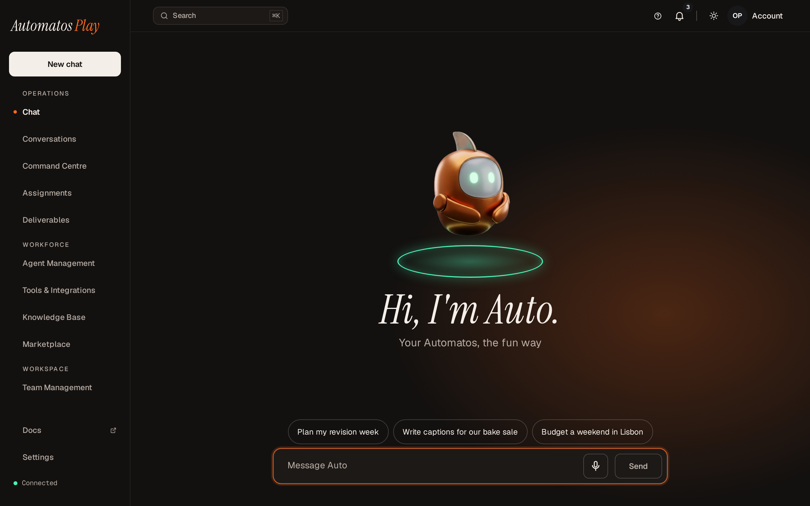
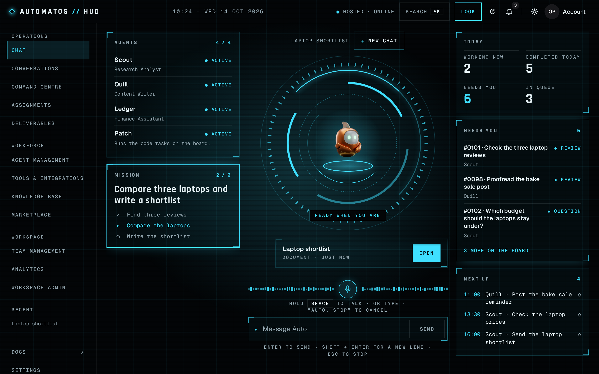

# Themes

Relevant source files

The following files were used as context for generating this page:

- [frontend/components/settings/themes/appearance-tab.tsx](../../frontend/components/settings/themes/appearance-tab.tsx)
- [frontend/components/settings/themes/theme-labels.ts](../../frontend/components/settings/themes/theme-labels.ts)
- [frontend/components/settings/SettingsPanel.tsx](../../frontend/components/settings/SettingsPanel.tsx)
- [frontend/components/ui/theme-toggle.tsx](../../frontend/components/ui/theme-toggle.tsx)
- [frontend/components/shared/global-search.tsx](../../frontend/components/shared/global-search.tsx)
- [frontend/components/marketplace/themes/listing-format.ts](../../frontend/components/marketplace/themes/listing-format.ts)
- [frontend/components/marketplace/marketplace-homepage.tsx](../../frontend/components/marketplace/marketplace-homepage.tsx)
- [frontend/components/theme-host/no-look-editor-note.tsx](../../frontend/components/theme-host/no-look-editor-note.tsx)
- [frontend/components/theme-host/theme-host-provider.tsx](../../frontend/components/theme-host/theme-host-provider.tsx)
- [frontend/lib/theme-host/choice-sync.ts](../../frontend/lib/theme-host/choice-sync.ts)
- [frontend/lib/theme-host/installed-entry.ts](../../frontend/lib/theme-host/installed-entry.ts)
- [frontend/lib/theme-host/manifest.ts](../../frontend/lib/theme-host/manifest.ts)
- [frontend/components/layout/studio-header.tsx](../../frontend/components/layout/studio-header.tsx)
- [frontend/components/settings/themes/installed-row.tsx](../../frontend/components/settings/themes/installed-row.tsx)
- [frontend/hooks/use-studio-theme.ts](../../frontend/hooks/use-studio-theme.ts)
- [frontend/hooks/use-global-search.ts](../../frontend/hooks/use-global-search.ts)
- [frontend/components/layout/main-layout.tsx](../../frontend/components/layout/main-layout.tsx)
- [frontend/app/safe-mode/page.tsx](../../frontend/app/safe-mode/page.tsx)
- [frontend/app/looks/page.tsx](../../frontend/app/looks/page.tsx)
- [frontend/app/looks/style/page.tsx](../../frontend/app/looks/style/page.tsx)
- [orchestrator/api/themes_install.py](../../orchestrator/api/themes_install.py)
- [orchestrator/api/themes_import.py](../../orchestrator/api/themes_import.py)
- [orchestrator/api/themes_settings.py](../../orchestrator/api/themes_settings.py)
- [orchestrator/api/marketplace_themes.py](../../orchestrator/api/marketplace_themes.py)
- [orchestrator/api/marketplace_themes_submit.py](../../orchestrator/api/marketplace_themes_submit.py)
- [orchestrator/services/themes/choices.py](../../orchestrator/services/themes/choices.py)
- [orchestrator/services/themes/defaults.py](../../orchestrator/services/themes/defaults.py)
- [orchestrator/services/themes/signed_upload.py](../../orchestrator/services/themes/signed_upload.py)
- [orchestrator/services/themes/optin.py](../../orchestrator/services/themes/optin.py)
- [orchestrator/services/themes/records.py](../../orchestrator/services/themes/records.py)
- [orchestrator/services/themes/listings.py](../../orchestrator/services/themes/listings.py)
- [orchestrator/services/themes/looks.py](../../orchestrator/services/themes/looks.py)
- [orchestrator/services/themes/contract.py](../../orchestrator/services/themes/contract.py)
- [orchestrator/services/themes/revocation_pull.py](../../orchestrator/services/themes/revocation_pull.py)
- [orchestrator/services/themes/data/signing-keys.json](../../orchestrator/services/themes/data/signing-keys.json)
- [orchestrator/core/auth/step_up.py](../../orchestrator/core/auth/step_up.py)
- [orchestrator/config.py](../../orchestrator/config.py)

A theme changes how Automatos looks for you in a workspace. It can give the app its own frame, its own versions of
some pages, pages of its own, its own colours, fonts and mascot, and a set of looks you can tune. Your choice is yours
alone: other members of the workspace pick their own.

<table>
  <tr>
    <td></td>
    <td></td>
  </tr>
  <tr>
    <td><strong>Play</strong>: warm, with Auto as a mascot.</td>
    <td><strong>HUD</strong>: a mission-control console.</td>
  </tr>
</table>

These pages are for people who use Automatos and for the owners and admins who manage a workspace's themes. To build a
theme, use the [Automatos Design Kit](https://github.com/AutomatosAI/automatos-design-kit): its
[guides](https://github.com/AutomatosAI/automatos-design-kit/tree/main/guides) cover the package, `theme.json`, the
SDK, looks and the phone block.

## Styles and themes

| Name | What it is |
|---|---|
| **Studio** | A style built into Automatos. It is the default: you see it until you, or your workspace, choose something else. (Studio here is the name of a style, not Automatos Studio, the hosted app.) |
| **Classic** | The other style built into Automatos. |
| **An installed theme** | A theme package (a `.autotheme` file) added to the workspace, from the Marketplace or from a file. No theme is compiled into the app: every theme, Play, HUD, Arcade and Candy included, is installed this way. |
| **Play**, **HUD**, **Arcade** and **Candy** | Four themes made in the Design Kit under the reserved `automatos` publisher (`automatos/play`, `automatos/hud`, `automatos/arcade` and `automatos/candy`). [Arcade](arcade.md) and [Candy](candy.md) have pages here; the Design Kit's [README](https://github.com/AutomatosAI/automatos-design-kit#readme) says what each one is. To add one, see [Get Play, HUD, Arcade or Candy](installing-and-choosing.md#get-play-hud-arcade-or-candy). |

Each installed theme names the style it is built on, Studio or Classic (its `base`). This release runs only
Studio-based themes. A Classic-based theme installs and can be chosen, but it doesn't start: you see Studio, with the
reason "Its theme.json could not be read." If a theme's version is withdrawn, you see its base in its place.

## Themes and looks

- A **theme** is the package: its code, its styles and its rules for looks.
- A **look** is one set of a theme's settings, such as its ground, accent or type, saved under a name.
- A theme ships **presets**, looks of its own that you can't change. You can save your own looks next to them.
- Your looks are kept on the server for you, per workspace and per theme. See [Looks](looks.md).

## Who vouches for a theme

Every installed theme sits in one of these groups. The group decides whether you must opt in before it runs, and
whether it can be the workspace default.

| Kind | Where it comes from | Label you see | Each member opts in | Can be the workspace default |
|---|---|---|---|---|
| **Private upload** | An owner or admin uploads a `.autotheme` file with **Install theme**. Nobody at Automatos reviewed it. | **Private · not reviewed**. The Appearance menu and ⌘K note **Private · opt in first** until you opt in. | Yes, once per version | No |
| **Signed upload** | An uploaded `.autotheme` with its signature file (`.sig.json`), verified by an active Automatos signing key. | **Signed by Automatos**, in Settings, the Appearance menu and ⌘K | No | Yes |
| **Marketplace theme** | Added from **Marketplace › Themes**. Every version listed there was reviewed: by a person at Automatos, or, for an official theme, by the Design Kit's publish run, after its own review passed and the server's automated checks didn't block it. It updates itself unless pinned. | None, or **Signed by Automatos** when its version is signed | No | Yes |
| **Official** | A Marketplace theme from the reserved `automatos` publisher whose listed version carries a signature an active Automatos key verifies. A reserved name alone is never Official. | **Official** on the Marketplace card, **Signed by Automatos** in Settings | No | Yes |

**The signing key.** This release ships Automatos's theme-signing key (`ed25519:e138b6d0fa7aaaf3`). Each version
the Design Kit publishes is signed with it: the hosted Marketplace stores the signature with the version, and the
kit's release carries it as a `<version>.sig.json` file. So an official theme added from the Marketplace shows
**Signed by Automatos**, and the same release uploaded with its signature file is a signed upload. An upload without
its signature file is a private upload. A signature file that key didn't make is refused ("No Automatos signing key
verifies this signature for these files, so nothing was installed."). For server operators:
[the signing key](../theme-host/operations.md#add-the-production-signing-key).

Why the opt-in: a theme's code runs in your browser with your session. The opt-in dialog says it in the server's own
words: "This theme was not reviewed. Its code runs with your access to all your workspaces." See
[Installing and choosing](installing-and-choosing.md).

## Where everything is

The **Appearance** menu is the button with a sun, moon or screen icon (it shows your light or dark setting) at the
top of the app, next to the notifications bell. A theme's own frame shows the same button among its header buttons.

| To do this | Go here |
|---|---|
| Get Play, HUD, Arcade or Candy | [Get Play, HUD, Arcade or Candy](installing-and-choosing.md#get-play-hud-arcade-or-candy) |
| Switch between Classic, Studio and the installed themes | The **Appearance** menu, under **Style** |
| Switch by name | ⌘K (Ctrl+K), then the **Themes** group. Type "theme", "style" or "appearance" to list them all. |
| See the installed themes, opt in and choose one | **Settings › Appearance › Themes** (`/settings?tab=appearance`) |
| Install, update, roll back, uninstall, set the default, change theme settings | **Settings › Appearance › Themes**, as an owner or admin |
| Browse the reviewed themes and add one | **Marketplace › Themes** (on the hosted edition, `/marketplace` also opens signed out) |
| Bring Automatos Cloud's themes into a local install | **Sync with Automatos Cloud**, in the Marketplace header (owners and admins) |
| Hold a Marketplace theme on its version | **Settings › Appearance › Themes › Pinned versions** |
| Edit your look | **Appearance › Customise look…**, which opens **Make it yours** (`/looks`) |
| See the theme's style sheet | `/looks/style` |
| Get back in when a theme breaks the app | `/safe-mode`, or add `?safe_mode=themes` to any address |
| Pair a phone | **Settings › Phones & devices** |

Each theme names the narrowest window it draws (its `minWidth`). From that width up the app draws the theme's frame
and pages; in a narrower window you get Studio's layout instead, and **Make it yours** says it needs a wider window.
Play (from 1.2.0), HUD (from 1.0.1), Arcade and Candy draw from 360 pixels, so a phone's browser gets their phone
layouts (see [On your phone](on-your-phone.md)).
**Customise look…** shows in the Appearance menu only while a theme is your style and its layout is showing.

## The two editions

| | Local edition | Hosted edition |
|---|---|---|
| Private uploads | On by default. | On by default only in a workspace of one person. An owner or admin can switch them on, unless the platform has turned them off. See [the workspace's theme settings](managing-themes.md#the-workspaces-theme-settings). |
| "Confirm it's you" | Never asked. | Sensitive theme actions ask you to confirm your sign-in when you last signed in more than 10 minutes ago (the server's default). |
| Withdrawn themes | The server checks Automatos's public list of withdrawn theme versions every hour by default. | Automatos keeps the list. |
| Marketplace › Themes | The themes approved on your own server, plus the official themes **Sync with Automatos Cloud** brings in when an owner or admin presses it. | Automatos's reviewed themes. Anyone can browse `/marketplace` signed out; adding one asks you to sign in. |
| Marketplace theme updates | When a newer version is listed: after a Sync brings one, or when your server approves one. A pinned install stays. | When a newer version is listed. A pinned install stays. |

The actions that ask you to confirm it's you: installing a theme (from a file or the Marketplace), opting in, making or
clearing the default, applying an update, rolling back, changing the theme settings and publishing a theme. Choosing
a theme and uninstalling one never ask.

## Pages in this topic

- [Installing and choosing](installing-and-choosing.md): getting Play, HUD, Arcade or Candy, Install theme, the scan
  report, opting in, choosing, the workspace default and the signature file.
- [Looks](looks.md): presets, Make it yours, saving, resetting, deleting and sharing a look, where looks are kept,
  reduced motion.
- [On your phone](on-your-phone.md): a theme's phone layout in a phone's browser, and its phone skin in Automatos Go.
- [Managing themes](managing-themes.md): updates (a Marketplace theme updates itself), pins, roll back, uninstall,
  "Needs update", withdrawn themes, safe mode and the workspace's theme settings.
- [FAQ](faq.md): the questions people ask first.
- [Arcade](arcade.md) and [Candy](candy.md): two of Automatos's own themes, their pages and looks, on the web and in
  Automatos Go.

Related:

- [Marketplace › Themes](../community-marketplace/themes-tab.md)
- [The open Marketplace](../community-marketplace/open-marketplace.md): browsing signed out, and Sync with Automatos
  Cloud on a local install
- [The phone's theme: the `mobile` block](../theme-host/mobile.md) (technical)
- [Theme host](../theme-host/_index.md) (technical: the architecture, the API, the security model and operations)
